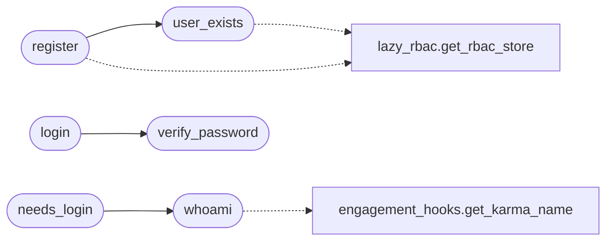

# `modules.cli_auth`

> Source: [modules/cli_auth.py:1](../../modules/cli_auth.py#L1) | language `py` | coverage 100.0% | [API index](../index.md)

CLI authentication module — login against users.json with remember-me.

Authenticates CLI operators against the same ``users.json`` database
used by lazyc2.py, using werkzeug's scrypt password verification.

Supports a "remember me" token stored in ``payload.json`` under
``cli_remember_token`` so operators can skip login on subsequent
shell starts. The token is a random 48-byte URL-safe string bound to
the username and stored both in ``payload.json`` and per-user in
``users.json`` entries.

## Contents

- **Functions:** [`user_exists`](#user_exists), [`register`](#register), [`verify_password`](#verify_password), [`login`](#login), [`logout`](#logout), [`try_auto_login`](#try_auto_login), [`whoami`](#whoami), [`get_current_operator`](#get_current_operator), [`sync_elo_from_session`](#sync_elo_from_session), [`needs_login`](#needs_login)

## Call Graph

Solid arrows stay in this module, dashed arrows leave it.



## Functions

<a id="user_exists"></a>

### `user_exists`

`function` | [modules/cli_auth.py:122](../../modules/cli_auth.py#L122)

```python
def user_exists(username: str) -> bool
```

Check if a username already exists in users.json or RBAC store.

**Parameters**

| Name | Type | Default | Description |
|---|---|---|---|
| `username` | `str` |  | Username to check. |

**Returns:** `bool` - True if the username already exists.

*Calls:* [`get_rbac_store`](modules.lazy_rbac.py.md#get_rbac_store)

*Called by:* [`register`](#register)

---

<a id="register"></a>

### `register`

`function` | [modules/cli_auth.py:145](../../modules/cli_auth.py#L145)

```python
def register(username: str, password: str) -> dict[str, Any]
```

Register a new operator in users.json.

Follows the same logic as the lowazyc2.py /register endpoint.
First user becomes admin; subsequent users get the default role.
Minimum 12-character password.

**Parameters**

| Name | Type | Default | Description |
|---|---|---|---|
| `username` | `str` |  | Desired username. |
| `password` | `str` |  | Clelazyt password. |

**Returns:** `dict[str, Any]` - Dict with ``success``, ``username``, ``role`` keys.

*Calls:* [`user_exists`](#user_exists), [`get_rbac_store`](modules.lazy_rbac.py.md#get_rbac_store)

*Called by:* [`CliAuthCommandSet.do_register`](cli.commands.cli_auth.py.md#cliauthcommandset-do_register)

---

<a id="verify_password"></a>

### `verify_password`

`function` | [modules/cli_auth.py:214](../../modules/cli_auth.py#L214)

```python
def verify_password(username: str, password: str) -> bool
```

Verify a username/password against users.json using werkzeug.

**Parameters**

| Name | Type | Default | Description |
|---|---|---|---|
| `username` | `str` |  | Operator username. |
| `password` | `str` |  | Clear-text password attempt. |

**Returns:** `bool` - True if the credentials match a user in users.json.

*Called by:* [`login`](#login)

---

<a id="login"></a>

### `login`

`function` | [modules/cli_auth.py:240](../../modules/cli_auth.py#L240)

```python
def login(username: str, password: str, remember: bool = False) -> dict[str, Any]
```

Authenticate a CLI operator and optionally persist a remember-me token.

**Parameters**

| Name | Type | Default | Description |
|---|---|---|---|
| `username` | `str` |  | Operator username. |
| `password` | `str` |  | Clear-text password. |
| `remember` | `bool` | `False` | If True, persist a remember-me token in payload.json and users.json for auto-login on future shell starts. |

**Returns:** `dict[str, Any]` - Dict with ``success``, ``username``, ``elo``, ``role``, `[`remember`](modules.memory_store.py.md#remember)` keys.

*Calls:* [`verify_password`](#verify_password)

*Called by:* [`CliAuthCommandSet.do_login`](cli.commands.cli_auth.py.md#cliauthcommandset-do_login)

---

<a id="logout"></a>

### `logout`

`function` | [modules/cli_auth.py:293](../../modules/cli_auth.py#L293)

```python
def logout() -> dict[str, Any]
```

Log out the current CLI operator and clear the remember-me token.

**Returns:** `dict[str, Any]` - Dict with ``success`` key.

*Called by:* [`CliAuthCommandSet.do_logout`](cli.commands.cli_auth.py.md#cliauthcommandset-do_logout)

---

<a id="try_auto_login"></a>

### `try_auto_login`

`function` | [modules/cli_auth.py:328](../../modules/cli_auth.py#L328)

```python
def try_auto_login() -> dict[str, Any]
```

Attempt auto-login using the remember-me token from payload.json.

Called at shell startup (preloop). If ``cli_auto_login`` is set in
payload.json and the token matches a user's stored token, logs in
silently without prompting for credentials.

**Returns:** `dict[str, Any]` - Dict with ``success``, ``username``, ``elo``, ``role``.

*Called by:* [`LazyOwnShell.preloop`](lazyown.py.md#lazyownshell-preloop)

---

<a id="whoami"></a>

### `whoami`

`function` | [modules/cli_auth.py:366](../../modules/cli_auth.py#L366)

```python
def whoami() -> dict[str, Any]
```

Return the currently logged-in CLI operator's identity.

**Returns:** `dict[str, Any]` - Dict with ``logged_in``, ``username``, ``elo``, ``role``.

*Calls:* [`get_karma_name`](cli.engagement_hooks.py.md#get_karma_name)

*Called by:* [`CliAuthCommandSet.do_whoami`](cli.commands.cli_auth.py.md#cliauthcommandset-do_whoami), [`needs_login`](#needs_login)

---

<a id="get_current_operator"></a>

### `get_current_operator`

`function` | [modules/cli_auth.py:396](../../modules/cli_auth.py#L396)

```python
def get_current_operator() -> str | None
```

Return the current operator username, or None if not logged in.

**Returns:** `str | None` - Username string or None.

*Called by:* [`build_password_provider_from_cli_login`](cli.auto_crypto.py.md#build_password_provider_from_cli_login)

---

<a id="sync_elo_from_session"></a>

### `sync_elo_from_session`

`function` | [modules/cli_auth.py:408](../../modules/cli_auth.py#L408)

```python
def sync_elo_from_session(elo: int) -> None
```

Update the CLI session ELO from engagement state.

**Parameters**

| Name | Type | Default | Description |
|---|---|---|---|
| `elo` | `int` |  | New ELO value to store in the session. |

---

<a id="needs_login"></a>

### `needs_login`

`function` | [modules/cli_auth.py:487](../../modules/cli_auth.py#L487)

```python
def needs_login() -> bool
```

Check if the current session has a logged-in operator.

**Returns:** `bool` - True if no valid session exists.

*Calls:* [`whoami`](#whoami)

*Called by:* [`LazyOwnShell.postparsing_precmd`](lazyown.py.md#lazyownshell-postparsing_precmd), [`LazyOwnShell.preloop`](lazyown.py.md#lazyownshell-preloop)

---
