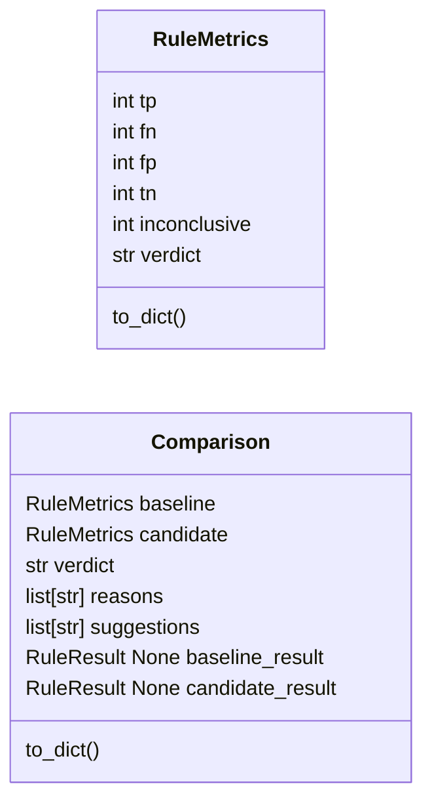
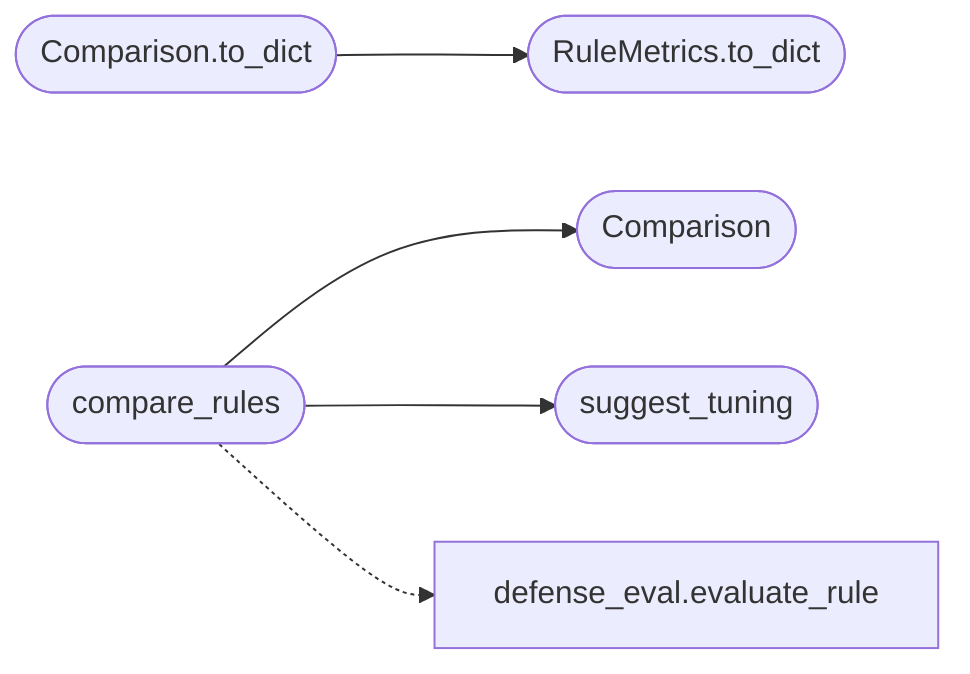

# `modules.closedloop`

> Source: [modules/closedloop.py:1](../../modules/closedloop.py#L1) | language `py` | coverage 100.0% | [API index](../index.md)

Closed-loop detection rule tuning: baseline vs candidate comparison.

Given a baseline rule and a candidate rule plus the same attack
(target) and benign (control) datasets, this module replays both, keeps
the per-rule metrics, computes the improvement delta and emits
deterministic tuning suggestions derived from the replay evidence. The
operator decides; nothing is deployed automatically.

Adapted from the ARTEX ``closedloop`` engine (AGPL-3.0).

## Contents

- **Classes:** [`RuleMetrics`](#rulemetrics), [`Comparison`](#comparison)
- **Functions:** [`compare_rules`](#compare_rules), [`suggest_tuning`](#suggest_tuning)
- **Constants:** [`VERDICT_IMPROVED`](#verdict_improved), [`VERDICT_REGRESSED`](#verdict_regressed), [`VERDICT_EQUIVALENT`](#verdict_equivalent), [`VERDICT_INCONCLUSIVE`](#verdict_inconclusive)

## Type Diagram



## Call Graph

Solid arrows stay in this module, dashed arrows leave it.



## Classes

<a id="rulemetrics"></a>

### `RuleMetrics`

`class` `dataclass` | [modules/closedloop.py:32](../../modules/closedloop.py#L32)

Decorators: `@dataclass`

```python
class RuleMetrics
```

Confusion-style metrics for one replayed rule.

**Attributes**

| Name | Type | Default | Description |
|---|---|---|---|
| [`tp`](#rulemetrics-tp) | `int` | `0` |  |
| [`fn`](#rulemetrics-fn) | `int` | `0` |  |
| [`fp`](#rulemetrics-fp) | `int` | `0` |  |
| [`tn`](#rulemetrics-tn) | `int` | `0` |  |
| [`inconclusive`](#rulemetrics-inconclusive) | `int` | `0` |  |
| [`verdict`](#rulemetrics-verdict) | `str` | `''` |  |

**Members**

| Member | Kind | Summary |
|---|---|---|
| [`to_dict`](#rulemetrics-to_dict) | method | Return a JSON-serializable view. |

<a id="rulemetrics-to_dict"></a>

#### `RuleMetrics.to_dict`

`method` | [modules/closedloop.py:42](../../modules/closedloop.py#L42)

```python
def to_dict(self) -> dict[str, Any]
```

Return a JSON-serializable view.

**Returns:** `dict[str, Any]`

*Called by:* [`Comparison.to_dict`](#comparison-to_dict)

---

<a id="comparison"></a>

### `Comparison`

`class` `dataclass` | [modules/closedloop.py:55](../../modules/closedloop.py#L55)

Decorators: `@dataclass`

```python
class Comparison
```

Outcome of comparing a candidate rule against a baseline.

**Attributes**

| Name | Type | Default | Description |
|---|---|---|---|
| [`baseline`](#comparison-baseline) | `RuleMetrics` | `field(default_factory=RuleMetrics)` |  |
| [`candidate`](#comparison-candidate) | `RuleMetrics` | `field(default_factory=RuleMetrics)` |  |
| [`verdict`](#comparison-verdict) | `str` | `VERDICT_INCONCLUSIVE` |  |
| [`reasons`](#comparison-reasons) | `list[str]` | `field(default_factory=list)` |  |
| [`suggestions`](#comparison-suggestions) | `list[str]` | `field(default_factory=list)` |  |
| [`baseline_result`](#comparison-baseline_result) | `RuleResult \| None` | `None` |  |
| [`candidate_result`](#comparison-candidate_result) | `RuleResult \| None` | `None` |  |

**Members**

| Member | Kind | Summary |
|---|---|---|
| [`to_dict`](#comparison-to_dict) | method | Return a JSON-serializable view. |

<a id="comparison-to_dict"></a>

#### `Comparison.to_dict`

`method` | [modules/closedloop.py:66](../../modules/closedloop.py#L66)

```python
def to_dict(self) -> dict[str, Any]
```

Return a JSON-serializable view.

**Returns:** `dict[str, Any]`

*Calls:* [`RuleMetrics.to_dict`](#rulemetrics-to_dict)

---

## Functions

<a id="compare_rules"></a>

### `compare_rules`

`function` | [modules/closedloop.py:90](../../modules/closedloop.py#L90)

```python
def compare_rules(baseline_rule: str, candidate_rule: str, target_logs: str, control_logs: str) -> Comparison
```

Replay baseline and candidate rules over identical datasets.

**Parameters**

| Name | Type | Default | Description |
|---|---|---|---|
| `baseline_rule` | `str` |  | Current rule JSON document. |
| `candidate_rule` | `str` |  | Proposed rule JSON document. |
| `target_logs` | `str` |  | Attack dataset (JSON array or JSON lines). |
| `control_logs` | `str` |  | Benign dataset (JSON array or JSON lines). |

**Returns:** `Comparison` - A [`Comparison`](#comparison) with metrics, verdict and suggestions.

**Raises**

- [`RuleEvaluationError`](modules.defense_eval.py.md#ruleevaluationerror): When either rule or dataset is invalid.

*Calls:* [`Comparison`](#comparison), [`suggest_tuning`](#suggest_tuning), [`evaluate_rule`](modules.defense_eval.py.md#evaluate_rule)

*Called by:* [`run_closedloop_tune`](modules.defense_stages.py.md#run_closedloop_tune)

---

<a id="suggest_tuning"></a>

### `suggest_tuning`

`function` | [modules/closedloop.py:136](../../modules/closedloop.py#L136)

```python
def suggest_tuning(candidate: RuleResult, baseline: RuleResult | None = None) -> list[str]
```

Return deterministic tuning suggestions from replay evidence.

**Parameters**

| Name | Type | Default | Description |
|---|---|---|---|
| `candidate` | `RuleResult` |  | Replay result for the candidate rule. |
| `baseline` | `RuleResult \| None` | `None` | Optional replay result for the baseline rule. |

**Returns:** `list[str]` - Human-readable suggestions (empty when nothing to tune).

*Called by:* [`compare_rules`](#compare_rules)

---

## Constants

<a id="verdict_improved"></a>

### `VERDICT_IMPROVED`

`constant` | [modules/closedloop.py:23](../../modules/closedloop.py#L23)

```python
VERDICT_IMPROVED = 'improved'
```

---

<a id="verdict_regressed"></a>

### `VERDICT_REGRESSED`

`constant` | [modules/closedloop.py:24](../../modules/closedloop.py#L24)

```python
VERDICT_REGRESSED = 'regressed'
```

---

<a id="verdict_equivalent"></a>

### `VERDICT_EQUIVALENT`

`constant` | [modules/closedloop.py:25](../../modules/closedloop.py#L25)

```python
VERDICT_EQUIVALENT = 'equivalent'
```

---

<a id="verdict_inconclusive"></a>

### `VERDICT_INCONCLUSIVE`

`constant` | [modules/closedloop.py:26](../../modules/closedloop.py#L26)

```python
VERDICT_INCONCLUSIVE = 'inconclusive'
```

---
