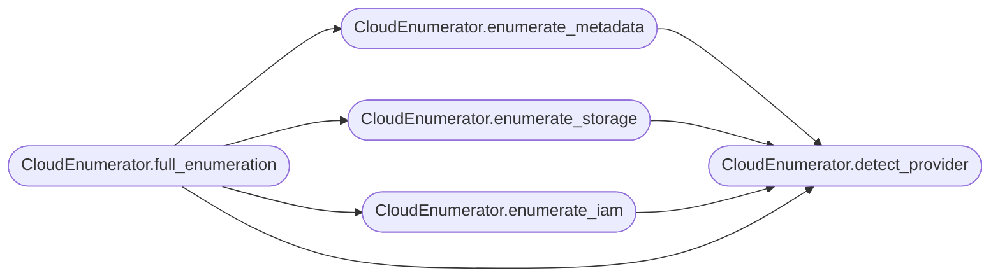

# `modules.cloud_enum`

> Source: [modules/cloud_enum.py:1](../../modules/cloud_enum.py#L1) | language `py` | coverage 100.0% | [API index](../index.md)

Native cloud enumeration modules for AWS, Azure, and GCP.

Provides IMDS scraping, storage enumeration, IAM enumeration,
and privilege escalation detection for major cloud providers.

## Contents

- **Classes:** [`CloudEnumerator`](#cloudenumerator)
- **Constants:** [`IMDS_ENDPOINTS`](#imds_endpoints), [`IMDS_HEADERS`](#imds_headers)

## Call Graph

Solid arrows stay in this module, dashed arrows leave it.



## Classes

<a id="cloudenumerator"></a>

### `CloudEnumerator`

`class` | [modules/cloud_enum.py:23](../../modules/cloud_enum.py#L23)

```python
class CloudEnumerator
```

Enumerate cloud provider metadata, storage, and IAM from compromised hosts.

Supports AWS, Azure, and GCP with automatic provider detection.

**Parameters**

| Name | Type | Default | Description |
|---|---|---|---|
| `provider` |  |  | Cloud provider hint ('aws', 'azure', 'gcp', 'auto'). |
| `session` |  |  | Optional requests.Session for authenticated requests. |
| `timeout` |  |  | Request timeout in seconds. |

**Members**

| Member | Kind | Summary |
|---|---|---|
| [`__init__`](#cloudenumerator-__init__) | constructor |  |
| [`detect_provider`](#cloudenumerator-detect_provider) | method | Auto-detect which cloud provider the host is running on. |
| [`enumerate_metadata`](#cloudenumerator-enumerate_metadata) | method | Enumerate cloud instance metadata (IMDS). |
| [`enumerate_storage`](#cloudenumerator-enumerate_storage) | method | Enumerate cloud storage buckets and objects. |
| [`enumerate_iam`](#cloudenumerator-enumerate_iam) | method | Enumerate IAM roles, users, and policies. |
| [`full_enumeration`](#cloudenumerator-full_enumeration) | method | Run full cloud enumeration: metadata + storage + IAM. |

<a id="cloudenumerator-__init__"></a>

#### `CloudEnumerator.__init__`

`constructor` | [modules/cloud_enum.py:34](../../modules/cloud_enum.py#L34)

```python
def __init__(self, provider: str = 'auto', session: Any = None, timeout: int = 10)
```

**Parameters**

| Name | Type | Default | Description |
|---|---|---|---|
| `provider` | `str` | `'auto'` | Cloud provider hint ('aws', 'azure', 'gcp', 'auto'). |
| `session` | `Any` | `None` | Optional requests.Session for authenticated requests. |
| `timeout` | `int` | `10` | Request timeout in seconds. |

*Called by:* [`CloudCommandSet.do_cloud_enum`](cli.commands.cloud.py.md#cloudcommandset-do_cloud_enum)

<a id="cloudenumerator-detect_provider"></a>

#### `CloudEnumerator.detect_provider`

`method` | [modules/cloud_enum.py:47](../../modules/cloud_enum.py#L47)

```python
def detect_provider(self) -> str | None
```

Auto-detect which cloud provider the host is running on.

**Returns:** `str | None` - Provider name ('aws', 'azure', 'gcp') or None.

*Called by:* [`CloudCommandSet.do_cloud_enum`](cli.commands.cloud.py.md#cloudcommandset-do_cloud_enum), [`CloudEnumerator.enumerate_iam`](#cloudenumerator-enumerate_iam), [`CloudEnumerator.enumerate_metadata`](#cloudenumerator-enumerate_metadata), [`CloudEnumerator.enumerate_storage`](#cloudenumerator-enumerate_storage), [`CloudEnumerator.full_enumeration`](#cloudenumerator-full_enumeration)

<a id="cloudenumerator-enumerate_metadata"></a>

#### `CloudEnumerator.enumerate_metadata`

`method` | [modules/cloud_enum.py:75](../../modules/cloud_enum.py#L75)

```python
def enumerate_metadata(self) -> dict[str, Any]
```

Enumerate cloud instance metadata (IMDS).

**Returns:** `dict[str, Any]` - Dict with provider, instance_id, region, and metadata fields.

*Calls:* [`CloudEnumerator.detect_provider`](#cloudenumerator-detect_provider)

*Called by:* [`CloudCommandSet.do_cloud_enum`](cli.commands.cloud.py.md#cloudcommandset-do_cloud_enum), [`CloudEnumerator.full_enumeration`](#cloudenumerator-full_enumeration)

<a id="cloudenumerator-enumerate_storage"></a>

#### `CloudEnumerator.enumerate_storage`

`method` | [modules/cloud_enum.py:251](../../modules/cloud_enum.py#L251)

```python
def enumerate_storage(self, target_bucket: str | None = None) -> list[dict]
```

Enumerate cloud storage buckets and objects.

Uses CLI tools (aws, az, gcloud) if available on the host.

**Parameters**

| Name | Type | Default | Description |
|---|---|---|---|
| `target_bucket` | `str \| None` | `None` | Optional specific bucket name to enumerate. |

**Returns:** `list[dict]` - List of dicts with bucket names and access levels.

*Calls:* [`CloudEnumerator.detect_provider`](#cloudenumerator-detect_provider)

*Called by:* [`CloudCommandSet.do_cloud_enum`](cli.commands.cloud.py.md#cloudcommandset-do_cloud_enum), [`CloudEnumerator.full_enumeration`](#cloudenumerator-full_enumeration)

<a id="cloudenumerator-enumerate_iam"></a>

#### `CloudEnumerator.enumerate_iam`

`method` | [modules/cloud_enum.py:372](../../modules/cloud_enum.py#L372)

```python
def enumerate_iam(self) -> dict[str, Any]
```

Enumerate IAM roles, users, and policies.

**Returns:** `dict[str, Any]` - Dict with users, roles, policies, and privilege escalation paths.

*Calls:* [`CloudEnumerator.detect_provider`](#cloudenumerator-detect_provider)

*Called by:* [`CloudCommandSet.do_cloud_enum`](cli.commands.cloud.py.md#cloudcommandset-do_cloud_enum), [`CloudEnumerator.full_enumeration`](#cloudenumerator-full_enumeration)

<a id="cloudenumerator-full_enumeration"></a>

#### `CloudEnumerator.full_enumeration`

`method` | [modules/cloud_enum.py:576](../../modules/cloud_enum.py#L576)

```python
def full_enumeration(self) -> dict[str, Any]
```

Run full cloud enumeration: metadata + storage + IAM.

**Returns:** `dict[str, Any]` - Dict with metadata, storage, and iam sections.

*Calls:* [`CloudEnumerator.detect_provider`](#cloudenumerator-detect_provider), [`CloudEnumerator.enumerate_iam`](#cloudenumerator-enumerate_iam), [`CloudEnumerator.enumerate_metadata`](#cloudenumerator-enumerate_metadata), [`CloudEnumerator.enumerate_storage`](#cloudenumerator-enumerate_storage)

---

## Constants

<a id="imds_endpoints"></a>

### `IMDS_ENDPOINTS`

`constant` | [modules/cloud_enum.py:11](../../modules/cloud_enum.py#L11)

```python
IMDS_ENDPOINTS
```

---

<a id="imds_headers"></a>

### `IMDS_HEADERS`

`constant` | [modules/cloud_enum.py:17](../../modules/cloud_enum.py#L17)

```python
IMDS_HEADERS = {'gcp': {'Metadata-Flavor': 'Google'}, 'azure': {'Metadata': 'true'}}
```

---
