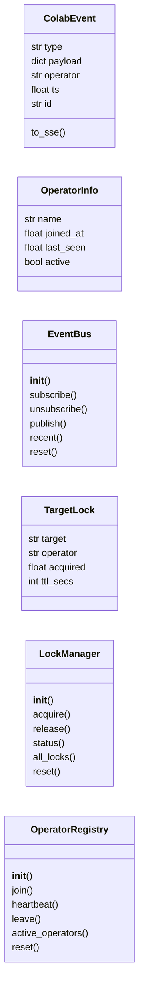
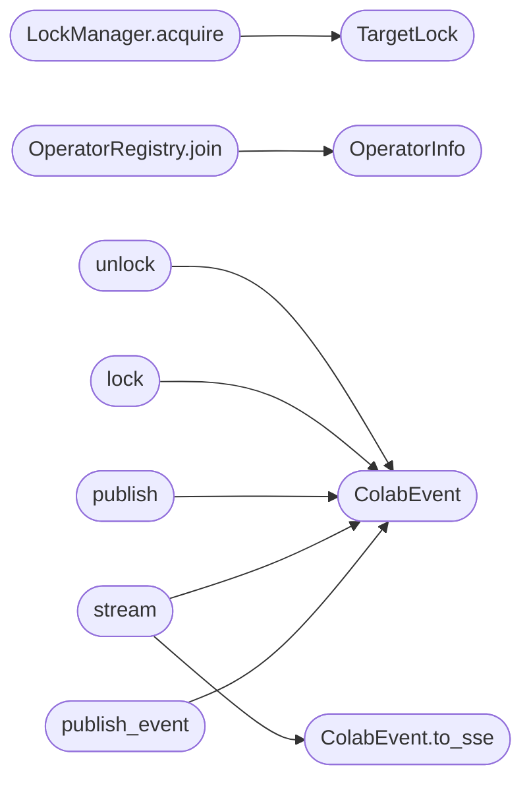

# `modules.collab_bp`

> Source: [modules/collab_bp.py:1](../../modules/collab_bp.py#L1) | language `py` | coverage 13.2% | [API index](../index.md)

modules/collab_bp.py ==================== Multi-operator collaboration layer for LazyOwn.

Provides:
- Server-Sent Events (SSE) stream at /collab/stream  -- real-time broadcast to all operators
- Target locking  at /collab/lock / /collab/unlock   -- prevents two operators executing same target
- Operator registry at /collab/operators             -- who is currently connected
- Event bus at /collab/publish                       -- any module can push structured events

Design (SOLID)
--------------
- SRP : EventBus, LockManager, OperatorRegistry are independent classes
- OCP : new event types added by publishing with a new "type" field
- LSP : OperatorRegistry and LockManager share a common Resettable interface
- ISP : consumers only import the blueprint; internal classes are not exposed
- DIP : Blueprint depends on injected EventBus / LockManager instances (testable)

Authentication
--------------
All endpoints require authentication (login_required + require_permission).
Operators are identified from their authenticated session, not from self-reported
query parameters.  The `[`operator`](#colabevent-operator)` field in events is derived from the
``current_user`` identity.

## Contents

- **Classes:** [`ColabEvent`](#colabevent), [`OperatorInfo`](#operatorinfo), [`EventBus`](#eventbus), [`TargetLock`](#targetlock), [`LockManager`](#lockmanager), [`OperatorRegistry`](#operatorregistry)
- **Functions:** [`get_event_bus`](#get_event_bus), [`get_lock_manager`](#get_lock_manager), [`get_operator_registry`](#get_operator_registry), [`publish_event`](#publish_event), [`collab_ui`](#collab_ui), [`stream`](#stream), [`operators`](#operators), [`publish`](#publish), [`lock`](#lock), [`unlock`](#unlock), [`locks`](#locks), [`history`](#history)

## Type Diagram



## Call Graph

Solid arrows stay in this module, dashed arrows leave it.



## Classes

<a id="colabevent"></a>

### `ColabEvent`

`class` `dataclass` | [modules/collab_bp.py:163](../../modules/collab_bp.py#L163)

Decorators: `@dataclass`

```python
class ColabEvent
```

**Attributes**

| Name | Type | Default | Description |
|---|---|---|---|
| [`type`](#colabevent-type) | `str` |  |  |
| [`payload`](#colabevent-payload) | `dict` |  |  |
| [`operator`](#colabevent-operator) | `str` | `'system'` |  |
| [`ts`](#colabevent-ts) | `float` | `field(default_factory=time.time)` |  |
| [`id`](#colabevent-id) | `str` | `field(default_factory=lambda: uuid.uuid4().hex[:8])` |  |

**Members**

| Member | Kind | Summary |
|---|---|---|
| [`to_sse`](#colabevent-to_sse) | method |  |

<a id="colabevent-to_sse"></a>

#### `ColabEvent.to_sse`

`method` | [modules/collab_bp.py:170](../../modules/collab_bp.py#L170)

```python
def to_sse(self) -> str
```

**Returns:** `str`

*Called by:* [`stream`](#stream)

---

<a id="operatorinfo"></a>

### `OperatorInfo`

`class` `dataclass` | [modules/collab_bp.py:176](../../modules/collab_bp.py#L176)

Decorators: `@dataclass`

```python
class OperatorInfo
```

**Attributes**

| Name | Type | Default | Description |
|---|---|---|---|
| [`name`](#operatorinfo-name) | `str` |  |  |
| [`joined_at`](#operatorinfo-joined_at) | `float` | `field(default_factory=time.time)` |  |
| [`last_seen`](#operatorinfo-last_seen) | `float` | `field(default_factory=time.time)` |  |
| [`active`](#operatorinfo-active) | `bool` | `True` |  |

---

<a id="eventbus"></a>

### `EventBus`

`class` | [modules/collab_bp.py:188](../../modules/collab_bp.py#L188)

```python
class EventBus
```

In-process pub/sub bus.

Each subscriber gets its own Queue; publish() fans out to all queues. Thread-safe.

**Members**

| Member | Kind | Summary |
|---|---|---|
| [`__init__`](#eventbus-__init__) | constructor |  |
| [`subscribe`](#eventbus-subscribe) | method |  |
| [`unsubscribe`](#eventbus-unsubscribe) | method |  |
| [`publish`](#eventbus-publish) | method |  |
| [`recent`](#eventbus-recent) | method |  |
| [`reset`](#eventbus-reset) | method |  |

<a id="eventbus-__init__"></a>

#### `EventBus.__init__`

`constructor` | [modules/collab_bp.py:198](../../modules/collab_bp.py#L198)

```python
def __init__(self) -> None
```

<a id="eventbus-subscribe"></a>

#### `EventBus.subscribe`

`method` | [modules/collab_bp.py:203](../../modules/collab_bp.py#L203)

```python
def subscribe(self, subscriber_id: str) -> queue.Queue
```

**Parameters**

| Name | Type | Default | Description |
|---|---|---|---|
| `subscriber_id` | `str` |  |  |

**Returns:** `queue.Queue`

<a id="eventbus-unsubscribe"></a>

#### `EventBus.unsubscribe`

`method` | [modules/collab_bp.py:215](../../modules/collab_bp.py#L215)

```python
def unsubscribe(self, subscriber_id: str) -> None
```

**Parameters**

| Name | Type | Default | Description |
|---|---|---|---|
| `subscriber_id` | `str` |  |  |

<a id="eventbus-publish"></a>

#### `EventBus.publish`

`method` | [modules/collab_bp.py:219](../../modules/collab_bp.py#L219)

```python
def publish(self, event: ColabEvent) -> None
```

**Parameters**

| Name | Type | Default | Description |
|---|---|---|---|
| `event` | `ColabEvent` |  |  |

<a id="eventbus-recent"></a>

#### `EventBus.recent`

`method` | [modules/collab_bp.py:234](../../modules/collab_bp.py#L234)

```python
def recent(self, n: int = 50) -> list[ColabEvent]
```

**Parameters**

| Name | Type | Default | Description |
|---|---|---|---|
| `n` | `int` | `50` |  |

**Returns:** `list[ColabEvent]`

<a id="eventbus-reset"></a>

#### `EventBus.reset`

`method` | [modules/collab_bp.py:238](../../modules/collab_bp.py#L238)

```python
def reset(self) -> None
```

---

<a id="targetlock"></a>

### `TargetLock`

`class` `dataclass` | [modules/collab_bp.py:250](../../modules/collab_bp.py#L250)

Decorators: `@dataclass`

```python
class TargetLock
```

**Attributes**

| Name | Type | Default | Description |
|---|---|---|---|
| [`target`](#targetlock-target) | `str` |  |  |
| [`operator`](#targetlock-operator) | `str` |  |  |
| [`acquired`](#targetlock-acquired) | `float` | `field(default_factory=time.time)` |  |
| [`ttl_secs`](#targetlock-ttl_secs) | `int` | `300` |  |

---

<a id="lockmanager"></a>

### `LockManager`

`class` | [modules/collab_bp.py:257](../../modules/collab_bp.py#L257)

```python
class LockManager
```

Per-target advisory locks.

Prevents two operators running tools against the same host simultaneously.

**Members**

| Member | Kind | Summary |
|---|---|---|
| [`__init__`](#lockmanager-__init__) | constructor |  |
| [`acquire`](#lockmanager-acquire) | method |  |
| [`release`](#lockmanager-release) | method |  |
| [`status`](#lockmanager-status) | method |  |
| [`all_locks`](#lockmanager-all_locks) | method |  |
| [`reset`](#lockmanager-reset) | method |  |

<a id="lockmanager-__init__"></a>

#### `LockManager.__init__`

`constructor` | [modules/collab_bp.py:263](../../modules/collab_bp.py#L263)

```python
def __init__(self) -> None
```

<a id="lockmanager-acquire"></a>

#### `LockManager.acquire`

`method` | [modules/collab_bp.py:267](../../modules/collab_bp.py#L267)

```python
def acquire(self, target: str, operator: str, ttl_secs: int = 300) -> bool
```

**Parameters**

| Name | Type | Default | Description |
|---|---|---|---|
| `target` | `str` |  |  |
| `operator` | `str` |  |  |
| `ttl_secs` | `int` | `300` |  |

**Returns:** `bool`

*Calls:* [`TargetLock`](#targetlock)

<a id="lockmanager-release"></a>

#### `LockManager.release`

`method` | [modules/collab_bp.py:279](../../modules/collab_bp.py#L279)

```python
def release(self, target: str, operator: str) -> bool
```

**Parameters**

| Name | Type | Default | Description |
|---|---|---|---|
| `target` | `str` |  |  |
| `operator` | `str` |  |  |

**Returns:** `bool`

<a id="lockmanager-status"></a>

#### `LockManager.status`

`method` | [modules/collab_bp.py:287](../../modules/collab_bp.py#L287)

```python
def status(self, target: str) -> TargetLock | None
```

**Parameters**

| Name | Type | Default | Description |
|---|---|---|---|
| `target` | `str` |  |  |

**Returns:** `TargetLock | None`

<a id="lockmanager-all_locks"></a>

#### `LockManager.all_locks`

`method` | [modules/collab_bp.py:292](../../modules/collab_bp.py#L292)

```python
def all_locks(self) -> list[TargetLock]
```

**Returns:** `list[TargetLock]`

<a id="lockmanager-reset"></a>

#### `LockManager.reset`

`method` | [modules/collab_bp.py:304](../../modules/collab_bp.py#L304)

```python
def reset(self) -> None
```

---

<a id="operatorregistry"></a>

### `OperatorRegistry`

`class` | [modules/collab_bp.py:314](../../modules/collab_bp.py#L314)

```python
class OperatorRegistry
```

Tracks which operators are currently connected.

**Members**

| Member | Kind | Summary |
|---|---|---|
| [`__init__`](#operatorregistry-__init__) | constructor |  |
| [`join`](#operatorregistry-join) | method |  |
| [`heartbeat`](#operatorregistry-heartbeat) | method |  |
| [`leave`](#operatorregistry-leave) | method |  |
| [`active_operators`](#operatorregistry-active_operators) | method |  |
| [`reset`](#operatorregistry-reset) | method |  |

<a id="operatorregistry-__init__"></a>

#### `OperatorRegistry.__init__`

`constructor` | [modules/collab_bp.py:319](../../modules/collab_bp.py#L319)

```python
def __init__(self) -> None
```

<a id="operatorregistry-join"></a>

#### `OperatorRegistry.join`

`method` | [modules/collab_bp.py:323](../../modules/collab_bp.py#L323)

```python
def join(self, name: str) -> OperatorInfo
```

**Parameters**

| Name | Type | Default | Description |
|---|---|---|---|
| `name` | `str` |  |  |

**Returns:** `OperatorInfo`

*Calls:* [`OperatorInfo`](#operatorinfo)

<a id="operatorregistry-heartbeat"></a>

#### `OperatorRegistry.heartbeat`

`method` | [modules/collab_bp.py:334](../../modules/collab_bp.py#L334)

```python
def heartbeat(self, name: str) -> None
```

**Parameters**

| Name | Type | Default | Description |
|---|---|---|---|
| `name` | `str` |  |  |

<a id="operatorregistry-leave"></a>

#### `OperatorRegistry.leave`

`method` | [modules/collab_bp.py:340](../../modules/collab_bp.py#L340)

```python
def leave(self, name: str) -> None
```

**Parameters**

| Name | Type | Default | Description |
|---|---|---|---|
| `name` | `str` |  |  |

<a id="operatorregistry-active_operators"></a>

#### `OperatorRegistry.active_operators`

`method` | [modules/collab_bp.py:345](../../modules/collab_bp.py#L345)

```python
def active_operators(self) -> list[OperatorInfo]
```

**Returns:** `list[OperatorInfo]`

<a id="operatorregistry-reset"></a>

#### `OperatorRegistry.reset`

`method` | [modules/collab_bp.py:356](../../modules/collab_bp.py#L356)

```python
def reset(self) -> None
```

---

## Functions

<a id="get_event_bus"></a>

### `get_event_bus`

`function` | [modules/collab_bp.py:370](../../modules/collab_bp.py#L370)

```python
def get_event_bus() -> EventBus
```

**Returns:** `EventBus`

*Called by:* [`receive_result`](lazyc2.py.md#receive_result), [`run_command`](lazyc2.py.md#run_command)

---

<a id="get_lock_manager"></a>

### `get_lock_manager`

`function` | [modules/collab_bp.py:374](../../modules/collab_bp.py#L374)

```python
def get_lock_manager() -> LockManager
```

**Returns:** `LockManager`

---

<a id="get_operator_registry"></a>

### `get_operator_registry`

`function` | [modules/collab_bp.py:378](../../modules/collab_bp.py#L378)

```python
def get_operator_registry() -> OperatorRegistry
```

**Returns:** `OperatorRegistry`

---

<a id="publish_event"></a>

### `publish_event`

`function` | [modules/collab_bp.py:382](../../modules/collab_bp.py#L382)

```python
def publish_event(type: str, payload: dict, operator: str = 'system') -> None
```

Module-level convenience for other modules to broadcast events.

**Parameters**

| Name | Type | Default | Description |
|---|---|---|---|
| `type` | `str` |  |  |
| `payload` | `dict` |  |  |
| `operator` | `str` | `'system'` |  |

*Calls:* [`ColabEvent`](#colabevent)

*Called by:* [`CollaborationCommandSet.do_share_finding`](cli.commands.collaboration.py.md#collaborationcommandset-do_share_finding), [`CollaborationCommandSet.do_team_chat`](cli.commands.collaboration.py.md#collaborationcommandset-do_team_chat)

---

<a id="collab_ui"></a>

### `collab_ui`

`function` | [modules/collab_bp.py:396](../../modules/collab_bp.py#L396)

Decorators: `@collab_bp.route('/')`, `@login_required`

```python
def collab_ui()
```

---

<a id="stream"></a>

### `stream`

`function` | [modules/collab_bp.py:411](../../modules/collab_bp.py#L411)

Decorators: `@collab_bp.route('/stream')`, `@_collab_login_required`

```python
def stream()
```

*Calls:* [`ColabEvent`](#colabevent), [`ColabEvent.to_sse`](#colabevent-to_sse)

*Called by:* [`build_executor`](modules.lazy_runner.py.md#build_executor)

---

<a id="operators"></a>

### `operators`

`function` | [modules/collab_bp.py:458](../../modules/collab_bp.py#L458)

Decorators: `@collab_bp.route('/operators')`, `@_collab_login_required`

```python
def operators()
```

---

<a id="publish"></a>

### `publish`

`function` | [modules/collab_bp.py:470](../../modules/collab_bp.py#L470)

Decorators: `@collab_bp.route('/publish', methods=['POST'])`, `@_collab_permission_required('collab_publish')`

```python
def publish()
```

*Calls:* [`ColabEvent`](#colabevent)

---

<a id="lock"></a>

### `lock`

`function` | [modules/collab_bp.py:483](../../modules/collab_bp.py#L483)

Decorators: `@collab_bp.route('/lock', methods=['POST'])`, `@_collab_permission_required('collab_lock')`

```python
def lock()
```

*Calls:* [`ColabEvent`](#colabevent)

---

<a id="unlock"></a>

### `unlock`

`function` | [modules/collab_bp.py:504](../../modules/collab_bp.py#L504)

Decorators: `@collab_bp.route('/unlock', methods=['POST'])`, `@_collab_permission_required('collab_lock')`

```python
def unlock()
```

*Calls:* [`ColabEvent`](#colabevent)

---

<a id="locks"></a>

### `locks`

`function` | [modules/collab_bp.py:522](../../modules/collab_bp.py#L522)

Decorators: `@collab_bp.route('/locks')`, `@_collab_login_required`

```python
def locks()
```

---

<a id="history"></a>

### `history`

`function` | [modules/collab_bp.py:537](../../modules/collab_bp.py#L537)

Decorators: `@collab_bp.route('/history')`, `@_collab_login_required`

```python
def history()
```

---
