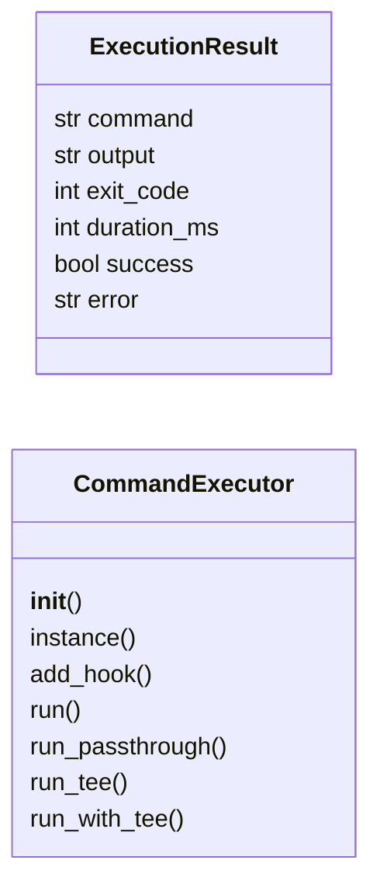
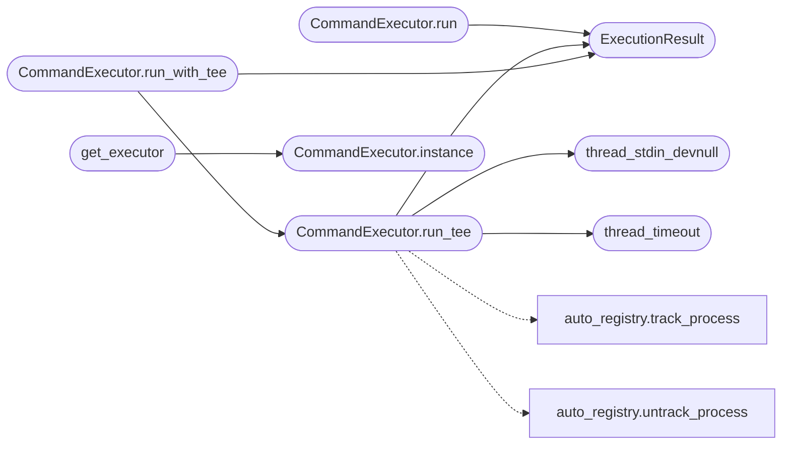

# `modules.command_executor`

> Source: [modules/command_executor.py:1](../../modules/command_executor.py#L1) | language `py` | coverage 76.5% | [API index](../index.md)

UnifiedCommandExecutor — shared shell command execution service.

Replaces scattered subprocess calls across CLI, C2, and MCP with a single
executor that:
- Runs commands via subprocess (real-time streaming or capture)
- Publishes events via UnifiedEventBus
- Logs to CSV via session report
- Records metrics (duration, exit code, success)
- Stores output in StateManager when relevant

Design (SOLID)
--------------
- Single Responsibility : only command execution and its observability.
- Open/Closed           : new output handlers via Callable hooks.
- Liskov                : all execution modes return typed ExecutionResult.
- Interface Segregation : just ``run()`` and ``run_capture()``.
- Dependency Inversion  : consumers depend on the executor, not on subprocess.

## Contents

- **Classes:** [`ExecutionResult`](#executionresult), [`CommandExecutor`](#commandexecutor)
- **Functions:** [`set_thread_timeout`](#set_thread_timeout), [`clear_thread_timeout`](#clear_thread_timeout), [`thread_timeout`](#thread_timeout), [`set_thread_stdin_devnull`](#set_thread_stdin_devnull), [`clear_thread_stdin_devnull`](#clear_thread_stdin_devnull), [`thread_stdin_devnull`](#thread_stdin_devnull), [`get_executor`](#get_executor)

## Type Diagram



## Call Graph

Solid arrows stay in this module, dashed arrows leave it.



## Classes

<a id="executionresult"></a>

### `ExecutionResult`

`class` `dataclass` | [modules/command_executor.py:97](../../modules/command_executor.py#L97)

Decorators: `@dataclass`

```python
class ExecutionResult
```

**Attributes**

| Name | Type | Default | Description |
|---|---|---|---|
| [`command`](#executionresult-command) | `str` |  |  |
| [`output`](#executionresult-output) | `str` | `''` |  |
| [`exit_code`](#executionresult-exit_code) | `int` | `-1` |  |
| [`duration_ms`](#executionresult-duration_ms) | `int` | `0` |  |
| [`success`](#executionresult-success) | `bool` | `False` |  |
| [`error`](#executionresult-error) | `str` | `''` |  |

---

<a id="commandexecutor"></a>

### `CommandExecutor`

`class` | [modules/command_executor.py:106](../../modules/command_executor.py#L106)

```python
class CommandExecutor
```

Shared shell command execution service.

Usage::

    executor = CommandExecutor()
    result = executor.run("nmap -sC 10.0.0.1")
    print(result.output[:200])

**Members**

| Member | Kind | Summary |
|---|---|---|
| [`__init__`](#commandexecutor-__init__) | constructor |  |
| [`instance`](#commandexecutor-instance) | classmethod |  |
| [`add_hook`](#commandexecutor-add_hook) | method | Register a post-execution hook (e.g., for StateManager or metrics). |
| [`run`](#commandexecutor-run) | method | Execute a shell command and return the result. |
| [`run_passthrough`](#commandexecutor-run_passthrough) | method | Run a command with stdio inherited, returning its exit code. |
| [`run_tee`](#commandexecutor-run_tee) | method | Run a command teeing raw output bytes to a writer and a log file. |
| [`run_with_tee`](#commandexecutor-run_with_tee) | method | Execute a command and tee output to a file. |

<a id="commandexecutor-__init__"></a>

#### `CommandExecutor.__init__`

`constructor` | [modules/command_executor.py:118](../../modules/command_executor.py#L118)

```python
def __init__(self) -> None
```

<a id="commandexecutor-instance"></a>

#### `CommandExecutor.instance`

`classmethod` | [modules/command_executor.py:122](../../modules/command_executor.py#L122)

Decorators: `@classmethod`

```python
def instance(cls) -> CommandExecutor
```

**Returns:** `CommandExecutor`

*Called by:* [`get_executor`](#get_executor)

<a id="commandexecutor-add_hook"></a>

#### `CommandExecutor.add_hook`

`method` | [modules/command_executor.py:127](../../modules/command_executor.py#L127)

```python
def add_hook(self, hook: Callable[[ExecutionResult], None]) -> None
```

Register a post-execution hook (e.g., for StateManager or metrics).

**Parameters**

| Name | Type | Default | Description |
|---|---|---|---|
| `hook` | `Callable[[ExecutionResult], None]` |  |  |

<a id="commandexecutor-run"></a>

#### `CommandExecutor.run`

`method` | [modules/command_executor.py:131](../../modules/command_executor.py#L131)

```python
def run(self, command: str, timeout: int = 120, stream: bool = False) -> ExecutionResult
```

Execute a shell command and return the result.

**Parameters**

| Name | Type | Default | Description |
|---|---|---|---|
| `command` | `str` |  | The shell command string to execute. |
| `timeout` | `int` | `120` | Maximum execution time in seconds. |
| `stream` | `bool` | `False` | If True, print output in real-time. If False, capture silently. |

**Returns:** `ExecutionResult` - ExecutionResult with output, exit_code, duration_ms, and success.

*Calls:* [`ExecutionResult`](#executionresult)

<a id="commandexecutor-run_passthrough"></a>

#### `CommandExecutor.run_passthrough`

`method` | [modules/command_executor.py:179](../../modules/command_executor.py#L179)

```python
def run_passthrough(self, command: str, env: dict | None = None) -> int
```

Run a command with stdio inherited, returning its exit code.

Used for the NOLOGS path: output goes straight to the
operator terminal (colors intact), nothing is captured.

**Parameters**

| Name | Type | Default | Description |
|---|---|---|---|
| `command` | `str` |  | Shell command string to execute. |
| `env` | `dict \| None` | `None` | Child environment mapping, or None to inherit. |

**Returns:** `int` - The child exit code.

<a id="commandexecutor-run_tee"></a>

#### `CommandExecutor.run_tee`

`method` | [modules/command_executor.py:194](../../modules/command_executor.py#L194)

```python
def run_tee(self, command: str, *, env: dict | None = None, writer: Callable[[str], object] | None = None, log_file: str | Path | None = None, timeout: float | None = None) -> ExecutionResult
```

Run a command teeing raw output bytes to a writer and a log file.

Bytes are forwarded untouched (ANSI colors preserved); stderr is
merged into stdout exactly like an interactive terminal row.

**Parameters**

| Name | Type | Default | Description |
|---|---|---|---|
| `command` | `str` |  | Shell command string to execute. |
| `env` | `dict \| None` | `None` | Child environment mapping, or None to inherit. Pass `core.hardening.terminal_env` to keep child colors. |
| `writer` | `Callable[[str], object] \| None` | `None` | Called with every stdout chunk. Defaults to writing and flushing ``sys.stdout``. |
| `log_file` | `str \| Path \| None` | `None` | Optional path appended with the same chunks. |
| `timeout` | `float \| None` | `None` | Wall-clock seconds for `[`wait`](modules.lazy_loop.py.md#interceptqueue-wait)`; None waits forever. On expiry the child is killed and `subprocess.TimeoutExpired` propagates. |

**Returns:** `ExecutionResult` - ExecutionResult with the full output and exit code.

**Raises**

- `TimeoutExpired`: (raised in the body, not documented)

*Calls:* [`track_process`](modules.auto_registry.py.md#track_process), [`untrack_process`](modules.auto_registry.py.md#untrack_process), [`ExecutionResult`](#executionresult), [`thread_stdin_devnull`](#thread_stdin_devnull), [`thread_timeout`](#thread_timeout)

*Called by:* [`CommandExecutor.run_with_tee`](#commandexecutor-run_with_tee)

<a id="commandexecutor-run_with_tee"></a>

#### `CommandExecutor.run_with_tee`

`method` | [modules/command_executor.py:358](../../modules/command_executor.py#L358)

```python
def run_with_tee(self, command: str, output_path: str, timeout: int = 120) -> ExecutionResult
```

Execute a command and tee output to a file.

**Parameters**

| Name | Type | Default | Description |
|---|---|---|---|
| `command` | `str` |  | Shell command string to execute. |
| `output_path` | `str` |  | Log file receiving the same raw bytes shown. |
| `timeout` | `int` | `120` | Wall-clock seconds; expiry yields an error result. |

**Returns:** `ExecutionResult` - ExecutionResult with the full output and exit code.

*Calls:* [`CommandExecutor.run_tee`](#commandexecutor-run_tee), [`ExecutionResult`](#executionresult)

---

## Functions

<a id="set_thread_timeout"></a>

### `set_thread_timeout`

`function` | [modules/command_executor.py:41](../../modules/command_executor.py#L41)

```python
def set_thread_timeout(seconds: float) -> None
```

Bound the next `[`run_tee`](#commandexecutor-run_tee)` call on this thread by wall-clock seconds.

**Parameters**

| Name | Type | Default | Description |
|---|---|---|---|
| `seconds` | `float` |  |  |

*Called by:* [`execute_shell_verb`](modules.auto_registry.py.md#execute_shell_verb)

---

<a id="clear_thread_timeout"></a>

### `clear_thread_timeout`

`function` | [modules/command_executor.py:46](../../modules/command_executor.py#L46)

```python
def clear_thread_timeout() -> None
```

Remove this thread's `[`run_tee`](#commandexecutor-run_tee)` deadline, if any.

*Called by:* [`execute_shell_verb`](modules.auto_registry.py.md#execute_shell_verb)

---

<a id="thread_timeout"></a>

### `thread_timeout`

`function` | [modules/command_executor.py:54](../../modules/command_executor.py#L54)

```python
def thread_timeout() -> float | None
```

Return this thread's pending `[`run_tee`](#commandexecutor-run_tee)` deadline, or None.

**Returns:** `float | None`

*Called by:* [`CommandExecutor.run_tee`](#commandexecutor-run_tee)

---

<a id="set_thread_stdin_devnull"></a>

### `set_thread_stdin_devnull`

`function` | [modules/command_executor.py:59](../../modules/command_executor.py#L59)

```python
def set_thread_stdin_devnull(enabled: bool = True) -> None
```

Detach the next `[`run_tee`](#commandexecutor-run_tee)` child from the operator terminal.

**Parameters**

| Name | Type | Default | Description |
|---|---|---|---|
| `enabled` | `bool` | `True` |  |

*Called by:* [`execute_shell_verb`](modules.auto_registry.py.md#execute_shell_verb)

---

<a id="clear_thread_stdin_devnull"></a>

### `clear_thread_stdin_devnull`

`function` | [modules/command_executor.py:64](../../modules/command_executor.py#L64)

```python
def clear_thread_stdin_devnull() -> None
```

Restore inherited stdin for this thread's `[`run_tee`](#commandexecutor-run_tee)` calls.

*Called by:* [`execute_shell_verb`](modules.auto_registry.py.md#execute_shell_verb)

---

<a id="thread_stdin_devnull"></a>

### `thread_stdin_devnull`

`function` | [modules/command_executor.py:72](../../modules/command_executor.py#L72)

```python
def thread_stdin_devnull() -> bool
```

Return True when this thread's `[`run_tee`](#commandexecutor-run_tee)` children drop stdin.

**Returns:** `bool`

*Called by:* [`CommandExecutor.run_tee`](#commandexecutor-run_tee)

---

<a id="get_executor"></a>

### `get_executor`

`function` | [modules/command_executor.py:426](../../modules/command_executor.py#L426)

```python
def get_executor() -> CommandExecutor
```

**Returns:** `CommandExecutor`

*Calls:* [`CommandExecutor.instance`](#commandexecutor-instance)

---
