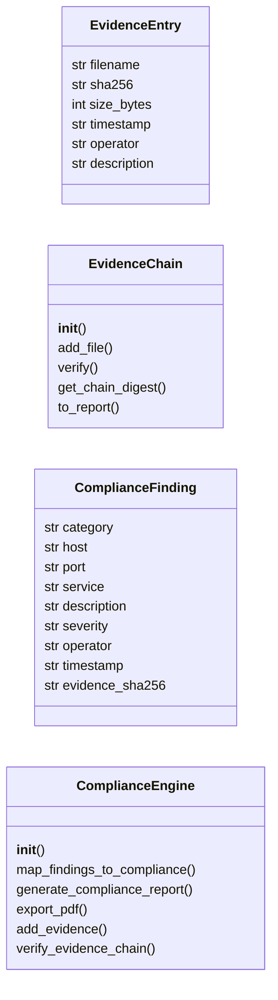
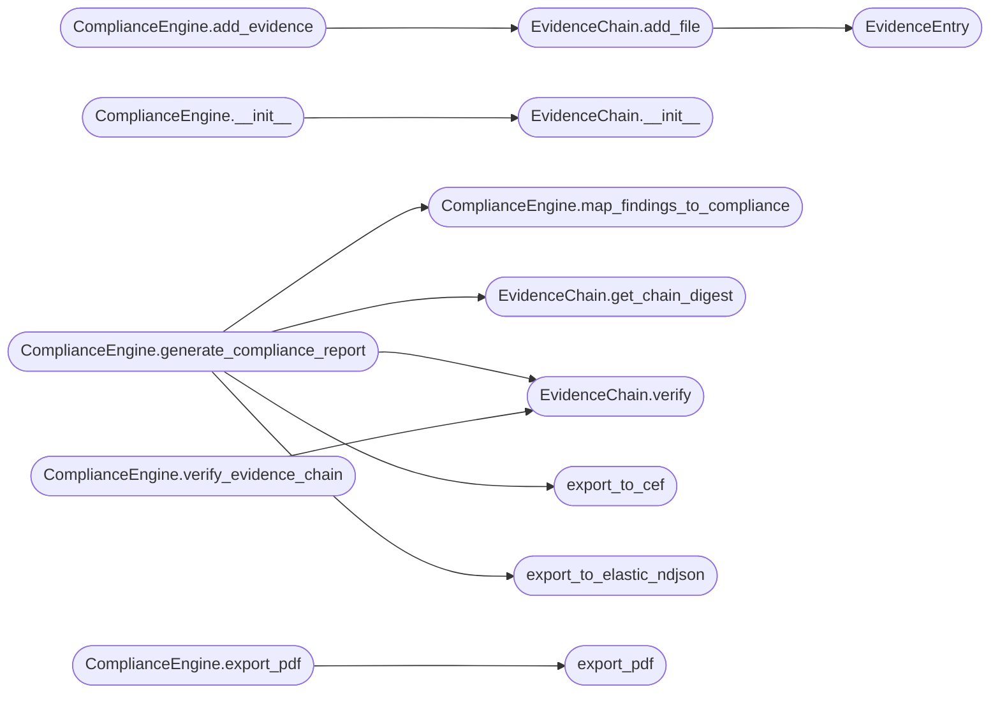

# `modules.compliance`

> Source: [modules/compliance.py:1](../../modules/compliance.py#L1) | language `py` | coverage 42.1% | [API index](../index.md)

modules/compliance.py ===================== Enterprise compliance engine for LazyOwn RedTeam Framework.

Capabilities:
- Framework mappings (PCI-DSS 4.0, ISO 27001:2022, NIST SP 800-53 Rev 5)
- Cryptographic evidence chain (SHA256 merkle-style chain of custody)
- PDF report export (via fpdf2, zero external pandoc dependency)
- SIEM/Elastic bulk export (JSON-ND format for Elasticsearch, CEF for ArcSight)
- Operator attribution in all audit trails
- Automated compliance coverage scoring per engagement

Usage:
    from modules.compliance import ComplianceEngine, EvidenceChain, export_pdf

    engine = ComplianceEngine(sessions_dir="sessions/default")
    report = engine.generate_compliance_report(include_evidence_chain=True)
    engine.export_pdf(report, "compliance_report.pdf")

## Contents

- **Classes:** [`EvidenceEntry`](#evidenceentry), [`EvidenceChain`](#evidencechain), [`ComplianceFinding`](#compliancefinding), [`ComplianceEngine`](#complianceengine)
- **Functions:** [`export_pdf`](#export_pdf), [`export_to_elastic_ndjson`](#export_to_elastic_ndjson), [`export_to_cef`](#export_to_cef)
- **Constants:** [`COMPLIANCE_FRAMEWORKS`](#compliance_frameworks), [`FINDING_CATEGORY_TO_COMPLIANCE_MAP`](#finding_category_to_compliance_map)

## Type Diagram



## Call Graph

Solid arrows stay in this module, dashed arrows leave it.



## Classes

<a id="evidenceentry"></a>

### `EvidenceEntry`

`class` `dataclass` | [modules/compliance.py:340](../../modules/compliance.py#L340)

Decorators: `@dataclass(frozen=True, slots=True)`

```python
class EvidenceEntry
```

**Attributes**

| Name | Type | Default | Description |
|---|---|---|---|
| [`filename`](#evidenceentry-filename) | `str` |  |  |
| [`sha256`](#evidenceentry-sha256) | `str` |  |  |
| [`size_bytes`](#evidenceentry-size_bytes) | `int` |  |  |
| [`timestamp`](#evidenceentry-timestamp) | `str` |  |  |
| [`operator`](#evidenceentry-operator) | `str` |  |  |
| [`description`](#evidenceentry-description) | `str` |  |  |

---

<a id="evidencechain"></a>

### `EvidenceChain`

`class` | [modules/compliance.py:349](../../modules/compliance.py#L349)

```python
class EvidenceChain
```

Merkle-style chain of custody for red-team evidence.

Each file artefact added to the chain is hashed with SHA256 and linked
to the previous entry, creating a tamper-evident chain. The chain state
is persisted to ``sessions/evidence_chain.jsonl``.

**Members**

| Member | Kind | Summary |
|---|---|---|
| [`__init__`](#evidencechain-__init__) | constructor |  |
| [`add_file`](#evidencechain-add_file) | method |  |
| [`verify`](#evidencechain-verify) | method |  |
| [`get_chain_digest`](#evidencechain-get_chain_digest) | method |  |
| [`to_report`](#evidencechain-to_report) | method |  |

<a id="evidencechain-__init__"></a>

#### `EvidenceChain.__init__`

`constructor` | [modules/compliance.py:357](../../modules/compliance.py#L357)

```python
def __init__(self, sessions_dir: str = 'sessions') -> None
```

**Parameters**

| Name | Type | Default | Description |
|---|---|---|---|
| `sessions_dir` | `str` | `'sessions'` |  |

*Called by:* [`ComplianceEngine.__init__`](#complianceengine-__init__)

<a id="evidencechain-add_file"></a>

#### `EvidenceChain.add_file`

`method` | [modules/compliance.py:383](../../modules/compliance.py#L383)

```python
def add_file(self, filepath: str, operator: str, description: str = '') -> EvidenceEntry
```

**Parameters**

| Name | Type | Default | Description |
|---|---|---|---|
| `filepath` | `str` |  |  |
| `operator` | `str` |  |  |
| `description` | `str` | `''` |  |

**Returns:** `EvidenceEntry`

**Raises**

- `FileNotFoundError`: (raised in the body, not documented)

*Calls:* [`EvidenceEntry`](#evidenceentry)

*Called by:* [`ComplianceEngine.add_evidence`](#complianceengine-add_evidence)

<a id="evidencechain-verify"></a>

#### `EvidenceChain.verify`

`method` | [modules/compliance.py:410](../../modules/compliance.py#L410)

```python
def verify(self) -> tuple[bool, list[str]]
```

**Returns:** `tuple[bool, list[str]]`

*Called by:* [`ComplianceEngine.generate_compliance_report`](#complianceengine-generate_compliance_report), [`ComplianceEngine.verify_evidence_chain`](#complianceengine-verify_evidence_chain)

<a id="evidencechain-get_chain_digest"></a>

#### `EvidenceChain.get_chain_digest`

`method` | [modules/compliance.py:429](../../modules/compliance.py#L429)

```python
def get_chain_digest(self) -> str
```

**Returns:** `str`

*Called by:* [`ComplianceEngine.generate_compliance_report`](#complianceengine-generate_compliance_report)

<a id="evidencechain-to_report"></a>

#### `EvidenceChain.to_report`

`method` | [modules/compliance.py:432](../../modules/compliance.py#L432)

```python
def to_report(self) -> list[dict[str, str]]
```

**Returns:** `list[dict[str, str]]`

---

<a id="compliancefinding"></a>

### `ComplianceFinding`

`class` `dataclass` | [modules/compliance.py:620](../../modules/compliance.py#L620)

Decorators: `@dataclass`

```python
class ComplianceFinding
```

**Attributes**

| Name | Type | Default | Description |
|---|---|---|---|
| [`category`](#compliancefinding-category) | `str` |  |  |
| [`host`](#compliancefinding-host) | `str` |  |  |
| [`port`](#compliancefinding-port) | `str` |  |  |
| [`service`](#compliancefinding-service) | `str` |  |  |
| [`description`](#compliancefinding-description) | `str` |  |  |
| [`severity`](#compliancefinding-severity) | `str` |  |  |
| [`operator`](#compliancefinding-operator) | `str` |  |  |
| [`timestamp`](#compliancefinding-timestamp) | `str` | `field(default_factory=lambda: datetime.now(UTC).isoformat())` |  |
| [`evidence_sha256`](#compliancefinding-evidence_sha256) | `str` | `''` |  |

---

<a id="complianceengine"></a>

### `ComplianceEngine`

`class` | [modules/compliance.py:632](../../modules/compliance.py#L632)

```python
class ComplianceEngine
```

Generates compliance-mapped reports with evidence chain support.

**Members**

| Member | Kind | Summary |
|---|---|---|
| [`__init__`](#complianceengine-__init__) | constructor |  |
| [`map_findings_to_compliance`](#complianceengine-map_findings_to_compliance) | method | Map findings to compliance framework controls. |
| [`generate_compliance_report`](#complianceengine-generate_compliance_report) | method | Generate a full compliance report with evidence chain and optional SIEM export. |
| [`export_pdf`](#complianceengine-export_pdf) | method |  |
| [`add_evidence`](#complianceengine-add_evidence) | method |  |
| [`verify_evidence_chain`](#complianceengine-verify_evidence_chain) | method |  |

<a id="complianceengine-__init__"></a>

#### `ComplianceEngine.__init__`

`constructor` | [modules/compliance.py:635](../../modules/compliance.py#L635)

```python
def __init__(self, sessions_dir: str = 'sessions') -> None
```

**Parameters**

| Name | Type | Default | Description |
|---|---|---|---|
| `sessions_dir` | `str` | `'sessions'` |  |

*Calls:* [`EvidenceChain.__init__`](#evidencechain-__init__)

<a id="complianceengine-map_findings_to_compliance"></a>

#### `ComplianceEngine.map_findings_to_compliance`

`method` | [modules/compliance.py:639](../../modules/compliance.py#L639)

```python
def map_findings_to_compliance(self, findings: list[ComplianceFinding], frameworks: list[str] | None = None) -> dict[str, Any]
```

Map findings to compliance framework controls.

**Parameters**

| Name | Type | Default | Description |
|---|---|---|---|
| `findings` | `list[ComplianceFinding]` |  | List of ComplianceFinding objects. |
| `frameworks` | `list[str] \| None` | `None` | List of framework keys (e.g. ['pci_dss', 'iso27001', 'nist_800_53']). If None, all frameworks are included. |

**Returns:** `dict[str, Any]` - Dict with per-framework coverage and control-level mappings.

*Called by:* [`ComplianceEngine.generate_compliance_report`](#complianceengine-generate_compliance_report)

<a id="complianceengine-generate_compliance_report"></a>

#### `ComplianceEngine.generate_compliance_report`

`method` | [modules/compliance.py:710](../../modules/compliance.py#L710)

```python
def generate_compliance_report(self, findings: list[ComplianceFinding] | None = None, include_evidence_chain: bool = True, include_siem_formats: bool = False) -> dict[str, Any]
```

Generate a full compliance report with evidence chain and optional SIEM export.

**Parameters**

| Name | Type | Default | Description |
|---|---|---|---|
| `findings` | `list[ComplianceFinding] \| None` | `None` | List of findings. If None, loads from sessions/. |
| `include_evidence_chain` | `bool` | `True` | Include cryptographic evidence chain in report. |
| `include_siem_formats` | `bool` | `False` | Generate NDJSON and CEF exports. |

**Returns:** `dict[str, Any]` - Comprehensive compliance report dict.

*Calls:* [`ComplianceEngine.map_findings_to_compliance`](#complianceengine-map_findings_to_compliance), [`EvidenceChain.get_chain_digest`](#evidencechain-get_chain_digest), [`EvidenceChain.verify`](#evidencechain-verify), [`export_to_cef`](#export_to_cef), [`export_to_elastic_ndjson`](#export_to_elastic_ndjson)

<a id="complianceengine-export_pdf"></a>

#### `ComplianceEngine.export_pdf`

`method` | [modules/compliance.py:857](../../modules/compliance.py#L857)

```python
def export_pdf(self, report: dict[str, Any], output_path: str) -> str | None
```

**Parameters**

| Name | Type | Default | Description |
|---|---|---|---|
| `report` | `dict[str, Any]` |  |  |
| `output_path` | `str` |  |  |

**Returns:** `str | None`

*Calls:* [`export_pdf`](#export_pdf)

<a id="complianceengine-add_evidence"></a>

#### `ComplianceEngine.add_evidence`

`method` | [modules/compliance.py:927](../../modules/compliance.py#L927)

```python
def add_evidence(self, filepath: str, operator: str, description: str = '') -> EvidenceEntry
```

**Parameters**

| Name | Type | Default | Description |
|---|---|---|---|
| `filepath` | `str` |  |  |
| `operator` | `str` |  |  |
| `description` | `str` | `''` |  |

**Returns:** `EvidenceEntry`

*Calls:* [`EvidenceChain.add_file`](#evidencechain-add_file)

<a id="complianceengine-verify_evidence_chain"></a>

#### `ComplianceEngine.verify_evidence_chain`

`method` | [modules/compliance.py:930](../../modules/compliance.py#L930)

```python
def verify_evidence_chain(self) -> tuple[bool, list[str]]
```

**Returns:** `tuple[bool, list[str]]`

*Calls:* [`EvidenceChain.verify`](#evidencechain-verify)

---

## Functions

<a id="export_pdf"></a>

### `export_pdf`

`function` | [modules/compliance.py:449](../../modules/compliance.py#L449)

```python
def export_pdf(report_md: str, output_path: str, title: str = 'LazyOwn RedTeam Report', classification: str = 'CONFIDENTIAL') -> str | None
```

Export a Markdown report to PDF using fpdf2.

Zero external dependencies beyond fpdf2 (no pandoc, no weasyprint).
Returns the output path on success, None on failure.

**Parameters**

| Name | Type | Default | Description |
|---|---|---|---|
| `report_md` | `str` |  |  |
| `output_path` | `str` |  |  |
| `title` | `str` | `'LazyOwn RedTeam Report'` |  |
| `classification` | `str` | `'CONFIDENTIAL'` |  |

**Returns:** `str | None`

*Called by:* [`ComplianceEngine.export_pdf`](#complianceengine-export_pdf)

---

<a id="export_to_elastic_ndjson"></a>

### `export_to_elastic_ndjson`

`function` | [modules/compliance.py:533](../../modules/compliance.py#L533)

```python
def export_to_elastic_ndjson(findings: list[dict[str, Any]], output_path: str, index_prefix: str = 'lazyown') -> str
```

Export findings as Elasticsearch NDJSON bulk format.

Produces a newline-delimited JSON file compatible with Elasticsearch _bulk API.

**Parameters**

| Name | Type | Default | Description |
|---|---|---|---|
| `findings` | `list[dict[str, Any]]` |  |  |
| `output_path` | `str` |  |  |
| `index_prefix` | `str` | `'lazyown'` |  |

**Returns:** `str`

*Called by:* [`ComplianceEngine.generate_compliance_report`](#complianceengine-generate_compliance_report)

---

<a id="export_to_cef"></a>

### `export_to_cef`

`function` | [modules/compliance.py:572](../../modules/compliance.py#L572)

```python
def export_to_cef(findings: list[dict[str, Any]], output_path: str, vendor: str = 'LazyOwn', product: str = 'RedTeam', version: str = '1.0') -> str
```

Export findings in CEF (Common Event Format) for ArcSight/QRadar/Splunk.

CEF:0|<vendor>|<product>|<version>|<signature_id>|<name>|<severity>|<extension>

**Parameters**

| Name | Type | Default | Description |
|---|---|---|---|
| `findings` | `list[dict[str, Any]]` |  |  |
| `output_path` | `str` |  |  |
| `vendor` | `str` | `'LazyOwn'` |  |
| `product` | `str` | `'RedTeam'` |  |
| `version` | `str` | `'1.0'` |  |

**Returns:** `str`

*Called by:* [`ComplianceEngine.generate_compliance_report`](#complianceengine-generate_compliance_report)

---

## Constants

<a id="compliance_frameworks"></a>

### `COMPLIANCE_FRAMEWORKS`

`constant` | [modules/compliance.py:40](../../modules/compliance.py#L40)

```python
COMPLIANCE_FRAMEWORKS: dict[str, dict[str, Any]]
```

---

<a id="finding_category_to_compliance_map"></a>

### `FINDING_CATEGORY_TO_COMPLIANCE_MAP`

`constant` | [modules/compliance.py:317](../../modules/compliance.py#L317)

```python
FINDING_CATEGORY_TO_COMPLIANCE_MAP: dict[str, list[str]]
```

---
