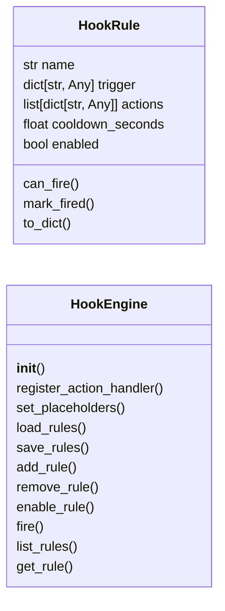
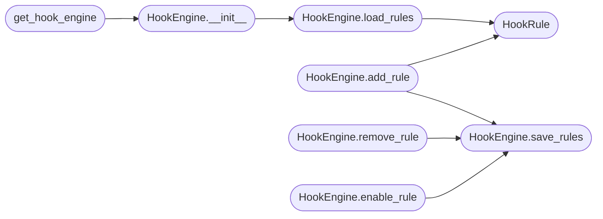

# `modules.conditional_hooks`

> Source: [modules/conditional_hooks.py:1](../../modules/conditional_hooks.py#L1) | language `py` | coverage 77.8% | [API index](../index.md)

Conditional Hooks System for LazyOwn (Mythic-style triggers).

Lets operators define WHEN->THEN rules that fire automatically on
engagement events: beacon connection, credential capture, privilege
escalation, host discovery, service detection.

Rules are stored as JSON and evaluated in-process. Multiple actions per
trigger, with cooldown to prevent spam. Inspired by Mythic's eventing
system but implemented natively.

Usage
-----
    from modules.conditional_hooks import HookEngine

    engine = HookEngine()
    engine.add_rule({
        "name": "auto-seatbelt-on-beacon",
        "trigger": {"event": "beacon_connected"},
        "actions": [{"type": "run_command", "command": "seatbelt -group=all"}],
        "cooldown_seconds": 300,
    })
    engine.fire("beacon_connected", {"client_id": "abc123"})

## Contents

- **Classes:** [`HookRule`](#hookrule), [`HookEngine`](#hookengine)
- **Functions:** [`get_hook_engine`](#get_hook_engine)
- **Constants:** [`DEFAULT_RULES`](#default_rules)

## Type Diagram



## Call Graph

Solid arrows stay in this module, dashed arrows leave it.



## Classes

<a id="hookrule"></a>

### `HookRule`

`class` `dataclass` | [modules/conditional_hooks.py:45](../../modules/conditional_hooks.py#L45)

Decorators: `@dataclass`

```python
class HookRule
```

A single WHEN->THEN rule.

**Attributes**

| Name | Type | Default | Description |
|---|---|---|---|
| [`name`](#hookrule-name) | `str` |  |  |
| [`trigger`](#hookrule-trigger) | `dict[str, Any]` |  |  |
| [`actions`](#hookrule-actions) | `list[dict[str, Any]]` |  |  |
| [`cooldown_seconds`](#hookrule-cooldown_seconds) | `float` | `0.0` |  |
| [`enabled`](#hookrule-enabled) | `bool` | `True` |  |

**Members**

| Member | Kind | Summary |
|---|---|---|
| [`can_fire`](#hookrule-can_fire) | method |  |
| [`mark_fired`](#hookrule-mark_fired) | method |  |
| [`to_dict`](#hookrule-to_dict) | method |  |

<a id="hookrule-can_fire"></a>

#### `HookRule.can_fire`

`method` | [modules/conditional_hooks.py:56](../../modules/conditional_hooks.py#L56)

```python
def can_fire(self, now: float | None = None) -> bool
```

**Parameters**

| Name | Type | Default | Description |
|---|---|---|---|
| `now` | `float \| None` | `None` |  |

**Returns:** `bool`

<a id="hookrule-mark_fired"></a>

#### `HookRule.mark_fired`

`method` | [modules/conditional_hooks.py:65](../../modules/conditional_hooks.py#L65)

```python
def mark_fired(self) -> None
```

<a id="hookrule-to_dict"></a>

#### `HookRule.to_dict`

`method` | [modules/conditional_hooks.py:69](../../modules/conditional_hooks.py#L69)

```python
def to_dict(self) -> dict[str, Any]
```

**Returns:** `dict[str, Any]`

---

<a id="hookengine"></a>

### `HookEngine`

`class` | [modules/conditional_hooks.py:258](../../modules/conditional_hooks.py#L258)

```python
class HookEngine
```

Match events against rules and execute matching actions.

Usage::

    engine = HookEngine()
    engine.fire("beacon_connected", {"client_id": "abc", "platform": "windows"})

Rules are loaded from ``sessions/conditional_hooks.json`` with
built-in defaults as fallback.

**Members**

| Member | Kind | Summary |
|---|---|---|
| [`__init__`](#hookengine-__init__) | constructor |  |
| [`register_action_handler`](#hookengine-register_action_handler) | method | Register a handler for a custom action type. |
| [`set_placeholders`](#hookengine-set_placeholders) | method | Set placeholder values for command templating (rhost, lhost, etc.). |
| [`load_rules`](#hookengine-load_rules) | method | Load rules from JSON file, or create it with defaults. |
| [`save_rules`](#hookengine-save_rules) | method | Persist current rules to JSON. |
| [`add_rule`](#hookengine-add_rule) | method | Add a rule at runtime. |
| [`remove_rule`](#hookengine-remove_rule) | method | Remove a rule by name. |
| [`enable_rule`](#hookengine-enable_rule) | method | Enable or disable a rule by name. |
| [`fire`](#hookengine-fire) | method | Fire an event, evaluating all matching rules. |
| [`list_rules`](#hookengine-list_rules) | method | Return all rules as dictionaries. |
| [`get_rule`](#hookengine-get_rule) | method | Return a single rule by name, or None. |

<a id="hookengine-__init__"></a>

#### `HookEngine.__init__`

`constructor` | [modules/conditional_hooks.py:270](../../modules/conditional_hooks.py#L270)

```python
def __init__(self) -> None
```

*Calls:* [`HookEngine.load_rules`](#hookengine-load_rules)

*Called by:* [`get_hook_engine`](#get_hook_engine)

<a id="hookengine-register_action_handler"></a>

#### `HookEngine.register_action_handler`

`method` | [modules/conditional_hooks.py:277](../../modules/conditional_hooks.py#L277)

```python
def register_action_handler(self, action_type: str, handler: Callable) -> None
```

Register a handler for a custom action type.

**Parameters**

| Name | Type | Default | Description |
|---|---|---|---|
| `action_type` | `str` |  | String identifier (e.g. ``"run_command"``). |
| `handler` | `Callable` |  | Callable receiving ``(action: dict, context: dict)``. |

<a id="hookengine-set_placeholders"></a>

#### `HookEngine.set_placeholders`

`method` | [modules/conditional_hooks.py:286](../../modules/conditional_hooks.py#L286)

```python
def set_placeholders(self, placeholders: dict[str, str]) -> None
```

Set placeholder values for command templating (rhost, lhost, etc.).

**Parameters**

| Name | Type | Default | Description |
|---|---|---|---|
| `placeholders` | `dict[str, str]` |  |  |

<a id="hookengine-load_rules"></a>

#### `HookEngine.load_rules`

`method` | [modules/conditional_hooks.py:290](../../modules/conditional_hooks.py#L290)

```python
def load_rules(self, path: Path | None = None) -> None
```

Load rules from JSON file, or create it with defaults.

**Parameters**

| Name | Type | Default | Description |
|---|---|---|---|
| `path` | `Path \| None` | `None` | Optional path to rules JSON. Defaults to sessions/conditional_hooks.json. |

*Calls:* [`HookRule`](#hookrule)

*Called by:* [`HookEngine.__init__`](#hookengine-__init__)

<a id="hookengine-save_rules"></a>

#### `HookEngine.save_rules`

`method` | [modules/conditional_hooks.py:322](../../modules/conditional_hooks.py#L322)

```python
def save_rules(self, path: Path | None = None) -> None
```

Persist current rules to JSON.

**Parameters**

| Name | Type | Default | Description |
|---|---|---|---|
| `path` | `Path \| None` | `None` |  |

*Called by:* [`HookEngine.add_rule`](#hookengine-add_rule), [`HookEngine.enable_rule`](#hookengine-enable_rule), [`HookEngine.remove_rule`](#hookengine-remove_rule)

<a id="hookengine-add_rule"></a>

#### `HookEngine.add_rule`

`method` | [modules/conditional_hooks.py:330](../../modules/conditional_hooks.py#L330)

```python
def add_rule(self, rule_dict: dict[str, Any]) -> HookRule
```

Add a rule at runtime.

**Parameters**

| Name | Type | Default | Description |
|---|---|---|---|
| `rule_dict` | `dict[str, Any]` |  | Dictionary with HookRule fields. |

**Returns:** `HookRule` - The new [`HookRule`](#hookrule).

*Calls:* [`HookEngine.save_rules`](#hookengine-save_rules), [`HookRule`](#hookrule)

<a id="hookengine-remove_rule"></a>

#### `HookEngine.remove_rule`

`method` | [modules/conditional_hooks.py:345](../../modules/conditional_hooks.py#L345)

```python
def remove_rule(self, name: str) -> bool
```

Remove a rule by name.

**Parameters**

| Name | Type | Default | Description |
|---|---|---|---|
| `name` | `str` |  |  |

**Returns:** `bool` - True if removed, False if not found.

*Calls:* [`HookEngine.save_rules`](#hookengine-save_rules)

<a id="hookengine-enable_rule"></a>

#### `HookEngine.enable_rule`

`method` | [modules/conditional_hooks.py:359](../../modules/conditional_hooks.py#L359)

```python
def enable_rule(self, name: str, enabled: bool = True) -> bool
```

Enable or disable a rule by name.

**Parameters**

| Name | Type | Default | Description |
|---|---|---|---|
| `name` | `str` |  |  |
| `enabled` | `bool` | `True` |  |

**Returns:** `bool`

*Calls:* [`HookEngine.save_rules`](#hookengine-save_rules)

<a id="hookengine-fire"></a>

#### `HookEngine.fire`

`method` | [modules/conditional_hooks.py:516](../../modules/conditional_hooks.py#L516)

```python
def fire(self, event: str, context: dict[str, Any] | None = None) -> list[dict[str, Any]]
```

Fire an event, evaluating all matching rules.

**Parameters**

| Name | Type | Default | Description |
|---|---|---|---|
| `event` | `str` |  | Event type (must be in ``_VALID_EVENTS``). |
| `context` | `dict[str, Any] \| None` | `None` | Key-value data about the event. |

**Returns:** `list[dict[str, Any]]` - List of dicts with `[`rule`](skills.claude_md_orchestrator.models.py.md#finding-rule)`, ``action``, and ``result`` keys.

<a id="hookengine-list_rules"></a>

#### `HookEngine.list_rules`

`method` | [modules/conditional_hooks.py:571](../../modules/conditional_hooks.py#L571)

```python
def list_rules(self) -> list[dict[str, Any]]
```

Return all rules as dictionaries.

**Returns:** `list[dict[str, Any]]`

<a id="hookengine-get_rule"></a>

#### `HookEngine.get_rule`

`method` | [modules/conditional_hooks.py:575](../../modules/conditional_hooks.py#L575)

```python
def get_rule(self, name: str) -> dict[str, Any] | None
```

Return a single rule by name, or None.

**Parameters**

| Name | Type | Default | Description |
|---|---|---|---|
| `name` | `str` |  |  |

**Returns:** `dict[str, Any] | None`

---

## Functions

<a id="get_hook_engine"></a>

### `get_hook_engine`

`function` | [modules/conditional_hooks.py:586](../../modules/conditional_hooks.py#L586)

```python
def get_hook_engine() -> HookEngine
```

Return the singleton [`HookEngine`](#hookengine).

**Returns:** `HookEngine`

*Calls:* [`HookEngine.__init__`](#hookengine-__init__)

*Called by:* [`AutomationCommandSet.do_hooks_add`](cli.commands.automation.py.md#automationcommandset-do_hooks_add), [`AutomationCommandSet.do_hooks_enable`](cli.commands.automation.py.md#automationcommandset-do_hooks_enable), [`AutomationCommandSet.do_hooks_fire`](cli.commands.automation.py.md#automationcommandset-do_hooks_fire), [`AutomationCommandSet.do_hooks_list`](cli.commands.automation.py.md#automationcommandset-do_hooks_list), [`AutomationCommandSet.do_hooks_remove`](cli.commands.automation.py.md#automationcommandset-do_hooks_remove)

---

## Constants

<a id="default_rules"></a>

### `DEFAULT_RULES`

`constant` | [modules/conditional_hooks.py:79](../../modules/conditional_hooks.py#L79)

```python
DEFAULT_RULES: list[dict[str, Any]]
```

---
