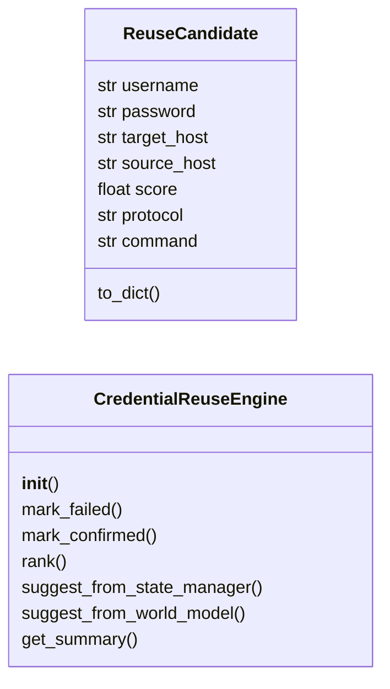
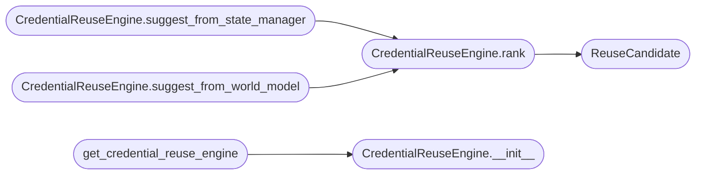

# `modules.credential_reuse`

> Source: [modules/credential_reuse.py:1](../../modules/credential_reuse.py#L1) | language `py` | coverage 83.3% | [API index](../index.md)

Credential Reuse Engine for LazyOwn.

Automatically suggests captured credentials for newly discovered hosts.
When creds are found on host A, the engine ranks all other hosts by
likelihood that the same creds will work, generating actionable spray
recommendations with ready-to-run crackmapexec commands.

Design
------
- Single Responsibility: score + rank credential reuse candidates
- Taps StateManager for hosts/creds, WorldModel for confirmed/failed edges
- Produces a sorted list of (cred, host, score, command) tuples
- Score decays with subnet distance, service overlap, and prior failures

## Contents

- **Classes:** [`ReuseCandidate`](#reusecandidate), [`CredentialReuseEngine`](#credentialreuseengine)
- **Functions:** [`get_credential_reuse_engine`](#get_credential_reuse_engine)

## Type Diagram



## Call Graph

Solid arrows stay in this module, dashed arrows leave it.



## Classes

<a id="reusecandidate"></a>

### `ReuseCandidate`

`class` `dataclass` | [modules/credential_reuse.py:32](../../modules/credential_reuse.py#L32)

Decorators: `@dataclass`

```python
class ReuseCandidate
```

Scored credential-to-host reuse suggestion.

**Attributes**

| Name | Type | Default | Description |
|---|---|---|---|
| [`username`](#reusecandidate-username) | `str` |  |  |
| [`password`](#reusecandidate-password) | `str` |  |  |
| [`target_host`](#reusecandidate-target_host) | `str` |  |  |
| [`source_host`](#reusecandidate-source_host) | `str` |  |  |
| [`score`](#reusecandidate-score) | `float` |  |  |
| [`protocol`](#reusecandidate-protocol) | `str` | `'smb'` |  |
| [`command`](#reusecandidate-command) | `str` | `''` |  |

**Members**

| Member | Kind | Summary |
|---|---|---|
| [`to_dict`](#reusecandidate-to_dict) | method |  |

<a id="reusecandidate-to_dict"></a>

#### `ReuseCandidate.to_dict`

`method` | [modules/credential_reuse.py:43](../../modules/credential_reuse.py#L43)

```python
def to_dict(self) -> dict[str, Any]
```

**Returns:** `dict[str, Any]`

---

<a id="credentialreuseengine"></a>

### `CredentialReuseEngine`

`class` | [modules/credential_reuse.py:55](../../modules/credential_reuse.py#L55)

```python
class CredentialReuseEngine
```

Scoring engine for credential spraying prioritisation.

Usage::

    engine = CredentialReuseEngine()
    candidates = engine.rank(
        hosts=["10.0.0.1", "10.0.0.2", "10.0.1.5"],
        creds=[{"username": "admin", "password": "P@ssw0rd", "host": "10.0.0.1"}],
    )
    for c in candidates:
        print(f"Try {c.username}:{c.password} against {c.target_host} "
              f"[score={c.score:.2f}]")
        print(f"  {c.command}")

**Members**

| Member | Kind | Summary |
|---|---|---|
| [`__init__`](#credentialreuseengine-__init__) | constructor |  |
| [`mark_failed`](#credentialreuseengine-mark_failed) | method | Record that a credential did NOT work against a host. |
| [`mark_confirmed`](#credentialreuseengine-mark_confirmed) | method | Record that a credential worked against a host. |
| [`rank`](#credentialreuseengine-rank) | method | Score all (cred, host) pairs and return top candidates. |
| [`suggest_from_state_manager`](#credentialreuseengine-suggest_from_state_manager) | method | Convenience: rank creds using hosts and creds from StateManager. |
| [`suggest_from_world_model`](#credentialreuseengine-suggest_from_world_model) | method | Convenience: rank creds using hosts and creds from WorldModel. |
| [`get_summary`](#credentialreuseengine-get_summary) | method | Format candidates as a human-readable summary string. |

<a id="credentialreuseengine-__init__"></a>

#### `CredentialReuseEngine.__init__`

`constructor` | [modules/credential_reuse.py:80](../../modules/credential_reuse.py#L80)

```python
def __init__(self) -> None
```

*Called by:* [`get_credential_reuse_engine`](#get_credential_reuse_engine)

<a id="credentialreuseengine-mark_failed"></a>

#### `CredentialReuseEngine.mark_failed`

`method` | [modules/credential_reuse.py:107](../../modules/credential_reuse.py#L107)

```python
def mark_failed(self, username: str, password: str, host: str) -> None
```

Record that a credential did NOT work against a host.

**Parameters**

| Name | Type | Default | Description |
|---|---|---|---|
| `username` | `str` |  |  |
| `password` | `str` |  |  |
| `host` | `str` |  |  |

<a id="credentialreuseengine-mark_confirmed"></a>

#### `CredentialReuseEngine.mark_confirmed`

`method` | [modules/credential_reuse.py:112](../../modules/credential_reuse.py#L112)

```python
def mark_confirmed(self, username: str, password: str, host: str) -> None
```

Record that a credential worked against a host.

**Parameters**

| Name | Type | Default | Description |
|---|---|---|---|
| `username` | `str` |  |  |
| `password` | `str` |  |  |
| `host` | `str` |  |  |

<a id="credentialreuseengine-rank"></a>

#### `CredentialReuseEngine.rank`

`method` | [modules/credential_reuse.py:226](../../modules/credential_reuse.py#L226)

```python
def rank(self, hosts: list[str], creds: list[dict[str, Any]], host_services: dict[str, list[dict[str, Any]]] | None = None, limit: int = 20) -> list[ReuseCandidate]
```

Score all (cred, host) pairs and return top candidates.

**Parameters**

| Name | Type | Default | Description |
|---|---|---|---|
| `hosts` | `list[str]` |  | Discovered target IP addresses. |
| `creds` | `list[dict[str, Any]]` |  | Credential dicts with `[`username`](#reusecandidate-username)`, `[`password`](#reusecandidate-password)`, ``host`` keys. |
| `host_services` | `dict[str, list[dict[str, Any]]] \| None` | `None` | Optional mapping of host -> list of service dicts (ports, protocols) for protocol-aware scoring. |
| `limit` | `int` | `20` | Maximum number of candidates to return. |

**Returns:** `list[ReuseCandidate]` - Sorted list of [`ReuseCandidate`](#reusecandidate), highest score first.

*Calls:* [`ReuseCandidate`](#reusecandidate)

*Called by:* [`CredentialReuseEngine.suggest_from_state_manager`](#credentialreuseengine-suggest_from_state_manager), [`CredentialReuseEngine.suggest_from_world_model`](#credentialreuseengine-suggest_from_world_model)

<a id="credentialreuseengine-suggest_from_state_manager"></a>

#### `CredentialReuseEngine.suggest_from_state_manager`

`method` | [modules/credential_reuse.py:278](../../modules/credential_reuse.py#L278)

```python
def suggest_from_state_manager(self, state_manager: Any, limit: int = 20) -> list[ReuseCandidate]
```

Convenience: rank creds using hosts and creds from StateManager.

**Parameters**

| Name | Type | Default | Description |
|---|---|---|---|
| `state_manager` | `Any` |  | An instance of [`StateManager`](modules.state_manager.py.md#statemanager). |
| `limit` | `int` | `20` | Max candidates. |

**Returns:** `list[ReuseCandidate]` - Sorted list of [`ReuseCandidate`](#reusecandidate).

*Calls:* [`CredentialReuseEngine.rank`](#credentialreuseengine-rank)

<a id="credentialreuseengine-suggest_from_world_model"></a>

#### `CredentialReuseEngine.suggest_from_world_model`

`method` | [modules/credential_reuse.py:308](../../modules/credential_reuse.py#L308)

```python
def suggest_from_world_model(self, world_model: Any, limit: int = 20) -> list[ReuseCandidate]
```

Convenience: rank creds using hosts and creds from WorldModel.

**Parameters**

| Name | Type | Default | Description |
|---|---|---|---|
| `world_model` | `Any` |  | An instance of [`WorldModel`](modules.world_model.py.md#worldmodel). |
| `limit` | `int` | `20` | Max candidates. |

**Returns:** `list[ReuseCandidate]` - Sorted list of [`ReuseCandidate`](#reusecandidate).

*Calls:* [`CredentialReuseEngine.rank`](#credentialreuseengine-rank)

<a id="credentialreuseengine-get_summary"></a>

#### `CredentialReuseEngine.get_summary`

`method` | [modules/credential_reuse.py:338](../../modules/credential_reuse.py#L338)

```python
def get_summary(self, candidates: list[ReuseCandidate]) -> str
```

Format candidates as a human-readable summary string.

**Parameters**

| Name | Type | Default | Description |
|---|---|---|---|
| `candidates` | `list[ReuseCandidate]` |  |  |

**Returns:** `str`

---

## Functions

<a id="get_credential_reuse_engine"></a>

### `get_credential_reuse_engine`

`function` | [modules/credential_reuse.py:358](../../modules/credential_reuse.py#L358)

```python
def get_credential_reuse_engine() -> CredentialReuseEngine
```

Return the singleton [`CredentialReuseEngine`](#credentialreuseengine).

**Returns:** `CredentialReuseEngine`

*Calls:* [`CredentialReuseEngine.__init__`](#credentialreuseengine-__init__)

*Called by:* [`AutomationCommandSet.do_cred_mark_failed`](cli.commands.automation.py.md#automationcommandset-do_cred_mark_failed), [`AutomationCommandSet.do_cred_reuse`](cli.commands.automation.py.md#automationcommandset-do_cred_reuse)

---
