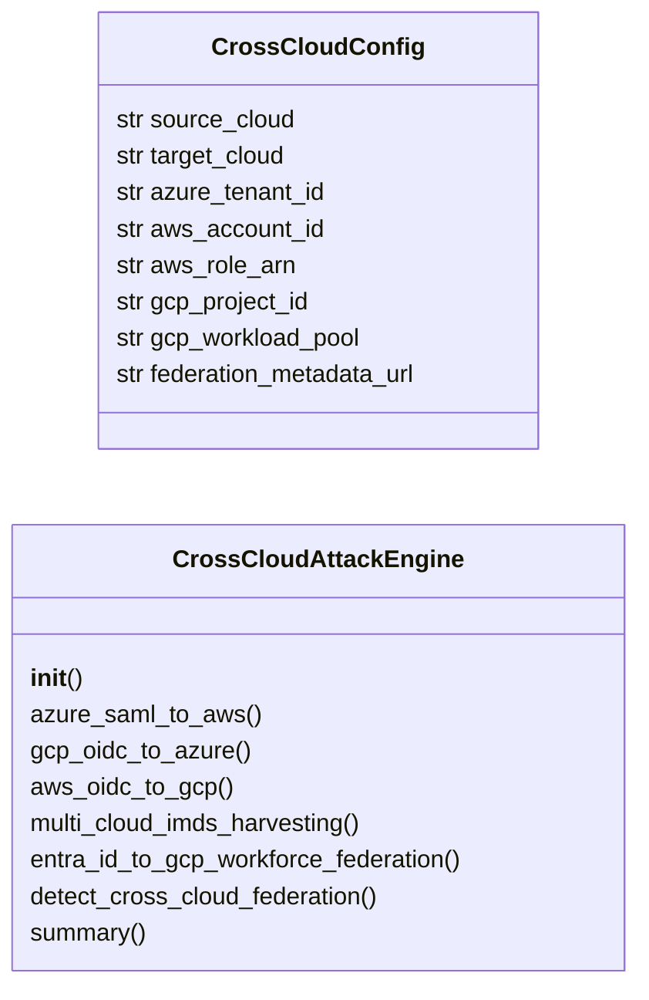
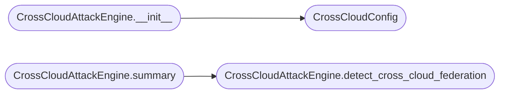

# `modules.cross_cloud`

> Source: [modules/cross_cloud.py:1](../../modules/cross_cloud.py#L1) | language `py` | coverage 81.8% | [API index](../index.md)

Cross-cloud identity paths — multi-cloud identity federation abuse.

Implements attack paths that bridge cloud providers through identity
federation: Azure AD -> AWS (SAML federation), GCP -> Azure (OIDC
federation), multi-cloud metadata harvesting, and cross-cloud service
account impersonation through workload identity federation.

Allows attackers to pivot from one cloud to another using federated
identities, expanding compromise radius across multi-cloud environments.

## Contents

- **Classes:** [`CrossCloudConfig`](#crosscloudconfig), [`CrossCloudAttackEngine`](#crosscloudattackengine)
- **Constants:** [`CROSS_CLOUD_ATTACKS`](#cross_cloud_attacks)

## Type Diagram



## Call Graph

Solid arrows stay in this module, dashed arrows leave it.



## Classes

<a id="crosscloudconfig"></a>

### `CrossCloudConfig`

`class` `dataclass` | [modules/cross_cloud.py:30](../../modules/cross_cloud.py#L30)

Decorators: `@dataclass`

```python
class CrossCloudConfig
```

Configuration for cross-cloud identity attacks.

**Attributes**

| Name | Type | Default | Description |
|---|---|---|---|
| [`source_cloud`](#crosscloudconfig-source_cloud) | `str` | `''` | Source cloud provider (aws, azure, gcp). |
| [`target_cloud`](#crosscloudconfig-target_cloud) | `str` | `''` | Target cloud provider. |
| [`azure_tenant_id`](#crosscloudconfig-azure_tenant_id) | `str` | `''` | Azure AD tenant ID. |
| [`aws_account_id`](#crosscloudconfig-aws_account_id) | `str` | `''` | AWS account ID. |
| [`aws_role_arn`](#crosscloudconfig-aws_role_arn) | `str` | `''` | AWS IAM role ARN for federation. |
| [`gcp_project_id`](#crosscloudconfig-gcp_project_id) | `str` | `''` | GCP project ID. |
| [`gcp_workload_pool`](#crosscloudconfig-gcp_workload_pool) | `str` | `''` | GCP workload identity pool. |
| [`federation_metadata_url`](#crosscloudconfig-federation_metadata_url) | `str` | `''` | SAML/OIDC metadata URL. |

---

<a id="crosscloudattackengine"></a>

### `CrossCloudAttackEngine`

`class` | [modules/cross_cloud.py:54](../../modules/cross_cloud.py#L54)

```python
class CrossCloudAttackEngine
```

Execute cross-cloud identity federation attacks.

Bridges identity providers across AWS, Azure, and GCP using SAML 2.0
and OIDC federation to pivot between cloud environments.

**Members**

| Member | Kind | Summary |
|---|---|---|
| [`__init__`](#crosscloudattackengine-__init__) | constructor |  |
| [`azure_saml_to_aws`](#crosscloudattackengine-azure_saml_to_aws) | method | Abuse Azure AD SAML federation to gain AWS access. |
| [`gcp_oidc_to_azure`](#crosscloudattackengine-gcp_oidc_to_azure) | method | Abuse GCP OIDC federation to gain Azure access. |
| [`aws_oidc_to_gcp`](#crosscloudattackengine-aws_oidc_to_gcp) | method | Abuse AWS OIDC federation to gain GCP access. |
| [`multi_cloud_imds_harvesting`](#crosscloudattackengine-multi_cloud_imds_harvesting) | method | Harvest metadata from all cloud providers simultaneously. |
| [`entra_id_to_gcp_workforce_federation`](#crosscloudattackengine-entra_id_to_gcp_workforce_federation) | method | Exploit Entra ID to GCP workforce identity federation. |
| [`detect_cross_cloud_federation`](#crosscloudattackengine-detect_cross_cloud_federation) | method | Detect cross-cloud federation configurations for attack surface mapping. |
| [`summary`](#crosscloudattackengine-summary) | method |  |

<a id="crosscloudattackengine-__init__"></a>

#### `CrossCloudAttackEngine.__init__`

`constructor` | [modules/cross_cloud.py:64](../../modules/cross_cloud.py#L64)

```python
def __init__(self, config: CrossCloudConfig | None = None)
```

**Parameters**

| Name | Type | Default | Description |
|---|---|---|---|
| `config` | `CrossCloudConfig \| None` | `None` |  |

*Calls:* [`CrossCloudConfig`](#crosscloudconfig)

*Called by:* [`CloudAttackCommandSet.do_cross_cloud`](cli.commands.cloud_attacks.py.md#cloudattackcommandset-do_cross_cloud)

<a id="crosscloudattackengine-azure_saml_to_aws"></a>

#### `CrossCloudAttackEngine.azure_saml_to_aws`

`method` | [modules/cross_cloud.py:67](../../modules/cross_cloud.py#L67)

```python
def azure_saml_to_aws(self) -> dict[str, Any]
```

Abuse Azure AD SAML federation to gain AWS access.

If Azure AD is configured as a SAML IdP for AWS IAM Identity Center
or direct SAML federation, an attacker with Azure AD access can
assume AWS IAM roles.

**Returns:** `dict[str, Any]` - Dict with attack steps, commands, and required permissions.

*Called by:* [`CloudAttackCommandSet.do_cross_cloud`](cli.commands.cloud_attacks.py.md#cloudattackcommandset-do_cross_cloud)

<a id="crosscloudattackengine-gcp_oidc_to_azure"></a>

#### `CrossCloudAttackEngine.gcp_oidc_to_azure`

`method` | [modules/cross_cloud.py:104](../../modules/cross_cloud.py#L104)

```python
def gcp_oidc_to_azure(self) -> dict[str, Any]
```

Abuse GCP OIDC federation to gain Azure access.

GCP workload identity federation allows GCP service accounts to
authenticate to Azure AD via OIDC and obtain Azure access tokens.

**Returns:** `dict[str, Any]` - Dict with attack steps and token exchange commands.

*Called by:* [`CloudAttackCommandSet.do_cross_cloud`](cli.commands.cloud_attacks.py.md#cloudattackcommandset-do_cross_cloud)

<a id="crosscloudattackengine-aws_oidc_to_gcp"></a>

#### `CrossCloudAttackEngine.aws_oidc_to_gcp`

`method` | [modules/cross_cloud.py:133](../../modules/cross_cloud.py#L133)

```python
def aws_oidc_to_gcp(self) -> dict[str, Any]
```

Abuse AWS OIDC federation to gain GCP access.

GCP Workload Identity Federation can trust AWS as an OIDC identity
provider. An attacker with AWS access can generate OIDC tokens
to impersonate GCP service accounts.

**Returns:** `dict[str, Any]` - Dict with AWS-to-GCP attack path.

*Called by:* [`CloudAttackCommandSet.do_cross_cloud`](cli.commands.cloud_attacks.py.md#cloudattackcommandset-do_cross_cloud)

<a id="crosscloudattackengine-multi_cloud_imds_harvesting"></a>

#### `CrossCloudAttackEngine.multi_cloud_imds_harvesting`

`method` | [modules/cross_cloud.py:167](../../modules/cross_cloud.py#L167)

```python
def multi_cloud_imds_harvesting(self) -> dict[str, Any]
```

Harvest metadata from all cloud providers simultaneously.

Useful on multi-cloud or hybrid environments where workloads may
have access to multiple cloud metadata services.

**Returns:** `dict[str, Any]` - Dict with multi-cloud metadata harvesting commands.

*Called by:* [`CloudAttackCommandSet.do_cross_cloud`](cli.commands.cloud_attacks.py.md#cloudattackcommandset-do_cross_cloud)

<a id="crosscloudattackengine-entra_id_to_gcp_workforce_federation"></a>

#### `CrossCloudAttackEngine.entra_id_to_gcp_workforce_federation`

`method` | [modules/cross_cloud.py:204](../../modules/cross_cloud.py#L204)

```python
def entra_id_to_gcp_workforce_federation(self) -> dict[str, Any]
```

Exploit Entra ID to GCP workforce identity federation.

Microsoft Entra ID can serve as an identity provider for GCP
workforce identity federation. Compromising Entra ID accounts
with GCP federation grants GCP console/CLI access.

**Returns:** `dict[str, Any]` - Dict with Entra-to-GCP attack steps.

<a id="crosscloudattackengine-detect_cross_cloud_federation"></a>

#### `CrossCloudAttackEngine.detect_cross_cloud_federation`

`method` | [modules/cross_cloud.py:234](../../modules/cross_cloud.py#L234)

```python
def detect_cross_cloud_federation(self) -> dict[str, Any]
```

Detect cross-cloud federation configurations for attack surface mapping.

**Returns:** `dict[str, Any]` - Dict with detection commands per provider.

*Called by:* [`CloudAttackCommandSet.do_cross_cloud`](cli.commands.cloud_attacks.py.md#cloudattackcommandset-do_cross_cloud), [`CrossCloudAttackEngine.summary`](#crosscloudattackengine-summary)

<a id="crosscloudattackengine-summary"></a>

#### `CrossCloudAttackEngine.summary`

`method` | [modules/cross_cloud.py:258](../../modules/cross_cloud.py#L258)

```python
def summary(self) -> dict[str, Any]
```

**Returns:** `dict[str, Any]`

*Calls:* [`CrossCloudAttackEngine.detect_cross_cloud_federation`](#crosscloudattackengine-detect_cross_cloud_federation)

---

## Constants

<a id="cross_cloud_attacks"></a>

### `CROSS_CLOUD_ATTACKS`

`constant` | [modules/cross_cloud.py:17](../../modules/cross_cloud.py#L17)

```python
CROSS_CLOUD_ATTACKS
```

---
