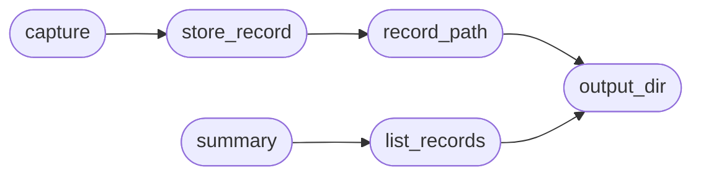

# `modules.ctf_capture`

> Source: [modules/ctf_capture.py:1](../../modules/ctf_capture.py#L1) | language `py` | coverage 100.0% | [API index](../index.md)

CTF capture verification for gym attack paths.

Turns raw beacon/exploit output into deterministic CTF records under
``sessions/ctf/<vuln_id>/record.json``. A capture succeeds only when a
checker matches the provided evidence output; no manual override exists
so the harness stays replayable.

## Contents

- **Functions:** [`output_dir`](#output_dir), [`capture`](#capture), [`record_path`](#record_path), [`store_record`](#store_record), [`list_records`](#list_records), [`summary`](#summary)
- **Constants:** [`CTF_DIRNAME`](#ctf_dirname), [`RECORD_NAME`](#record_name), [`ROOT_SHELL_RE`](#root_shell_re), [`SHADOW_LINE_RE`](#shadow_line_re), [`CRED_LINE_RE`](#cred_line_re), [`CHECKERS`](#checkers)

## Call Graph

Solid arrows stay in this module, dashed arrows leave it.



## Functions

<a id="output_dir"></a>

### `output_dir`

`function` | [modules/ctf_capture.py:28](../../modules/ctf_capture.py#L28)

```python
def output_dir(sessions_dir: str | Path | None = None) -> Path
```

Resolve the CTF storage directory.

**Parameters**

| Name | Type | Default | Description |
|---|---|---|---|
| `sessions_dir` | `str \| Path \| None` | `None` | Optional sessions directory override. |

**Returns:** `Path` - ``sessions/ctf`` inside the base directory.

*Called by:* [`list_records`](#list_records), [`record_path`](#record_path), [`load_matrix`](modules.gym_matrix_runner.py.md#load_matrix)

---

<a id="capture"></a>

### `capture`

`function` | [modules/ctf_capture.py:99](../../modules/ctf_capture.py#L99)

```python
def capture(vuln_id: str, target: str, output: str = '', sessions_dir: str | Path | None = None) -> dict
```

Verify output evidence for one gym vector and store the record.

**Parameters**

| Name | Type | Default | Description |
|---|---|---|---|
| `vuln_id` | `str` |  | Gym vulnerability id from the index playbook. |
| `target` | `str` |  | Attacked host IP. |
| `output` | `str` | `''` | Raw artifact output to verify. |
| `sessions_dir` | `str \| Path \| None` | `None` | Optional sessions directory override. |

**Returns:** `dict` - The stored record dict with ``status`` `[`captured`](modules.chain_runner.py.md#stepoutcome-captured)` or ``failed``.

**Raises**

- `ValueError`: If vuln_id is unknown to the gym index.

*Calls:* [`store_record`](#store_record)

---

<a id="record_path"></a>

### `record_path`

`function` | [modules/ctf_capture.py:175](../../modules/ctf_capture.py#L175)

```python
def record_path(vuln_id: str, sessions_dir: str | Path | None = None) -> Path
```

Return the record file path for one vulnerability.

**Parameters**

| Name | Type | Default | Description |
|---|---|---|---|
| `vuln_id` | `str` |  | Gym vulnerability id. |
| `sessions_dir` | `str \| Path \| None` | `None` | Optional sessions directory override. |

**Returns:** `Path` - The per-vuln record JSON path.

*Calls:* [`output_dir`](#output_dir)

*Called by:* [`store_record`](#store_record)

---

<a id="store_record"></a>

### `store_record`

`function` | [modules/ctf_capture.py:201](../../modules/ctf_capture.py#L201)

```python
def store_record(record: dict, sessions_dir: str | Path | None = None) -> Path
```

Persist one capture record atomically.

**Parameters**

| Name | Type | Default | Description |
|---|---|---|---|
| `record` | `dict` |  | Record dict from [`capture`](#capture). |
| `sessions_dir` | `str \| Path \| None` | `None` | Optional sessions directory override. |

**Returns:** `Path` - The record file path written.

*Calls:* [`record_path`](#record_path)

*Called by:* [`capture`](#capture)

---

<a id="list_records"></a>

### `list_records`

`function` | [modules/ctf_capture.py:219](../../modules/ctf_capture.py#L219)

```python
def list_records(sessions_dir: str | Path | None = None) -> dict[str, dict]
```

Return every stored CTF record keyed by vuln id.

**Parameters**

| Name | Type | Default | Description |
|---|---|---|---|
| `sessions_dir` | `str \| Path \| None` | `None` | Optional sessions directory override. |

**Returns:** `dict[str, dict]` - Mapping ``vuln_id -> record``.

*Calls:* [`output_dir`](#output_dir)

*Called by:* [`summary`](#summary)

---

<a id="summary"></a>

### `summary`

`function` | [modules/ctf_capture.py:242](../../modules/ctf_capture.py#L242)

```python
def summary(sessions_dir: str | Path | None = None) -> dict
```

Aggregate capture stats for the report pipeline.

**Parameters**

| Name | Type | Default | Description |
|---|---|---|---|
| `sessions_dir` | `str \| Path \| None` | `None` | Optional sessions directory override. |

**Returns:** `dict` - Dict with count/status/cve/severity breakdowns and the records.

*Calls:* [`list_records`](#list_records)

---

## Constants

<a id="ctf_dirname"></a>

### `CTF_DIRNAME`

`constant` | [modules/ctf_capture.py:20](../../modules/ctf_capture.py#L20)

```python
CTF_DIRNAME = 'ctf'
```

---

<a id="record_name"></a>

### `RECORD_NAME`

`constant` | [modules/ctf_capture.py:21](../../modules/ctf_capture.py#L21)

```python
RECORD_NAME = 'record.json'
```

---

<a id="root_shell_re"></a>

### `ROOT_SHELL_RE`

`constant` | [modules/ctf_capture.py:23](../../modules/ctf_capture.py#L23)

```python
ROOT_SHELL_RE
```

---

<a id="shadow_line_re"></a>

### `SHADOW_LINE_RE`

`constant` | [modules/ctf_capture.py:24](../../modules/ctf_capture.py#L24)

```python
SHADOW_LINE_RE = re.compile('^[A-Za-z0-9_.-]+:\\$[0-9a-zA-Z]+\\$', re.MULTILINE)
```

---

<a id="cred_line_re"></a>

### `CRED_LINE_RE`

`constant` | [modules/ctf_capture.py:25](../../modules/ctf_capture.py#L25)

```python
CRED_LINE_RE = re.compile('^([A-Za-z0-9_.-]+)\\s*[:|]\\s*(\\S+)\\s*$', re.MULTILINE)
```

---

<a id="checkers"></a>

### `CHECKERS`

`constant` | [modules/ctf_capture.py:92](../../modules/ctf_capture.py#L92)

```python
CHECKERS: tuple[tuple[str, Callable[[str], str]], ...]
```

---
