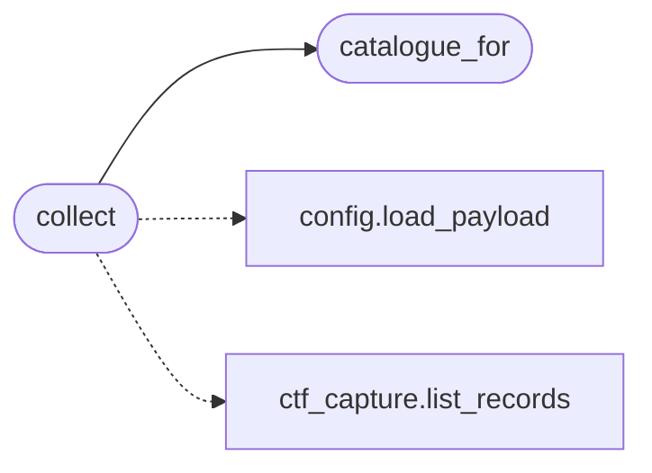

# `modules.ctf_signalman`

> Source: [modules/ctf_signalman.py:1](../../modules/ctf_signalman.py#L1) | language `py` | coverage 100.0% | [API index](../index.md)

CTF signalman: one scoreboard for every recorded capture.

Mined from sapper-v2's signalman (a role the sapper commander invented
to collect unsubmitted flags and score them in one place) and
reimplemented LazyOwn-native. The gym harness records evidence per
vector through ``ctf_capture``; this module sweeps a whole gym catalogue,
re-verifies every not-yet-captured vector against the aggregate evidence
tree once, and renders a single scoreboard: captured, missing and score.

One contract per file (SOLID): catalogue selection, the sweep and the
scoreboard rendering live here. Recording stays in ``ctf_capture`` and
I/O (evidence trees, session dirs) is parameterized, so nothing here
knows about the shell.

Captures are bound, not open: a vector becomes `[`captured`](modules.chain_runner.py.md#stepoutcome-captured)` only when a checker
the vector's own objective declares matches, so a single recon pass cannot score
an unrelated vector. Each record carries its ``expected_checkers`` and the
``matched_checkers`` that fired, so a reviewer can falsify any claimed capture.

## Contents

- **Functions:** [`catalogue_for`](#catalogue_for), [`collect`](#collect), [`render_scoreboard`](#render_scoreboard), [`save_scoreboard`](#save_scoreboard)

## Call Graph

Solid arrows stay in this module, dashed arrows leave it.



## Functions

<a id="catalogue_for"></a>

### `catalogue_for`

`function` | [modules/ctf_signalman.py:53](../../modules/ctf_signalman.py#L53)

```python
def catalogue_for(scenario: str) -> tuple[list[dict], Callable[[str], Any]]
```

Resolve one gym scenario into its vectors and lookup callable.

**Parameters**

| Name | Type | Default | Description |
|---|---|---|---|
| `scenario` | `str` |  | ``metasploitable``, ``ad_lab`` or ``winbox``. |

**Returns:** `tuple[list[dict], Callable[[str], Any]]` - The catalogue entry list and the module ``get`` callable.

**Raises**

- `ValueError`: On an unknown scenario.

*Called by:* [`collect`](#collect)

---

<a id="collect"></a>

### `collect`

`function` | [modules/ctf_signalman.py:106](../../modules/ctf_signalman.py#L106)

```python
def collect(scenario: str, target: str = '', sessions_dir: str | Path = 'sessions', search_bases: list[str | Path] | None = None) -> dict
```

Sweep the whole gym scenario and score every vector in one pass.

For every catalogue vector without a captured record the aggregate
evidence tree is verified once through the standard checkers; the
sweep is idempotent (already captured vectors keep their record).

**Parameters**

| Name | Type | Default | Description |
|---|---|---|---|
| `scenario` | `str` |  | Gym scenario name (``metasploitable``, ``ad_lab``). |
| `target` | `str` | `''` | Attacked host recorded on new captures (defaults to the payload ``rhost`` when empty). |
| `sessions_dir` | `str \| Path` | `'sessions'` | CTF storage root. |
| `search_bases` | `list[str \| Path] \| None` | `None` | Evidence trees; defaults to the sessions dir. |

**Returns:** `dict` - Report dict with `[`captured`](modules.chain_runner.py.md#stepoutcome-captured)`, ``missing``, `[`score`](modules.chain_match.py.md#score)` (percent),
``total`` and the refreshed ``records``.

*Calls:* [`load_payload`](core.config.py.md#load_payload), [`list_records`](modules.ctf_capture.py.md#list_records), [`catalogue_for`](#catalogue_for)

---

<a id="render_scoreboard"></a>

### `render_scoreboard`

`function` | [modules/ctf_signalman.py:166](../../modules/ctf_signalman.py#L166)

```python
def render_scoreboard(report: dict) -> str
```

Render the collect report as a compact scoreboard.

**Parameters**

| Name | Type | Default | Description |
|---|---|---|---|
| `report` | `dict` |  | Report from [`collect`](#collect). |

**Returns:** `str` - Multi-line scoreboard text with severity per captured vector.

---

<a id="save_scoreboard"></a>

### `save_scoreboard`

`function` | [modules/ctf_signalman.py:193](../../modules/ctf_signalman.py#L193)

```python
def save_scoreboard(report: dict, sessions_dir: str | Path = 'sessions') -> Path
```

Persist the scoreboard next to the CTF records.

**Parameters**

| Name | Type | Default | Description |
|---|---|---|---|
| `report` | `dict` |  | Report from [`collect`](#collect). |
| `sessions_dir` | `str \| Path` | `'sessions'` | CTF storage root. |

**Returns:** `Path` - The written scoreboard path.

---
