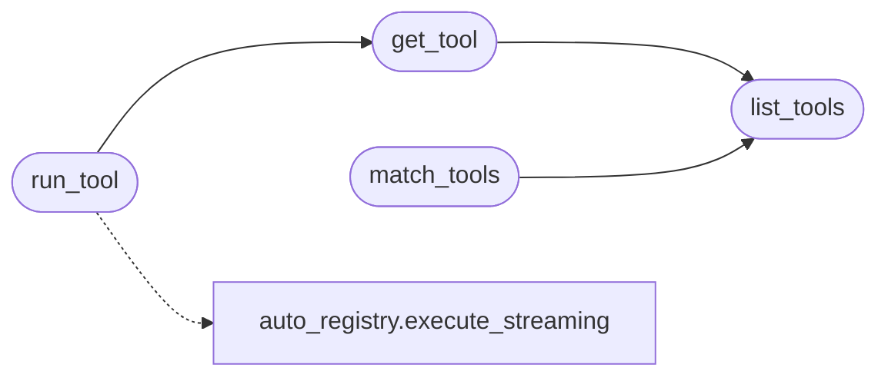

# `modules.custom_tools`

> Source: [modules/custom_tools.py:1](../../modules/custom_tools.py#L1) | language `py` | coverage 100.0% | [API index](../index.md)

Operator-defined custom tools exposed to the autonomous loop.

Kinds:
    command -- shell line with ``{arg}`` substituted and executed through
        the streaming runner (guard/scope/constraints still apply).
    script  -- ``.sh`` runs with bash, anything else with python3.
    http    -- URL/body templates with ``{arg}`` posting through the
        notification URL allowlist.

The planner proposes matches as ``custom tool <name> <target>`` intents
and the worker routes them to [`run_tool`](#run_tool) in-process, so custom
tools get the same trigger+command contract as the rest of the loop.

## Contents

- **Functions:** [`add_tool`](#add_tool), [`remove_tool`](#remove_tool), [`list_tools`](#list_tools), [`get_tool`](#get_tool), [`match_tools`](#match_tools), [`run_tool`](#run_tool)
- **Constants:** [`KINDS`](#kinds), [`DEFAULT_TIMEOUT_SEC`](#default_timeout_sec)

## Call Graph

Solid arrows stay in this module, dashed arrows leave it.



## Functions

<a id="add_tool"></a>

### `add_tool`

`function` | [modules/custom_tools.py:52](../../modules/custom_tools.py#L52)

```python
def add_tool(name: str, kind: str, target: str, description: str = '', method: str = 'GET', body: str = '', timeout: float = DEFAULT_TIMEOUT_SEC, trigger: str = '') -> dict
```

Register or replace one custom tool.

**Parameters**

| Name | Type | Default | Description |
|---|---|---|---|
| `name` | `str` |  | Tool name used in intents. |
| `kind` | `str` |  | ``command``, `[`script`](lazyc2.py.md#script)` or ``http``. |
| `target` | `str` |  | Command line, script path or URL template. |
| `description` | `str` | `''` | Short text used for keyword matching. |
| `method` | `str` | `'GET'` | HTTP method for ``http`` tools. |
| `body` | `str` | `''` | Request body template for ``http`` tools. |
| `timeout` | `float` | `DEFAULT_TIMEOUT_SEC` | Execution timeout in seconds. |
| `trigger` | `str` | `''` | Comma/space separated service tokens (``http,https,smb``) that make the loop propose this tool when the matching service is discovered, exactly like ``tools/*.tool`` files. |

**Returns:** `dict` - Stored tool entry.

**Raises**

- `ValueError`: Unknown kind or empty name/target.

*Called by:* [`LazyCommandSet.do_lazy_tool`](cli.commands.lazyops.py.md#lazycommandset-do_lazy_tool)

---

<a id="remove_tool"></a>

### `remove_tool`

`function` | [modules/custom_tools.py:97](../../modules/custom_tools.py#L97)

```python
def remove_tool(name: str) -> bool
```

Delete a tool by name.

**Parameters**

| Name | Type | Default | Description |
|---|---|---|---|
| `name` | `str` |  |  |

**Returns:** `bool`

*Called by:* [`LazyCommandSet.do_lazy_tool`](cli.commands.lazyops.py.md#lazycommandset-do_lazy_tool)

---

<a id="list_tools"></a>

### `list_tools`

`function` | [modules/custom_tools.py:109](../../modules/custom_tools.py#L109)

```python
def list_tools() -> list[dict]
```

Return every registered tool.

**Returns:** `list[dict]`

*Called by:* [`LazyCommandSet.do_lazy_tool`](cli.commands.lazyops.py.md#lazycommandset-do_lazy_tool), [`get_tool`](#get_tool), [`match_tools`](#match_tools)

---

<a id="get_tool"></a>

### `get_tool`

`function` | [modules/custom_tools.py:114](../../modules/custom_tools.py#L114)

```python
def get_tool(name: str) -> dict | None
```

Find one tool by name.

**Parameters**

| Name | Type | Default | Description |
|---|---|---|---|
| `name` | `str` |  |  |

**Returns:** `dict | None`

*Calls:* [`list_tools`](#list_tools)

*Called by:* [`run_tool`](#run_tool)

---

<a id="match_tools"></a>

### `match_tools`

`function` | [modules/custom_tools.py:128](../../modules/custom_tools.py#L128)

```python
def match_tools(text: str, limit: int = 3) -> list[dict]
```

Rank tools whose name/description/trigger keywords appear in the text.

**Parameters**

| Name | Type | Default | Description |
|---|---|---|---|
| `text` | `str` |  |  |
| `limit` | `int` | `3` |  |

**Returns:** `list[dict]`

*Calls:* [`list_tools`](#list_tools)

---

<a id="run_tool"></a>

### `run_tool`

`function` | [modules/custom_tools.py:151](../../modules/custom_tools.py#L151)

```python
def run_tool(name: str, arg: str = '', on_output=None) -> str
```

Execute one custom tool and return its transcript.

**Parameters**

| Name | Type | Default | Description |
|---|---|---|---|
| `name` | `str` |  | Tool name. |
| `arg` | `str` | `''` | Argument substituted into ``{arg}`` placeholders. |
| `on_output` |  | `None` | Optional live line observer. |

**Returns:** `str` - Captured output or an ``execution failed:`` transcript line.

*Calls:* [`execute_streaming`](modules.auto_registry.py.md#execute_streaming), [`get_tool`](#get_tool)

*Called by:* [`LazyCommandSet.do_lazy_tool`](cli.commands.lazyops.py.md#lazycommandset-do_lazy_tool), [`build_executor`](modules.lazy_runner.py.md#build_executor)

---

## Constants

<a id="kinds"></a>

### `KINDS`

`constant` | [modules/custom_tools.py:24](../../modules/custom_tools.py#L24)

```python
KINDS = ('command', 'script', 'http')
```

---

<a id="default_timeout_sec"></a>

### `DEFAULT_TIMEOUT_SEC`

`constant` | [modules/custom_tools.py:26](../../modules/custom_tools.py#L26)

```python
DEFAULT_TIMEOUT_SEC = 60.0
```

---
