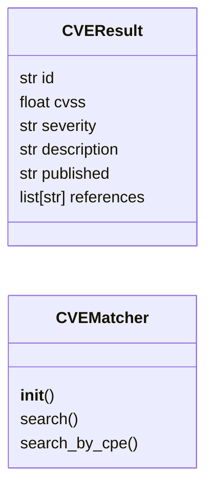

# `modules.cve_matcher`

> Source: [modules/cve_matcher.py:1](../../modules/cve_matcher.py#L1) | language `py` | coverage 87.5% | [API index](../index.md)

modules/cve_matcher.py ======================= CVE lookup via NVD API 2.0 (no key required for basic queries).

Rate limits:
  Without key : 5 requests / 30 s
  With key    : 50 requests / 30 s  (set NVD_API_KEY env var)

Results are cached on disk under sessions/cve_cache/ (TTL: 1 hour).

Usage:
    from modules.cve_matcher import CVEMatcher

    m = CVEMatcher()
    for cve in m.search("openssh", "8.4"):
        print(cve.id, cve.cvss, cve.description[:80])

    # CLI:
    python3 modules/cve_matcher.py --product openssh --version 8.4 [--max 10] [--json]

## Contents

- **Classes:** [`CVEResult`](#cveresult), [`CVEMatcher`](#cvematcher)
- **Functions:** [`get_matcher`](#get_matcher), [`search`](#search)
- **Constants:** [`NVD_API_BASE`](#nvd_api_base)

## Type Diagram



## Call Graph

Solid arrows stay in this module, dashed arrows leave it.


## Classes

<a id="cveresult"></a>

### `CVEResult`

`class` `dataclass` | [modules/cve_matcher.py:51](../../modules/cve_matcher.py#L51)

Decorators: `@dataclass`

```python
class CVEResult
```

**Attributes**

| Name | Type | Default | Description |
|---|---|---|---|
| [`id`](#cveresult-id) | `str` |  |  |
| [`cvss`](#cveresult-cvss) | `float` |  |  |
| [`severity`](#cveresult-severity) | `str` |  |  |
| [`description`](#cveresult-description) | `str` |  |  |
| [`published`](#cveresult-published) | `str` |  |  |
| [`references`](#cveresult-references) | `list[str]` | `field(default_factory=list)` |  |

---

<a id="cvematcher"></a>

### `CVEMatcher`

`class` | [modules/cve_matcher.py:60](../../modules/cve_matcher.py#L60)

```python
class CVEMatcher
```

Lookup CVEs for a given product/version using the NVD REST API 2.0.

**Parameters**

| Name | Type | Default | Description |
|---|---|---|---|
| `api_key` | `NVD API key (optional, falls back to NVD_API_KEY env var).` |  |  |
| `cache_dir` | `directory for on-disk result cache.` |  |  |

**Members**

| Member | Kind | Summary |
|---|---|---|
| [`__init__`](#cvematcher-__init__) | constructor |  |
| [`search`](#cvematcher-search) | method | Search CVEs by product / version keywords. |
| [`search_by_cpe`](#cvematcher-search_by_cpe) | method | Search CVEs by CPE 2.3 string. |

<a id="cvematcher-__init__"></a>

#### `CVEMatcher.__init__`

`constructor` | [modules/cve_matcher.py:70](../../modules/cve_matcher.py#L70)

```python
def __init__(self, api_key: str = '', cache_dir: str | Path | None = None) -> None
```

**Parameters**

| Name | Type | Default | Description |
|---|---|---|---|
| `api_key` | `str` | `''` |  |
| `cache_dir` | `str \| Path \| None` | `None` |  |

*Called by:* [`get_matcher`](#get_matcher)

<a id="cvematcher-search"></a>

#### `CVEMatcher.search`

`method` | [modules/cve_matcher.py:82](../../modules/cve_matcher.py#L82)

```python
def search(self, *keywords: str, max_results: int = 10) -> list[CVEResult]
```

Search CVEs by product / version keywords.

**Parameters**

| Name | Type | Default | Description |
|---|---|---|---|
| `*keywords` | `str` |  |  |
| `max_results` | `int` | `10` |  |

**Returns:** `list[CVEResult]`

<a id="cvematcher-search_by_cpe"></a>

#### `CVEMatcher.search_by_cpe`

`method` | [modules/cve_matcher.py:89](../../modules/cve_matcher.py#L89)

```python
def search_by_cpe(self, cpe_name: str, max_results: int = 10) -> list[CVEResult]
```

Search CVEs by CPE 2.3 string.

**Parameters**

| Name | Type | Default | Description |
|---|---|---|---|
| `cpe_name` | `str` |  |  |
| `max_results` | `int` | `10` |  |

**Returns:** `list[CVEResult]`

---

## Functions

<a id="get_matcher"></a>

### `get_matcher`

`function` | [modules/cve_matcher.py:198](../../modules/cve_matcher.py#L198)

```python
def get_matcher() -> CVEMatcher
```

Return (or create) the module-level singleton CVEMatcher.

**Returns:** `CVEMatcher`

*Calls:* [`CVEMatcher.__init__`](#cvematcher-__init__)

*Called by:* [`search`](#search)

---

<a id="search"></a>

### `search`

`function` | [modules/cve_matcher.py:206](../../modules/cve_matcher.py#L206)

```python
def search(product: str, version: str = '', max_results: int = 10) -> list[CVEResult]
```

Module-level convenience wrapper.

**Parameters**

| Name | Type | Default | Description |
|---|---|---|---|
| `product` | `str` |  |  |
| `version` | `str` | `''` |  |
| `max_results` | `int` | `10` |  |

**Returns:** `list[CVEResult]`

*Calls:* [`get_matcher`](#get_matcher)

---

## Constants

<a id="nvd_api_base"></a>

### `NVD_API_BASE`

`constant` | [modules/cve_matcher.py:39](../../modules/cve_matcher.py#L39)

```python
NVD_API_BASE = 'https://services.nvd.nist.gov/rest/json/cves/2.0'
```

---
