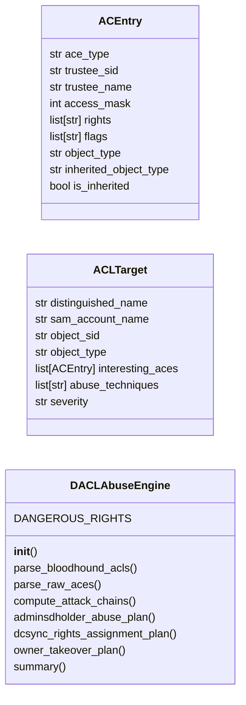
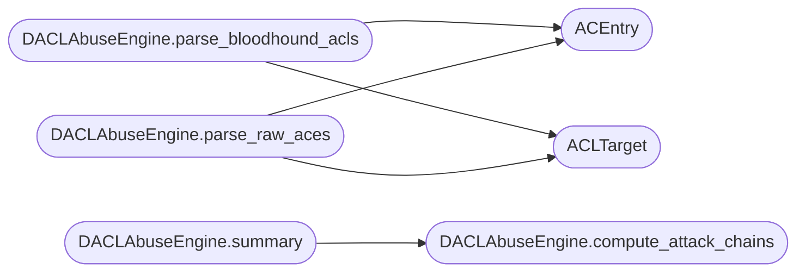

# `modules.dacl_abuse`

> Source: [modules/dacl_abuse.py:1](../../modules/dacl_abuse.py#L1) | language `py` | coverage 91.7% | [API index](../index.md)

DACL/SACL abuse module — ACL manipulation for AD privilege escalation.

Identifies and exploits dangerous Access Control Entries (ACEs) in Active
Directory object security descriptors. Covers ownership takeover, AdminSDHolder
abuse, ACL inheritance manipulation, and DCSync rights assignment.

Allows privilege escalation by abusing misconfigured DACLs to grant
DCSync, reset passwords, add group memberships, or modify GPO links.

## Contents

- **Classes:** [`ACEntry`](#acentry), [`ACLTarget`](#acltarget), [`DACLAbuseEngine`](#daclabuseengine)
- **Constants:** [`ACE_TYPES`](#ace_types), [`ACE_FLAGS`](#ace_flags), [`GENERIC_ALL`](#generic_all), [`GENERIC_WRITE`](#generic_write), [`WRITE_DACL`](#write_dacl), [`WRITE_OWNER`](#write_owner), [`EXTENDED_RIGHTS`](#extended_rights), [`ABUSE_TECHNIQUES`](#abuse_techniques)

## Type Diagram



## Call Graph

Solid arrows stay in this module, dashed arrows leave it.



## Classes

<a id="acentry"></a>

### `ACEntry`

`class` `dataclass` | [modules/dacl_abuse.py:67](../../modules/dacl_abuse.py#L67)

Decorators: `@dataclass`

```python
class ACEntry
```

A single Access Control Entry in an AD object's DACL/SACL.

**Attributes**

| Name | Type | Default | Description |
|---|---|---|---|
| [`ace_type`](#acentry-ace_type) | `str` | `''` | ACCESS_ALLOWED, ACCESS_DENIED, etc. |
| [`trustee_sid`](#acentry-trustee_sid) | `str` | `''` | SID of the principal granted the permission. |
| [`trustee_name`](#acentry-trustee_name) | `str` | `''` |  |
| [`access_mask`](#acentry-access_mask) | `int` | `0` | Bitmask of granted rights. |
| [`rights`](#acentry-rights) | `list[str]` | `field(default_factory=list)` |  |
| [`flags`](#acentry-flags) | `list[str]` | `field(default_factory=list)` | Inheritance flags. |
| [`object_type`](#acentry-object_type) | `str` | `''` | GUID of the specific attribute right. |
| [`inherited_object_type`](#acentry-inherited_object_type) | `str` | `''` | GUID for inheritance scoping. |
| [`is_inherited`](#acentry-is_inherited) | `bool` | `False` |  |

---

<a id="acltarget"></a>

### `ACLTarget`

`class` `dataclass` | [modules/dacl_abuse.py:91](../../modules/dacl_abuse.py#L91)

Decorators: `@dataclass`

```python
class ACLTarget
```

An AD object with exploitable ACEs.

**Attributes**

| Name | Type | Default | Description |
|---|---|---|---|
| [`distinguished_name`](#acltarget-distinguished_name) | `str` | `''` | DN in AD. |
| [`sam_account_name`](#acltarget-sam_account_name) | `str` | `''` | sAMAccountName (or name for non-users). |
| [`object_sid`](#acltarget-object_sid) | `str` | `''` | Security identifier. |
| [`object_type`](#acltarget-object_type) | `str` | `''` | user, group, computer, gpo, ou, domain. |
| [`interesting_aces`](#acltarget-interesting_aces) | `list[ACEntry]` | `field(default_factory=list)` | ACEs that grant abuse primitives. |
| [`abuse_techniques`](#acltarget-abuse_techniques) | `list[str]` | `field(default_factory=list)` | List of applicable abuse techniques. |
| [`severity`](#acltarget-severity) | `str` | `'medium'` | critical, high, medium, low. |

---

<a id="daclabuseengine"></a>

### `DACLAbuseEngine`

`class` | [modules/dacl_abuse.py:113](../../modules/dacl_abuse.py#L113)

```python
class DACLAbuseEngine
```

Identify and exploit dangerous DACL/SACL entries on AD objects.

Analyzes BloodHound or LDAP ACL data to find exploitable permission
paths and generates exploitation plans for each abuse primitive.

**Attributes**

| Name | Type | Default | Description |
|---|---|---|---|
| [`DANGEROUS_RIGHTS`](#daclabuseengine-dangerous_rights) |  | `{GENERIC_ALL: 'GenericAll', GENERIC_WRITE: 'GenericWrite', WRITE_DACL: 'WriteDacl', WRITE_OWNER: 'WriteOwner', 65536: 'ExtendedRight', 64: 'ReadProperty'}` |  |

**Members**

| Member | Kind | Summary |
|---|---|---|
| [`__init__`](#daclabuseengine-__init__) | constructor |  |
| [`parse_bloodhound_acls`](#daclabuseengine-parse_bloodhound_acls) | method | Parse BloodHound edge data to extract exploitable ACLs. |
| [`parse_raw_aces`](#daclabuseengine-parse_raw_aces) | method | Parse raw ACE data from ntSecurityDescriptor parsing. |
| [`compute_attack_chains`](#daclabuseengine-compute_attack_chains) | method | Generate exploitation plans for all discovered ACL targets. |
| [`adminsdholder_abuse_plan`](#daclabuseengine-adminsdholder_abuse_plan) | method | Generate an AdminSDHolder abuse plan. |
| [`dcsync_rights_assignment_plan`](#daclabuseengine-dcsync_rights_assignment_plan) | method | Generate a DCSync rights assignment plan. |
| [`owner_takeover_plan`](#daclabuseengine-owner_takeover_plan) | method | Generate an ownership takeover plan. |
| [`summary`](#daclabuseengine-summary) | method | Return a summary of all DACL/SACL abuse findings. |

<a id="daclabuseengine-__init__"></a>

#### `DACLAbuseEngine.__init__`

`constructor` | [modules/dacl_abuse.py:136](../../modules/dacl_abuse.py#L136)

```python
def __init__(self, domain: str = '', domain_sid: str = '', acl_data: list[dict[str, Any]] = None)
```

**Parameters**

| Name | Type | Default | Description |
|---|---|---|---|
| `domain` | `str` | `''` |  |
| `domain_sid` | `str` | `''` |  |
| `acl_data` | `list[dict[str, Any]]` | `None` |  |

*Called by:* [`ActiveDirectoryCommandSet.do_dacl_abuse`](cli.commands.active_directory.py.md#activedirectorycommandset-do_dacl_abuse)

<a id="daclabuseengine-parse_bloodhound_acls"></a>

#### `DACLAbuseEngine.parse_bloodhound_acls`

`method` | [modules/dacl_abuse.py:143](../../modules/dacl_abuse.py#L143)

```python
def parse_bloodhound_acls(self, edges: list[dict[str, Any]]) -> list[ACLTarget]
```

Parse BloodHound edge data to extract exploitable ACLs.

**Parameters**

| Name | Type | Default | Description |
|---|---|---|---|
| `edges` | `list[dict[str, Any]]` |  | List of BloodHound edge dicts with ACL data. |

**Returns:** `list[ACLTarget]` - List of ACLTarget objects.

*Calls:* [`ACEntry`](#acentry), [`ACLTarget`](#acltarget)

<a id="daclabuseengine-parse_raw_aces"></a>

#### `DACLAbuseEngine.parse_raw_aces`

`method` | [modules/dacl_abuse.py:182](../../modules/dacl_abuse.py#L182)

```python
def parse_raw_aces(self, raw_nthashes: list[dict[str, Any]]) -> list[ACLTarget]
```

Parse raw ACE data from ntSecurityDescriptor parsing.

**Parameters**

| Name | Type | Default | Description |
|---|---|---|---|
| `raw_nthashes` | `list[dict[str, Any]]` |  | List of dicts with object DN and ACE list. |

**Returns:** `list[ACLTarget]` - List of ACLTarget objects.

*Calls:* [`ACEntry`](#acentry), [`ACLTarget`](#acltarget)

<a id="daclabuseengine-compute_attack_chains"></a>

#### `DACLAbuseEngine.compute_attack_chains`

`method` | [modules/dacl_abuse.py:224](../../modules/dacl_abuse.py#L224)

```python
def compute_attack_chains(self) -> list[dict[str, Any]]
```

Generate exploitation plans for all discovered ACL targets.

**Returns:** `list[dict[str, Any]]` - List of attack chain dicts with commands and prerequisites.

*Called by:* [`DACLAbuseEngine.summary`](#daclabuseengine-summary)

<a id="daclabuseengine-adminsdholder_abuse_plan"></a>

#### `DACLAbuseEngine.adminsdholder_abuse_plan`

`method` | [modules/dacl_abuse.py:291](../../modules/dacl_abuse.py#L291)

```python
def adminsdholder_abuse_plan(self, target_sid: str) -> dict[str, Any]
```

Generate an AdminSDHolder abuse plan.

AdminSDHolder's ACL is propagated every 60 minutes to all protected
groups. Modifying its DACL is a stealthy persistence technique.

**Parameters**

| Name | Type | Default | Description |
|---|---|---|---|
| `target_sid` | `str` |  | SID of the attacker-controlled account. |

**Returns:** `dict[str, Any]` - Dict with abuse instructions and commands.

*Called by:* [`ActiveDirectoryCommandSet.do_dacl_abuse`](cli.commands.active_directory.py.md#activedirectorycommandset-do_dacl_abuse)

<a id="daclabuseengine-dcsync_rights_assignment_plan"></a>

#### `DACLAbuseEngine.dcsync_rights_assignment_plan`

`method` | [modules/dacl_abuse.py:318](../../modules/dacl_abuse.py#L318)

```python
def dcsync_rights_assignment_plan(self, target_sid: str, domain_dn: str = '') -> dict[str, Any]
```

Generate a DCSync rights assignment plan.

Grants DS-Replication-Get-Changes and DS-Replication-Get-Changes-All
extended rights to an attacker-controlled account on the domain root.

**Parameters**

| Name | Type | Default | Description |
|---|---|---|---|
| `target_sid` | `str` |  | SID to grant DCSync rights to. |
| `domain_dn` | `str` | `''` | Domain distinguished name. |

**Returns:** `dict[str, Any]` - Dict with DCSync assignment commands.

*Called by:* [`ActiveDirectoryCommandSet.do_dacl_abuse`](cli.commands.active_directory.py.md#activedirectorycommandset-do_dacl_abuse)

<a id="daclabuseengine-owner_takeover_plan"></a>

#### `DACLAbuseEngine.owner_takeover_plan`

`method` | [modules/dacl_abuse.py:348](../../modules/dacl_abuse.py#L348)

```python
def owner_takeover_plan(self, target_dn: str, attacker_sid: str) -> dict[str, Any]
```

Generate an ownership takeover plan.

Changes the owner of an AD object to the attacker, then grants
WriteDacl to modify permissions.

**Parameters**

| Name | Type | Default | Description |
|---|---|---|---|
| `target_dn` | `str` |  | Distinguished name of the target object. |
| `attacker_sid` | `str` |  | Attacker's SID. |

**Returns:** `dict[str, Any]` - Dict with owner takeover instructions.

<a id="daclabuseengine-summary"></a>

#### `DACLAbuseEngine.summary`

`method` | [modules/dacl_abuse.py:418](../../modules/dacl_abuse.py#L418)

```python
def summary(self) -> dict[str, Any]
```

Return a summary of all DACL/SACL abuse findings.

**Returns:** `dict[str, Any]` - Dict with target counts by severity, technique counts, and attack chains.

*Calls:* [`DACLAbuseEngine.compute_attack_chains`](#daclabuseengine-compute_attack_chains)

*Called by:* [`ActiveDirectoryCommandSet.do_dacl_abuse`](cli.commands.active_directory.py.md#activedirectorycommandset-do_dacl_abuse)

---

## Constants

<a id="ace_types"></a>

### `ACE_TYPES`

`constant` | [modules/dacl_abuse.py:17](../../modules/dacl_abuse.py#L17)

```python
ACE_TYPES
```

---

<a id="ace_flags"></a>

### `ACE_FLAGS`

`constant` | [modules/dacl_abuse.py:24](../../modules/dacl_abuse.py#L24)

```python
ACE_FLAGS
```

---

<a id="generic_all"></a>

### `GENERIC_ALL`

`constant` | [modules/dacl_abuse.py:32](../../modules/dacl_abuse.py#L32)

```python
GENERIC_ALL = 268435456
```

---

<a id="generic_write"></a>

### `GENERIC_WRITE`

`constant` | [modules/dacl_abuse.py:33](../../modules/dacl_abuse.py#L33)

```python
GENERIC_WRITE = 1073741824
```

---

<a id="write_dacl"></a>

### `WRITE_DACL`

`constant` | [modules/dacl_abuse.py:34](../../modules/dacl_abuse.py#L34)

```python
WRITE_DACL = 262144
```

---

<a id="write_owner"></a>

### `WRITE_OWNER`

`constant` | [modules/dacl_abuse.py:35](../../modules/dacl_abuse.py#L35)

```python
WRITE_OWNER = 524288
```

---

<a id="extended_rights"></a>

### `EXTENDED_RIGHTS`

`constant` | [modules/dacl_abuse.py:36](../../modules/dacl_abuse.py#L36)

```python
EXTENDED_RIGHTS
```

---

<a id="abuse_techniques"></a>

### `ABUSE_TECHNIQUES`

`constant` | [modules/dacl_abuse.py:48](../../modules/dacl_abuse.py#L48)

```python
ABUSE_TECHNIQUES
```

---
