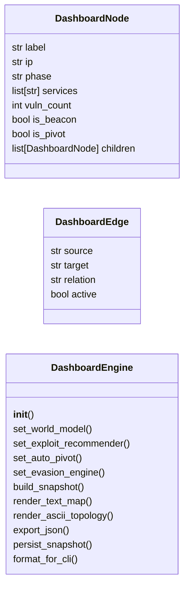
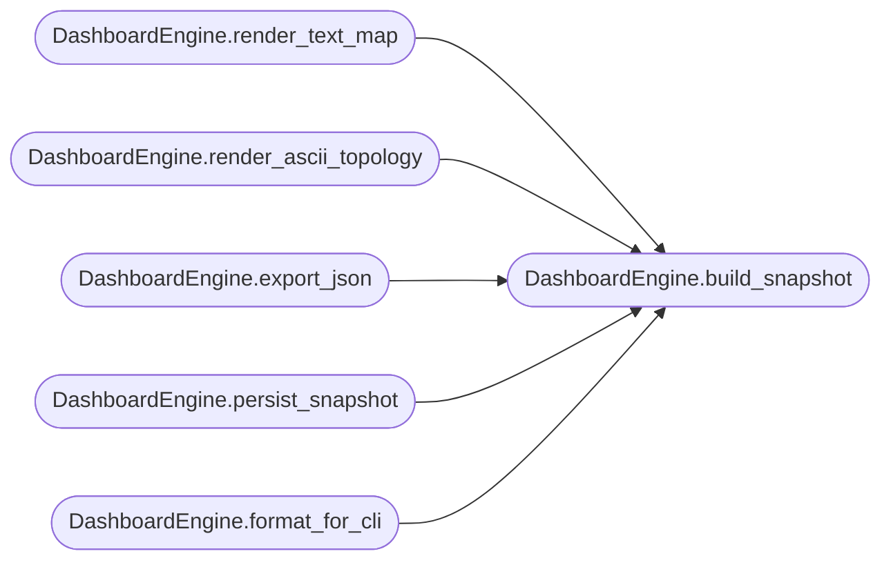

# `modules.dashboard_engine`

> Source: [modules/dashboard_engine.py:1](../../modules/dashboard_engine.py#L1) | language `py` | coverage 53.3% | [API index](../index.md)

Live Network Map Dashboard for LazyOwn.

Provides a curses-based real-time visualization of:
- Discovered hosts with service status
- Kill-chain phase progression per host
- Active exploit recommendations
- Pivot chain topology
- Beacon health indicators

Consumes data from WorldModel, ExploitRecommender, AutoPivotEngine, and EvasionEngine.

## Contents

- **Classes:** [`DashboardNode`](#dashboardnode), [`DashboardEdge`](#dashboardedge), [`DashboardEngine`](#dashboardengine)
- **Constants:** [`SESSIONS_DIR`](#sessions_dir)

## Type Diagram



## Call Graph

Solid arrows stay in this module, dashed arrows leave it.



## Classes

<a id="dashboardnode"></a>

### `DashboardNode`

`class` `dataclass` | [modules/dashboard_engine.py:99](../../modules/dashboard_engine.py#L99)

Decorators: `@dataclass`

```python
class DashboardNode
```

**Attributes**

| Name | Type | Default | Description |
|---|---|---|---|
| [`label`](#dashboardnode-label) | `str` |  |  |
| [`ip`](#dashboardnode-ip) | `str` |  |  |
| [`phase`](#dashboardnode-phase) | `str` |  |  |
| [`services`](#dashboardnode-services) | `list[str]` | `field(default_factory=list)` |  |
| [`vuln_count`](#dashboardnode-vuln_count) | `int` | `0` |  |
| [`is_beacon`](#dashboardnode-is_beacon) | `bool` | `False` |  |
| [`is_pivot`](#dashboardnode-is_pivot) | `bool` | `False` |  |
| [`children`](#dashboardnode-children) | `list[DashboardNode]` | `field(default_factory=list)` |  |

---

<a id="dashboardedge"></a>

### `DashboardEdge`

`class` `dataclass` | [modules/dashboard_engine.py:111](../../modules/dashboard_engine.py#L111)

Decorators: `@dataclass`

```python
class DashboardEdge
```

**Attributes**

| Name | Type | Default | Description |
|---|---|---|---|
| [`source`](#dashboardedge-source) | `str` |  |  |
| [`target`](#dashboardedge-target) | `str` |  |  |
| [`relation`](#dashboardedge-relation) | `str` |  |  |
| [`active`](#dashboardedge-active) | `bool` | `True` |  |

---

<a id="dashboardengine"></a>

### `DashboardEngine`

`class` | [modules/dashboard_engine.py:118](../../modules/dashboard_engine.py#L118)

```python
class DashboardEngine
```

Builds a live dashboard data model from campaign state.

Does NOT depend on curses directly — produces structured data suitable
for text-based rendering, JSON export, or TUI consumption.

**Members**

| Member | Kind | Summary |
|---|---|---|
| [`__init__`](#dashboardengine-__init__) | constructor |  |
| [`set_world_model`](#dashboardengine-set_world_model) | method |  |
| [`set_exploit_recommender`](#dashboardengine-set_exploit_recommender) | method |  |
| [`set_auto_pivot`](#dashboardengine-set_auto_pivot) | method |  |
| [`set_evasion_engine`](#dashboardengine-set_evasion_engine) | method |  |
| [`build_snapshot`](#dashboardengine-build_snapshot) | method | Build a complete dashboard snapshot from all data sources. |
| [`render_text_map`](#dashboardengine-render_text_map) | method | Render a text-based network map from a dashboard snapshot. |
| [`render_ascii_topology`](#dashboardengine-render_ascii_topology) | method | Render an ASCII-art topology tree from a snapshot. |
| [`export_json`](#dashboardengine-export_json) | method | Export dashboard snapshot as JSON string. |
| [`persist_snapshot`](#dashboardengine-persist_snapshot) | method | Persist dashboard snapshot to sessions/dashboard_snapshot.json. |
| [`format_for_cli`](#dashboardengine-format_for_cli) | method | Compact single-line status for CLI prompt integration. |

<a id="dashboardengine-__init__"></a>

#### `DashboardEngine.__init__`

`constructor` | [modules/dashboard_engine.py:139](../../modules/dashboard_engine.py#L139)

```python
def __init__(self, world_model: Any = None) -> None
```

**Parameters**

| Name | Type | Default | Description |
|---|---|---|---|
| `world_model` | `Any` | `None` |  |

*Called by:* [`PwnCommandSet.do_rich_tui`](cli.commands.pwn.py.md#pwncommandset-do_rich_tui), [`RichDashboard.__init__`](modules.rich_tui.py.md#richdashboard-__init__)

<a id="dashboardengine-set_world_model"></a>

#### `DashboardEngine.set_world_model`

`method` | [modules/dashboard_engine.py:148](../../modules/dashboard_engine.py#L148)

```python
def set_world_model(self, model: Any) -> None
```

**Parameters**

| Name | Type | Default | Description |
|---|---|---|---|
| `model` | `Any` |  |  |

<a id="dashboardengine-set_exploit_recommender"></a>

#### `DashboardEngine.set_exploit_recommender`

`method` | [modules/dashboard_engine.py:151](../../modules/dashboard_engine.py#L151)

```python
def set_exploit_recommender(self, recommender: Any) -> None
```

**Parameters**

| Name | Type | Default | Description |
|---|---|---|---|
| `recommender` | `Any` |  |  |

*Called by:* [`PwnCommandSet.do_rich_tui`](cli.commands.pwn.py.md#pwncommandset-do_rich_tui)

<a id="dashboardengine-set_auto_pivot"></a>

#### `DashboardEngine.set_auto_pivot`

`method` | [modules/dashboard_engine.py:154](../../modules/dashboard_engine.py#L154)

```python
def set_auto_pivot(self, pivot: Any) -> None
```

**Parameters**

| Name | Type | Default | Description |
|---|---|---|---|
| `pivot` | `Any` |  |  |

<a id="dashboardengine-set_evasion_engine"></a>

#### `DashboardEngine.set_evasion_engine`

`method` | [modules/dashboard_engine.py:157](../../modules/dashboard_engine.py#L157)

```python
def set_evasion_engine(self, evasion: Any) -> None
```

**Parameters**

| Name | Type | Default | Description |
|---|---|---|---|
| `evasion` | `Any` |  |  |

<a id="dashboardengine-build_snapshot"></a>

#### `DashboardEngine.build_snapshot`

`method` | [modules/dashboard_engine.py:160](../../modules/dashboard_engine.py#L160)

```python
def build_snapshot(self) -> dict[str, Any]
```

Build a complete dashboard snapshot from all data sources.

**Returns:** `dict[str, Any]` - Dict with keys: nodes, edges, stats, recommendations, pivots, beacons.

*Called by:* [`DashboardEngine.export_json`](#dashboardengine-export_json), [`DashboardEngine.format_for_cli`](#dashboardengine-format_for_cli), [`DashboardEngine.persist_snapshot`](#dashboardengine-persist_snapshot), [`DashboardEngine.render_ascii_topology`](#dashboardengine-render_ascii_topology), [`DashboardEngine.render_text_map`](#dashboardengine-render_text_map)

<a id="dashboardengine-render_text_map"></a>

#### `DashboardEngine.render_text_map`

`method` | [modules/dashboard_engine.py:276](../../modules/dashboard_engine.py#L276)

```python
def render_text_map(self, snapshot: dict[str, Any] | None = None) -> str
```

Render a text-based network map from a dashboard snapshot.

**Parameters**

| Name | Type | Default | Description |
|---|---|---|---|
| `snapshot` | `dict[str, Any] \| None` | `None` | Dashboard snapshot dict from build_snapshot(). Builds a fresh snapshot if None. |

**Returns:** `str` - A multi-line ASCII-art network topology string.

*Calls:* [`DashboardEngine.build_snapshot`](#dashboardengine-build_snapshot)

<a id="dashboardengine-render_ascii_topology"></a>

#### `DashboardEngine.render_ascii_topology`

`method` | [modules/dashboard_engine.py:358](../../modules/dashboard_engine.py#L358)

```python
def render_ascii_topology(self, snapshot: dict[str, Any] | None = None) -> str
```

Render an ASCII-art topology tree from a snapshot.

**Parameters**

| Name | Type | Default | Description |
|---|---|---|---|
| `snapshot` | `dict[str, Any] \| None` | `None` | Dashboard snapshot dict from build_snapshot(). |

**Returns:** `str` - Multi-line ASCII topology string.

*Calls:* [`DashboardEngine.build_snapshot`](#dashboardengine-build_snapshot)

<a id="dashboardengine-export_json"></a>

#### `DashboardEngine.export_json`

`method` | [modules/dashboard_engine.py:408](../../modules/dashboard_engine.py#L408)

```python
def export_json(self, snapshot: dict[str, Any] | None = None) -> str
```

Export dashboard snapshot as JSON string.

**Parameters**

| Name | Type | Default | Description |
|---|---|---|---|
| `snapshot` | `dict[str, Any] \| None` | `None` | Dashboard snapshot dict from build_snapshot(). |

**Returns:** `str` - JSON string.

*Calls:* [`DashboardEngine.build_snapshot`](#dashboardengine-build_snapshot)

<a id="dashboardengine-persist_snapshot"></a>

#### `DashboardEngine.persist_snapshot`

`method` | [modules/dashboard_engine.py:421](../../modules/dashboard_engine.py#L421)

```python
def persist_snapshot(self, snapshot: dict[str, Any] | None = None) -> Path
```

Persist dashboard snapshot to sessions/dashboard_snapshot.json.

**Parameters**

| Name | Type | Default | Description |
|---|---|---|---|
| `snapshot` | `dict[str, Any] \| None` | `None` | Dashboard snapshot dict from build_snapshot(). |

**Returns:** `Path` - Path to the written file.

*Calls:* [`DashboardEngine.build_snapshot`](#dashboardengine-build_snapshot)

<a id="dashboardengine-format_for_cli"></a>

#### `DashboardEngine.format_for_cli`

`method` | [modules/dashboard_engine.py:438](../../modules/dashboard_engine.py#L438)

```python
def format_for_cli(self, snapshot: dict[str, Any] | None = None) -> str
```

Compact single-line status for CLI prompt integration.

**Parameters**

| Name | Type | Default | Description |
|---|---|---|---|
| `snapshot` | `dict[str, Any] \| None` | `None` | Dashboard snapshot dict from build_snapshot(). |

**Returns:** `str` - Short status string: "[H:3 S:12 R:5 P:2 B:1]"

*Calls:* [`DashboardEngine.build_snapshot`](#dashboardengine-build_snapshot)

---

## Constants

<a id="sessions_dir"></a>

### `SESSIONS_DIR`

`constant` | [modules/dashboard_engine.py:23](../../modules/dashboard_engine.py#L23)

```python
SESSIONS_DIR = Path(__file__).resolve().parent.parent / 'sessions'
```

---
