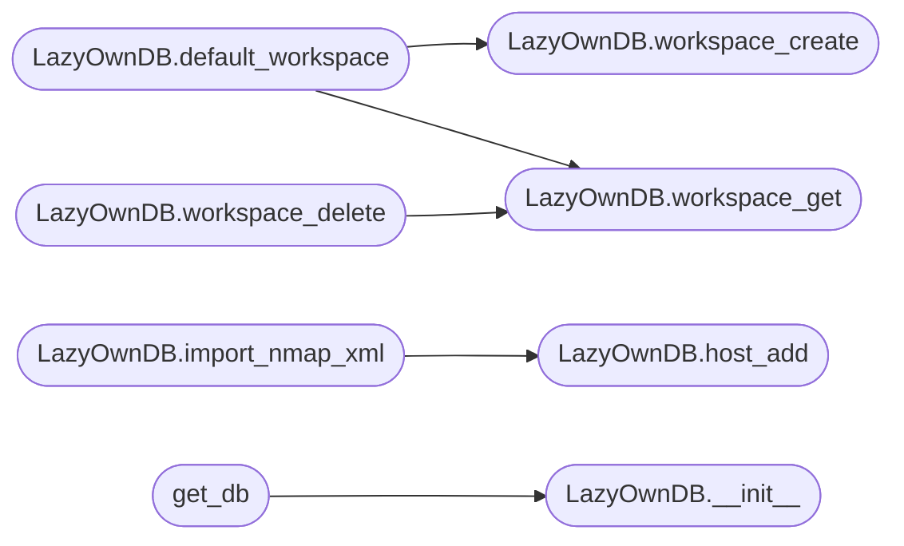

# `modules.db`

> Source: [modules/db.py:1](../../modules/db.py#L1) | language `py` | coverage 100.0% | [API index](../index.md)

SQLite database layer for LazyOwn -- hosts, services, vulns, loot, creds, notes.

Mirrors the Metasploit ``db_*`` workflow with workspace isolation,
nmap XML import, and queryable tables. Uses SQLite (zero deps) with
a ``sessions/db/`` storage directory under the active session dir.

## Contents

- **Classes:** [`LazyOwnDB`](#lazyowndb)
- **Functions:** [`get_db`](#get_db)
- **Constants:** [`MIGRATIONS`](#migrations)

## Call Graph

Solid arrows stay in this module, dashed arrows leave it.



## Classes

<a id="lazyowndb"></a>

### `LazyOwnDB`

`class` | [modules/db.py:147](../../modules/db.py#L147)

```python
class LazyOwnDB
```

SQLite database for LazyOwn campaign state.

Thread-safe per-connection (SQLite serialises writes). Not safe to
share a single [`LazyOwnDB`](#lazyowndb) instance across threads without
external locking; use one connection per thread instead.

**Parameters**

| Name | Type | Default | Description |
|---|---|---|---|
| `db_path` |  |  | Path to the SQLite file. Defaults to ``sessions/db/lazyown.db``. |

**Members**

| Member | Kind | Summary |
|---|---|---|
| [`__init__`](#lazyowndb-__init__) | constructor |  |
| [`db_path`](#lazyowndb-db_path) | property | Path to the SQLite database file. |
| [`migration_status`](#lazyowndb-migration_status) | method | Return the current and latest migration versions. |
| [`workspace_create`](#lazyowndb-workspace_create) | method | Create a new workspace. |
| [`workspace_list`](#lazyowndb-workspace_list) | method | Return all workspaces as dicts. |
| [`workspace_get`](#lazyowndb-workspace_get) | method | Get a workspace by name, or None. |
| [`default_workspace`](#lazyowndb-default_workspace) | method | Return the id of the named workspace, creating it when absent. |
| [`workspace_delete`](#lazyowndb-workspace_delete) | method | Delete a workspace and all its data. |
| [`host_add`](#lazyowndb-host_add) | method | Add or update a host. |
| [`host_delete`](#lazyowndb-host_delete) | method | Delete a host and its related data. |
| [`host_list`](#lazyowndb-host_list) | method | List all hosts in a workspace. |
| [`host_find`](#lazyowndb-host_find) | method | Search hosts by address, hostname, or os. |
| [`service_add`](#lazyowndb-service_add) | method | Add a service to a host. |
| [`service_list`](#lazyowndb-service_list) | method | List all services on a host. |
| [`vuln_add`](#lazyowndb-vuln_add) | method | Add a vulnerability to a host. |
| [`vuln_get`](#lazyowndb-vuln_get) | method | Return one vuln row with its host address, or None. |
| [`vuln_update`](#lazyowndb-vuln_update) | method | Update mutable vuln fields; returns True when a row changed. |
| [`vuln_list`](#lazyowndb-vuln_list) | method | List vulns in workspace, optionally filtered by severity. |
| [`cred_add`](#lazyowndb-cred_add) | method | Add a credential (password encrypted at rest). |
| [`cred_list`](#lazyowndb-cred_list) | method | List all creds in workspace (passwords decrypted). |
| [`loot_add`](#lazyowndb-loot_add) | method | Add a loot entry. |
| [`loot_list`](#lazyowndb-loot_list) | method | List all loot in workspace. |
| [`note_add`](#lazyowndb-note_add) | method | Add a note. |
| [`note_list`](#lazyowndb-note_list) | method | List all notes in workspace. |
| [`import_nmap_xml`](#lazyowndb-import_nmap_xml) | method | Import an Nmap XML file into the database. |
| [`export_csv`](#lazyowndb-export_csv) | method | Export a table to CSV string. |
| [`status`](#lazyowndb-status) | method | Return counts for every entity type in a workspace. |
| [`close`](#lazyowndb-close) | method | Close the database connection for the current thread. |

<a id="lazyowndb-__init__"></a>

#### `LazyOwnDB.__init__`

`constructor` | [modules/db.py:159](../../modules/db.py#L159)

```python
def __init__(self, db_path: str | None = None) -> None
```

**Parameters**

| Name | Type | Default | Description |
|---|---|---|---|
| `db_path` | `str \| None` | `None` | Path to the SQLite file. Defaults to ``sessions/db/lazyown.db``. |

*Called by:* [`CollaborationCommandSet.do_share_finding`](cli.commands.collaboration.py.md#collaborationcommandset-do_share_finding), [`DatabaseCommandSet.do_db_init`](cli.commands.database.py.md#databasecommandset-do_db_init), [`get_db`](#get_db), [`EstoridesToLazyOwnBridge.get_combined_surface`](modules.estorides_importer.py.md#estoridestolazyownbridge-get_combined_surface), [`extract_seeds_from_db`](modules.estorides_importer.py.md#extract_seeds_from_db), [`HashCracker.import_to_db`](modules.hash_cracker.py.md#hashcracker-import_to_db), [`NucleiParser.import_to_db`](modules.integrations.nuclei_parser.py.md#nucleiparser-import_to_db), [`StateManager.db`](modules.state_manager.py.md#statemanager-db)

<a id="lazyowndb-db_path"></a>

#### `LazyOwnDB.db_path`

`property` | [modules/db.py:182](../../modules/db.py#L182)

Decorators: `@property`

```python
def db_path(self) -> str
```

Path to the SQLite database file.

**Returns:** `str`

<a id="lazyowndb-migration_status"></a>

#### `LazyOwnDB.migration_status`

`method` | [modules/db.py:222](../../modules/db.py#L222)

```python
def migration_status(self) -> dict[str, Any]
```

Return the current and latest migration versions.

**Returns:** `dict[str, Any]` - Dict with keys `[`current`](cli.autosuggest.py.md#autosuggestengine-current)` (int), ``latest`` (int), and
``pending`` (list[int] of versions not yet applied).

<a id="lazyowndb-workspace_create"></a>

#### `LazyOwnDB.workspace_create`

`method` | [modules/db.py:292](../../modules/db.py#L292)

```python
def workspace_create(self, name: str, description: str = '') -> int
```

Create a new workspace.

Returns the workspace ID, or -1 if the name already exists.

**Parameters**

| Name | Type | Default | Description |
|---|---|---|---|
| `name` | `str` |  |  |
| `description` | `str` | `''` |  |

**Returns:** `int`

*Called by:* [`LazyOwnDB.default_workspace`](#lazyowndb-default_workspace), [`EstoridesToLazyOwnBridge.get_combined_surface`](modules.estorides_importer.py.md#estoridestolazyownbridge-get_combined_surface), [`HashCracker.import_to_db`](modules.hash_cracker.py.md#hashcracker-import_to_db), [`NucleiParser.import_to_db`](modules.integrations.nuclei_parser.py.md#nucleiparser-import_to_db)

<a id="lazyowndb-workspace_list"></a>

#### `LazyOwnDB.workspace_list`

`method` | [modules/db.py:307](../../modules/db.py#L307)

```python
def workspace_list(self) -> list[dict[str, Any]]
```

Return all workspaces as dicts.

**Returns:** `list[dict[str, Any]]`

<a id="lazyowndb-workspace_get"></a>

#### `LazyOwnDB.workspace_get`

`method` | [modules/db.py:313](../../modules/db.py#L313)

```python
def workspace_get(self, name: str) -> dict[str, Any] | None
```

Get a workspace by name, or None.

**Parameters**

| Name | Type | Default | Description |
|---|---|---|---|
| `name` | `str` |  |  |

**Returns:** `dict[str, Any] | None`

*Called by:* [`LazyOwnDB.default_workspace`](#lazyowndb-default_workspace), [`LazyOwnDB.workspace_delete`](#lazyowndb-workspace_delete), [`EstoridesToLazyOwnBridge.get_combined_surface`](modules.estorides_importer.py.md#estoridestolazyownbridge-get_combined_surface), [`extract_seeds_from_db`](modules.estorides_importer.py.md#extract_seeds_from_db), [`HashCracker.import_to_db`](modules.hash_cracker.py.md#hashcracker-import_to_db), [`NucleiParser.import_to_db`](modules.integrations.nuclei_parser.py.md#nucleiparser-import_to_db)

<a id="lazyowndb-default_workspace"></a>

#### `LazyOwnDB.default_workspace`

`method` | [modules/db.py:320](../../modules/db.py#L320)

```python
def default_workspace(self, name: str = 'default') -> int
```

Return the id of the named workspace, creating it when absent.

**Parameters**

| Name | Type | Default | Description |
|---|---|---|---|
| `name` | `str` | `'default'` | Workspace name. Defaults to ``"default"``. |

**Returns:** `int` - The workspace row id.

*Calls:* [`LazyOwnDB.workspace_create`](#lazyowndb-workspace_create), [`LazyOwnDB.workspace_get`](#lazyowndb-workspace_get)

<a id="lazyowndb-workspace_delete"></a>

#### `LazyOwnDB.workspace_delete`

`method` | [modules/db.py:333](../../modules/db.py#L333)

```python
def workspace_delete(self, name: str) -> bool
```

Delete a workspace and all its data.

Returns True if deleted.

**Parameters**

| Name | Type | Default | Description |
|---|---|---|---|
| `name` | `str` |  |  |

**Returns:** `bool`

*Calls:* [`LazyOwnDB.workspace_get`](#lazyowndb-workspace_get)

<a id="lazyowndb-host_add"></a>

#### `LazyOwnDB.host_add`

`method` | [modules/db.py:357](../../modules/db.py#L357)

```python
def host_add(self, workspace_id: int, address: str, mac: str = '', hostname: str = '', os: str = '', state: str = 'unknown', **kwargs: Any) -> int
```

Add or update a host.

Returns the host ID.

**Parameters**

| Name | Type | Default | Description |
|---|---|---|---|
| `workspace_id` | `int` |  |  |
| `address` | `str` |  |  |
| `mac` | `str` | `''` |  |
| `hostname` | `str` | `''` |  |
| `os` | `str` | `''` |  |
| `state` | `str` | `'unknown'` |  |
| `**kwargs` | `Any` |  |  |

**Returns:** `int`

*Called by:* [`LazyOwnDB.import_nmap_xml`](#lazyowndb-import_nmap_xml)

<a id="lazyowndb-host_delete"></a>

#### `LazyOwnDB.host_delete`

`method` | [modules/db.py:390](../../modules/db.py#L390)

```python
def host_delete(self, host_id: int) -> bool
```

Delete a host and its related data.

**Parameters**

| Name | Type | Default | Description |
|---|---|---|---|
| `host_id` | `int` |  |  |

**Returns:** `bool`

<a id="lazyowndb-host_list"></a>

#### `LazyOwnDB.host_list`

`method` | [modules/db.py:401](../../modules/db.py#L401)

```python
def host_list(self, workspace_id: int) -> list[dict[str, Any]]
```

List all hosts in a workspace.

**Parameters**

| Name | Type | Default | Description |
|---|---|---|---|
| `workspace_id` | `int` |  |  |

**Returns:** `list[dict[str, Any]]`

*Called by:* [`EstoridesToLazyOwnBridge.get_combined_surface`](modules.estorides_importer.py.md#estoridestolazyownbridge-get_combined_surface), [`extract_seeds_from_db`](modules.estorides_importer.py.md#extract_seeds_from_db)

<a id="lazyowndb-host_find"></a>

#### `LazyOwnDB.host_find`

`method` | [modules/db.py:410](../../modules/db.py#L410)

```python
def host_find(self, workspace_id: int, query: str) -> list[dict[str, Any]]
```

Search hosts by address, hostname, or os.

**Parameters**

| Name | Type | Default | Description |
|---|---|---|---|
| `workspace_id` | `int` |  |  |
| `query` | `str` |  |  |

**Returns:** `list[dict[str, Any]]`

<a id="lazyowndb-service_add"></a>

#### `LazyOwnDB.service_add`

`method` | [modules/db.py:427](../../modules/db.py#L427)

```python
def service_add(self, host_id: int, port: int, protocol: str = 'tcp', state: str = 'open', name: str = '', product: str = '', version: str = '', **kwargs: Any) -> int
```

Add a service to a host.

**Parameters**

| Name | Type | Default | Description |
|---|---|---|---|
| `host_id` | `int` |  |  |
| `port` | `int` |  |  |
| `protocol` | `str` | `'tcp'` |  |
| `state` | `str` | `'open'` |  |
| `name` | `str` | `''` |  |
| `product` | `str` | `''` |  |
| `version` | `str` | `''` |  |
| `**kwargs` | `Any` |  |  |

**Returns:** `int`

<a id="lazyowndb-service_list"></a>

#### `LazyOwnDB.service_list`

`method` | [modules/db.py:447](../../modules/db.py#L447)

```python
def service_list(self, host_id: int) -> list[dict[str, Any]]
```

List all services on a host.

**Parameters**

| Name | Type | Default | Description |
|---|---|---|---|
| `host_id` | `int` |  |  |

**Returns:** `list[dict[str, Any]]`

<a id="lazyowndb-vuln_add"></a>

#### `LazyOwnDB.vuln_add`

`method` | [modules/db.py:460](../../modules/db.py#L460)

```python
def vuln_add(self, host_id: int, name: str, severity: str = 'unknown', description: str = '', refs: str = '', **kwargs: Any) -> int
```

Add a vulnerability to a host.

**Parameters**

| Name | Type | Default | Description |
|---|---|---|---|
| `host_id` | `int` |  |  |
| `name` | `str` |  |  |
| `severity` | `str` | `'unknown'` |  |
| `description` | `str` | `''` |  |
| `refs` | `str` | `''` |  |
| `**kwargs` | `Any` |  |  |

**Returns:** `int`

*Called by:* [`NucleiParser.import_to_db`](modules.integrations.nuclei_parser.py.md#nucleiparser-import_to_db)

<a id="lazyowndb-vuln_get"></a>

#### `LazyOwnDB.vuln_get`

`method` | [modules/db.py:478](../../modules/db.py#L478)

```python
def vuln_get(self, vuln_id: int) -> dict[str, Any] | None
```

Return one vuln row with its host address, or None.

**Parameters**

| Name | Type | Default | Description |
|---|---|---|---|
| `vuln_id` | `int` |  |  |

**Returns:** `dict[str, Any] | None`

<a id="lazyowndb-vuln_update"></a>

#### `LazyOwnDB.vuln_update`

`method` | [modules/db.py:490](../../modules/db.py#L490)

```python
def vuln_update(self, vuln_id: int, refs: str | None = None, severity: str | None = None, description: str | None = None) -> bool
```

Update mutable vuln fields; returns True when a row changed.

**Parameters**

| Name | Type | Default | Description |
|---|---|---|---|
| `vuln_id` | `int` |  | Vuln row id. |
| `refs` | `str \| None` | `None` | Replacement refs string (status/evidence markers). |
| `severity` | `str \| None` | `None` | Replacement severity label. |
| `description` | `str \| None` | `None` | Replacement description text. |

**Returns:** `bool` - True when the row existed and was updated.

<a id="lazyowndb-vuln_list"></a>

#### `LazyOwnDB.vuln_list`

`method` | [modules/db.py:528](../../modules/db.py#L528)

```python
def vuln_list(self, workspace_id: int, severity: str | None = None) -> list[dict[str, Any]]
```

List vulns in workspace, optionally filtered by severity.

**Parameters**

| Name | Type | Default | Description |
|---|---|---|---|
| `workspace_id` | `int` |  |  |
| `severity` | `str \| None` | `None` |  |

**Returns:** `list[dict[str, Any]]`

<a id="lazyowndb-cred_add"></a>

#### `LazyOwnDB.cred_add`

`method` | [modules/db.py:557](../../modules/db.py#L557)

```python
def cred_add(self, host_id: int, username: str = '', password: str = '', realm: str = '', cred_type: str = 'password', origin: str = 'manual', **kwargs: Any) -> int
```

Add a credential (password encrypted at rest).

**Parameters**

| Name | Type | Default | Description |
|---|---|---|---|
| `host_id` | `int` |  |  |
| `username` | `str` | `''` |  |
| `password` | `str` | `''` |  |
| `realm` | `str` | `''` |  |
| `cred_type` | `str` | `'password'` |  |
| `origin` | `str` | `'manual'` |  |
| `**kwargs` | `Any` |  |  |

**Returns:** `int`

*Called by:* [`HashCracker.import_to_db`](modules.hash_cracker.py.md#hashcracker-import_to_db)

<a id="lazyowndb-cred_list"></a>

#### `LazyOwnDB.cred_list`

`method` | [modules/db.py:577](../../modules/db.py#L577)

```python
def cred_list(self, workspace_id: int) -> list[dict[str, Any]]
```

List all creds in workspace (passwords decrypted).

**Parameters**

| Name | Type | Default | Description |
|---|---|---|---|
| `workspace_id` | `int` |  |  |

**Returns:** `list[dict[str, Any]]`

<a id="lazyowndb-loot_add"></a>

#### `LazyOwnDB.loot_add`

`method` | [modules/db.py:596](../../modules/db.py#L596)

```python
def loot_add(self, workspace_id: int, name: str, loot_type: str = 'file', path: str = '', notes: str = '', host_id: int | None = None, **kwargs: Any) -> int
```

Add a loot entry.

**Parameters**

| Name | Type | Default | Description |
|---|---|---|---|
| `workspace_id` | `int` |  |  |
| `name` | `str` |  |  |
| `loot_type` | `str` | `'file'` |  |
| `path` | `str` | `''` |  |
| `notes` | `str` | `''` |  |
| `host_id` | `int \| None` | `None` |  |
| `**kwargs` | `Any` |  |  |

**Returns:** `int`

<a id="lazyowndb-loot_list"></a>

#### `LazyOwnDB.loot_list`

`method` | [modules/db.py:615](../../modules/db.py#L615)

```python
def loot_list(self, workspace_id: int) -> list[dict[str, Any]]
```

List all loot in workspace.

**Parameters**

| Name | Type | Default | Description |
|---|---|---|---|
| `workspace_id` | `int` |  |  |

**Returns:** `list[dict[str, Any]]`

<a id="lazyowndb-note_add"></a>

#### `LazyOwnDB.note_add`

`method` | [modules/db.py:631](../../modules/db.py#L631)

```python
def note_add(self, workspace_id: int, data: str, note_type: str = 'general', host_id: int | None = None, **kwargs: Any) -> int
```

Add a note.

**Parameters**

| Name | Type | Default | Description |
|---|---|---|---|
| `workspace_id` | `int` |  |  |
| `data` | `str` |  |  |
| `note_type` | `str` | `'general'` |  |
| `host_id` | `int \| None` | `None` |  |
| `**kwargs` | `Any` |  |  |

**Returns:** `int`

*Called by:* [`CollaborationCommandSet.do_share_finding`](cli.commands.collaboration.py.md#collaborationcommandset-do_share_finding)

<a id="lazyowndb-note_list"></a>

#### `LazyOwnDB.note_list`

`method` | [modules/db.py:648](../../modules/db.py#L648)

```python
def note_list(self, workspace_id: int) -> list[dict[str, Any]]
```

List all notes in workspace.

**Parameters**

| Name | Type | Default | Description |
|---|---|---|---|
| `workspace_id` | `int` |  |  |

**Returns:** `list[dict[str, Any]]`

<a id="lazyowndb-import_nmap_xml"></a>

#### `LazyOwnDB.import_nmap_xml`

`method` | [modules/db.py:664](../../modules/db.py#L664)

```python
def import_nmap_xml(self, workspace_id: int, xml_path: str) -> dict[str, int]
```

Import an Nmap XML file into the database.

Returns a dict with counts of imported hosts, services, and os
fingerprints.

**Parameters**

| Name | Type | Default | Description |
|---|---|---|---|
| `workspace_id` | `int` |  |  |
| `xml_path` | `str` |  |  |

**Returns:** `dict[str, int]`

*Calls:* [`LazyOwnDB.host_add`](#lazyowndb-host_add)

<a id="lazyowndb-export_csv"></a>

#### `LazyOwnDB.export_csv`

`method` | [modules/db.py:740](../../modules/db.py#L740)

```python
def export_csv(self, table: str, workspace_id: int | None = None) -> str
```

Export a table to CSV string.

**Parameters**

| Name | Type | Default | Description |
|---|---|---|---|
| `table` | `str` |  | One of `[`hosts`](modules.state_manager.py.md#sessionsnapshot-hosts)`, ``services``, `[`vulns`](skills.toposwarm_autonomous.py.md#penteststate-vulns)`, `[`creds`](cli.session_hud.py.md#hudsnapshot-creds)`, ``loot``, ``notes``. |
| `workspace_id` | `int \| None` | `None` | Filter by workspace (required for workspace- scoped tables). If None, exports all data. |

**Returns:** `str` - CSV-formatted string with header row.

**Raises**

- `ValueError`: If table is not in the allowed set.

<a id="lazyowndb-status"></a>

#### `LazyOwnDB.status`

`method` | [modules/db.py:775](../../modules/db.py#L775)

```python
def status(self, workspace_id: int) -> dict[str, int]
```

Return counts for every entity type in a workspace.

**Parameters**

| Name | Type | Default | Description |
|---|---|---|---|
| `workspace_id` | `int` |  |  |

**Returns:** `dict[str, int]`

<a id="lazyowndb-close"></a>

#### `LazyOwnDB.close`

`method` | [modules/db.py:804](../../modules/db.py#L804)

```python
def close(self) -> None
```

Close the database connection for the current thread.

Idempotent — safe to call multiple times.

*Called by:* [`StateManager.close`](modules.state_manager.py.md#statemanager-close)

---

## Functions

<a id="get_db"></a>

### `get_db`

`function` | [modules/db.py:821](../../modules/db.py#L821)

```python
def get_db(db_path: str | None = None) -> LazyOwnDB
```

Get or create a [`LazyOwnDB`](#lazyowndb) instance.

This is a convenience factory. The caller is responsible for calling
[`LazyOwnDB.close`](#lazyowndb-close) when done.

**Parameters**

| Name | Type | Default | Description |
|---|---|---|---|
| `db_path` | `str \| None` | `None` | Optional path to the SQLite file. |

**Returns:** `LazyOwnDB` - A new [`LazyOwnDB`](#lazyowndb) instance.

*Calls:* [`LazyOwnDB.__init__`](#lazyowndb-__init__)

*Called by:* [`apply`](modules.sinks.campaign_db.py.md#apply), [`check_calls`](scripts.devtools.core_smoke.py.md#check_calls)

---

## Constants

<a id="migrations"></a>

### `MIGRATIONS`

`constant` | [modules/db.py:119](../../modules/db.py#L119)

```python
MIGRATIONS: list[tuple[int, str]]
```

---
