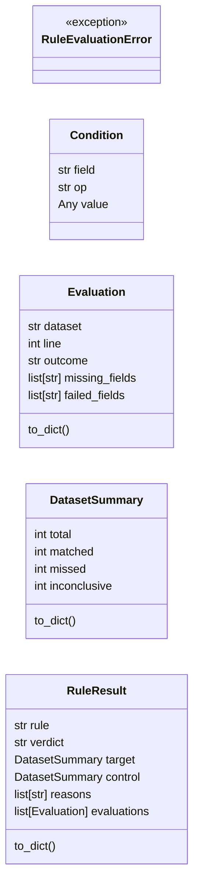
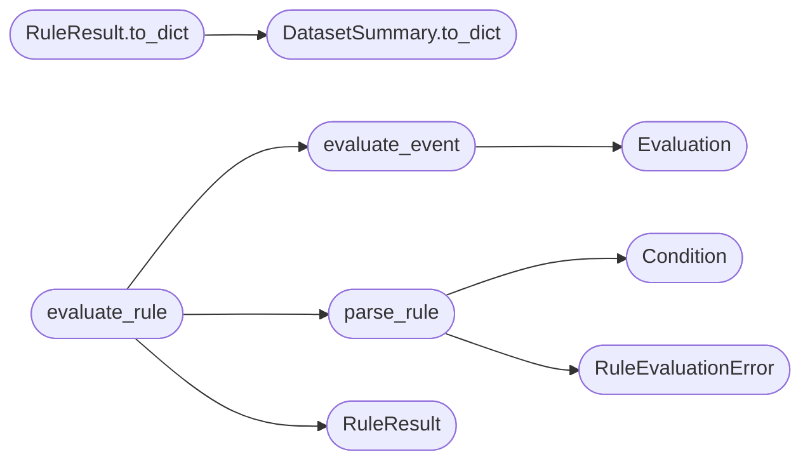

# `modules.defense_eval`

> Source: [modules/defense_eval.py:1](../../modules/defense_eval.py#L1) | language `py` | coverage 100.0% | [API index](../index.md)

Detection rule replay over recorded attack and control logs.

Pure log replay: a deliberately small rule language (JSON, ``eq`` /
``neq`` / ``contains`` conditions) is evaluated against two datasets.
The `[`target`](#ruleresult-target)` dataset holds attack traffic; the `[`control`](#ruleresult-control)` dataset
holds benign traffic. A rule only passes when every target event
matches, no control event matches, and no referenced field was absent
or of an incompatible type. Nothing here touches the network, executes
commands or deploys rules to a SIEM.

Adapted from the ARTEX ``defenseeval`` engine (AGPL-3.0), which is in
turn inspired by the original ARTEX project.

## Contents

- **Classes:** [`Condition`](#condition), [`Evaluation`](#evaluation), [`DatasetSummary`](#datasetsummary), [`RuleResult`](#ruleresult)
- **Exceptions:** [`RuleEvaluationError`](#ruleevaluationerror)
- **Functions:** [`parse_rule`](#parse_rule), [`evaluate_event`](#evaluate_event), [`evaluate_rule`](#evaluate_rule), [`metrics`](#metrics)
- **Constants:** [`ENGINE_VERSION`](#engine_version), [`MAX_EVENTS`](#max_events), [`MAX_CONDITIONS`](#max_conditions), [`VERDICT_PASS`](#verdict_pass), [`VERDICT_FAIL`](#verdict_fail), [`VERDICT_INCONCLUSIVE`](#verdict_inconclusive)

## Type Diagram



## Call Graph

Solid arrows stay in this module, dashed arrows leave it.



## Classes

<a id="condition"></a>

### `Condition`

`class` `dataclass` | [modules/defense_eval.py:44](../../modules/defense_eval.py#L44)

Decorators: `@dataclass`

```python
class Condition
```

One rule condition: field, operator and expected value.

**Attributes**

| Name | Type | Default | Description |
|---|---|---|---|
| [`field`](#condition-field) | `str` |  |  |
| [`op`](#condition-op) | `str` |  |  |
| [`value`](#condition-value) | `Any` |  |  |

---

<a id="evaluation"></a>

### `Evaluation`

`class` `dataclass` | [modules/defense_eval.py:53](../../modules/defense_eval.py#L53)

Decorators: `@dataclass`

```python
class Evaluation
```

Outcome of applying the rule to one event.

**Attributes**

| Name | Type | Default | Description |
|---|---|---|---|
| [`dataset`](#evaluation-dataset) | `str` |  |  |
| [`line`](#evaluation-line) | `int` |  |  |
| [`outcome`](#evaluation-outcome) | `str` |  |  |
| [`missing_fields`](#evaluation-missing_fields) | `list[str]` | `field(default_factory=list)` |  |
| [`failed_fields`](#evaluation-failed_fields) | `list[str]` | `field(default_factory=list)` |  |

**Members**

| Member | Kind | Summary |
|---|---|---|
| [`to_dict`](#evaluation-to_dict) | method | Return a JSON-serializable view. |

<a id="evaluation-to_dict"></a>

#### `Evaluation.to_dict`

`method` | [modules/defense_eval.py:62](../../modules/defense_eval.py#L62)

```python
def to_dict(self) -> dict[str, Any]
```

Return a JSON-serializable view.

**Returns:** `dict[str, Any]`

---

<a id="datasetsummary"></a>

### `DatasetSummary`

`class` `dataclass` | [modules/defense_eval.py:74](../../modules/defense_eval.py#L74)

Decorators: `@dataclass`

```python
class DatasetSummary
```

Per-dataset match counts.

**Attributes**

| Name | Type | Default | Description |
|---|---|---|---|
| [`total`](#datasetsummary-total) | `int` | `0` |  |
| [`matched`](#datasetsummary-matched) | `int` | `0` |  |
| [`missed`](#datasetsummary-missed) | `int` | `0` |  |
| [`inconclusive`](#datasetsummary-inconclusive) | `int` | `0` |  |

**Members**

| Member | Kind | Summary |
|---|---|---|
| [`to_dict`](#datasetsummary-to_dict) | method | Return a JSON-serializable view. |

<a id="datasetsummary-to_dict"></a>

#### `DatasetSummary.to_dict`

`method` | [modules/defense_eval.py:82](../../modules/defense_eval.py#L82)

```python
def to_dict(self) -> dict[str, Any]
```

Return a JSON-serializable view.

**Returns:** `dict[str, Any]`

*Called by:* [`RuleResult.to_dict`](#ruleresult-to_dict)

---

<a id="ruleresult"></a>

### `RuleResult`

`class` `dataclass` | [modules/defense_eval.py:93](../../modules/defense_eval.py#L93)

Decorators: `@dataclass`

```python
class RuleResult
```

Verdict of one rule replay across target and control datasets.

**Attributes**

| Name | Type | Default | Description |
|---|---|---|---|
| [`rule`](#ruleresult-rule) | `str` | `''` |  |
| [`verdict`](#ruleresult-verdict) | `str` | `VERDICT_INCONCLUSIVE` |  |
| [`target`](#ruleresult-target) | `DatasetSummary` | `field(default_factory=DatasetSummary)` |  |
| [`control`](#ruleresult-control) | `DatasetSummary` | `field(default_factory=DatasetSummary)` |  |
| [`reasons`](#ruleresult-reasons) | `list[str]` | `field(default_factory=list)` |  |
| [`evaluations`](#ruleresult-evaluations) | `list[Evaluation]` | `field(default_factory=list)` |  |

**Members**

| Member | Kind | Summary |
|---|---|---|
| [`to_dict`](#ruleresult-to_dict) | method | Return a JSON-serializable view. |

<a id="ruleresult-to_dict"></a>

#### `RuleResult.to_dict`

`method` | [modules/defense_eval.py:103](../../modules/defense_eval.py#L103)

```python
def to_dict(self) -> dict[str, Any]
```

Return a JSON-serializable view.

**Returns:** `dict[str, Any]`

*Calls:* [`DatasetSummary.to_dict`](#datasetsummary-to_dict)

---

## Exceptions

<a id="ruleevaluationerror"></a>

### `RuleEvaluationError`

`exception` | [modules/defense_eval.py:39](../../modules/defense_eval.py#L39)

```python
class RuleEvaluationError(ValueError)
```

Bases: `ValueError`

Raised when rule text or log data is invalid or oversized.

---

## Functions

<a id="parse_rule"></a>

### `parse_rule`

`function` | [modules/defense_eval.py:115](../../modules/defense_eval.py#L115)

```python
def parse_rule(rule_text: str) -> list[Condition]
```

Parse the rule JSON document into a condition list.

**Parameters**

| Name | Type | Default | Description |
|---|---|---|---|
| `rule_text` | `str` |  | JSON document ``{"version": 1, "all": [...]}``. |

**Returns:** `list[Condition]` - The ordered condition list.

**Raises**

- [`RuleEvaluationError`](#ruleevaluationerror): Malformed, oversized or unsupported rule.

*Calls:* [`Condition`](#condition), [`RuleEvaluationError`](#ruleevaluationerror)

*Called by:* [`evaluate_rule`](#evaluate_rule)

---

<a id="evaluate_event"></a>

### `evaluate_event`

`function` | [modules/defense_eval.py:234](../../modules/defense_eval.py#L234)

```python
def evaluate_event(conditions: list[Condition], fields: dict[str, Any]) -> Evaluation
```

Apply every condition to one event.

**Parameters**

| Name | Type | Default | Description |
|---|---|---|---|
| `conditions` | `list[Condition]` |  | Parsed rule conditions. |
| `fields` | `dict[str, Any]` |  | Normalized event field mapping. |

**Returns:** `Evaluation` - An [`Evaluation`](#evaluation) for the event.

*Calls:* [`Evaluation`](#evaluation)

*Called by:* [`evaluate_rule`](#evaluate_rule)

---

<a id="evaluate_rule"></a>

### `evaluate_rule`

`function` | [modules/defense_eval.py:322](../../modules/defense_eval.py#L322)

```python
def evaluate_rule(rule_text: str, target_logs: str, control_logs: str) -> RuleResult
```

Replay one rule against target and control datasets.

A pass requires nonempty target and control sets, every target event
matching, no control event matching and no unevaluable referenced
field. This is log replay only: it never proves detection quality in
a live SIEM.

**Parameters**

| Name | Type | Default | Description |
|---|---|---|---|
| `rule_text` | `str` |  | The JSON rule document. |
| `target_logs` | `str` |  | Attack dataset (JSON array or JSON lines). |
| `control_logs` | `str` |  | Benign dataset (JSON array or JSON lines). |

**Returns:** `RuleResult` - A [`RuleResult`](#ruleresult) with verdict, summaries and evaluations.

**Raises**

- [`RuleEvaluationError`](#ruleevaluationerror): Invalid rule or unparsable datasets.

*Calls:* [`RuleResult`](#ruleresult), [`evaluate_event`](#evaluate_event), [`parse_rule`](#parse_rule)

*Called by:* [`compare_rules`](modules.closedloop.py.md#compare_rules), [`run_defense_validate`](modules.defense_stages.py.md#run_defense_validate)

---

<a id="metrics"></a>

### `metrics`

`function` | [modules/defense_eval.py:380](../../modules/defense_eval.py#L380)

```python
def metrics(result: RuleResult) -> dict[str, int]
```

Return tp/fn/fp/tn metrics for one replay result.

**Parameters**

| Name | Type | Default | Description |
|---|---|---|---|
| `result` | `RuleResult` |  | A replay result from [`evaluate_rule`](#evaluate_rule). |

**Returns:** `dict[str, int]` - Mapping with `[`tp`](modules.closedloop.py.md#rulemetrics-tp)` (target matches), `[`fn`](modules.closedloop.py.md#rulemetrics-fn)` (target misses),
`[`fp`](modules.closedloop.py.md#rulemetrics-fp)` (control matches) and `[`tn`](modules.closedloop.py.md#rulemetrics-tn)` (control misses).

---

## Constants

<a id="engine_version"></a>

### `ENGINE_VERSION`

`constant` | [modules/defense_eval.py:22](../../modules/defense_eval.py#L22)

```python
ENGINE_VERSION = 'lazyown-defense-eval/v1'
```

---

<a id="max_events"></a>

### `MAX_EVENTS`

`constant` | [modules/defense_eval.py:25](../../modules/defense_eval.py#L25)

```python
MAX_EVENTS = 2000
```

---

<a id="max_conditions"></a>

### `MAX_CONDITIONS`

`constant` | [modules/defense_eval.py:27](../../modules/defense_eval.py#L27)

```python
MAX_CONDITIONS = 16
```

---

<a id="verdict_pass"></a>

### `VERDICT_PASS`

`constant` | [modules/defense_eval.py:32](../../modules/defense_eval.py#L32)

```python
VERDICT_PASS = 'pass'
```

---

<a id="verdict_fail"></a>

### `VERDICT_FAIL`

`constant` | [modules/defense_eval.py:33](../../modules/defense_eval.py#L33)

```python
VERDICT_FAIL = 'fail'
```

---

<a id="verdict_inconclusive"></a>

### `VERDICT_INCONCLUSIVE`

`constant` | [modules/defense_eval.py:34](../../modules/defense_eval.py#L34)

```python
VERDICT_INCONCLUSIVE = 'inconclusive'
```

---
