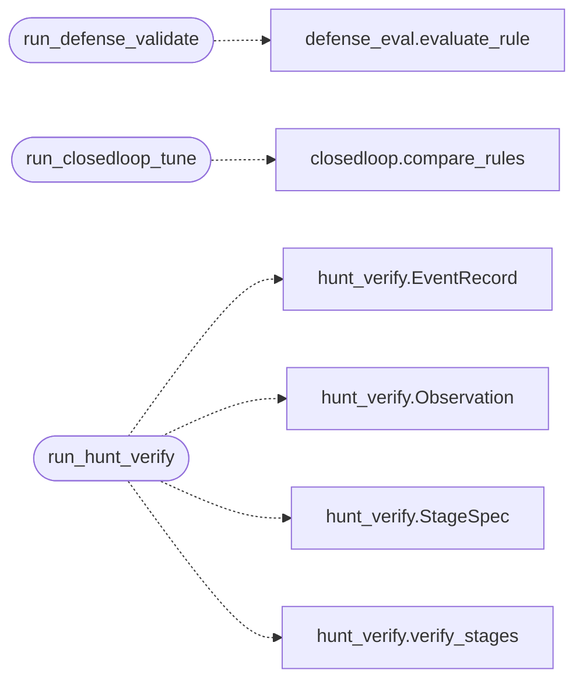

# `modules.defense_stages`

> Source: [modules/defense_stages.py:1](../../modules/defense_stages.py#L1) | language `py` | coverage 100.0% | [API index](../index.md)

Orchestrator stage runners for defense validation and hunt verification.

Each runner is one pipeline stage managed by
[`modules.orchestrator_config`](modules.orchestrator_config.py.md) (toggles, params, profiles) and
executed by the autonomous loop on terminal status. File-driven: stage
params in ``config/orchestrator.yaml`` or ``payload.json`` declare the
rule, dataset and output paths, with ``{task}`` replaced by the task id.
A missing configuration never aborts the loop; the stage records a skip
in the activity log instead.

## Contents

- **Functions:** [`run_defense_validate`](#run_defense_validate), [`run_closedloop_tune`](#run_closedloop_tune), [`run_hunt_verify`](#run_hunt_verify)
- **Constants:** [`STAGE_DEFENSE`](#stage_defense), [`STAGE_CLOSEDLOOP`](#stage_closedloop), [`STAGE_HUNT`](#stage_hunt)

## Call Graph

Solid arrows stay in this module, dashed arrows leave it.



## Functions

<a id="run_defense_validate"></a>

### `run_defense_validate`

`function` | [modules/defense_stages.py:82](../../modules/defense_stages.py#L82)

```python
def run_defense_validate(task_id: str) -> dict[str, Any]
```

Replay the configured detection rule over attack and control logs.

**Parameters**

| Name | Type | Default | Description |
|---|---|---|---|
| `task_id` | `str` |  | Active loop task id (``{task}`` in paths). |

**Returns:** `dict[str, Any]` - The persisted result mapping (empty when nothing configured).

*Calls:* [`evaluate_rule`](modules.defense_eval.py.md#evaluate_rule)

---

<a id="run_closedloop_tune"></a>

### `run_closedloop_tune`

`function` | [modules/defense_stages.py:117](../../modules/defense_stages.py#L117)

```python
def run_closedloop_tune(task_id: str) -> dict[str, Any]
```

Compare baseline vs candidate detection rules with suggestions.

**Parameters**

| Name | Type | Default | Description |
|---|---|---|---|
| `task_id` | `str` |  | Active loop task id (``{task}`` in paths). |

**Returns:** `dict[str, Any]` - The persisted comparison mapping (empty when not configured).

*Calls:* [`compare_rules`](modules.closedloop.py.md#compare_rules)

---

<a id="run_hunt_verify"></a>

### `run_hunt_verify`

`function` | [modules/defense_stages.py:151](../../modules/defense_stages.py#L151)

```python
def run_hunt_verify(task_id: str) -> dict[str, Any]
```

Verify hunting observations against retained evidence per stage.

**Parameters**

| Name | Type | Default | Description |
|---|---|---|---|
| `task_id` | `str` |  | Active loop task id (``{task}`` in paths). |

**Returns:** `dict[str, Any]` - The persisted verification mapping (empty when not configured).

*Calls:* [`EventRecord`](modules.hunt_verify.py.md#eventrecord), [`Observation`](modules.hunt_verify.py.md#observation), [`StageSpec`](modules.hunt_verify.py.md#stagespec), [`verify_stages`](modules.hunt_verify.py.md#verify_stages)

---

## Constants

<a id="stage_defense"></a>

### `STAGE_DEFENSE`

`constant` | [modules/defense_stages.py:23](../../modules/defense_stages.py#L23)

```python
STAGE_DEFENSE = 'defense_validate'
```

---

<a id="stage_closedloop"></a>

### `STAGE_CLOSEDLOOP`

`constant` | [modules/defense_stages.py:24](../../modules/defense_stages.py#L24)

```python
STAGE_CLOSEDLOOP = 'closedloop_tune'
```

---

<a id="stage_hunt"></a>

### `STAGE_HUNT`

`constant` | [modules/defense_stages.py:25](../../modules/defense_stages.py#L25)

```python
STAGE_HUNT = 'hunt_verify'
```

---
