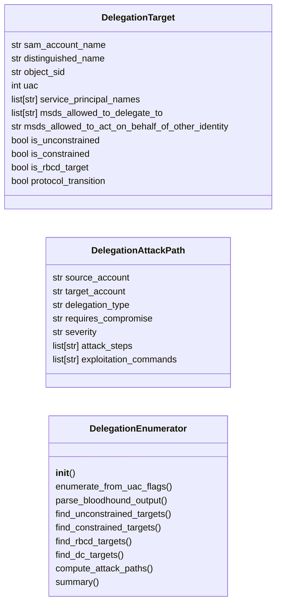
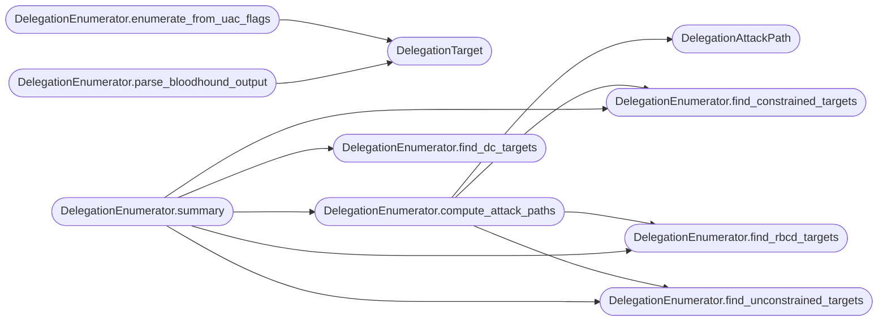

# `modules.delegation_attacks`

> Source: [modules/delegation_attacks.py:1](../../modules/delegation_attacks.py#L1) | language `py` | coverage 92.3% | [API index](../index.md)

Active Directory delegation enumeration and abuse.

Enumerates and exploits Kerberos delegation configurations: unconstrained
delegation, constrained delegation (with/without protocol transition), and
resource-based constrained delegation (RBCD).

Each delegation type allows attackers to impersonate users to services,
escalating from standard domain user to domain admin through misconfigured
delegation trusts.

## Contents

- **Classes:** [`DelegationTarget`](#delegationtarget), [`DelegationAttackPath`](#delegationattackpath), [`DelegationEnumerator`](#delegationenumerator)
- **Constants:** [`DELEGATION_FLAGS`](#delegation_flags), [`UAC_TRUSTED_FOR_DELEGATION`](#uac_trusted_for_delegation), [`UAC_TRUSTED_TO_AUTH_FOR_DELEGATION`](#uac_trusted_to_auth_for_delegation), [`UAC_WORKSTATION_TRUST_ACCOUNT`](#uac_workstation_trust_account), [`UAC_SERVER_TRUST_ACCOUNT`](#uac_server_trust_account)

## Type Diagram



## Call Graph

Solid arrows stay in this module, dashed arrows leave it.



## Classes

<a id="delegationtarget"></a>

### `DelegationTarget`

`class` `dataclass` | [modules/delegation_attacks.py:32](../../modules/delegation_attacks.py#L32)

Decorators: `@dataclass`

```python
class DelegationTarget
```

A delegation-enabled account or computer.

**Attributes**

| Name | Type | Default | Description |
|---|---|---|---|
| [`sam_account_name`](#delegationtarget-sam_account_name) | `str` | `''` | sAMAccountName. |
| [`distinguished_name`](#delegationtarget-distinguished_name) | `str` | `''` | DN in AD. |
| [`object_sid`](#delegationtarget-object_sid) | `str` | `''` | Security identifier. |
| [`uac`](#delegationtarget-uac) | `int` | `0` | userAccountControl flags integer. |
| [`service_principal_names`](#delegationtarget-service_principal_names) | `list[str]` | `field(default_factory=list)` | List of SPNs. |
| [`msds_allowed_to_delegate_to`](#delegationtarget-msds_allowed_to_delegate_to) | `list[str]` | `field(default_factory=list)` | Constrained delegation targets. |
| [`msds_allowed_to_act_on_behalf_of_other_identity`](#delegationtarget-msds_allowed_to_act_on_behalf_of_other_identity) | `str` | `''` | RBCD SID. |
| [`is_unconstrained`](#delegationtarget-is_unconstrained) | `bool` | `False` | Has TRUSTED_FOR_DELEGATION flag. |
| [`is_constrained`](#delegationtarget-is_constrained) | `bool` | `False` | Has msDS-AllowedToDelegateTo entries. |
| [`is_rbcd_target`](#delegationtarget-is_rbcd_target) | `bool` | `False` | Has msDS-AllowedToActOnBehalfOfOtherIdentity set. |
| [`protocol_transition`](#delegationtarget-protocol_transition) | `bool` | `False` | Has TRUSTED_TO_AUTH_FOR_DELEGATION. |

---

<a id="delegationattackpath"></a>

### `DelegationAttackPath`

`class` `dataclass` | [modules/delegation_attacks.py:63](../../modules/delegation_attacks.py#L63)

Decorators: `@dataclass`

```python
class DelegationAttackPath
```

A delegation-based attack path from source to target.

**Attributes**

| Name | Type | Default | Description |
|---|---|---|---|
| [`source_account`](#delegationattackpath-source_account) | `str` | `''` | Account that can delegate. |
| [`target_account`](#delegationattackpath-target_account) | `str` | `''` | Account being delegated to. |
| [`delegation_type`](#delegationattackpath-delegation_type) | `str` | `''` | unconstrained, constrained, or rbcd. |
| [`requires_compromise`](#delegationattackpath-requires_compromise) | `str` | `''` | What needs to be compromised first. |
| [`severity`](#delegationattackpath-severity) | `str` | `'medium'` | critical, high, medium, low. |
| [`attack_steps`](#delegationattackpath-attack_steps) | `list[str]` | `field(default_factory=list)` | Ordered list of attack step descriptions. |
| [`exploitation_commands`](#delegationattackpath-exploitation_commands) | `list[str]` | `field(default_factory=list)` | Shell commands to execute the attack. |

---

<a id="delegationenumerator"></a>

### `DelegationEnumerator`

`class` | [modules/delegation_attacks.py:85](../../modules/delegation_attacks.py#L85)

```python
class DelegationEnumerator
```

Enumerate Kerberos delegation configurations from Active Directory.

Parses LDAP output, BloodHound data, or raw AD attributes to identify
unconstrained delegation, constrained delegation, and RBCD targets.

**Members**

| Member | Kind | Summary |
|---|---|---|
| [`__init__`](#delegationenumerator-__init__) | constructor |  |
| [`enumerate_from_uac_flags`](#delegationenumerator-enumerate_from_uac_flags) | method | Enumerate delegation targets from parsed account data. |
| [`parse_bloodhound_output`](#delegationenumerator-parse_bloodhound_output) | method | Parse BloodHound JSON output for delegation data. |
| [`find_unconstrained_targets`](#delegationenumerator-find_unconstrained_targets) | method | Return all accounts with unconstrained delegation enabled. |
| [`find_constrained_targets`](#delegationenumerator-find_constrained_targets) | method | Return all accounts with constrained delegation configured. |
| [`find_rbcd_targets`](#delegationenumerator-find_rbcd_targets) | method | Return all accounts with RBCD configured. |
| [`find_dc_targets`](#delegationenumerator-find_dc_targets) | method | Return domain controllers with delegation configured. |
| [`compute_attack_paths`](#delegationenumerator-compute_attack_paths) | method | Compute delegation-based attack paths. |
| [`summary`](#delegationenumerator-summary) | method | Return a summary of all delegation findings. |

<a id="delegationenumerator-__init__"></a>

#### `DelegationEnumerator.__init__`

`constructor` | [modules/delegation_attacks.py:98](../../modules/delegation_attacks.py#L98)

```python
def __init__(self, domain: str = '', raw_ldap_output: str = '')
```

**Parameters**

| Name | Type | Default | Description |
|---|---|---|---|
| `domain` | `str` | `''` |  |
| `raw_ldap_output` | `str` | `''` |  |

*Called by:* [`ActiveDirectoryCommandSet.do_delegation_attack`](cli.commands.active_directory.py.md#activedirectorycommandset-do_delegation_attack), [`ActiveDirectoryCommandSet.do_delegation_enum`](cli.commands.active_directory.py.md#activedirectorycommandset-do_delegation_enum)

<a id="delegationenumerator-enumerate_from_uac_flags"></a>

#### `DelegationEnumerator.enumerate_from_uac_flags`

`method` | [modules/delegation_attacks.py:104](../../modules/delegation_attacks.py#L104)

```python
def enumerate_from_uac_flags(self, accounts: list[dict[str, Any]]) -> list[DelegationTarget]
```

Enumerate delegation targets from parsed account data.

**Parameters**

| Name | Type | Default | Description |
|---|---|---|---|
| `accounts` | `list[dict[str, Any]]` |  | List of dicts with samaccountname, useraccountcontrol, serviceprincipalname, msds-allowedtodelegateto. |

**Returns:** `list[DelegationTarget]` - List of DelegationTarget objects.

*Calls:* [`DelegationTarget`](#delegationtarget)

<a id="delegationenumerator-parse_bloodhound_output"></a>

#### `DelegationEnumerator.parse_bloodhound_output`

`method` | [modules/delegation_attacks.py:151](../../modules/delegation_attacks.py#L151)

```python
def parse_bloodhound_output(self, bloodhound_json: list[dict[str, Any]]) -> list[DelegationTarget]
```

Parse BloodHound JSON output for delegation data.

**Parameters**

| Name | Type | Default | Description |
|---|---|---|---|
| `bloodhound_json` | `list[dict[str, Any]]` |  | List of BloodHound node/edge dicts. |

**Returns:** `list[DelegationTarget]` - List of DelegationTarget objects.

*Calls:* [`DelegationTarget`](#delegationtarget)

<a id="delegationenumerator-find_unconstrained_targets"></a>

#### `DelegationEnumerator.find_unconstrained_targets`

`method` | [modules/delegation_attacks.py:181](../../modules/delegation_attacks.py#L181)

```python
def find_unconstrained_targets(self) -> list[DelegationTarget]
```

Return all accounts with unconstrained delegation enabled.

**Returns:** `list[DelegationTarget]` - Filtered list of unconstrained delegation targets.

*Called by:* [`DelegationEnumerator.compute_attack_paths`](#delegationenumerator-compute_attack_paths), [`DelegationEnumerator.summary`](#delegationenumerator-summary)

<a id="delegationenumerator-find_constrained_targets"></a>

#### `DelegationEnumerator.find_constrained_targets`

`method` | [modules/delegation_attacks.py:189](../../modules/delegation_attacks.py#L189)

```python
def find_constrained_targets(self) -> list[DelegationTarget]
```

Return all accounts with constrained delegation configured.

**Returns:** `list[DelegationTarget]` - Filtered list of constrained delegation targets.

*Called by:* [`DelegationEnumerator.compute_attack_paths`](#delegationenumerator-compute_attack_paths), [`DelegationEnumerator.summary`](#delegationenumerator-summary)

<a id="delegationenumerator-find_rbcd_targets"></a>

#### `DelegationEnumerator.find_rbcd_targets`

`method` | [modules/delegation_attacks.py:197](../../modules/delegation_attacks.py#L197)

```python
def find_rbcd_targets(self) -> list[DelegationTarget]
```

Return all accounts with RBCD configured.

**Returns:** `list[DelegationTarget]` - Filtered list of RBCD targets.

*Called by:* [`DelegationEnumerator.compute_attack_paths`](#delegationenumerator-compute_attack_paths), [`DelegationEnumerator.summary`](#delegationenumerator-summary)

<a id="delegationenumerator-find_dc_targets"></a>

#### `DelegationEnumerator.find_dc_targets`

`method` | [modules/delegation_attacks.py:205](../../modules/delegation_attacks.py#L205)

```python
def find_dc_targets(self) -> list[DelegationTarget]
```

Return domain controllers with delegation configured.

**Returns:** `list[DelegationTarget]` - List of DC delegation targets.

*Called by:* [`DelegationEnumerator.summary`](#delegationenumerator-summary)

<a id="delegationenumerator-compute_attack_paths"></a>

#### `DelegationEnumerator.compute_attack_paths`

`method` | [modules/delegation_attacks.py:215](../../modules/delegation_attacks.py#L215)

```python
def compute_attack_paths(self) -> list[DelegationAttackPath]
```

Compute delegation-based attack paths.

Analyzes discovered targets to build attack chains:
Unconstrained: Compromise DC/sensitive server -> capture TGTs from privileged users.
Constrained: Compromise account with delegation -> impersonate to target services.
RBCD: Create machine account -> configure RBCD -> impersonate arbitrary user.

**Returns:** `list[DelegationAttackPath]` - Ordered list of DelegationAttackPath by severity.

*Calls:* [`DelegationAttackPath`](#delegationattackpath), [`DelegationEnumerator.find_constrained_targets`](#delegationenumerator-find_constrained_targets), [`DelegationEnumerator.find_rbcd_targets`](#delegationenumerator-find_rbcd_targets), [`DelegationEnumerator.find_unconstrained_targets`](#delegationenumerator-find_unconstrained_targets)

*Called by:* [`ActiveDirectoryCommandSet.do_delegation_attack`](cli.commands.active_directory.py.md#activedirectorycommandset-do_delegation_attack), [`DelegationEnumerator.summary`](#delegationenumerator-summary)

<a id="delegationenumerator-summary"></a>

#### `DelegationEnumerator.summary`

`method` | [modules/delegation_attacks.py:296](../../modules/delegation_attacks.py#L296)

```python
def summary(self) -> dict[str, Any]
```

Return a summary of all delegation findings.

**Returns:** `dict[str, Any]` - Dict with counts, targets list, and computed attack paths.

*Calls:* [`DelegationEnumerator.compute_attack_paths`](#delegationenumerator-compute_attack_paths), [`DelegationEnumerator.find_constrained_targets`](#delegationenumerator-find_constrained_targets), [`DelegationEnumerator.find_dc_targets`](#delegationenumerator-find_dc_targets), [`DelegationEnumerator.find_rbcd_targets`](#delegationenumerator-find_rbcd_targets), [`DelegationEnumerator.find_unconstrained_targets`](#delegationenumerator-find_unconstrained_targets)

*Called by:* [`ActiveDirectoryCommandSet.do_delegation_enum`](cli.commands.active_directory.py.md#activedirectorycommandset-do_delegation_enum)

---

## Constants

<a id="delegation_flags"></a>

### `DELEGATION_FLAGS`

`constant` | [modules/delegation_attacks.py:17](../../modules/delegation_attacks.py#L17)

```python
DELEGATION_FLAGS
```

---

<a id="uac_trusted_for_delegation"></a>

### `UAC_TRUSTED_FOR_DELEGATION`

`constant` | [modules/delegation_attacks.py:25](../../modules/delegation_attacks.py#L25)

```python
UAC_TRUSTED_FOR_DELEGATION = 524288
```

---

<a id="uac_trusted_to_auth_for_delegation"></a>

### `UAC_TRUSTED_TO_AUTH_FOR_DELEGATION`

`constant` | [modules/delegation_attacks.py:26](../../modules/delegation_attacks.py#L26)

```python
UAC_TRUSTED_TO_AUTH_FOR_DELEGATION = 16777216
```

---

<a id="uac_workstation_trust_account"></a>

### `UAC_WORKSTATION_TRUST_ACCOUNT`

`constant` | [modules/delegation_attacks.py:27](../../modules/delegation_attacks.py#L27)

```python
UAC_WORKSTATION_TRUST_ACCOUNT = 4096
```

---

<a id="uac_server_trust_account"></a>

### `UAC_SERVER_TRUST_ACCOUNT`

`constant` | [modules/delegation_attacks.py:28](../../modules/delegation_attacks.py#L28)

```python
UAC_SERVER_TRUST_ACCOUNT = 8192
```

---
