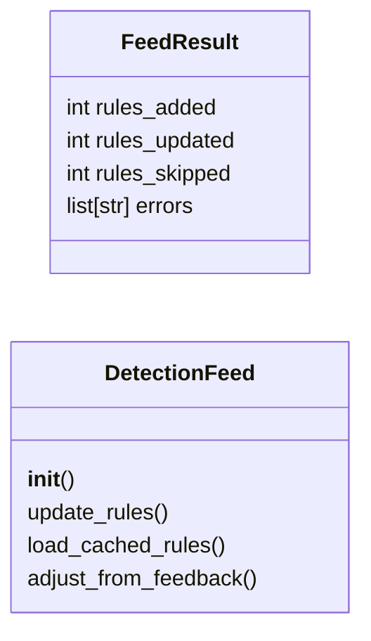
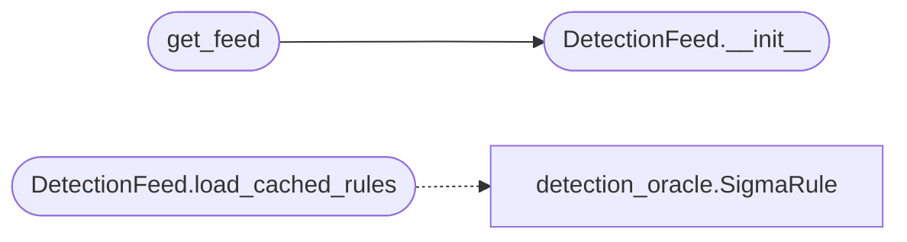

# `modules.detection_feed`

> Source: [modules/detection_feed.py:1](../../modules/detection_feed.py#L1) | language `py` | coverage 87.5% | [API index](../index.md)

Dynamic detection feed for the Detection Oracle.

The [`DetectionOracle`](modules.detection_oracle.py.md#detectionoracle) in ``modules/detection_oracle.py`` uses 17
static Sigma-lite rules with fixed `[`base_probability`](modules.detection_oracle.py.md#sigmarule-base_probability)` values.  In a real
engagement, EDR vendors and SIEM rulesets evolve constantly.  This module
provides a feed mechanism that can:

1. Download updated Sigma rules from SigmaHQ (GitHub) and convert them to
   [`SigmaRule`](modules.detection_oracle.py.md#sigmarule) objects.
2. Adjust `[`base_probability`](modules.detection_oracle.py.md#sigmarule-base_probability)` values based on historical campaign feedback
   (false positives lower the probability; missed detections raise it).
3. Cache downloaded rules locally so the oracle works offline after the
   first fetch.

Design (SOLID)
--------------
- Single Responsibility : fetch + adjust detection rules only.
- Open/Closed           : new feed sources added as entries in
  ``_FEED_SOURCES``.
- Dependency Inversion  : [`DetectionOracle`](modules.detection_oracle.py.md#detectionoracle) depends on the
  `[`DetectionFeed`](#detectionfeed)` interface, not a specific source.

## Contents

- **Classes:** [`FeedResult`](#feedresult), [`DetectionFeed`](#detectionfeed)
- **Functions:** [`get_feed`](#get_feed)

## Type Diagram



## Call Graph

Solid arrows stay in this module, dashed arrows leave it.



## Classes

<a id="feedresult"></a>

### `FeedResult`

`class` `dataclass` | [modules/detection_feed.py:64](../../modules/detection_feed.py#L64)

Decorators: `@dataclass`

```python
class FeedResult
```

Result of a feed update operation.

**Attributes**

| Name | Type | Default | Description |
|---|---|---|---|
| [`rules_added`](#feedresult-rules_added) | `int` | `0` |  |
| [`rules_updated`](#feedresult-rules_updated) | `int` | `0` |  |
| [`rules_skipped`](#feedresult-rules_skipped) | `int` | `0` |  |
| [`errors`](#feedresult-errors) | `list[str]` | `field(default_factory=list)` |  |

---

<a id="detectionfeed"></a>

### `DetectionFeed`

`class` | [modules/detection_feed.py:73](../../modules/detection_feed.py#L73)

```python
class DetectionFeed
```

Fetches and adjusts detection rules from external sources.

Sources
-------
- SigmaHQ: Raw Sigma YAML rules from the SigmaHQ GitHub repository.
- Campaign feedback: Adjusts probabilities based on past detection
  outcomes stored in ``sessions/detection_feedback.jsonl``.

**Members**

| Member | Kind | Summary |
|---|---|---|
| [`__init__`](#detectionfeed-__init__) | constructor |  |
| [`update_rules`](#detectionfeed-update_rules) | method | Download and parse rules from the given source. |
| [`load_cached_rules`](#detectionfeed-load_cached_rules) | method | Load previously cached rules from disk. |
| [`adjust_from_feedback`](#detectionfeed-adjust_from_feedback) | method | Adjust rule probabilities based on historical detection feedback. |

<a id="detectionfeed-__init__"></a>

#### `DetectionFeed.__init__`

`constructor` | [modules/detection_feed.py:83](../../modules/detection_feed.py#L83)

```python
def __init__(self, cache_dir: Path | None = None, sources: dict[str, str] | None = None) -> None
```

**Parameters**

| Name | Type | Default | Description |
|---|---|---|---|
| `cache_dir` | `Path \| None` | `None` |  |
| `sources` | `dict[str, str] \| None` | `None` |  |

*Called by:* [`get_feed`](#get_feed)

<a id="detectionfeed-update_rules"></a>

#### `DetectionFeed.update_rules`

`method` | [modules/detection_feed.py:92](../../modules/detection_feed.py#L92)

```python
def update_rules(self, source: str = 'sigmahq') -> list[SigmaRule]
```

Download and parse rules from the given source.

**Parameters**

| Name | Type | Default | Description |
|---|---|---|---|
| `source` | `str` | `'sigmahq'` | Source name (key in ``_FEED_SOURCES``). |

**Returns:** `list[SigmaRule]` - List of new [`SigmaRule`](modules.detection_oracle.py.md#sigmarule) objects parsed from the feed.

<a id="detectionfeed-load_cached_rules"></a>

#### `DetectionFeed.load_cached_rules`

`method` | [modules/detection_feed.py:246](../../modules/detection_feed.py#L246)

```python
def load_cached_rules(self, source: str = 'sigmahq') -> list[SigmaRule]
```

Load previously cached rules from disk.

**Parameters**

| Name | Type | Default | Description |
|---|---|---|---|
| `source` | `str` | `'sigmahq'` |  |

**Returns:** `list[SigmaRule]`

*Calls:* [`SigmaRule`](modules.detection_oracle.py.md#sigmarule)

<a id="detectionfeed-adjust_from_feedback"></a>

#### `DetectionFeed.adjust_from_feedback`

`method` | [modules/detection_feed.py:270](../../modules/detection_feed.py#L270)

```python
def adjust_from_feedback(self, feedback_file: Path | None = None) -> int
```

Adjust rule probabilities based on historical detection feedback.

Reads ``sessions/detection_feedback.jsonl`` (or a custom path) where
each line is::

    {"rule_id": "LAZ-001", "detected": true, "actual": false}

- ``detected=true, actual=false`` → false positive → lower probability
- ``detected=false, actual=true``  → missed detection → raise probability

**Parameters**

| Name | Type | Default | Description |
|---|---|---|---|
| `feedback_file` | `Path \| None` | `None` | Optional path to a feedback JSONL file. |

**Returns:** `int` - Number of rules whose probability was adjusted.

---

## Functions

<a id="get_feed"></a>

### `get_feed`

`function` | [modules/detection_feed.py:326](../../modules/detection_feed.py#L326)

```python
def get_feed() -> DetectionFeed
```

Return a module-level [`DetectionFeed`](#detectionfeed) singleton.

**Returns:** `DetectionFeed`

*Calls:* [`DetectionFeed.__init__`](#detectionfeed-__init__)

*Called by:* [`DetectionOracle.refresh`](modules.detection_oracle.py.md#detectionoracle-refresh)

---
