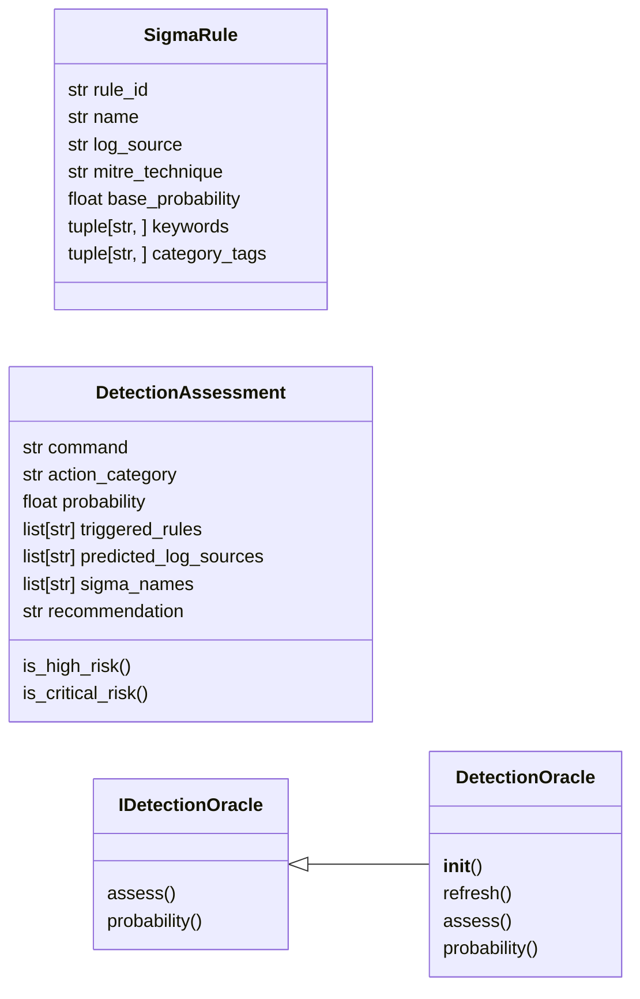
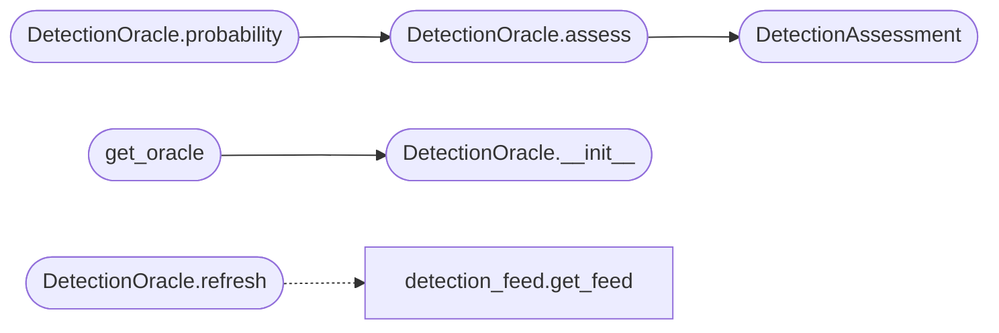

# `modules.detection_oracle`

> Source: [modules/detection_oracle.py:1](../../modules/detection_oracle.py#L1) | language `py` | coverage 92.9% | [API index](../index.md)

modules/detection_oracle.py ============================ Blue Team Mirror — predicts detection probability for a given action before it is executed by the autonomous loop or a hive-mind drone.

Maps LazyOwn action categories and specific command patterns to sigma-lite
detection rules, predicted log sources, and an aggregated detection probability
score in [0.0, 1.0].

Design principles
-----------------
- Single Responsibility : detection prediction only; no command execution
- Open/Closed           : new sigma rules added via _SIGMA_RULES list only
- Liskov Substitution   : IDetectionOracle defines the contract
- Interface Segregation : IDetectionOracle exposes only assess() and probability()
- Dependency Inversion  : callers depend on IDetectionOracle, not DetectionOracle

Usage
-----
    from modules.detection_oracle import get_oracle

    oracle = get_oracle()
    assessment = oracle.assess("mimikatz", "sekurlsa::logonpasswords", "credential")
    if assessment.is_high_risk:
        print(f"High detection risk ({assessment.probability:.0%}): "
              f"{assessment.sigma_names}")
        print(assessment.recommendation)

## Contents

- **Classes:** [`SigmaRule`](#sigmarule), [`DetectionAssessment`](#detectionassessment), [`IDetectionOracle`](#idetectionoracle), [`DetectionOracle`](#detectionoracle)
- **Functions:** [`get_oracle`](#get_oracle)

## Type Diagram



## Call Graph

Solid arrows stay in this module, dashed arrows leave it.



## Classes

<a id="sigmarule"></a>

### `SigmaRule`

`class` `dataclass` | [modules/detection_oracle.py:51](../../modules/detection_oracle.py#L51)

Decorators: `@dataclass(frozen=True)`

```python
class SigmaRule
```

Lightweight representation of a Sigma-compatible detection rule.

**Attributes**

| Name | Type | Default | Description |
|---|---|---|---|
| [`rule_id`](#sigmarule-rule_id) | `str` |  |  |
| [`name`](#sigmarule-name) | `str` |  |  |
| [`log_source`](#sigmarule-log_source) | `str` |  |  |
| [`mitre_technique`](#sigmarule-mitre_technique) | `str` |  |  |
| [`base_probability`](#sigmarule-base_probability) | `float` |  |  |
| [`keywords`](#sigmarule-keywords) | `tuple[str, ...]` |  |  |
| [`category_tags`](#sigmarule-category_tags) | `tuple[str, ...]` |  |  |

---

<a id="detectionassessment"></a>

### `DetectionAssessment`

`class` `dataclass` | [modules/detection_oracle.py:64](../../modules/detection_oracle.py#L64)

Decorators: `@dataclass`

```python
class DetectionAssessment
```

Result returned by DetectionOracle.assess().

**Attributes**

| Name | Type | Default | Description |
|---|---|---|---|
| [`command`](#detectionassessment-command) | `str` |  |  |
| [`action_category`](#detectionassessment-action_category) | `str` |  |  |
| [`probability`](#detectionassessment-probability) | `float` |  |  |
| [`triggered_rules`](#detectionassessment-triggered_rules) | `list[str]` |  |  |
| [`predicted_log_sources`](#detectionassessment-predicted_log_sources) | `list[str]` |  |  |
| [`sigma_names`](#detectionassessment-sigma_names) | `list[str]` |  |  |
| [`recommendation`](#detectionassessment-recommendation) | `str` |  |  |

**Members**

| Member | Kind | Summary |
|---|---|---|
| [`is_high_risk`](#detectionassessment-is_high_risk) | property | Return True when detection probability is 70% or higher. |
| [`is_critical_risk`](#detectionassessment-is_critical_risk) | property | Return True when detection probability is 90% or higher. |

<a id="detectionassessment-is_high_risk"></a>

#### `DetectionAssessment.is_high_risk`

`property` | [modules/detection_oracle.py:76](../../modules/detection_oracle.py#L76)

Decorators: `@property`

```python
def is_high_risk(self) -> bool
```

Return True when detection probability is 70% or higher.

**Returns:** `bool`

<a id="detectionassessment-is_critical_risk"></a>

#### `DetectionAssessment.is_critical_risk`

`property` | [modules/detection_oracle.py:81](../../modules/detection_oracle.py#L81)

Decorators: `@property`

```python
def is_critical_risk(self) -> bool
```

Return True when detection probability is 90% or higher.

**Returns:** `bool`

---

<a id="idetectionoracle"></a>

### `IDetectionOracle`

`class` `abstract` | [modules/detection_oracle.py:91](../../modules/detection_oracle.py#L91)

```python
class IDetectionOracle(ABC)
```

Bases: `ABC`

Subclasses: [`DetectionOracle`](#detectionoracle)

Read-only contract for detection probability assessment.

**Members**

| Member | Kind | Summary |
|---|---|---|
| [`assess`](#idetectionoracle-assess) | method | Return a full DetectionAssessment for the given action. |
| [`probability`](#idetectionoracle-probability) | method | Return only the probability score in [0.0, 1.0]. |

<a id="idetectionoracle-assess"></a>

#### `IDetectionOracle.assess`

`method` `abstract` | [modules/detection_oracle.py:95](../../modules/detection_oracle.py#L95)

Decorators: `@abstractmethod`

```python
def assess(self, command: str, args: str, action_category: str, benign_alternatives: Sequence[str] | None = None) -> DetectionAssessment
```

Return a full DetectionAssessment for the given action.

**Parameters**

| Name | Type | Default | Description |
|---|---|---|---|
| `command` | `str` |  |  |
| `args` | `str` |  |  |
| `action_category` | `str` |  |  |
| `benign_alternatives` | `Sequence[str] \| None` | `None` |  |

**Returns:** `DetectionAssessment`

<a id="idetectionoracle-probability"></a>

#### `IDetectionOracle.probability`

`method` `abstract` | [modules/detection_oracle.py:105](../../modules/detection_oracle.py#L105)

Decorators: `@abstractmethod`

```python
def probability(self, command: str, args: str, action_category: str, benign_alternatives: Sequence[str] | None = None) -> float
```

Return only the probability score in [0.0, 1.0].

**Parameters**

| Name | Type | Default | Description |
|---|---|---|---|
| `command` | `str` |  |  |
| `args` | `str` |  |  |
| `action_category` | `str` |  |  |
| `benign_alternatives` | `Sequence[str] \| None` | `None` |  |

**Returns:** `float`

---

<a id="detectionoracle"></a>

### `DetectionOracle`

`class` | [modules/detection_oracle.py:357](../../modules/detection_oracle.py#L357)

```python
class DetectionOracle(IDetectionOracle)
```

Bases: [`IDetectionOracle`](#idetectionoracle)

Maps a (command, args, action_category) triple to a detection probability.

Matching algorithm
------------------
1. Scan all sigma rules for keyword hits in the lowercased command+args.
2. Include rules whose category_tags overlap with action_category.
3. Boost matched rule probabilities by 10% when both keyword AND category hit.
4. Aggregate using the OR-probability formula:
       P = 1 - prod(1 - effective_p_i)
5. Clamp result to [0.0, 1.0].
6. Fall back to _CATEGORY_BASE_PROBABILITY when no rules matched.

**Members**

| Member | Kind | Summary |
|---|---|---|
| [`__init__`](#detectionoracle-__init__) | constructor |  |
| [`refresh`](#detectionoracle-refresh) | method | Update rules from the detection feed (if available). |
| [`assess`](#detectionoracle-assess) | method | Assess the detection risk of a command, dampened by benign twins. |
| [`probability`](#detectionoracle-probability) | method | Return the detection probability, honouring benign alternatives. |

<a id="detectionoracle-__init__"></a>

#### `DetectionOracle.__init__`

`constructor` | [modules/detection_oracle.py:372](../../modules/detection_oracle.py#L372)

```python
def __init__(self, rules: list[SigmaRule] | None = None, feed: DetectionFeed | None = None) -> None
```

**Parameters**

| Name | Type | Default | Description |
|---|---|---|---|
| `rules` | `list[SigmaRule] \| None` | `None` |  |
| `feed` | `DetectionFeed \| None` | `None` |  |

*Called by:* [`get_oracle`](#get_oracle)

<a id="detectionoracle-refresh"></a>

#### `DetectionOracle.refresh`

`method` | [modules/detection_oracle.py:376](../../modules/detection_oracle.py#L376)

```python
def refresh(self) -> int
```

Update rules from the detection feed (if available).

Downloads new Sigma rules from the feed source, caches them locally,
and merges them with the existing static rules.  Also adjusts
probabilities based on historical detection feedback.

**Returns:** `int` - Number of new rules added to the oracle.

*Calls:* [`get_feed`](modules.detection_feed.py.md#get_feed)

<a id="detectionoracle-assess"></a>

#### `DetectionOracle.assess`

`method` | [modules/detection_oracle.py:411](../../modules/detection_oracle.py#L411)

```python
def assess(self, command: str, args: str, action_category: str, benign_alternatives: Sequence[str] | None = None) -> DetectionAssessment
```

Assess the detection risk of a command, dampened by benign twins.

Threat-informed defense contract: a ``benign_alternatives`` entry
overlapping the command vocabulary means the flagged behaviour is
plausibly a benign twin (scheduled scans, managed agents); the
derived log-noise score is dampened and the sigma evidence is
kept attached so consumers see both the risk and its benign
explanation.

**Parameters**

| Name | Type | Default | Description |
|---|---|---|---|
| `command` | `str` |  | Command token. |
| `args` | `str` |  | Command arguments line. |
| `action_category` | `str` |  | Opsec action category. |
| `benign_alternatives` | `Sequence[str] \| None` | `None` | Chain step alternatives explicating the benign counterpart of this action. |

**Returns:** `DetectionAssessment` - DetectionAssessment with the dampened probability when a
declared alternative overlaps the command.

*Calls:* [`DetectionAssessment`](#detectionassessment)

*Called by:* [`DetectionOracle.probability`](#detectionoracle-probability)

<a id="detectionoracle-probability"></a>

#### `DetectionOracle.probability`

`method` | [modules/detection_oracle.py:460](../../modules/detection_oracle.py#L460)

```python
def probability(self, command: str, args: str, action_category: str, benign_alternatives: Sequence[str] | None = None) -> float
```

Return the detection probability, honouring benign alternatives.

**Parameters**

| Name | Type | Default | Description |
|---|---|---|---|
| `command` | `str` |  |  |
| `args` | `str` |  |  |
| `action_category` | `str` |  |  |
| `benign_alternatives` | `Sequence[str] \| None` | `None` |  |

**Returns:** `float`

*Calls:* [`DetectionOracle.assess`](#detectionoracle-assess)

---

## Functions

<a id="get_oracle"></a>

### `get_oracle`

`function` | [modules/detection_oracle.py:553](../../modules/detection_oracle.py#L553)

```python
def get_oracle() -> DetectionOracle
```

Return (or create) the module-level singleton DetectionOracle.

**Returns:** `DetectionOracle`

*Calls:* [`DetectionOracle.__init__`](#detectionoracle-__init__)

*Called by:* [`PurpleTeamLoop.execute_and_measure`](modules.auto_purple.py.md#purpleteamloop-execute_and_measure), [`PurpleTeamLoop.measure_only`](modules.auto_purple.py.md#purpleteamloop-measure_only), [`ai_snapshot`](modules.loop_ai_bridge.py.md#ai_snapshot), [`annotate_detection`](modules.loop_ai_bridge.py.md#annotate_detection)

---
