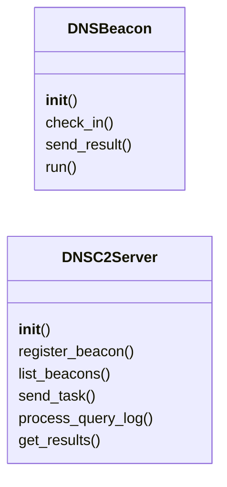
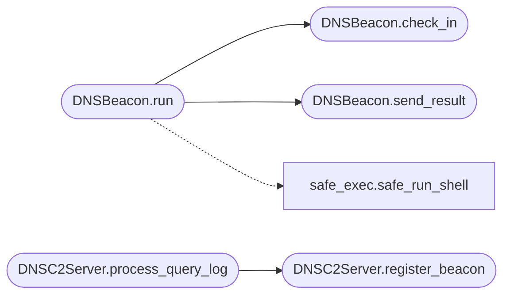

# `modules.dns_beacon`

> Source: [modules/dns_beacon.py:1](../../modules/dns_beacon.py#L1) | language `py` | coverage 100.0% | [API index](../index.md)

DNS Beacon — covert C2 channel via DNS tunneling.

Supports A/AAAA/TXT record tunneling. The beacon encodes commands and results
as DNS subdomain queries. The server reconstructs data from DNS query logs.

Transport modes:
    A       — Commands in A-record response IP addresses.
    TXT     — Commands in TXT record responses.
    AAAA    — Commands in AAAA-record responses.

## Contents

- **Classes:** [`DNSBeacon`](#dnsbeacon), [`DNSC2Server`](#dnsc2server)

## Type Diagram



## Call Graph

Solid arrows stay in this module, dashed arrows leave it.



## Classes

<a id="dnsbeacon"></a>

### `DNSBeacon`

`class` | [modules/dns_beacon.py:23](../../modules/dns_beacon.py#L23)

```python
class DNSBeacon
```

DNS tunneling beacon client.

Encodes heartbeats and command output as subdomain queries.
Decodes DNS response data as commands.

**Parameters**

| Name | Type | Default | Description |
|---|---|---|---|
| `domain` |  |  | DNS domain controlled by the operator. |
| `dns_server` |  |  | Resolver to use (default: system resolver). |
| `sleep_seconds` |  |  | Interval between check-ins. |
| `jitter_percent` |  |  | Random jitter percentage applied to sleep. |
| `dns_type` |  |  | DNS record type (A, TXT, AAAA). |
| `encode_method` |  |  | Encoding for data (base32, base64, hex). |

**Members**

| Member | Kind | Summary |
|---|---|---|
| [`__init__`](#dnsbeacon-__init__) | constructor |  |
| [`check_in`](#dnsbeacon-check_in) | method | Send heartbeat and check for pending commands. |
| [`send_result`](#dnsbeacon-send_result) | method | Send command output via DNS TXT queries. |
| [`run`](#dnsbeacon-run) | method | Main beacon loop: check-in -> execute command -> send result -> sleep. |

<a id="dnsbeacon-__init__"></a>

#### `DNSBeacon.__init__`

`constructor` | [modules/dns_beacon.py:38](../../modules/dns_beacon.py#L38)

```python
def __init__(self, domain: str, dns_server: str | None = None, sleep_seconds: int = 5, jitter_percent: int = 30, dns_type: str = 'A', encode_method: str = 'base32')
```

**Parameters**

| Name | Type | Default | Description |
|---|---|---|---|
| `domain` | `str` |  | DNS domain controlled by the operator. |
| `dns_server` | `str \| None` | `None` | Resolver to use (default: system resolver). |
| `sleep_seconds` | `int` | `5` | Interval between check-ins. |
| `jitter_percent` | `int` | `30` | Random jitter percentage applied to sleep. |
| `dns_type` | `str` | `'A'` | DNS record type (A, TXT, AAAA). |
| `encode_method` | `str` | `'base32'` | Encoding for data (base32, base64, hex). |

*Called by:* [`DNSExfilCommandSet.do_dns_beacon`](cli.commands.dns_exfil.py.md#dnsexfilcommandset-do_dns_beacon)

<a id="dnsbeacon-check_in"></a>

#### `DNSBeacon.check_in`

`method` | [modules/dns_beacon.py:105](../../modules/dns_beacon.py#L105)

```python
def check_in(self) -> str | None
```

Send heartbeat and check for pending commands.

**Returns:** `str | None` - Command string if one is queued, or None.

*Called by:* [`DNSBeacon.run`](#dnsbeacon-run)

<a id="dnsbeacon-send_result"></a>

#### `DNSBeacon.send_result`

`method` | [modules/dns_beacon.py:135](../../modules/dns_beacon.py#L135)

```python
def send_result(self, command: str, output: str, exit_code: int = 0)
```

Send command output via DNS TXT queries.

**Parameters**

| Name | Type | Default | Description |
|---|---|---|---|
| `command` | `str` |  | The executed command. |
| `output` | `str` |  | Command stdout/stderr. |
| `exit_code` | `int` | `0` | Process exit code. |

*Called by:* [`DNSBeacon.run`](#dnsbeacon-run)

<a id="dnsbeacon-run"></a>

#### `DNSBeacon.run`

`method` | [modules/dns_beacon.py:171](../../modules/dns_beacon.py#L171)

```python
def run(self)
```

Main beacon loop: check-in -> execute command -> send result -> sleep.

*Calls:* [`safe_run_shell`](core.safe_exec.py.md#safe_run_shell), [`DNSBeacon.check_in`](#dnsbeacon-check_in), [`DNSBeacon.send_result`](#dnsbeacon-send_result)

*Called by:* [`DNSExfilCommandSet.do_dns_beacon`](cli.commands.dns_exfil.py.md#dnsexfilcommandset-do_dns_beacon)

---

<a id="dnsc2server"></a>

### `DNSC2Server`

`class` | [modules/dns_beacon.py:199](../../modules/dns_beacon.py#L199)

```python
class DNSC2Server
```

DNS C2 server for receiving beacon data from DNS query logs.

Monitors DNS query logs and reconstructs beacon traffic.
Supports log sources: file, tcpdump pipe, stdin.

**Parameters**

| Name | Type | Default | Description |
|---|---|---|---|
| `domain` |  |  | DNS domain controlled by the operator. |
| `log_source` |  |  | Path to DNS query log file, or 'tcpdump' for live capture. |
| `interface` |  |  | Network interface for tcpdump capture mode. |

**Members**

| Member | Kind | Summary |
|---|---|---|
| [`__init__`](#dnsc2server-__init__) | constructor |  |
| [`register_beacon`](#dnsc2server-register_beacon) | method | Register a new DNS beacon. |
| [`list_beacons`](#dnsc2server-list_beacons) | method | List all registered DNS beacons. |
| [`send_task`](#dnsc2server-send_task) | method | Queue a command for a DNS beacon. |
| [`process_query_log`](#dnsc2server-process_query_log) | method | Process a single DNS query log line and extract beacon data. |
| [`get_results`](#dnsc2server-get_results) | method | Get received results for a beacon. |

<a id="dnsc2server-__init__"></a>

#### `DNSC2Server.__init__`

`constructor` | [modules/dns_beacon.py:211](../../modules/dns_beacon.py#L211)

```python
def __init__(self, domain: str, log_source: str = '', interface: str = 'eth0')
```

**Parameters**

| Name | Type | Default | Description |
|---|---|---|---|
| `domain` | `str` |  | DNS domain controlled by the operator. |
| `log_source` | `str` | `''` | Path to DNS query log file, or 'tcpdump' for live capture. |
| `interface` | `str` | `'eth0'` | Network interface for tcpdump capture mode. |

<a id="dnsc2server-register_beacon"></a>

#### `DNSC2Server.register_beacon`

`method` | [modules/dns_beacon.py:225](../../modules/dns_beacon.py#L225)

```python
def register_beacon(self, beacon_id: str, hostname: str)
```

Register a new DNS beacon.

**Parameters**

| Name | Type | Default | Description |
|---|---|---|---|
| `beacon_id` | `str` |  |  |
| `hostname` | `str` |  |  |

*Called by:* [`DNSC2Server.process_query_log`](#dnsc2server-process_query_log)

<a id="dnsc2server-list_beacons"></a>

#### `DNSC2Server.list_beacons`

`method` | [modules/dns_beacon.py:235](../../modules/dns_beacon.py#L235)

```python
def list_beacons(self) -> list[dict]
```

List all registered DNS beacons.

**Returns:** `list[dict]`

<a id="dnsc2server-send_task"></a>

#### `DNSC2Server.send_task`

`method` | [modules/dns_beacon.py:239](../../modules/dns_beacon.py#L239)

```python
def send_task(self, beacon_id: str, command: str)
```

Queue a command for a DNS beacon.

**Parameters**

| Name | Type | Default | Description |
|---|---|---|---|
| `beacon_id` | `str` |  | Beacon identifier. |
| `command` | `str` |  | Shell command to execute. |

<a id="dnsc2server-process_query_log"></a>

#### `DNSC2Server.process_query_log`

`method` | [modules/dns_beacon.py:248](../../modules/dns_beacon.py#L248)

```python
def process_query_log(self, line: str)
```

Process a single DNS query log line and extract beacon data.

Supports standard syslog and BIND query log formats.

**Parameters**

| Name | Type | Default | Description |
|---|---|---|---|
| `line` | `str` |  | Raw DNS query log line. |

*Calls:* [`DNSC2Server.register_beacon`](#dnsc2server-register_beacon)

<a id="dnsc2server-get_results"></a>

#### `DNSC2Server.get_results`

`method` | [modules/dns_beacon.py:327](../../modules/dns_beacon.py#L327)

```python
def get_results(self, beacon_id: str) -> list[dict]
```

Get received results for a beacon.

**Parameters**

| Name | Type | Default | Description |
|---|---|---|---|
| `beacon_id` | `str` |  | Beacon identifier. |

**Returns:** `list[dict]` - List of result dictionaries.

---
