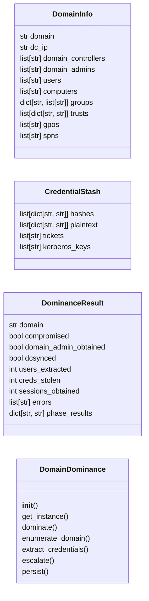
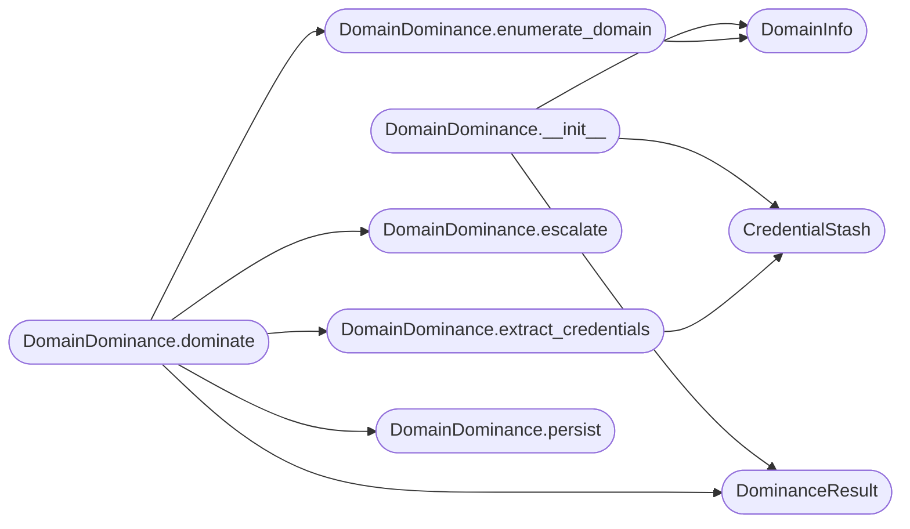

# `modules.domain_dominance`

> Source: [modules/domain_dominance.py:1](../../modules/domain_dominance.py#L1) | language `py` | coverage 83.3% | [API index](../index.md)

Domain Dominance Engine — automated Active Directory takeover.

Provides a `[`DomainDominance`](#domaindominance)` engine that orchestrates the full AD attack
kill-chain in one command: enumeration, credential extraction, lateral
movement, privilege escalation, and persistence. Integrates with the
existing BloodHound, impacket, and CrackMapExec tool chains.

Architecture:
    PhaseNavigator -> EnumStage -> CredStage -> LateralStage -> PrivEscStage -> PersistStage
        |
        +-- LLM Advisor (optional, Groq-powered for strategy decisions)

Security:
    All credentials are written to ``sessions/credentials_*.txt`` following
    the existing LazyOwn convention. No credentials are logged to stdout.

Usage:
    from modules.domain_dominance import DomainDominance
    dd = DomainDominance()
    results = dd.dominate(domain="corp.local", dc_ip="10.10.11.5")

## Contents

- **Classes:** [`DomainInfo`](#domaininfo), [`CredentialStash`](#credentialstash), [`DominanceResult`](#dominanceresult), [`DomainDominance`](#domaindominance)

## Type Diagram



## Call Graph

Solid arrows stay in this module, dashed arrows leave it.



## Classes

<a id="domaininfo"></a>

### `DomainInfo`

`class` `dataclass` | [modules/domain_dominance.py:49](../../modules/domain_dominance.py#L49)

Decorators: `@dataclass`

```python
class DomainInfo
```

Structured domain information collected during enumeration.

**Attributes**

| Name | Type | Default | Description |
|---|---|---|---|
| [`domain`](#domaininfo-domain) | `str` | `''` |  |
| [`dc_ip`](#domaininfo-dc_ip) | `str` | `''` |  |
| [`domain_controllers`](#domaininfo-domain_controllers) | `list[str]` | `field(default_factory=list)` |  |
| [`domain_admins`](#domaininfo-domain_admins) | `list[str]` | `field(default_factory=list)` |  |
| [`users`](#domaininfo-users) | `list[str]` | `field(default_factory=list)` |  |
| [`computers`](#domaininfo-computers) | `list[str]` | `field(default_factory=list)` |  |
| [`groups`](#domaininfo-groups) | `dict[str, list[str]]` | `field(default_factory=dict)` |  |
| [`trusts`](#domaininfo-trusts) | `list[dict[str, str]]` | `field(default_factory=list)` |  |
| [`gpos`](#domaininfo-gpos) | `list[str]` | `field(default_factory=list)` |  |
| [`spns`](#domaininfo-spns) | `list[str]` | `field(default_factory=list)` |  |

---

<a id="credentialstash"></a>

### `CredentialStash`

`class` `dataclass` | [modules/domain_dominance.py:65](../../modules/domain_dominance.py#L65)

Decorators: `@dataclass`

```python
class CredentialStash
```

Credentials collected during the engagement.

**Attributes**

| Name | Type | Default | Description |
|---|---|---|---|
| [`hashes`](#credentialstash-hashes) | `list[dict[str, str]]` | `field(default_factory=list)` |  |
| [`plaintext`](#credentialstash-plaintext) | `list[dict[str, str]]` | `field(default_factory=list)` |  |
| [`tickets`](#credentialstash-tickets) | `list[str]` | `field(default_factory=list)` |  |
| [`kerberos_keys`](#credentialstash-kerberos_keys) | `list[str]` | `field(default_factory=list)` |  |

---

<a id="dominanceresult"></a>

### `DominanceResult`

`class` `dataclass` | [modules/domain_dominance.py:75](../../modules/domain_dominance.py#L75)

Decorators: `@dataclass`

```python
class DominanceResult
```

Outcome of a domain dominance operation.

**Attributes**

| Name | Type | Default | Description |
|---|---|---|---|
| [`domain`](#dominanceresult-domain) | `str` |  |  |
| [`compromised`](#dominanceresult-compromised) | `bool` | `False` |  |
| [`domain_admin_obtained`](#dominanceresult-domain_admin_obtained) | `bool` | `False` |  |
| [`dcsynced`](#dominanceresult-dcsynced) | `bool` | `False` |  |
| [`users_extracted`](#dominanceresult-users_extracted) | `int` | `0` |  |
| [`creds_stolen`](#dominanceresult-creds_stolen) | `int` | `0` |  |
| [`sessions_obtained`](#dominanceresult-sessions_obtained) | `int` | `0` |  |
| [`errors`](#dominanceresult-errors) | `list[str]` | `field(default_factory=list)` |  |
| [`phase_results`](#dominanceresult-phase_results) | `dict[str, str]` | `field(default_factory=dict)` |  |

---

<a id="domaindominance"></a>

### `DomainDominance`

`class` | [modules/domain_dominance.py:89](../../modules/domain_dominance.py#L89)

```python
class DomainDominance
```

Orchestrate full domain takeover from initial foothold to persistence.

Public methods:
    dominate(domain, dc_ip) -> DominanceResult
    enumerate_domain(domain, dc_ip) -> DomainInfo
    extract_credentials(domain_info) -> CredentialStash
    escalate(domain_info, stash) -> list[str]
    persist(domain_info) -> list[str]

**Members**

| Member | Kind | Summary |
|---|---|---|
| [`__init__`](#domaindominance-__init__) | constructor |  |
| [`get_instance`](#domaindominance-get_instance) | classmethod |  |
| [`dominate`](#domaindominance-dominate) | method | Execute the full AD dominance kill-chain. |
| [`enumerate_domain`](#domaindominance-enumerate_domain) | method | Enumerate the target domain topology. |
| [`extract_credentials`](#domaindominance-extract_credentials) | method | Extract credentials using the discovered domain topology. |
| [`escalate`](#domaindominance-escalate) | method | Escalate privileges and move laterally through the domain. |
| [`persist`](#domaindominance-persist) | method | Establish persistence mechanisms across the domain. |

<a id="domaindominance-__init__"></a>

#### `DomainDominance.__init__`

`constructor` | [modules/domain_dominance.py:103](../../modules/domain_dominance.py#L103)

```python
def __init__(self) -> None
```

*Calls:* [`CredentialStash`](#credentialstash), [`DomainInfo`](#domaininfo), [`DominanceResult`](#dominanceresult)

*Called by:* [`LateralMigratedCommandSet.do_dominion`](cli.commands.lateral_migrated.py.md#lateralmigratedcommandset-do_dominion)

<a id="domaindominance-get_instance"></a>

#### `DomainDominance.get_instance`

`classmethod` | [modules/domain_dominance.py:110](../../modules/domain_dominance.py#L110)

Decorators: `@classmethod`

```python
def get_instance(cls) -> DomainDominance
```

**Returns:** `DomainDominance`

<a id="domaindominance-dominate"></a>

#### `DomainDominance.dominate`

`method` | [modules/domain_dominance.py:121](../../modules/domain_dominance.py#L121)

```python
def dominate(self, domain: str, dc_ip: str = '', username: str = '', password: str = '', ntlm_hash: str = '') -> DominanceResult
```

Execute the full AD dominance kill-chain.

**Parameters**

| Name | Type | Default | Description |
|---|---|---|---|
| `domain` | `str` |  | FQDN of the target domain. |
| `dc_ip` | `str` | `''` | Domain Controller IP (optional, will be discovered). |
| `username` | `str` | `''` | Known username for initial auth. |
| `password` | `str` | `''` | Known password for initial auth. |
| `ntlm_hash` | `str` | `''` | NTLM hash for pass-the-hash. |

**Returns:** `DominanceResult` - DominanceResult with full outcome.

*Calls:* [`DomainDominance.enumerate_domain`](#domaindominance-enumerate_domain), [`DomainDominance.escalate`](#domaindominance-escalate), [`DomainDominance.extract_credentials`](#domaindominance-extract_credentials), [`DomainDominance.persist`](#domaindominance-persist), [`DominanceResult`](#dominanceresult)

*Called by:* [`LateralMigratedCommandSet.do_dominion`](cli.commands.lateral_migrated.py.md#lateralmigratedcommandset-do_dominion)

<a id="domaindominance-enumerate_domain"></a>

#### `DomainDominance.enumerate_domain`

`method` | [modules/domain_dominance.py:194](../../modules/domain_dominance.py#L194)

```python
def enumerate_domain(self, domain: str, dc_ip: str = '') -> DomainInfo
```

Enumerate the target domain topology.

**Parameters**

| Name | Type | Default | Description |
|---|---|---|---|
| `domain` | `str` |  | Target domain FQDN. |
| `dc_ip` | `str` | `''` | Known DC IP or empty for discovery. |

**Returns:** `DomainInfo` - DomainInfo with enumeration results.

*Calls:* [`DomainInfo`](#domaininfo)

*Called by:* [`DomainDominance.dominate`](#domaindominance-dominate)

<a id="domaindominance-extract_credentials"></a>

#### `DomainDominance.extract_credentials`

`method` | [modules/domain_dominance.py:227](../../modules/domain_dominance.py#L227)

```python
def extract_credentials(self, domain_info: DomainInfo, known_creds: list[dict[str, str]] | None = None) -> CredentialStash
```

Extract credentials using the discovered domain topology.

**Parameters**

| Name | Type | Default | Description |
|---|---|---|---|
| `domain_info` | `DomainInfo` |  | Discovered DomainInfo. |
| `known_creds` | `list[dict[str, str]] \| None` | `None` | Pre-existing credentials to try. |

**Returns:** `CredentialStash` - CredentialStash with extracted credentials.

*Calls:* [`CredentialStash`](#credentialstash)

*Called by:* [`DomainDominance.dominate`](#domaindominance-dominate)

<a id="domaindominance-escalate"></a>

#### `DomainDominance.escalate`

`method` | [modules/domain_dominance.py:260](../../modules/domain_dominance.py#L260)

```python
def escalate(self, domain_info: DomainInfo, stash: CredentialStash) -> list[str]
```

Escalate privileges and move laterally through the domain.

**Parameters**

| Name | Type | Default | Description |
|---|---|---|---|
| `domain_info` | `DomainInfo` |  | Domain topology. |
| `stash` | `CredentialStash` |  | Collected credentials. |

**Returns:** `list[str]` - List of session identifiers obtained.

*Called by:* [`DomainDominance.dominate`](#domaindominance-dominate)

<a id="domaindominance-persist"></a>

#### `DomainDominance.persist`

`method` | [modules/domain_dominance.py:314](../../modules/domain_dominance.py#L314)

```python
def persist(self, domain_info: DomainInfo) -> list[str]
```

Establish persistence mechanisms across the domain.

**Parameters**

| Name | Type | Default | Description |
|---|---|---|---|
| `domain_info` | `DomainInfo` |  | Target domain topology. |

**Returns:** `list[str]` - List of persistence mechanism identifiers.

*Called by:* [`DomainDominance.dominate`](#domaindominance-dominate)

---
