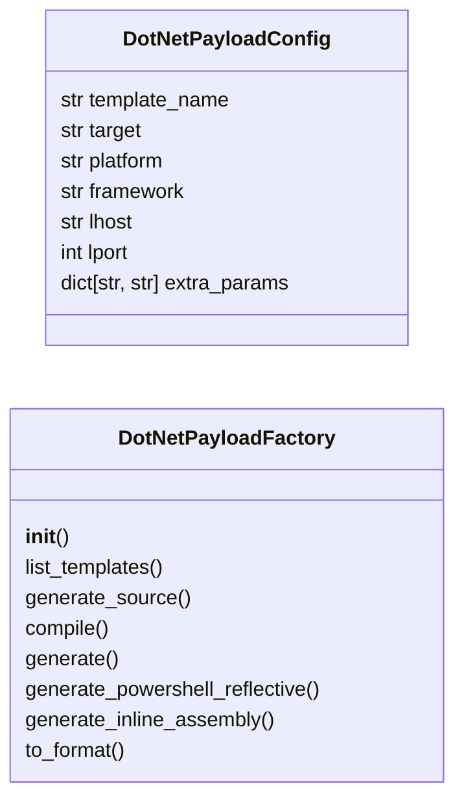
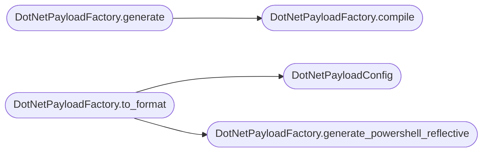

# `modules.dotnet_payload`

> Source: [modules/dotnet_payload.py:1](../../modules/dotnet_payload.py#L1) | language `py` | coverage 90.9% | [API index](../index.md)

.NET/C# payload generation — execute-assembly, inline-assembly, Roslyn compilation.

Provides DotNetPayloadFactory for generating C# payloads including reverse shells,
process injection shells, token manipulation tools, and AMSI/ETW bypass assemblies.
Supports both execute-assembly (compile to DLL/EXE via csc/dotnet) and inline-assembly
(embed C# source for reflective loading) delivery patterns.

All templates derive target connection parameters from payload.json configuration.

## Contents

- **Classes:** [`DotNetPayloadConfig`](#dotnetpayloadconfig), [`DotNetPayloadFactory`](#dotnetpayloadfactory)
- **Constants:** [`SESSIONS_DIR`](#sessions_dir), [`CSHARP_TEMPLATES`](#csharp_templates), [`COMPILE_TARGETS`](#compile_targets), [`DOTNET_FRAMEWORK_VERSIONS`](#dotnet_framework_versions)

## Type Diagram



## Call Graph

Solid arrows stay in this module, dashed arrows leave it.



## Classes

<a id="dotnetpayloadconfig"></a>

### `DotNetPayloadConfig`

`class` `dataclass` | [modules/dotnet_payload.py:293](../../modules/dotnet_payload.py#L293)

Decorators: `@dataclass`

```python
class DotNetPayloadConfig
```

Configuration for a .NET payload compilation.

**Attributes**

| Name | Type | Default | Description |
|---|---|---|---|
| [`template_name`](#dotnetpayloadconfig-template_name) | `str` | `'reverse_tcp'` | Key in CSHARP_TEMPLATES. |
| [`target`](#dotnetpayloadconfig-target) | `str` | `'exe'` | Compilation target (exe, dll, netmodule). |
| [`platform`](#dotnetpayloadconfig-platform) | `str` | `'x64'` | CPU architecture (x86, x64, AnyCPU). |
| [`framework`](#dotnetpayloadconfig-framework) | `str` | `''` | .NET framework version or '' for modern dotnet. |
| [`lhost`](#dotnetpayloadconfig-lhost) | `str` | `''` | Listener IP for reverse connections. |
| [`lport`](#dotnetpayloadconfig-lport) | `int` | `443` | Listener port for reverse connections. |
| [`extra_params`](#dotnetpayloadconfig-extra_params) | `dict[str, str]` | `field(default_factory=dict)` | Additional template substitution values. |

---

<a id="dotnetpayloadfactory"></a>

### `DotNetPayloadFactory`

`class` | [modules/dotnet_payload.py:315](../../modules/dotnet_payload.py#L315)

```python
class DotNetPayloadFactory
```

Generate, compile, and format .NET/C# payloads.

Detects available compilers (csc, mcs, dotnet) and selects the best
toolchain. Falls back to source-only output if no compiler is found.

**Members**

| Member | Kind | Summary |
|---|---|---|
| [`__init__`](#dotnetpayloadfactory-__init__) | constructor |  |
| [`list_templates`](#dotnetpayloadfactory-list_templates) | staticmethod | Return available .NET payload template names. |
| [`generate_source`](#dotnetpayloadfactory-generate_source) | method | Generate C# source code from a template. |
| [`compile`](#dotnetpayloadfactory-compile) | method | Compile C# source to an assembly. |
| [`generate`](#dotnetpayloadfactory-generate) | method | Generate a .NET payload — source code plus optional binary. |
| [`generate_powershell_reflective`](#dotnetpayloadfactory-generate_powershell_reflective) | method | Generate a PowerShell script that reflectively loads a .NET assembly. |
| [`generate_inline_assembly`](#dotnetpayloadfactory-generate_inline_assembly) | method | Generate self-decompiling inline .NET assembly load command. |
| [`to_format`](#dotnetpayloadfactory-to_format) | method | Convert a payload result to the requested output format. |

<a id="dotnetpayloadfactory-__init__"></a>

#### `DotNetPayloadFactory.__init__`

`constructor` | [modules/dotnet_payload.py:327](../../modules/dotnet_payload.py#L327)

```python
def __init__(self, output_dir: Path | None = None)
```

**Parameters**

| Name | Type | Default | Description |
|---|---|---|---|
| `output_dir` | `Path \| None` | `None` |  |

*Called by:* [`PayloadArsenalCommandSet.do_dotnet_payload`](cli.commands.payload_arsenal.py.md#payloadarsenalcommandset-do_dotnet_payload)

<a id="dotnetpayloadfactory-list_templates"></a>

#### `DotNetPayloadFactory.list_templates`

`staticmethod` | [modules/dotnet_payload.py:364](../../modules/dotnet_payload.py#L364)

Decorators: `@staticmethod`

```python
def list_templates() -> list[str]
```

Return available .NET payload template names.

**Returns:** `list[str]`

*Called by:* [`PayloadArsenalCommandSet.do_arsenal_show`](cli.commands.payload_arsenal.py.md#payloadarsenalcommandset-do_arsenal_show)

<a id="dotnetpayloadfactory-generate_source"></a>

#### `DotNetPayloadFactory.generate_source`

`method` | [modules/dotnet_payload.py:389](../../modules/dotnet_payload.py#L389)

```python
def generate_source(self, config: DotNetPayloadConfig) -> str
```

Generate C# source code from a template.

**Parameters**

| Name | Type | Default | Description |
|---|---|---|---|
| `config` | `DotNetPayloadConfig` |  | Payload configuration with template and connection params. |

**Returns:** `str` - Complete C# source code as a string.

**Raises**

- `ValueError`: If the template name is unknown.

<a id="dotnetpayloadfactory-compile"></a>

#### `DotNetPayloadFactory.compile`

`method` | [modules/dotnet_payload.py:403](../../modules/dotnet_payload.py#L403)

```python
def compile(self, config: DotNetPayloadConfig, source_code: str | None = None) -> Path | None
```

Compile C# source to an assembly.

**Parameters**

| Name | Type | Default | Description |
|---|---|---|---|
| `config` | `DotNetPayloadConfig` |  | Compilation target and parameters. |
| `source_code` | `str \| None` | `None` | Pre-generated source code (generated if None). |

**Returns:** `Path | None` - Path to the compiled binary, or None if compilation fails.

*Called by:* [`DotNetPayloadFactory.generate`](#dotnetpayloadfactory-generate)

<a id="dotnetpayloadfactory-generate"></a>

#### `DotNetPayloadFactory.generate`

`method` | [modules/dotnet_payload.py:454](../../modules/dotnet_payload.py#L454)

```python
def generate(self, config: DotNetPayloadConfig) -> dict[str, Any]
```

Generate a .NET payload — source code plus optional binary.

**Parameters**

| Name | Type | Default | Description |
|---|---|---|---|
| `config` | `DotNetPayloadConfig` |  | Full payload configuration. |

**Returns:** `dict[str, Any]` - Dict with keys: source, binary_path, binary_b64, format.

*Calls:* [`DotNetPayloadFactory.compile`](#dotnetpayloadfactory-compile)

*Called by:* [`PayloadArsenalCommandSet.do_dotnet_payload`](cli.commands.payload_arsenal.py.md#payloadarsenalcommandset-do_dotnet_payload)

<a id="dotnetpayloadfactory-generate_powershell_reflective"></a>

#### `DotNetPayloadFactory.generate_powershell_reflective`

`method` | [modules/dotnet_payload.py:481](../../modules/dotnet_payload.py#L481)

```python
def generate_powershell_reflective(self, config: DotNetPayloadConfig) -> str
```

Generate a PowerShell script that reflectively loads a .NET assembly.

**Parameters**

| Name | Type | Default | Description |
|---|---|---|---|
| `config` | `DotNetPayloadConfig` |  | Payload configuration for the embedded assembly. |

**Returns:** `str` - PowerShell script as a string.

*Called by:* [`DotNetPayloadFactory.to_format`](#dotnetpayloadfactory-to_format)

<a id="dotnetpayloadfactory-generate_inline_assembly"></a>

#### `DotNetPayloadFactory.generate_inline_assembly`

`method` | [modules/dotnet_payload.py:500](../../modules/dotnet_payload.py#L500)

```python
def generate_inline_assembly(self, config: DotNetPayloadConfig) -> str
```

Generate self-decompiling inline .NET assembly load command.

Decodes base64-encoded C# source, compiles via Add-Type, and executes
in a single PowerShell command line.

**Parameters**

| Name | Type | Default | Description |
|---|---|---|---|
| `config` | `DotNetPayloadConfig` |  | Payload configuration. |

**Returns:** `str` - Single-line PowerShell command.

*Called by:* [`PayloadArsenalCommandSet.do_dotnet_payload`](cli.commands.payload_arsenal.py.md#payloadarsenalcommandset-do_dotnet_payload)

<a id="dotnetpayloadfactory-to_format"></a>

#### `DotNetPayloadFactory.to_format`

`method` | [modules/dotnet_payload.py:520](../../modules/dotnet_payload.py#L520)

```python
def to_format(self, data: dict[str, Any], fmt: str) -> str
```

Convert a payload result to the requested output format.

**Parameters**

| Name | Type | Default | Description |
|---|---|---|---|
| `data` | `dict[str, Any]` |  | Result dict from generate(). |
| `fmt` | `str` |  | Output format key from OUTPUT_FORMATS. |

**Returns:** `str` - Payload in the requested format.

*Calls:* [`DotNetPayloadConfig`](#dotnetpayloadconfig), [`DotNetPayloadFactory.generate_powershell_reflective`](#dotnetpayloadfactory-generate_powershell_reflective)

---

## Constants

<a id="sessions_dir"></a>

### `SESSIONS_DIR`

`constant` | [modules/dotnet_payload.py:21](../../modules/dotnet_payload.py#L21)

```python
SESSIONS_DIR = Path(__file__).resolve().parent.parent / 'sessions'
```

---

<a id="csharp_templates"></a>

### `CSHARP_TEMPLATES`

`constant` | [modules/dotnet_payload.py:23](../../modules/dotnet_payload.py#L23)

```python
CSHARP_TEMPLATES: dict[str, str]
```

---

<a id="compile_targets"></a>

### `COMPILE_TARGETS`

`constant` | [modules/dotnet_payload.py:283](../../modules/dotnet_payload.py#L283)

```python
COMPILE_TARGETS
```

---

<a id="dotnet_framework_versions"></a>

### `DOTNET_FRAMEWORK_VERSIONS`

`constant` | [modules/dotnet_payload.py:289](../../modules/dotnet_payload.py#L289)

```python
DOTNET_FRAMEWORK_VERSIONS = ['v4.0', 'v4.5', 'v4.6', 'v4.8', 'net472', 'net48']
```

---
