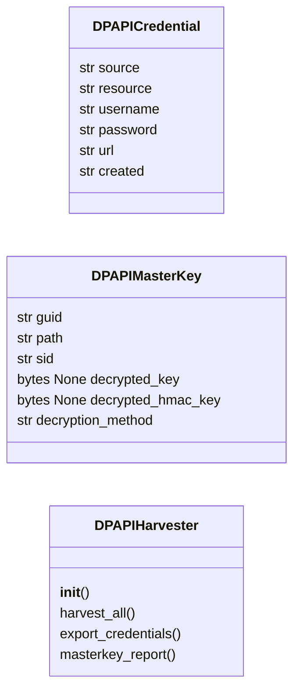

# `modules.dpapi_harvester`

> Source: [modules/dpapi_harvester.py:1](../../modules/dpapi_harvester.py#L1) | language `py` | coverage 75.0% | [API index](../index.md)

DPAPI credential decryption and harvesting engine.

Supports offline decryption of:
- Master keys (Preferred file, local machine keys, domain backup keys)
- Credential files (Credential Manager, Windows Vault)
- Browser data (Chrome, Edge — cookies, passwords, payment methods)
- Wi-Fi profiles and WPA2 keys
- RDP saved credentials
- DPAPI-protected blobs with known entropy

Uses Windows DPAPI via Python ctypes (local) or Impacket (remote).
Falls back to mimikatz-style masterkey extraction when available.

## Contents

- **Classes:** [`DPAPICredential`](#dpapicredential), [`DPAPIMasterKey`](#dpapimasterkey), [`DPAPIHarvester`](#dpapiharvester)

## Type Diagram



## Classes

<a id="dpapicredential"></a>

### `DPAPICredential`

`class` `dataclass` | [modules/dpapi_harvester.py:44](../../modules/dpapi_harvester.py#L44)

Decorators: `@dataclass`

```python
class DPAPICredential
```

**Attributes**

| Name | Type | Default | Description |
|---|---|---|---|
| [`source`](#dpapicredential-source) | `str` |  |  |
| [`resource`](#dpapicredential-resource) | `str` |  |  |
| [`username`](#dpapicredential-username) | `str` |  |  |
| [`password`](#dpapicredential-password) | `str` |  |  |
| [`url`](#dpapicredential-url) | `str` | `''` |  |
| [`created`](#dpapicredential-created) | `str` | `''` |  |

---

<a id="dpapimasterkey"></a>

### `DPAPIMasterKey`

`class` `dataclass` | [modules/dpapi_harvester.py:54](../../modules/dpapi_harvester.py#L54)

Decorators: `@dataclass`

```python
class DPAPIMasterKey
```

**Attributes**

| Name | Type | Default | Description |
|---|---|---|---|
| [`guid`](#dpapimasterkey-guid) | `str` |  |  |
| [`path`](#dpapimasterkey-path) | `str` |  |  |
| [`sid`](#dpapimasterkey-sid) | `str` |  |  |
| [`decrypted_key`](#dpapimasterkey-decrypted_key) | `bytes \| None` | `None` |  |
| [`decrypted_hmac_key`](#dpapimasterkey-decrypted_hmac_key) | `bytes \| None` | `None` |  |
| [`decryption_method`](#dpapimasterkey-decryption_method) | `str` | `'unknown'` |  |

---

<a id="dpapiharvester"></a>

### `DPAPIHarvester`

`class` | [modules/dpapi_harvester.py:63](../../modules/dpapi_harvester.py#L63)

```python
class DPAPIHarvester
```

Harvest and decrypt DPAPI-protected credentials.

Supports:
- Master key extraction from local machine
- Master key decryption via domain backup key
- Credential manager vault decryption
- Browser (Chrome/Edge) credential extraction
- Wi-Fi profile recovery
- RDP credential cache parsing

**Parameters**

| Name | Type | Default | Description |
|---|---|---|---|
| `sessions_dir` |  |  | Directory for output artifacts. |
| `masterkey_path` |  |  | Custom masterkey path to override default. |

**Members**

| Member | Kind | Summary |
|---|---|---|
| [`__init__`](#dpapiharvester-__init__) | constructor |  |
| [`harvest_all`](#dpapiharvester-harvest_all) | method | Run all harvesters and return all discovered credentials. |
| [`export_credentials`](#dpapiharvester-export_credentials) | method | Export all harvested credentials to a text file. |
| [`masterkey_report`](#dpapiharvester-masterkey_report) | method | Generate a master key report. |

<a id="dpapiharvester-__init__"></a>

#### `DPAPIHarvester.__init__`

`constructor` | [modules/dpapi_harvester.py:79](../../modules/dpapi_harvester.py#L79)

```python
def __init__(self, sessions_dir: str = 'sessions', masterkey_path: str = '')
```

**Parameters**

| Name | Type | Default | Description |
|---|---|---|---|
| `sessions_dir` | `str` | `'sessions'` | Directory for output artifacts. |
| `masterkey_path` | `str` | `''` | Custom masterkey path to override default. |

*Called by:* [`DPAPICommandSet.do_dpapi_harvest`](cli.commands.dpapi.py.md#dpapicommandset-do_dpapi_harvest)

<a id="dpapiharvester-harvest_all"></a>

#### `DPAPIHarvester.harvest_all`

`method` | [modules/dpapi_harvester.py:90](../../modules/dpapi_harvester.py#L90)

```python
def harvest_all(self) -> list[DPAPICredential]
```

Run all harvesters and return all discovered credentials.

**Returns:** `list[DPAPICredential]` - List of decrypted DPAPICredential objects.

*Called by:* [`DPAPICommandSet.do_dpapi_harvest`](cli.commands.dpapi.py.md#dpapicommandset-do_dpapi_harvest)

<a id="dpapiharvester-export_credentials"></a>

#### `DPAPIHarvester.export_credentials`

`method` | [modules/dpapi_harvester.py:367](../../modules/dpapi_harvester.py#L367)

```python
def export_credentials(self) -> str
```

Export all harvested credentials to a text file.

**Returns:** `str` - Path to the exported file.

*Called by:* [`DPAPICommandSet.do_dpapi_harvest`](cli.commands.dpapi.py.md#dpapicommandset-do_dpapi_harvest)

<a id="dpapiharvester-masterkey_report"></a>

#### `DPAPIHarvester.masterkey_report`

`method` | [modules/dpapi_harvester.py:386](../../modules/dpapi_harvester.py#L386)

```python
def masterkey_report(self) -> str
```

Generate a master key report.

**Returns:** `str` - Path to the report file.

*Called by:* [`DPAPICommandSet.do_dpapi_harvest`](cli.commands.dpapi.py.md#dpapicommandset-do_dpapi_harvest)

---
