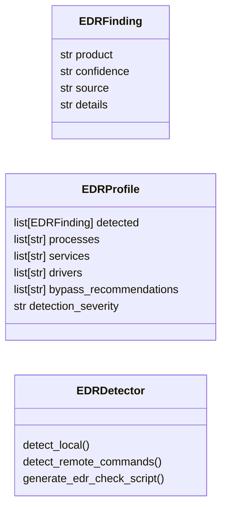

# `modules.edr_detector`

> Source: [modules/edr_detector.py:1](../../modules/edr_detector.py#L1) | language `py` | coverage 71.4% | [API index](../index.md)

EDR/AV Detection and Evasion Profiling Engine.

Detects endpoint security products (AV, EDR, XDR) on Windows targets through:
- WMI queries (AntiVirusProduct, AntiSpywareProduct)
- Service enumeration (running security services)
- Process enumeration (security agent processes)
- Registry inspection (installed security products)
- Driver enumeration (kernel security drivers)
- File system checks (known installation paths)
- DLL injection detection (hooked modules)

Supports remote detection via WinRM/SMB/WMI and local detection from an implant.
Generates an evasion profile recommending bypass techniques based on detected defenses.

## Contents

- **Classes:** [`EDRFinding`](#edrfinding), [`EDRProfile`](#edrprofile), [`EDRDetector`](#edrdetector)
- **Constants:** [`EDR_SIGNATURES`](#edr_signatures)

## Type Diagram



## Call Graph

Solid arrows stay in this module, dashed arrows leave it.


## Classes

<a id="edrfinding"></a>

### `EDRFinding`

`class` `dataclass` | [modules/edr_detector.py:174](../../modules/edr_detector.py#L174)

Decorators: `@dataclass`

```python
class EDRFinding
```

**Attributes**

| Name | Type | Default | Description |
|---|---|---|---|
| [`product`](#edrfinding-product) | `str` |  |  |
| [`confidence`](#edrfinding-confidence) | `str` |  |  |
| [`source`](#edrfinding-source) | `str` |  |  |
| [`details`](#edrfinding-details) | `str` |  |  |

---

<a id="edrprofile"></a>

### `EDRProfile`

`class` `dataclass` | [modules/edr_detector.py:182](../../modules/edr_detector.py#L182)

Decorators: `@dataclass`

```python
class EDRProfile
```

**Attributes**

| Name | Type | Default | Description |
|---|---|---|---|
| [`detected`](#edrprofile-detected) | `list[EDRFinding]` | `field(default_factory=list)` |  |
| [`processes`](#edrprofile-processes) | `list[str]` | `field(default_factory=list)` |  |
| [`services`](#edrprofile-services) | `list[str]` | `field(default_factory=list)` |  |
| [`drivers`](#edrprofile-drivers) | `list[str]` | `field(default_factory=list)` |  |
| [`bypass_recommendations`](#edrprofile-bypass_recommendations) | `list[str]` | `field(default_factory=list)` |  |
| [`detection_severity`](#edrprofile-detection_severity) | `str` | `'unknown'` |  |

---

<a id="edrdetector"></a>

### `EDRDetector`

`class` | [modules/edr_detector.py:191](../../modules/edr_detector.py#L191)

```python
class EDRDetector
```

Detect antivirus and EDR products on Windows targets.

Combines multiple detection sources to fingerprint security products:
WMI, services, processes, registry, drivers, file paths.

Can operate in local mode (running on the target) or generate
commands for remote execution via SMB/WinRM/WMI.

**Members**

| Member | Kind | Summary |
|---|---|---|
| [`detect_local`](#edrdetector-detect_local) | staticmethod | Detect EDR products on the local Windows machine. |
| [`detect_remote_commands`](#edrdetector-detect_remote_commands) | staticmethod | Generate commands for remote EDR detection. |
| [`generate_edr_check_script`](#edrdetector-generate_edr_check_script) | staticmethod | Generate a PowerShell script for comprehensive EDR detection. |

<a id="edrdetector-detect_local"></a>

#### `EDRDetector.detect_local`

`staticmethod` | [modules/edr_detector.py:202](../../modules/edr_detector.py#L202)

Decorators: `@staticmethod`

```python
def detect_local() -> EDRProfile
```

Detect EDR products on the local Windows machine.

**Returns:** `EDRProfile` - EDRProfile with detected products and recommendations.

*Calls:* [`EDRProfile`](#edrprofile)

*Called by:* [`EDRDetectCommandSet.do_edr_profile`](cli.commands.edr_detect.py.md#edrdetectcommandset-do_edr_profile)

<a id="edrdetector-detect_remote_commands"></a>

#### `EDRDetector.detect_remote_commands`

`staticmethod` | [modules/edr_detector.py:221](../../modules/edr_detector.py#L221)

Decorators: `@staticmethod`

```python
def detect_remote_commands(remote_type: str = 'wmi') -> list[dict[str, str]]
```

Generate commands for remote EDR detection.

**Parameters**

| Name | Type | Default | Description |
|---|---|---|---|
| `remote_type` | `str` | `'wmi'` | Transport method (wmi, smb, winrm, ssh). |

**Returns:** `list[dict[str, str]]` - List of dicts with 'name' and 'command' keys.

*Called by:* [`EDRDetectCommandSet.do_edr_detect`](cli.commands.edr_detect.py.md#edrdetectcommandset-do_edr_detect)

<a id="edrdetector-generate_edr_check_script"></a>

#### `EDRDetector.generate_edr_check_script`

`staticmethod` | [modules/edr_detector.py:440](../../modules/edr_detector.py#L440)

Decorators: `@staticmethod`

```python
def generate_edr_check_script(remote_type: str = 'wmi') -> str
```

Generate a PowerShell script for comprehensive EDR detection.

**Parameters**

| Name | Type | Default | Description |
|---|---|---|---|
| `remote_type` | `str` | `'wmi'` | Execution method hint for the script comments. |

**Returns:** `str` - Complete PowerShell script as a string.

*Called by:* [`EDRDetectCommandSet.do_edr_script`](cli.commands.edr_detect.py.md#edrdetectcommandset-do_edr_script)

---

## Constants

<a id="edr_signatures"></a>

### `EDR_SIGNATURES`

`constant` | [modules/edr_detector.py:25](../../modules/edr_detector.py#L25)

```python
EDR_SIGNATURES: dict[str, dict[str, Any]]
```

---
