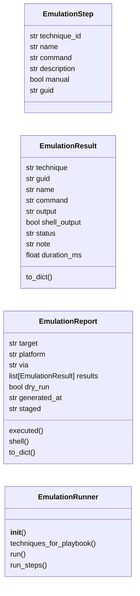
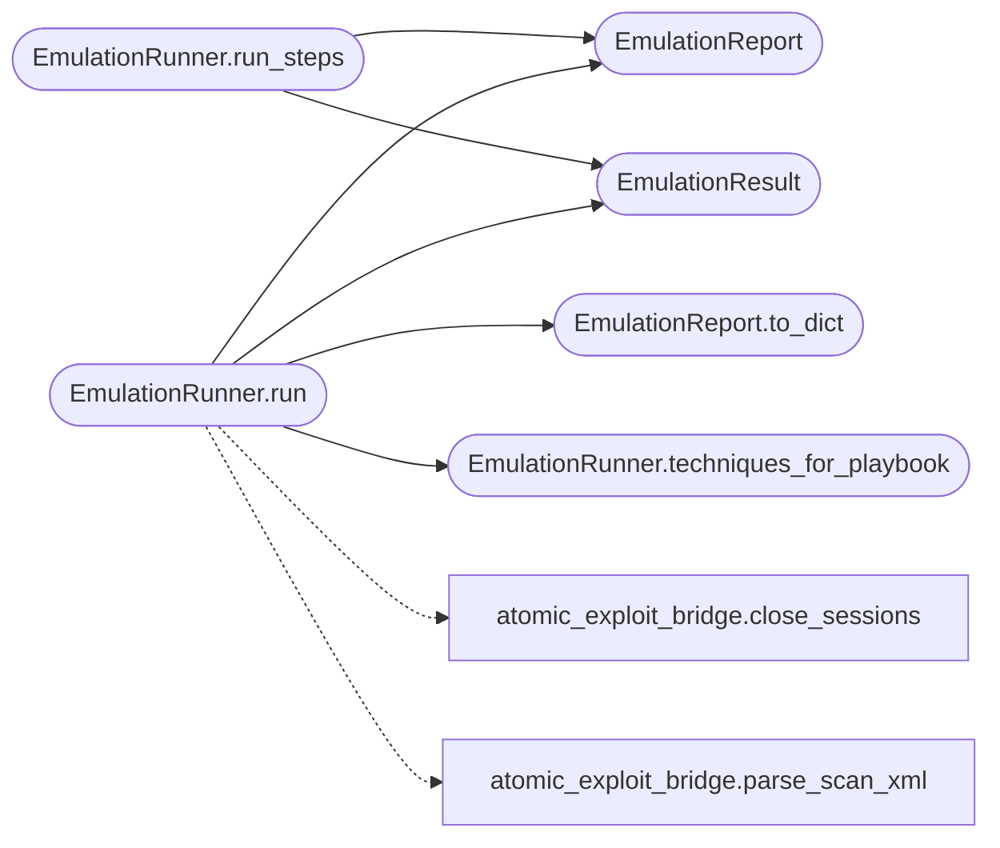

# `modules.emulation_runner`

> Source: [modules/emulation_runner.py:1](../../modules/emulation_runner.py#L1) | language `py` | coverage 100.0% | [API index](../index.md)

Single execution contract for Atomic emulation.

Resolves MITRE techniques or an APT playbook to concrete Atomic tests,
runs each rendered command through one execution primitive, normalizes
the result and publishes one outcome per test. The CLI, MCP, APT chains
and the loop consume this contract instead of reimplementing the loop.

## Contents

- **Classes:** [`EmulationStep`](#emulationstep), [`EmulationResult`](#emulationresult), [`EmulationReport`](#emulationreport), [`EmulationRunner`](#emulationrunner)

## Type Diagram



## Call Graph

Solid arrows stay in this module, dashed arrows leave it.



## Classes

<a id="emulationstep"></a>

### `EmulationStep`

`class` `dataclass` | [modules/emulation_runner.py:28](../../modules/emulation_runner.py#L28)

Decorators: `@dataclass`

```python
class EmulationStep
```

One already-resolved command to execute.

**Attributes**

| Name | Type | Default | Description |
|---|---|---|---|
| [`technique_id`](#emulationstep-technique_id) | `str` | `''` |  |
| [`name`](#emulationstep-name) | `str` | `''` |  |
| [`command`](#emulationstep-command) | `str` | `''` |  |
| [`description`](#emulationstep-description) | `str` | `''` |  |
| [`manual`](#emulationstep-manual) | `bool` | `False` |  |
| [`guid`](#emulationstep-guid) | `str` | `''` |  |

---

<a id="emulationresult"></a>

### `EmulationResult`

`class` `dataclass` | [modules/emulation_runner.py:40](../../modules/emulation_runner.py#L40)

Decorators: `@dataclass`

```python
class EmulationResult
```

Normalized result of one emulation test.

**Attributes**

| Name | Type | Default | Description |
|---|---|---|---|
| [`technique`](#emulationresult-technique) | `str` | `''` |  |
| [`guid`](#emulationresult-guid) | `str` | `''` |  |
| [`name`](#emulationresult-name) | `str` | `''` |  |
| [`command`](#emulationresult-command) | `str` | `''` |  |
| [`output`](#emulationresult-output) | `str` | `''` |  |
| [`shell_output`](#emulationresult-shell_output) | `bool` | `False` |  |
| [`status`](#emulationresult-status) | `str` | `'pending'` |  |
| [`note`](#emulationresult-note) | `str` | `''` |  |
| [`duration_ms`](#emulationresult-duration_ms) | `float` | `0.0` |  |

**Members**

| Member | Kind | Summary |
|---|---|---|
| [`to_dict`](#emulationresult-to_dict) | method | Return a JSON-serializable view. |

<a id="emulationresult-to_dict"></a>

#### `EmulationResult.to_dict`

`method` | [modules/emulation_runner.py:53](../../modules/emulation_runner.py#L53)

```python
def to_dict(self) -> dict[str, Any]
```

Return a JSON-serializable view.

**Returns:** `dict[str, Any]`

---

<a id="emulationreport"></a>

### `EmulationReport`

`class` `dataclass` | [modules/emulation_runner.py:69](../../modules/emulation_runner.py#L69)

Decorators: `@dataclass`

```python
class EmulationReport
```

Report for one emulation run.

**Attributes**

| Name | Type | Default | Description |
|---|---|---|---|
| [`target`](#emulationreport-target) | `str` | `''` |  |
| [`platform`](#emulationreport-platform) | `str` | `'linux'` |  |
| [`via`](#emulationreport-via) | `str` | `''` |  |
| [`results`](#emulationreport-results) | `list[EmulationResult]` | `field(default_factory=list)` |  |
| [`dry_run`](#emulationreport-dry_run) | `bool` | `False` |  |
| [`generated_at`](#emulationreport-generated_at) | `str` | `''` |  |
| [`staged`](#emulationreport-staged) | `str` | `''` |  |

**Members**

| Member | Kind | Summary |
|---|---|---|
| [`executed`](#emulationreport-executed) | property | Return the number of tests that actually ran. |
| [`shell`](#emulationreport-shell) | property | Return True when any test produced a shell signal. |
| [`to_dict`](#emulationreport-to_dict) | method | Return the legacy bridge-shaped mapping plus v2 fields. |

<a id="emulationreport-executed"></a>

#### `EmulationReport.executed`

`property` | [modules/emulation_runner.py:81](../../modules/emulation_runner.py#L81)

Decorators: `@property`

```python
def executed(self) -> int
```

Return the number of tests that actually ran.

**Returns:** `int`

<a id="emulationreport-shell"></a>

#### `EmulationReport.shell`

`property` | [modules/emulation_runner.py:86](../../modules/emulation_runner.py#L86)

Decorators: `@property`

```python
def shell(self) -> bool
```

Return True when any test produced a shell signal.

**Returns:** `bool`

<a id="emulationreport-to_dict"></a>

#### `EmulationReport.to_dict`

`method` | [modules/emulation_runner.py:90](../../modules/emulation_runner.py#L90)

```python
def to_dict(self) -> dict[str, Any]
```

Return the legacy bridge-shaped mapping plus v2 fields.

**Returns:** `dict[str, Any]`

*Called by:* [`EmulationRunner.run`](#emulationrunner-run)

---

<a id="emulationrunner"></a>

### `EmulationRunner`

`class` | [modules/emulation_runner.py:105](../../modules/emulation_runner.py#L105)

```python
class EmulationRunner
```

Resolve and execute Atomic tests through one primitive.

**Members**

| Member | Kind | Summary |
|---|---|---|
| [`__init__`](#emulationrunner-__init__) | constructor | Bind optional collaborators; defaults load the shared modules lazily. |
| [`techniques_for_playbook`](#emulationrunner-techniques_for_playbook) | method | Return ordered unique technique IDs for one APT playbook. |
| [`run`](#emulationrunner-run) | method | Execute emulation tests and return the staged report. |
| [`run_steps`](#emulationrunner-run_steps) | method | Execute already-resolved steps through one executor. |

<a id="emulationrunner-__init__"></a>

#### `EmulationRunner.__init__`

`constructor` | [modules/emulation_runner.py:108](../../modules/emulation_runner.py#L108)

```python
def __init__(self, resolver: Any = None, sessions_dir: Path | str | None = None, shell_opener: Callable[..., Any] | None = None, remote_exec_fn: Callable[..., str] | None = None, playbook_loader: Callable[[str], Any] | None = None, outcome_recorder: Callable[..., Any] | None = None, shell_detector: Callable[..., bool] | None = None) -> None
```

Bind optional collaborators; defaults load the shared modules lazily.

**Parameters**

| Name | Type | Default | Description |
|---|---|---|---|
| `resolver` | `Any` | `None` |  |
| `sessions_dir` | `Path \| str \| None` | `None` |  |
| `shell_opener` | `Callable[..., Any] \| None` | `None` |  |
| `remote_exec_fn` | `Callable[..., str] \| None` | `None` |  |
| `playbook_loader` | `Callable[[str], Any] \| None` | `None` |  |
| `outcome_recorder` | `Callable[..., Any] \| None` | `None` |  |
| `shell_detector` | `Callable[..., bool] \| None` | `None` |  |

*Called by:* [`emulate`](modules.atomic_exploit_bridge.py.md#emulate), [`PlaybookEngine.execute`](modules.playbook_engine.py.md#playbookengine-execute)

<a id="emulationrunner-techniques_for_playbook"></a>

#### `EmulationRunner.techniques_for_playbook`

`method` | [modules/emulation_runner.py:182](../../modules/emulation_runner.py#L182)

```python
def techniques_for_playbook(self, playbook: str, platform: str = '') -> list[str]
```

Return ordered unique technique IDs for one APT playbook.

**Parameters**

| Name | Type | Default | Description |
|---|---|---|---|
| `playbook` | `str` |  | APT playbook key. |
| `platform` | `str` | `''` | Optional platform filter kept for parity. |

**Returns:** `list[str]` - Technique IDs in phase order.

**Raises**

- `ValueError`: (raised in the body, not documented)

*Called by:* [`EmulationRunner.run`](#emulationrunner-run)

<a id="emulationrunner-run"></a>

#### `EmulationRunner.run`

`method` | [modules/emulation_runner.py:202](../../modules/emulation_runner.py#L202)

```python
def run(self, target: str, techniques: list[str] | None = None, playbook: str = '', platform: str = 'linux', lhost: str = '127.0.0.1', per_technique: int = 1, include_manual: bool = False, dry_run: bool = False, executor: Callable[[str], str] | None = None, exploits_dir: Path | str | None = None, scan_dir: Path | str | None = None) -> dict[str, Any]
```

Execute emulation tests and return the staged report.

**Parameters**

| Name | Type | Default | Description |
|---|---|---|---|
| `target` | `str` |  | Victim address. |
| `techniques` | `list[str] \| None` | `None` | Optional technique IDs; playbook supplies them when empty. |
| `playbook` | `str` | `''` | APT playbook key. |
| `platform` | `str` | `'linux'` | Atomic platform filter. |
| `lhost` | `str` | `'127.0.0.1'` | Attacker address for shell primitives. |
| `per_technique` | `int` | `1` | Tests to run per technique (1-3). |
| `include_manual` | `bool` | `False` | Execute tests whose executor is manual. |
| `dry_run` | `bool` | `False` | Resolve commands without executing them. |
| `executor` | `Callable[[str], str] \| None` | `None` | Optional command executor; replaces the shell primitive. |
| `exploits_dir` | `Path \| str \| None` | `None` | Exploit catalogue directory for the shell opener. |
| `scan_dir` | `Path \| str \| None` | `None` | Sessions directory override. |

**Returns:** `dict[str, Any]` - Report mapping with normalized results and staged path.

**Raises**

- `ValueError`: No techniques or unknown playbook.
- `RuntimeError`: No working shell primitive and no executor.

*Calls:* [`close_sessions`](modules.atomic_exploit_bridge.py.md#close_sessions), [`parse_scan_xml`](modules.atomic_exploit_bridge.py.md#parse_scan_xml), [`EmulationReport`](#emulationreport), [`EmulationReport.to_dict`](#emulationreport-to_dict), [`EmulationResult`](#emulationresult), [`EmulationRunner.techniques_for_playbook`](#emulationrunner-techniques_for_playbook)

*Called by:* [`emulate`](modules.atomic_exploit_bridge.py.md#emulate)

<a id="emulationrunner-run_steps"></a>

#### `EmulationRunner.run_steps`

`method` | [modules/emulation_runner.py:321](../../modules/emulation_runner.py#L321)

```python
def run_steps(self, steps: list[EmulationStep], target: str, executor: Callable[[str], str], platform: str = 'linux', dry_run: bool = False, source: str = 'emulation_runner') -> EmulationReport
```

Execute already-resolved steps through one executor.

**Parameters**

| Name | Type | Default | Description |
|---|---|---|---|
| `steps` | `list[EmulationStep]` |  | Resolved commands. |
| `target` | `str` |  | Victim address. |
| `executor` | `Callable[[str], str]` |  | Callable(command) -> output. |
| `platform` | `str` | `'linux'` | Platform label for the report. |
| `dry_run` | `bool` | `False` | Resolve without executing. |
| `source` | `str` | `'emulation_runner'` | Event source tag. |

**Returns:** `EmulationReport` - Emulation report.

*Calls:* [`EmulationReport`](#emulationreport), [`EmulationResult`](#emulationresult)

*Called by:* [`PlaybookEngine.execute`](modules.playbook_engine.py.md#playbookengine-execute)

---
