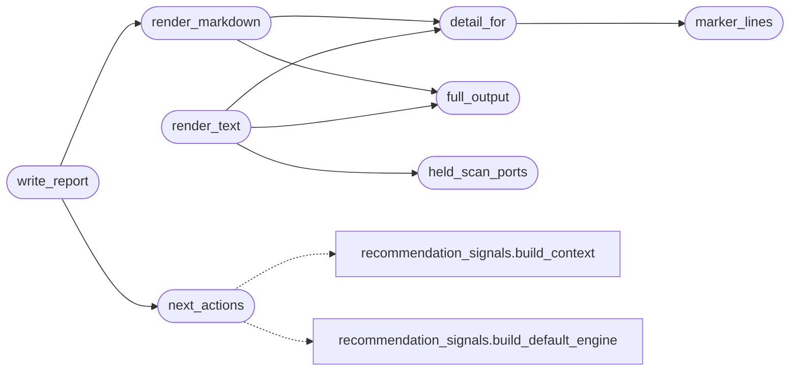

# `modules.engage_summary`

> Source: [modules/engage_summary.py:1](../../modules/engage_summary.py#L1) | language `py` | coverage 100.0% | [API index](../index.md)

Rich per-step engagement summaries from evidence and sessions artefacts.

Builds the operator-facing detail LAZY shows in its plan tab: what each
step found (OS, ports, populated fields, facts, candidates, payload),
what was skipped and why, and what to run next via the unified
recommendation engine (``cli/recommendation.py`` — the single source of
truth for suggestions). Full step outputs come from the evidence vault,
never from truncated tails. Reports persist under
``sessions/engagements/`` for later queries by operators or agents.

## Contents

- **Functions:** [`marker_lines`](#marker_lines), [`full_output`](#full_output), [`held_scan_ports`](#held_scan_ports), [`detail_for`](#detail_for), [`next_actions`](#next_actions), [`render_text`](#render_text), [`render_markdown`](#render_markdown), [`write_report`](#write_report)

## Call Graph

Solid arrows stay in this module, dashed arrows leave it.



## Functions

<a id="marker_lines"></a>

### `marker_lines`

`function` | [modules/engage_summary.py:35](../../modules/engage_summary.py#L35)

```python
def marker_lines(text: str, limit: int = MAX_MARKER_LINES) -> list[str]
```

Extract real log lines (``[+] ...

[+]``) dropping panels and bars.

**Parameters**

| Name | Type | Default | Description |
|---|---|---|---|
| `text` | `str` |  |  |
| `limit` | `int` | `MAX_MARKER_LINES` |  |

**Returns:** `list[str]`

*Called by:* [`detail_for`](#detail_for)

---

<a id="full_output"></a>

### `full_output`

`function` | [modules/engage_summary.py:51](../../modules/engage_summary.py#L51)

```python
def full_output(step: dict, sessions_dir: str | Path) -> str
```

Return the full step output from evidence, falling back to the tail.

**Parameters**

| Name | Type | Default | Description |
|---|---|---|---|
| `step` | `dict` |  |  |
| `sessions_dir` | `str \| Path` |  |  |

**Returns:** `str`

*Called by:* [`render_markdown`](#render_markdown), [`render_text`](#render_text)

---

<a id="held_scan_ports"></a>

### `held_scan_ports`

`function` | [modules/engage_summary.py:64](../../modules/engage_summary.py#L64)

```python
def held_scan_ports(target: str, sessions_dir: str | Path) -> tuple[list[str], list[str]]
```

Parse held scan XMLs for open ports.

Returns (ports, source_names). Ports look like ``4000/remoteanything``.

**Parameters**

| Name | Type | Default | Description |
|---|---|---|---|
| `target` | `str` |  |  |
| `sessions_dir` | `str \| Path` |  |  |

**Returns:** `tuple[list[str], list[str]]`

*Called by:* [`render_text`](#render_text)

---

<a id="detail_for"></a>

### `detail_for`

`function` | [modules/engage_summary.py:98](../../modules/engage_summary.py#L98)

```python
def detail_for(tool: str, text: str, target: str = '', sessions_dir: str | Path = 'sessions') -> list[str]
```

Extract the key facts from one step output for the summary.

**Parameters**

| Name | Type | Default | Description |
|---|---|---|---|
| `tool` | `str` |  |  |
| `text` | `str` |  |  |
| `target` | `str` | `''` |  |
| `sessions_dir` | `str \| Path` | `'sessions'` |  |

**Returns:** `list[str]`

*Calls:* [`marker_lines`](#marker_lines)

*Called by:* [`render_markdown`](#render_markdown), [`render_text`](#render_text)

---

<a id="next_actions"></a>

### `next_actions`

`function` | [modules/engage_summary.py:150](../../modules/engage_summary.py#L150)

```python
def next_actions(target: str, sessions_dir: str | Path = 'sessions', limit: int = MAX_NEXT) -> list[dict]
```

Rank next actions via the unified recommendation engine.

Degrades to [] when the engine is unavailable — callers always work.

**Parameters**

| Name | Type | Default | Description |
|---|---|---|---|
| `target` | `str` |  |  |
| `sessions_dir` | `str \| Path` | `'sessions'` |  |
| `limit` | `int` | `MAX_NEXT` |  |

**Returns:** `list[dict]`

*Calls:* [`build_context`](cli.recommendation_signals.py.md#build_context), [`build_default_engine`](cli.recommendation_signals.py.md#build_default_engine)

*Called by:* [`write_report`](#write_report)

---

<a id="render_text"></a>

### `render_text`

`function` | [modules/engage_summary.py:175](../../modules/engage_summary.py#L175)

```python
def render_text(engagement_id: str, target: str, shell: bool, steps: list[dict], sessions_dir: str | Path = 'sessions') -> str
```

Render the console summary with per-step detail lines.

**Parameters**

| Name | Type | Default | Description |
|---|---|---|---|
| `engagement_id` | `str` |  |  |
| `target` | `str` |  |  |
| `shell` | `bool` |  |  |
| `steps` | `list[dict]` |  |  |
| `sessions_dir` | `str \| Path` | `'sessions'` |  |

**Returns:** `str`

*Calls:* [`detail_for`](#detail_for), [`full_output`](#full_output), [`held_scan_ports`](#held_scan_ports)

---

<a id="render_markdown"></a>

### `render_markdown`

`function` | [modules/engage_summary.py:210](../../modules/engage_summary.py#L210)

```python
def render_markdown(engagement_id: str, target: str, shell: bool, steps: list[dict], next_list: list[dict], sessions_dir: str | Path = 'sessions') -> str
```

Render the persisted per-engagement report.

**Parameters**

| Name | Type | Default | Description |
|---|---|---|---|
| `engagement_id` | `str` |  |  |
| `target` | `str` |  |  |
| `shell` | `bool` |  |  |
| `steps` | `list[dict]` |  |  |
| `next_list` | `list[dict]` |  |  |
| `sessions_dir` | `str \| Path` | `'sessions'` |  |

**Returns:** `str`

*Calls:* [`detail_for`](#detail_for), [`full_output`](#full_output)

*Called by:* [`write_report`](#write_report)

---

<a id="write_report"></a>

### `write_report`

`function` | [modules/engage_summary.py:247](../../modules/engage_summary.py#L247)

```python
def write_report(engagement_id: str, target: str, shell: bool, steps: list[dict], sessions_dir: str | Path = 'sessions') -> str
```

Persist the engagement report; return its relative path.

**Parameters**

| Name | Type | Default | Description |
|---|---|---|---|
| `engagement_id` | `str` |  |  |
| `target` | `str` |  |  |
| `shell` | `bool` |  |  |
| `steps` | `list[dict]` |  |  |
| `sessions_dir` | `str \| Path` | `'sessions'` |  |

**Returns:** `str`

*Calls:* [`next_actions`](#next_actions), [`render_markdown`](#render_markdown)

---
