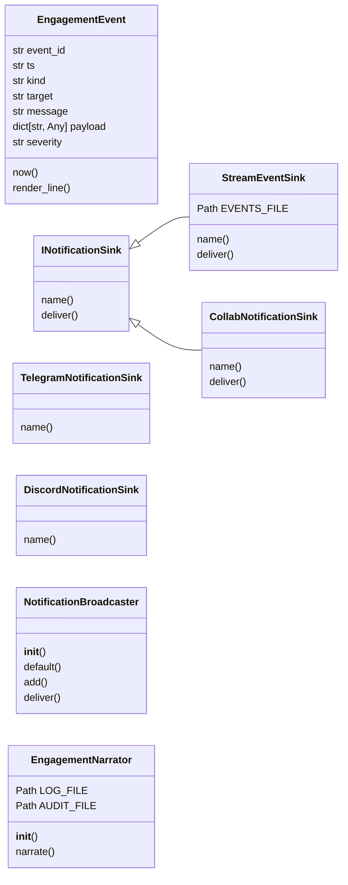
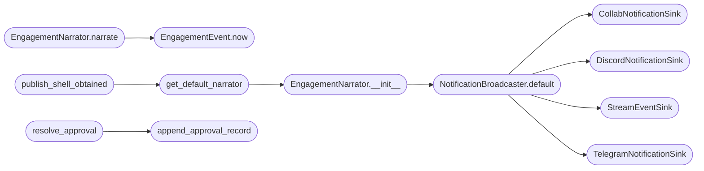

# `modules.engagement_hooks`

> Source: [modules/engagement_hooks.py:1](../../modules/engagement_hooks.py#L1) | language `py` | coverage 87.1% | [API index](../index.md)

modules/engagement_hooks.py — Engagement narration and notification fabric ==========================================================================

Single bridge layer shared by skills/autonomous_daemon.py (EngageOrchestrator)
and lazyc2.py (beacon registration). Provides:

  - EngagementNarrator   : human-readable journal at sessions/engagement.log
  - INotificationSink    : abstract sink contract (SRP/ISP)
  - CollabNotificationSink     : bridges to modules.collab_bp.publish_event
  - TelegramNotificationSink   : optional, gated by payload.enable_telegram_c2
  - DiscordNotificationSink    : optional, gated by payload.enable_discord_c2
  - StreamEventSink            : appends to sessions/autonomous_events.jsonl
  - NotificationBroadcaster    : fan-out to every registered sink
  - publish_shell_obtained(...): single entry point for lazyc2.py beacon code

SOLID:
  S — every class owns one concern.
  O — new sinks (Slack, syslog, SIEM) plug in via INotificationSink without
      touching the broadcaster or the narrator.
  L — every sink honours the INotificationSink contract; broadcaster never
      type-checks.
  I — small role-specific interfaces; the narrator does not depend on sink
      delivery details.
  D — the broadcaster depends on INotificationSink, not on concrete classes;
      callers inject sinks at construction time.

Security:
  - No dynamic imports of arbitrary modules. No eval/exec.
  - Outbound HTTP uses urllib with explicit URLs from payload.json keys only.
  - Every sink wraps its delivery in try/except; a failing sink never blocks
    the engagement loop or the beacon response path.
  - File writes go through pathlib with explicit parents=True so the daemon
    creates sessions/ on first use without escalating into other directories.
  - All payload keys read with .get() to default safely when payload.json is
    incomplete; missing credentials simply disable the corresponding sink.

## Contents

- **Classes:** [`EngagementEvent`](#engagementevent), [`INotificationSink`](#inotificationsink), [`StreamEventSink`](#streameventsink), [`CollabNotificationSink`](#collabnotificationsink), [`TelegramNotificationSink`](#telegramnotificationsink), [`DiscordNotificationSink`](#discordnotificationsink), [`NotificationBroadcaster`](#notificationbroadcaster), [`EngagementNarrator`](#engagementnarrator)
- **Functions:** [`get_default_narrator`](#get_default_narrator), [`publish_shell_obtained`](#publish_shell_obtained), [`append_approval_record`](#append_approval_record), [`list_pending_approvals`](#list_pending_approvals), [`resolve_approval`](#resolve_approval), [`is_valid_target`](#is_valid_target)
- **Constants:** [`ENGAGEMENT_LOG`](#engagement_log), [`ENGAGEMENT_AUDIT`](#engagement_audit), [`APPROVALS_FILE`](#approvals_file)

## Type Diagram



## Call Graph

Solid arrows stay in this module, dashed arrows leave it.



## Classes

<a id="engagementevent"></a>

### `EngagementEvent`

`class` `dataclass` | [modules/engagement_hooks.py:101](../../modules/engagement_hooks.py#L101)

Decorators: `@dataclass(frozen=True)`

```python
class EngagementEvent
```

Value object describing a single engagement-narrator event.

**Attributes**

| Name | Type | Default | Description |
|---|---|---|---|
| [`event_id`](#engagementevent-event_id) | `str` |  | Short hex identifier unique within a daemon run. |
| [`ts`](#engagementevent-ts) | `str` |  | ISO-8601 UTC timestamp. |
| [`kind`](#engagementevent-kind) | `str` |  | Semantic event type (PHASE, STEP, FINDING, SHELL, APPROVAL, SWITCH_TOOL, ERROR, INFO). |
| [`target`](#engagementevent-target) | `str` |  | Primary target IP or hostname for the event. |
| [`message`](#engagementevent-message) | `str` |  | Human-readable narrative line for engagement.log. |
| [`payload`](#engagementevent-payload) | `dict[str, Any]` | `field(default_factory=dict)` | Structured machine-readable payload for the audit JSONL. |
| [`severity`](#engagementevent-severity) | `str` | `'info'` | One of info, warning, critical. |

**Members**

| Member | Kind | Summary |
|---|---|---|
| [`now`](#engagementevent-now) | classmethod | Construct an event with a fresh id and current UTC timestamp. |
| [`render_line`](#engagementevent-render_line) | method | Return a single-line operator-facing log entry. |

<a id="engagementevent-now"></a>

#### `EngagementEvent.now`

`classmethod` | [modules/engagement_hooks.py:124](../../modules/engagement_hooks.py#L124)

Decorators: `@classmethod`

```python
def now(cls, kind: str, target: str, message: str, payload: dict[str, Any] | None = None, severity: str = 'info') -> EngagementEvent
```

Construct an event with a fresh id and current UTC timestamp.

**Parameters**

| Name | Type | Default | Description |
|---|---|---|---|
| `kind` | `str` |  |  |
| `target` | `str` |  |  |
| `message` | `str` |  |  |
| `payload` | `dict[str, Any] \| None` | `None` |  |
| `severity` | `str` | `'info'` |  |

**Returns:** `EngagementEvent`

*Called by:* [`EngagementNarrator.narrate`](#engagementnarrator-narrate)

<a id="engagementevent-render_line"></a>

#### `EngagementEvent.render_line`

`method` | [modules/engagement_hooks.py:143](../../modules/engagement_hooks.py#L143)

```python
def render_line(self) -> str
```

Return a single-line operator-facing log entry.

**Returns:** `str`

---

<a id="inotificationsink"></a>

### `INotificationSink`

`class` `abstract` | [modules/engagement_hooks.py:150](../../modules/engagement_hooks.py#L150)

```python
class INotificationSink(ABC)
```

Bases: `ABC`

Subclasses: [`CollabNotificationSink`](#collabnotificationsink), [`StreamEventSink`](#streameventsink)

Contract for downstream delivery channels (collab, telegram, etc.).

**Members**

| Member | Kind | Summary |
|---|---|---|
| [`name`](#inotificationsink-name) | property | Stable channel identifier used for diagnostic logging. |
| [`deliver`](#inotificationsink-deliver) | method | Deliver one event. |

<a id="inotificationsink-name"></a>

#### `INotificationSink.name`

`property` `abstract` | [modules/engagement_hooks.py:155](../../modules/engagement_hooks.py#L155)

Decorators: `@property`, `@abstractmethod`

```python
def name(self) -> str
```

Stable channel identifier used for diagnostic logging.

**Returns:** `str`

<a id="inotificationsink-deliver"></a>

#### `INotificationSink.deliver`

`method` `abstract` | [modules/engagement_hooks.py:159](../../modules/engagement_hooks.py#L159)

Decorators: `@abstractmethod`

```python
def deliver(self, event: EngagementEvent) -> bool
```

Deliver one event.

Return True when accepted.

Implementations must never raise. A delivery failure is reported by
returning False and logging the cause at debug level.

**Parameters**

| Name | Type | Default | Description |
|---|---|---|---|
| `event` | `EngagementEvent` |  |  |

**Returns:** `bool`

---

<a id="streameventsink"></a>

### `StreamEventSink`

`class` | [modules/engagement_hooks.py:167](../../modules/engagement_hooks.py#L167)

```python
class StreamEventSink(INotificationSink)
```

Bases: [`INotificationSink`](#inotificationsink)

Append every event to sessions/autonomous_events.jsonl for the daemon stream.

This sink is the canonical record consumed by lazyown_autonomous_events
so engage events join the existing autonomous stream rather than living
in a parallel file.

**Attributes**

| Name | Type | Default | Description |
|---|---|---|---|
| [`EVENTS_FILE`](#streameventsink-events_file) | `Path` | `_SESSIONS_DIR / 'autonomous_events.jsonl'` |  |

**Members**

| Member | Kind | Summary |
|---|---|---|
| [`name`](#streameventsink-name) | property | Stable channel identifier used for diagnostic logging. |
| [`deliver`](#streameventsink-deliver) | method | Deliver one event. |

<a id="streameventsink-name"></a>

#### `StreamEventSink.name`

`property` | [modules/engagement_hooks.py:178](../../modules/engagement_hooks.py#L178)

Decorators: `@property`

```python
def name(self) -> str
```

Stable channel identifier used for diagnostic logging.

**Returns:** `str`

> **Inherited:** Documentation from [`INotificationSink.name`](#inotificationsink-name) (modules/engagement_hooks.py:155).

<a id="streameventsink-deliver"></a>

#### `StreamEventSink.deliver`

`method` | [modules/engagement_hooks.py:181](../../modules/engagement_hooks.py#L181)

```python
def deliver(self, event: EngagementEvent) -> bool
```

Deliver one event.

Return True when accepted.

Implementations must never raise. A delivery failure is reported by
returning False and logging the cause at debug level.

**Parameters**

| Name | Type | Default | Description |
|---|---|---|---|
| `event` | `EngagementEvent` |  |  |

**Returns:** `bool`

> **Inherited:** Documentation from [`INotificationSink.deliver`](#inotificationsink-deliver) (modules/engagement_hooks.py:159).

---

<a id="collabnotificationsink"></a>

### `CollabNotificationSink`

`class` | [modules/engagement_hooks.py:204](../../modules/engagement_hooks.py#L204)

```python
class CollabNotificationSink(INotificationSink)
```

Bases: [`INotificationSink`](#inotificationsink)

Bridges engagement events to modules.collab_bp.publish_event.

Teammates connected to the C2 dashboard see every narrated event in
real time without any extra wiring. The import is lazy so unit tests
that do not bring up Flask still pass.

**Members**

| Member | Kind | Summary |
|---|---|---|
| [`name`](#collabnotificationsink-name) | property | Stable channel identifier used for diagnostic logging. |
| [`deliver`](#collabnotificationsink-deliver) | method | Deliver one event. |

<a id="collabnotificationsink-name"></a>

#### `CollabNotificationSink.name`

`property` | [modules/engagement_hooks.py:213](../../modules/engagement_hooks.py#L213)

Decorators: `@property`

```python
def name(self) -> str
```

Stable channel identifier used for diagnostic logging.

**Returns:** `str`

> **Inherited:** Documentation from [`INotificationSink.name`](#inotificationsink-name) (modules/engagement_hooks.py:155).

<a id="collabnotificationsink-deliver"></a>

#### `CollabNotificationSink.deliver`

`method` | [modules/engagement_hooks.py:216](../../modules/engagement_hooks.py#L216)

```python
def deliver(self, event: EngagementEvent) -> bool
```

Deliver one event.

Return True when accepted.

Implementations must never raise. A delivery failure is reported by
returning False and logging the cause at debug level.

**Parameters**

| Name | Type | Default | Description |
|---|---|---|---|
| `event` | `EngagementEvent` |  |  |

**Returns:** `bool`

> **Inherited:** Documentation from [`INotificationSink.deliver`](#inotificationsink-deliver) (modules/engagement_hooks.py:159).

---

<a id="telegramnotificationsink"></a>

### `TelegramNotificationSink`

`class` | [modules/engagement_hooks.py:278](../../modules/engagement_hooks.py#L278)

```python
class TelegramNotificationSink(_OutboundHTTPSink)
```

Bases: `_OutboundHTTPSink`

Send a notification to a Telegram chat via the Bot API.

Required payload.json keys:
  enable_telegram_c2: truthy flag to enable delivery
  telegram_token   : Bot API token
  telegram_chat_id : numeric chat id (or @channel)

**Members**

| Member | Kind | Summary |
|---|---|---|
| [`name`](#telegramnotificationsink-name) | property |  |

<a id="telegramnotificationsink-name"></a>

#### `TelegramNotificationSink.name`

`property` | [modules/engagement_hooks.py:288](../../modules/engagement_hooks.py#L288)

Decorators: `@property`

```python
def name(self) -> str
```

**Returns:** `str`

---

<a id="discordnotificationsink"></a>

### `DiscordNotificationSink`

`class` | [modules/engagement_hooks.py:311](../../modules/engagement_hooks.py#L311)

```python
class DiscordNotificationSink(_OutboundHTTPSink)
```

Bases: `_OutboundHTTPSink`

Send a notification to a Discord channel via webhook.

Required payload.json keys:
  enable_discord_c2 : truthy flag to enable delivery
  discord_webhook   : full webhook URL

**Members**

| Member | Kind | Summary |
|---|---|---|
| [`name`](#discordnotificationsink-name) | property |  |

<a id="discordnotificationsink-name"></a>

#### `DiscordNotificationSink.name`

`property` | [modules/engagement_hooks.py:320](../../modules/engagement_hooks.py#L320)

Decorators: `@property`

```python
def name(self) -> str
```

**Returns:** `str`

---

<a id="notificationbroadcaster"></a>

### `NotificationBroadcaster`

`class` | [modules/engagement_hooks.py:336](../../modules/engagement_hooks.py#L336)

```python
class NotificationBroadcaster
```

Fan-out events to every registered sink.

Construction:
    broadcaster = NotificationBroadcaster.default()

Custom sinks (or test doubles):
    broadcaster = NotificationBroadcaster([StreamEventSink(), my_sink])

deliver(event) returns the list of sink names that accepted the event.
No exception escapes; sink failures are silent at info level.

**Members**

| Member | Kind | Summary |
|---|---|---|
| [`__init__`](#notificationbroadcaster-__init__) | constructor |  |
| [`default`](#notificationbroadcaster-default) | classmethod | Return a broadcaster with the standard four-sink configuration. |
| [`add`](#notificationbroadcaster-add) | method | Register an additional sink at runtime. |
| [`deliver`](#notificationbroadcaster-deliver) | method | Push event to all sinks. |

<a id="notificationbroadcaster-__init__"></a>

#### `NotificationBroadcaster.__init__`

`constructor` | [modules/engagement_hooks.py:349](../../modules/engagement_hooks.py#L349)

```python
def __init__(self, sinks: list[INotificationSink]) -> None
```

**Parameters**

| Name | Type | Default | Description |
|---|---|---|---|
| `sinks` | `list[INotificationSink]` |  |  |

<a id="notificationbroadcaster-default"></a>

#### `NotificationBroadcaster.default`

`classmethod` | [modules/engagement_hooks.py:354](../../modules/engagement_hooks.py#L354)

Decorators: `@classmethod`

```python
def default(cls) -> NotificationBroadcaster
```

Return a broadcaster with the standard four-sink configuration.

**Returns:** `NotificationBroadcaster`

*Calls:* [`CollabNotificationSink`](#collabnotificationsink), [`DiscordNotificationSink`](#discordnotificationsink), [`StreamEventSink`](#streameventsink), [`TelegramNotificationSink`](#telegramnotificationsink)

*Called by:* [`EngagementNarrator.__init__`](#engagementnarrator-__init__)

<a id="notificationbroadcaster-add"></a>

#### `NotificationBroadcaster.add`

`method` | [modules/engagement_hooks.py:365](../../modules/engagement_hooks.py#L365)

```python
def add(self, sink: INotificationSink) -> None
```

Register an additional sink at runtime.

**Parameters**

| Name | Type | Default | Description |
|---|---|---|---|
| `sink` | `INotificationSink` |  |  |

<a id="notificationbroadcaster-deliver"></a>

#### `NotificationBroadcaster.deliver`

`method` | [modules/engagement_hooks.py:370](../../modules/engagement_hooks.py#L370)

```python
def deliver(self, event: EngagementEvent) -> list[str]
```

Push event to all sinks.

Return the names of accepting sinks.

**Parameters**

| Name | Type | Default | Description |
|---|---|---|---|
| `event` | `EngagementEvent` |  |  |

**Returns:** `list[str]`

---

<a id="engagementnarrator"></a>

### `EngagementNarrator`

`class` | [modules/engagement_hooks.py:382](../../modules/engagement_hooks.py#L382)

```python
class EngagementNarrator
```

Writes human-readable narration to sessions/engagement.log and an audit JSONL trail, then fans the event out through the broadcaster.

The narrator does not know about delivery details; it owns formatting
and persistence only.

**Attributes**

| Name | Type | Default | Description |
|---|---|---|---|
| [`LOG_FILE`](#engagementnarrator-log_file) | `Path` | `ENGAGEMENT_LOG` |  |
| [`AUDIT_FILE`](#engagementnarrator-audit_file) | `Path` | `ENGAGEMENT_AUDIT` |  |

**Members**

| Member | Kind | Summary |
|---|---|---|
| [`__init__`](#engagementnarrator-__init__) | constructor |  |
| [`narrate`](#engagementnarrator-narrate) | method | Write one line + audit record and dispatch to every sink. |

<a id="engagementnarrator-__init__"></a>

#### `EngagementNarrator.__init__`

`constructor` | [modules/engagement_hooks.py:393](../../modules/engagement_hooks.py#L393)

```python
def __init__(self, broadcaster: NotificationBroadcaster | None = None) -> None
```

**Parameters**

| Name | Type | Default | Description |
|---|---|---|---|
| `broadcaster` | `NotificationBroadcaster \| None` | `None` |  |

*Calls:* [`NotificationBroadcaster.default`](#notificationbroadcaster-default)

*Called by:* [`get_default_narrator`](#get_default_narrator)

<a id="engagementnarrator-narrate"></a>

#### `EngagementNarrator.narrate`

`method` | [modules/engagement_hooks.py:400](../../modules/engagement_hooks.py#L400)

```python
def narrate(self, kind: str, target: str, message: str, payload: dict[str, Any] | None = None, severity: str = 'info') -> EngagementEvent
```

Write one line + audit record and dispatch to every sink.

Returns the constructed EngagementEvent so callers can correlate.

**Parameters**

| Name | Type | Default | Description |
|---|---|---|---|
| `kind` | `str` |  |  |
| `target` | `str` |  |  |
| `message` | `str` |  |  |
| `payload` | `dict[str, Any] \| None` | `None` |  |
| `severity` | `str` | `'info'` |  |

**Returns:** `EngagementEvent`

*Calls:* [`EngagementEvent.now`](#engagementevent-now)

---

## Functions

<a id="get_default_narrator"></a>

### `get_default_narrator`

`function` | [modules/engagement_hooks.py:482](../../modules/engagement_hooks.py#L482)

```python
def get_default_narrator() -> EngagementNarrator
```

Return the process-wide default narrator (lazy singleton).

**Returns:** `EngagementNarrator`

*Calls:* [`EngagementNarrator.__init__`](#engagementnarrator-__init__)

*Called by:* [`publish_shell_obtained`](#publish_shell_obtained), [`EngagementNarratorAdapter.__init__`](modules.pipeline_engine.py.md#engagementnarratoradapter-__init__)

---

<a id="publish_shell_obtained"></a>

### `publish_shell_obtained`

`function` | [modules/engagement_hooks.py:491](../../modules/engagement_hooks.py#L491)

```python
def publish_shell_obtained(client_id: str, primary_ip: str = '', hostname: str = '', user: str = '', platform: str = '', narrator: EngagementNarrator | None = None) -> EngagementEvent | None
```

Single entry point called by lazyc2.py on every beacon check-in.

Idempotent: only narrates the first time a client_id is seen. Subsequent
calls for the same beacon return None without emitting any event so the
operator log stays clean.

**Parameters**

| Name | Type | Default | Description |
|---|---|---|---|
| `client_id` | `str` |  | Beacon client identifier from the C2 registration. |
| `primary_ip` | `str` | `''` | First IP from the beacon's ips field. |
| `hostname` | `str` | `''` | Hostname reported by the beacon. |
| `user` | `str` | `''` | Username under which the beacon is running. |
| `platform` | `str` | `''` | Beacon's reported OS / platform string. |
| `narrator` | `EngagementNarrator \| None` | `None` | Optional injected narrator (for tests). |

**Returns:** `EngagementEvent | None` - EngagementEvent for the first sighting, None for repeats.

*Calls:* [`get_default_narrator`](#get_default_narrator)

---

<a id="append_approval_record"></a>

### `append_approval_record`

`function` | [modules/engagement_hooks.py:564](../../modules/engagement_hooks.py#L564)

```python
def append_approval_record(record: dict[str, Any]) -> None
```

Append one approval-pending record to sessions/engagement_approvals.jsonl.

**Parameters**

| Name | Type | Default | Description |
|---|---|---|---|
| `record` | `dict[str, Any]` |  |  |

*Called by:* [`resolve_approval`](#resolve_approval)

---

<a id="list_pending_approvals"></a>

### `list_pending_approvals`

`function` | [modules/engagement_hooks.py:575](../../modules/engagement_hooks.py#L575)

```python
def list_pending_approvals() -> list[dict[str, Any]]
```

Return every approval record whose status is still 'pending'.

**Returns:** `list[dict[str, Any]]`

*Called by:* [`mcp_engage_list_pending`](skills.autonomous_daemon.py.md#mcp_engage_list_pending), [`mcp_engage_status`](skills.autonomous_daemon.py.md#mcp_engage_status)

---

<a id="resolve_approval"></a>

### `resolve_approval`

`function` | [modules/engagement_hooks.py:601](../../modules/engagement_hooks.py#L601)

```python
def resolve_approval(approval_id: str, decision: str, operator: str = '') -> bool
```

Append a resolution record for the given approval_id.

**Parameters**

| Name | Type | Default | Description |
|---|---|---|---|
| `approval_id` | `str` |  | Identifier returned when the approval was created. |
| `decision` | `str` |  | 'approved' or 'denied'. |
| `operator` | `str` | `''` | Optional operator handle for audit. |

**Returns:** `bool` - True when the resolution was persisted; False on malformed input.

*Calls:* [`append_approval_record`](#append_approval_record)

*Called by:* [`mcp_engage_approve`](skills.autonomous_daemon.py.md#mcp_engage_approve)

---

<a id="is_valid_target"></a>

### `is_valid_target`

`function` | [modules/engagement_hooks.py:626](../../modules/engagement_hooks.py#L626)

```python
def is_valid_target(value: str) -> bool
```

Validate that value is a dotted-quad IPv4 or a safe hostname token.

**Parameters**

| Name | Type | Default | Description |
|---|---|---|---|
| `value` | `str` |  |  |

**Returns:** `bool`

---

## Constants

<a id="engagement_log"></a>

### `ENGAGEMENT_LOG`

`constant` | [modules/engagement_hooks.py:64](../../modules/engagement_hooks.py#L64)

```python
ENGAGEMENT_LOG = _SESSIONS_DIR / 'engagement.log'
```

---

<a id="engagement_audit"></a>

### `ENGAGEMENT_AUDIT`

`constant` | [modules/engagement_hooks.py:65](../../modules/engagement_hooks.py#L65)

```python
ENGAGEMENT_AUDIT = _SESSIONS_DIR / 'engagement_audit.jsonl'
```

---

<a id="approvals_file"></a>

### `APPROVALS_FILE`

`constant` | [modules/engagement_hooks.py:66](../../modules/engagement_hooks.py#L66)

```python
APPROVALS_FILE = _SESSIONS_DIR / 'engagement_approvals.jsonl'
```

---
