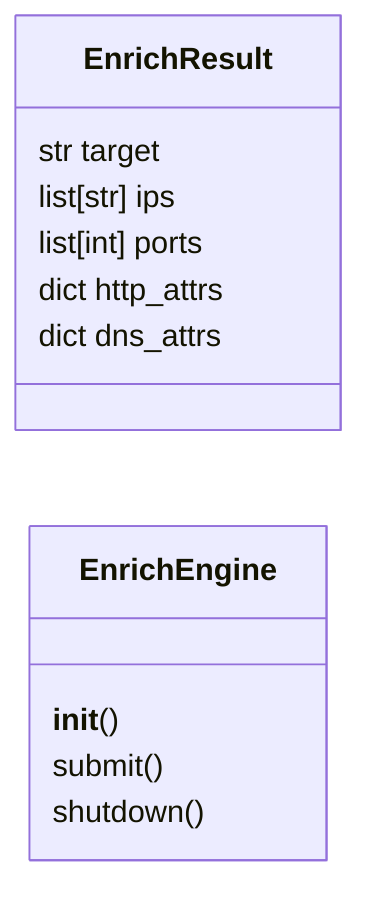
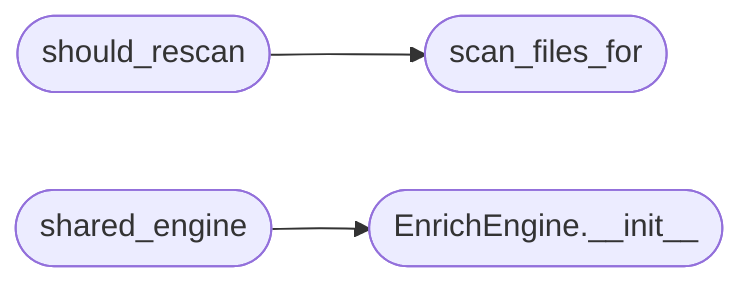

# `modules.enrich`

> Source: [modules/enrich.py:1](../../modules/enrich.py#L1) | language `py` | coverage 100.0% | [API index](../index.md)

Async target enrichment with scan dedup (LAZY enrich parity).

LAZY ``enrich/enrich.go`` runs DNS + HTTP jobs off the hot path with a
4-worker pool, 1024 queue and 5-minute cooldown. This port provides the
same shape in stdlib Python: a small thread-pool engine plus
[`should_rescan`](#should_rescan), which stops the loop re-running nmap when
``sessions/scan_<target>.nmap*`` already holds fresh results.

## Contents

- **Classes:** [`EnrichResult`](#enrichresult), [`EnrichEngine`](#enrichengine)
- **Functions:** [`scan_files_for`](#scan_files_for), [`should_rescan`](#should_rescan), [`resolve_dns`](#resolve_dns), [`fetch_http`](#fetch_http), [`shared_engine`](#shared_engine)
- **Constants:** [`WORKERS`](#workers), [`QUEUE_SIZE`](#queue_size), [`COOLDOWN_SEC`](#cooldown_sec), [`SCAN_FRESH_SEC`](#scan_fresh_sec)

## Type Diagram



## Call Graph

Solid arrows stay in this module, dashed arrows leave it.



## Classes

<a id="enrichresult"></a>

### `EnrichResult`

`class` `dataclass` | [modules/enrich.py:30](../../modules/enrich.py#L30)

Decorators: `@dataclass`

```python
class EnrichResult
```

One enrichment outcome for a target.

**Attributes**

| Name | Type | Default | Description |
|---|---|---|---|
| [`target`](#enrichresult-target) | `str` |  |  |
| [`ips`](#enrichresult-ips) | `list[str]` | `field(default_factory=list)` |  |
| [`ports`](#enrichresult-ports) | `list[int]` | `field(default_factory=list)` |  |
| [`http_attrs`](#enrichresult-http_attrs) | `dict` | `field(default_factory=dict)` |  |
| [`dns_attrs`](#enrichresult-dns_attrs) | `dict` | `field(default_factory=dict)` |  |

---

<a id="enrichengine"></a>

### `EnrichEngine`

`class` | [modules/enrich.py:100](../../modules/enrich.py#L100)

```python
class EnrichEngine
```

Bounded async enrichment pool (LAZY Engine parity).

**Members**

| Member | Kind | Summary |
|---|---|---|
| [`__init__`](#enrichengine-__init__) | constructor | Create the pool and cooldown index. |
| [`submit`](#enrichengine-submit) | method | Queue DNS+HTTP enrichment unless inside cooldown. |
| [`shutdown`](#enrichengine-shutdown) | method | Shut the pool down without blocking the loop by default. |

<a id="enrichengine-__init__"></a>

#### `EnrichEngine.__init__`

`constructor` | [modules/enrich.py:103](../../modules/enrich.py#L103)

```python
def __init__(self, max_workers: int = WORKERS) -> None
```

Create the pool and cooldown index.

**Parameters**

| Name | Type | Default | Description |
|---|---|---|---|
| `max_workers` | `int` | `WORKERS` |  |

*Called by:* [`shared_engine`](#shared_engine)

<a id="enrichengine-submit"></a>

#### `EnrichEngine.submit`

`method` | [modules/enrich.py:108](../../modules/enrich.py#L108)

```python
def submit(self, target: str) -> bool
```

Queue DNS+HTTP enrichment unless inside cooldown.

**Parameters**

| Name | Type | Default | Description |
|---|---|---|---|
| `target` | `str` |  |  |

**Returns:** `bool`

<a id="enrichengine-shutdown"></a>

#### `EnrichEngine.shutdown`

`method` | [modules/enrich.py:128](../../modules/enrich.py#L128)

```python
def shutdown(self, wait: bool = False) -> None
```

Shut the pool down without blocking the loop by default.

**Parameters**

| Name | Type | Default | Description |
|---|---|---|---|
| `wait` | `bool` | `False` |  |

---

## Functions

<a id="scan_files_for"></a>

### `scan_files_for`

`function` | [modules/enrich.py:40](../../modules/enrich.py#L40)

```python
def scan_files_for(sessions_dir: str | Path, target: str) -> list[Path]
```

Return existing scan artefacts for a target.

**Parameters**

| Name | Type | Default | Description |
|---|---|---|---|
| `sessions_dir` | `str \| Path` |  |  |
| `target` | `str` |  |  |

**Returns:** `list[Path]`

*Called by:* [`should_rescan`](#should_rescan)

---

<a id="should_rescan"></a>

### `should_rescan`

`function` | [modules/enrich.py:57](../../modules/enrich.py#L57)

```python
def should_rescan(sessions_dir: str | Path, target: str, fresh_sec: float = SCAN_FRESH_SEC) -> bool
```

Return True when no fresh scan artefact exists for target.

**Parameters**

| Name | Type | Default | Description |
|---|---|---|---|
| `sessions_dir` | `str \| Path` |  |  |
| `target` | `str` |  |  |
| `fresh_sec` | `float` | `SCAN_FRESH_SEC` |  |

**Returns:** `bool`

*Calls:* [`scan_files_for`](#scan_files_for)

---

<a id="resolve_dns"></a>

### `resolve_dns`

`function` | [modules/enrich.py:73](../../modules/enrich.py#L73)

```python
def resolve_dns(target: str, timeout: float = DNS_TIMEOUT_SEC) -> dict
```

Resolve A/AAAA for a target with a bounded timeout.

**Parameters**

| Name | Type | Default | Description |
|---|---|---|---|
| `target` | `str` |  |  |
| `timeout` | `float` | `DNS_TIMEOUT_SEC` |  |

**Returns:** `dict`

---

<a id="fetch_http"></a>

### `fetch_http`

`function` | [modules/enrich.py:86](../../modules/enrich.py#L86)

```python
def fetch_http(target: str, timeout: float = HTTP_TIMEOUT_SEC) -> dict
```

Fetch HTTP headers for a target without following credentials.

**Parameters**

| Name | Type | Default | Description |
|---|---|---|---|
| `target` | `str` |  |  |
| `timeout` | `float` | `HTTP_TIMEOUT_SEC` |  |

**Returns:** `dict`

---

<a id="shared_engine"></a>

### `shared_engine`

`function` | [modules/enrich.py:137](../../modules/enrich.py#L137)

```python
def shared_engine() -> EnrichEngine
```

Return the process-wide enrichment engine (LAZY parity).

One pool serves both flows; per-target cooldown dedups submissions
so enrichment never blocks the hot path.

**Returns:** `EnrichEngine`

*Calls:* [`EnrichEngine.__init__`](#enrichengine-__init__)

---

## Constants

<a id="workers"></a>

### `WORKERS`

`constant` | [modules/enrich.py:21](../../modules/enrich.py#L21)

```python
WORKERS = 4
```

---

<a id="queue_size"></a>

### `QUEUE_SIZE`

`constant` | [modules/enrich.py:22](../../modules/enrich.py#L22)

```python
QUEUE_SIZE = 1024
```

---

<a id="cooldown_sec"></a>

### `COOLDOWN_SEC`

`constant` | [modules/enrich.py:23](../../modules/enrich.py#L23)

```python
COOLDOWN_SEC = 300.0
```

---

<a id="scan_fresh_sec"></a>

### `SCAN_FRESH_SEC`

`constant` | [modules/enrich.py:26](../../modules/enrich.py#L26)

```python
SCAN_FRESH_SEC = 3600.0
```

---
