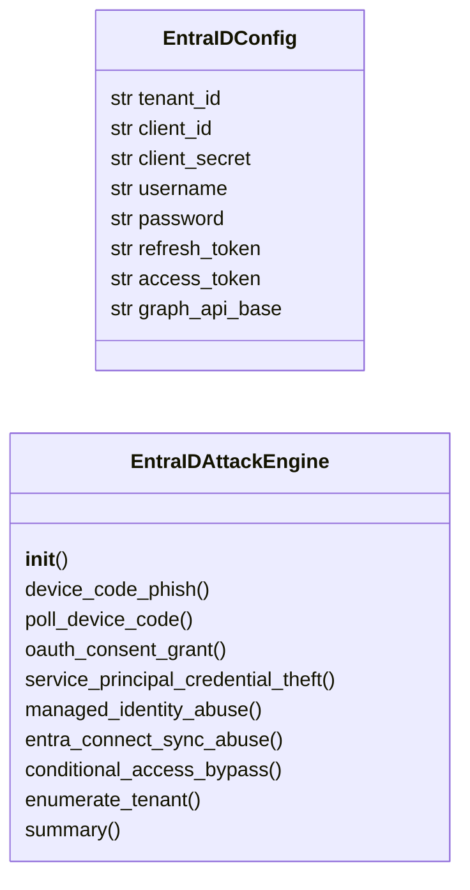
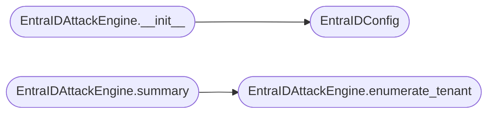

# `modules.entra_id_attacks`

> Source: [modules/entra_id_attacks.py:1](../../modules/entra_id_attacks.py#L1) | language `py` | coverage 84.6% | [API index](../index.md)

Azure AD / Entra ID attack module — Graph API abuse, OAuth consent grants, device code phishing.

Provides attack primitives against Microsoft Entra ID (formerly Azure AD):
OAuth application consent grant attacks, device code phishing, service
principal credential theft, managed identity abuse, and Entra Connect
synchronization exploitation.

Requires requests and msal libraries for Graph API operations.

## Contents

- **Classes:** [`EntraIDConfig`](#entraidconfig), [`EntraIDAttackEngine`](#entraidattackengine)
- **Constants:** [`GRAPH_API_BASE`](#graph_api_base), [`LOGIN_BASE`](#login_base), [`DEVICE_CODE_ENDPOINT`](#device_code_endpoint), [`TOKEN_ENDPOINT`](#token_endpoint), [`ENTRA_ID_ATTACKS`](#entra_id_attacks), [`GRAPH_SCOPES`](#graph_scopes)

## Type Diagram



## Call Graph

Solid arrows stay in this module, dashed arrows leave it.



## Classes

<a id="entraidconfig"></a>

### `EntraIDConfig`

`class` `dataclass` | [modules/entra_id_attacks.py:57](../../modules/entra_id_attacks.py#L57)

Decorators: `@dataclass`

```python
class EntraIDConfig
```

Configuration for Entra ID attack operations.

**Attributes**

| Name | Type | Default | Description |
|---|---|---|---|
| [`tenant_id`](#entraidconfig-tenant_id) | `str` | `'common'` | Azure tenant ID (or 'common', 'organizations', 'consumers'). |
| [`client_id`](#entraidconfig-client_id) | `str` | `''` | Application registration client ID. |
| [`client_secret`](#entraidconfig-client_secret) | `str` | `''` | Application client secret. |
| [`username`](#entraidconfig-username) | `str` | `''` | Target user principal name. |
| [`password`](#entraidconfig-password) | `str` | `''` | Target user password. |
| [`refresh_token`](#entraidconfig-refresh_token) | `str` | `''` | OAuth refresh token (if already obtained). |
| [`access_token`](#entraidconfig-access_token) | `str` | `''` | Bearer token for Graph API. |
| [`graph_api_base`](#entraidconfig-graph_api_base) | `str` | `GRAPH_API_BASE` | Microsoft Graph API endpoint. |

---

<a id="entraidattackengine"></a>

### `EntraIDAttackEngine`

`class` | [modules/entra_id_attacks.py:81](../../modules/entra_id_attacks.py#L81)

```python
class EntraIDAttackEngine
```

Execute Entra ID attacks against Azure AD / Microsoft 365 tenants.

Implements OAuth consent grant, device code phishing, service principal
credential abuse, and managed identity escalation paths.

**Members**

| Member | Kind | Summary |
|---|---|---|
| [`__init__`](#entraidattackengine-__init__) | constructor |  |
| [`device_code_phish`](#entraidattackengine-device_code_phish) | method | Initiate a device code phishing flow. |
| [`poll_device_code`](#entraidattackengine-poll_device_code) | method | Poll for device code completion to retrieve tokens. |
| [`oauth_consent_grant`](#entraidattackengine-oauth_consent_grant) | method | Generate an OAuth consent grant phishing URL. |
| [`service_principal_credential_theft`](#entraidattackengine-service_principal_credential_theft) | method | Plan service principal credential theft via app registration abuse. |
| [`managed_identity_abuse`](#entraidattackengine-managed_identity_abuse) | method | Exploit Azure managed identities from compromised VMs/containers. |
| [`entra_connect_sync_abuse`](#entraidattackengine-entra_connect_sync_abuse) | method | Exploit Entra Connect Sync for on-prem to cloud privilege escalation. |
| [`conditional_access_bypass`](#entraidattackengine-conditional_access_bypass) | method | Techniques for bypassing Entra ID Conditional Access policies. |
| [`enumerate_tenant`](#entraidattackengine-enumerate_tenant) | method | Enumerate tenant information via Graph API. |
| [`summary`](#entraidattackengine-summary) | method |  |

<a id="entraidattackengine-__init__"></a>

#### `EntraIDAttackEngine.__init__`

`constructor` | [modules/entra_id_attacks.py:92](../../modules/entra_id_attacks.py#L92)

```python
def __init__(self, config: EntraIDConfig | None = None)
```

**Parameters**

| Name | Type | Default | Description |
|---|---|---|---|
| `config` | `EntraIDConfig \| None` | `None` |  |

*Calls:* [`EntraIDConfig`](#entraidconfig)

*Called by:* [`CloudAttackCommandSet.do_entra_attack`](cli.commands.cloud_attacks.py.md#cloudattackcommandset-do_entra_attack)

<a id="entraidattackengine-device_code_phish"></a>

#### `EntraIDAttackEngine.device_code_phish`

`method` | [modules/entra_id_attacks.py:96](../../modules/entra_id_attacks.py#L96)

```python
def device_code_phish(self, scope: str = 'https://graph.microsoft.com/.default') -> dict[str, Any]
```

Initiate a device code phishing flow.

Generates a device code and user code for the target tenant.
The user authenticates at https://microsoft.com/devicelogin.

**Parameters**

| Name | Type | Default | Description |
|---|---|---|---|
| `scope` | `str` | `'https://graph.microsoft.com/.default'` | OAuth scope to request. |

**Returns:** `dict[str, Any]` - Dict with device_code, user_code, verification_uri, and polling info.

*Called by:* [`CloudAttackCommandSet.do_entra_attack`](cli.commands.cloud_attacks.py.md#cloudattackcommandset-do_entra_attack)

<a id="entraidattackengine-poll_device_code"></a>

#### `EntraIDAttackEngine.poll_device_code`

`method` | [modules/entra_id_attacks.py:129](../../modules/entra_id_attacks.py#L129)

```python
def poll_device_code(self, device_code: str, interval: int = 5, timeout: int = 900) -> dict[str, Any]
```

Poll for device code completion to retrieve tokens.

**Parameters**

| Name | Type | Default | Description |
|---|---|---|---|
| `device_code` | `str` |  | Device code from device_code_phish(). |
| `interval` | `int` | `5` | Polling interval in seconds. |
| `timeout` | `int` | `900` | Maximum polling time in seconds. |

**Returns:** `dict[str, Any]` - Dict with access_token, refresh_token, id_token, or error.

<a id="entraidattackengine-oauth_consent_grant"></a>

#### `EntraIDAttackEngine.oauth_consent_grant`

`method` | [modules/entra_id_attacks.py:166](../../modules/entra_id_attacks.py#L166)

```python
def oauth_consent_grant(self, redirect_uri: str = 'https://localhost') -> dict[str, Any]
```

Generate an OAuth consent grant phishing URL.

Creates an application consent link that grants the attacker's
application permissions to the tenant when approved by a user.

**Parameters**

| Name | Type | Default | Description |
|---|---|---|---|
| `redirect_uri` | `str` | `'https://localhost'` | OAuth redirect URI. |

**Returns:** `dict[str, Any]` - Dict with consent_url and required permissions.

*Called by:* [`CloudAttackCommandSet.do_entra_attack`](cli.commands.cloud_attacks.py.md#cloudattackcommandset-do_entra_attack)

<a id="entraidattackengine-service_principal_credential_theft"></a>

#### `EntraIDAttackEngine.service_principal_credential_theft`

`method` | [modules/entra_id_attacks.py:203](../../modules/entra_id_attacks.py#L203)

```python
def service_principal_credential_theft(self) -> dict[str, Any]
```

Plan service principal credential theft via app registration abuse.

If the attacker has Application.ReadWrite.All or Application Administrator
role, they can add credentials (certificates/secrets) to any app registration
and impersonate it.

**Returns:** `dict[str, Any]` - Dict with attack steps and Graph API commands.

*Called by:* [`CloudAttackCommandSet.do_entra_attack`](cli.commands.cloud_attacks.py.md#cloudattackcommandset-do_entra_attack)

<a id="entraidattackengine-managed_identity_abuse"></a>

#### `EntraIDAttackEngine.managed_identity_abuse`

`method` | [modules/entra_id_attacks.py:235](../../modules/entra_id_attacks.py#L235)

```python
def managed_identity_abuse(self, resource: str = 'https://graph.microsoft.com') -> dict[str, Any]
```

Exploit Azure managed identities from compromised VMs/containers.

Managed identities provide automatic tokens to Azure resources.
IMDS (169.254.169.254) exposes the identity endpoint.

**Parameters**

| Name | Type | Default | Description |
|---|---|---|---|
| `resource` | `str` | `'https://graph.microsoft.com'` | Token audience (resource). |

**Returns:** `dict[str, Any]` - Dict with IMDS commands and token extraction.

*Called by:* [`CloudAttackCommandSet.do_entra_attack`](cli.commands.cloud_attacks.py.md#cloudattackcommandset-do_entra_attack)

<a id="entraidattackengine-entra_connect_sync_abuse"></a>

#### `EntraIDAttackEngine.entra_connect_sync_abuse`

`method` | [modules/entra_id_attacks.py:266](../../modules/entra_id_attacks.py#L266)

```python
def entra_connect_sync_abuse(self) -> dict[str, Any]
```

Exploit Entra Connect Sync for on-prem to cloud privilege escalation.

The Entra Connect Sync service account has DCSync privileges on
the on-prem AD and write access to Entra ID.

**Returns:** `dict[str, Any]` - Dict with attack path and exploitation commands.

*Called by:* [`CloudAttackCommandSet.do_entra_attack`](cli.commands.cloud_attacks.py.md#cloudattackcommandset-do_entra_attack)

<a id="entraidattackengine-conditional_access_bypass"></a>

#### `EntraIDAttackEngine.conditional_access_bypass`

`method` | [modules/entra_id_attacks.py:307](../../modules/entra_id_attacks.py#L307)

```python
def conditional_access_bypass(self) -> dict[str, Any]
```

Techniques for bypassing Entra ID Conditional Access policies.

**Returns:** `dict[str, Any]` - Dict with bypass techniques and their prerequisites.

*Called by:* [`CloudAttackCommandSet.do_entra_attack`](cli.commands.cloud_attacks.py.md#cloudattackcommandset-do_entra_attack)

<a id="entraidattackengine-enumerate_tenant"></a>

#### `EntraIDAttackEngine.enumerate_tenant`

`method` | [modules/entra_id_attacks.py:345](../../modules/entra_id_attacks.py#L345)

```python
def enumerate_tenant(self) -> dict[str, Any]
```

Enumerate tenant information via Graph API.

**Returns:** `dict[str, Any]` - Dict with tenant details, domains, users, and apps.

*Called by:* [`CloudAttackCommandSet.do_entra_attack`](cli.commands.cloud_attacks.py.md#cloudattackcommandset-do_entra_attack), [`EntraIDAttackEngine.summary`](#entraidattackengine-summary)

<a id="entraidattackengine-summary"></a>

#### `EntraIDAttackEngine.summary`

`method` | [modules/entra_id_attacks.py:368](../../modules/entra_id_attacks.py#L368)

```python
def summary(self) -> dict[str, Any]
```

**Returns:** `dict[str, Any]`

*Calls:* [`EntraIDAttackEngine.enumerate_tenant`](#entraidattackengine-enumerate_tenant)

---

## Constants

<a id="graph_api_base"></a>

### `GRAPH_API_BASE`

`constant` | [modules/entra_id_attacks.py:25](../../modules/entra_id_attacks.py#L25)

```python
GRAPH_API_BASE = 'https://graph.microsoft.com/v1.0'
```

---

<a id="login_base"></a>

### `LOGIN_BASE`

`constant` | [modules/entra_id_attacks.py:26](../../modules/entra_id_attacks.py#L26)

```python
LOGIN_BASE = 'https://login.microsoftonline.com'
```

---

<a id="device_code_endpoint"></a>

### `DEVICE_CODE_ENDPOINT`

`constant` | [modules/entra_id_attacks.py:27](../../modules/entra_id_attacks.py#L27)

```python
DEVICE_CODE_ENDPOINT = f'{LOGIN_BASE}/common/oauth2/devicecode'
```

---

<a id="token_endpoint"></a>

### `TOKEN_ENDPOINT`

`constant` | [modules/entra_id_attacks.py:28](../../modules/entra_id_attacks.py#L28)

```python
TOKEN_ENDPOINT = '/oauth2/v2.0/token'
```

---

<a id="entra_id_attacks"></a>

### `ENTRA_ID_ATTACKS`

`constant` | [modules/entra_id_attacks.py:30](../../modules/entra_id_attacks.py#L30)

```python
ENTRA_ID_ATTACKS
```

---

<a id="graph_scopes"></a>

### `GRAPH_SCOPES`

`constant` | [modules/entra_id_attacks.py:43](../../modules/entra_id_attacks.py#L43)

```python
GRAPH_SCOPES
```

---
