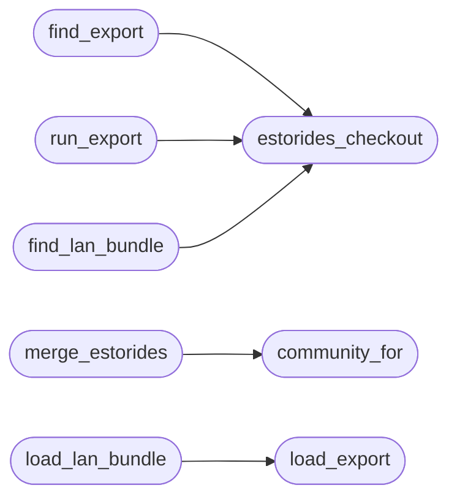

# `modules.estorides_fusion`

> Source: [modules/estorides_fusion.py:1](../../modules/estorides_fusion.py#L1) | language `py` | coverage 100.0% | [API index](../index.md)

Estorides intel fusion: merge OSINT graph entities into campaign graphs.

Reads an estorides export (``estorides_lazyown.json`` preferred, raw
``estorides_graph.json`` accepted) and merges it into the intel and
attack-surface graphs. When an IP or value already exists as a node, the
two records fuse: sources union plus ``estorides``, attributes merge,
edges re-anchor. New entities arrive tagged and capped so the graphs
stay readable.

Provenance stays explicit: every fused node carries ``estorides`` in its
sources and estorides edges keep their ``estorides:`` evidence prefix.

## Contents

- **Functions:** [`estorides_checkout`](#estorides_checkout), [`find_export`](#find_export), [`run_export`](#run_export), [`load_export`](#load_export), [`community_for`](#community_for), [`merge_estorides`](#merge_estorides), [`find_lan_bundle`](#find_lan_bundle), [`load_lan_bundle`](#load_lan_bundle), [`split_lan_targets`](#split_lan_targets)
- **Constants:** [`LAZYOWN_EXPORT`](#lazyown_export), [`LAN_LAZYOWN_EXPORTS`](#lan_lazyown_exports), [`LAN_INVENTORY_EXPORTS`](#lan_inventory_exports), [`LAN_STIX_EXPORTS`](#lan_stix_exports), [`MAX_NEW_NODES`](#max_new_nodes), [`MAX_LAN_NODES`](#max_lan_nodes)

## Call Graph

Solid arrows stay in this module, dashed arrows leave it.



## Functions

<a id="estorides_checkout"></a>

### `estorides_checkout`

`function` | [modules/estorides_fusion.py:48](../../modules/estorides_fusion.py#L48)

```python
def estorides_checkout() -> Path | None
```

Locate the estorides working copy.

Resolution order, no hardcoded user paths: the ESTORIDES_DIR
environment override first, then the lazyaddon install directory.

**Returns:** `Path | None`

*Called by:* [`find_export`](#find_export), [`find_lan_bundle`](#find_lan_bundle), [`run_export`](#run_export)

---

<a id="find_export"></a>

### `find_export`

`function` | [modules/estorides_fusion.py:68](../../modules/estorides_fusion.py#L68)

```python
def find_export(sessions_dir: str | Path = SESSIONS_DIR) -> Path | None
```

Find an estorides export, preferring the LazyOwn vocabulary file.

**Parameters**

| Name | Type | Default | Description |
|---|---|---|---|
| `sessions_dir` | `str \| Path` | `SESSIONS_DIR` |  |

**Returns:** `Path | None`

*Calls:* [`estorides_checkout`](#estorides_checkout)

*Called by:* [`SurfaceCommandSet.do_estorides_intel`](cli.commands.surface.py.md#surfacecommandset-do_estorides_intel)

---

<a id="run_export"></a>

### `run_export`

`function` | [modules/estorides_fusion.py:84](../../modules/estorides_fusion.py#L84)

```python
def run_export(sessions_dir: str | Path = SESSIONS_DIR, cli_path: str | None = None, timeout_sec: float = 300.0) -> Path | None
```

Run ``estorides_cli.py graph --export lazyown`` into sessions/.

Never raises: failures return None and the caller keeps working with
whatever export already exists.

**Parameters**

| Name | Type | Default | Description |
|---|---|---|---|
| `sessions_dir` | `str \| Path` | `SESSIONS_DIR` |  |
| `cli_path` | `str \| None` | `None` |  |
| `timeout_sec` | `float` | `300.0` |  |

**Returns:** `Path | None`

*Calls:* [`estorides_checkout`](#estorides_checkout)

*Called by:* [`SurfaceCommandSet.do_estorides_intel`](cli.commands.surface.py.md#surfacecommandset-do_estorides_intel)

---

<a id="load_export"></a>

### `load_export`

`function` | [modules/estorides_fusion.py:128](../../modules/estorides_fusion.py#L128)

```python
def load_export(path: str | Path) -> dict
```

Load an export in either vocabulary into nodes/edges lists.

**Parameters**

| Name | Type | Default | Description |
|---|---|---|---|
| `path` | `str \| Path` |  |  |

**Returns:** `dict`

*Called by:* [`SurfaceCommandSet.do_estorides_intel`](cli.commands.surface.py.md#surfacecommandset-do_estorides_intel), [`load_lan_bundle`](#load_lan_bundle)

---

<a id="community_for"></a>

### `community_for`

`function` | [modules/estorides_fusion.py:180](../../modules/estorides_fusion.py#L180)

```python
def community_for(kind: str, value: str) -> str
```

Assign a campaign community to a fused entity.

**Parameters**

| Name | Type | Default | Description |
|---|---|---|---|
| `kind` | `str` |  |  |
| `value` | `str` |  |  |

**Returns:** `str`

*Called by:* [`merge_estorides`](#merge_estorides)

---

<a id="merge_estorides"></a>

### `merge_estorides`

`function` | [modules/estorides_fusion.py:187](../../modules/estorides_fusion.py#L187)

```python
def merge_estorides(nodes: dict[str, dict], edges: list[dict], est: dict, cap: int = MAX_NEW_NODES) -> dict
```

Fuse estorides entities into graph nodes/edges in place.

Matching (kind, value) fuses records; new entities arrive with
``estorides`` provenance until ``cap``. Returns merge statistics.

**Parameters**

| Name | Type | Default | Description |
|---|---|---|---|
| `nodes` | `dict[str, dict]` |  |  |
| `edges` | `list[dict]` |  |  |
| `est` | `dict` |  |  |
| `cap` | `int` | `MAX_NEW_NODES` |  |

**Returns:** `dict`

*Calls:* [`community_for`](#community_for)

---

<a id="find_lan_bundle"></a>

### `find_lan_bundle`

`function` | [modules/estorides_fusion.py:268](../../modules/estorides_fusion.py#L268)

```python
def find_lan_bundle(sessions_dir: str | Path = SESSIONS_DIR) -> Path | None
```

Find a LAN bundle deliverable, preferring LazyOwn vocabulary.

**Parameters**

| Name | Type | Default | Description |
|---|---|---|---|
| `sessions_dir` | `str \| Path` | `SESSIONS_DIR` |  |

**Returns:** `Path | None`

*Calls:* [`estorides_checkout`](#estorides_checkout)

---

<a id="load_lan_bundle"></a>

### `load_lan_bundle`

`function` | [modules/estorides_fusion.py:288](../../modules/estorides_fusion.py#L288)

```python
def load_lan_bundle(path: str | Path) -> dict
```

Load a LAN bundle file into nodes/edges lists.

Never raises.

**Parameters**

| Name | Type | Default | Description |
|---|---|---|---|
| `path` | `str \| Path` |  |  |

**Returns:** `dict`

*Calls:* [`load_export`](#load_export)

---

<a id="split_lan_targets"></a>

### `split_lan_targets`

`function` | [modules/estorides_fusion.py:323](../../modules/estorides_fusion.py#L323)

```python
def split_lan_targets(est: dict) -> tuple[dict, dict]
```

Split a LAN payload into intel (all) and attack (hosts) views.

The intel graph keeps everything known. The attack graph keeps only
host nodes plus host-anchored edges so auto_loop queues actionable
targets without MAC/hostname noise.

**Parameters**

| Name | Type | Default | Description |
|---|---|---|---|
| `est` | `dict` |  |  |

**Returns:** `tuple[dict, dict]`

---

## Constants

<a id="lazyown_export"></a>

### `LAZYOWN_EXPORT`

`constant` | [modules/estorides_fusion.py:24](../../modules/estorides_fusion.py#L24)

```python
LAZYOWN_EXPORT = 'estorides_lazyown.json'
```

---

<a id="lan_lazyown_exports"></a>

### `LAN_LAZYOWN_EXPORTS`

`constant` | [modules/estorides_fusion.py:26](../../modules/estorides_fusion.py#L26)

```python
LAN_LAZYOWN_EXPORTS = ('lan_lazyown.json', 'lan_graph.json')
```

---

<a id="lan_inventory_exports"></a>

### `LAN_INVENTORY_EXPORTS`

`constant` | [modules/estorides_fusion.py:27](../../modules/estorides_fusion.py#L27)

```python
LAN_INVENTORY_EXPORTS = ('lan_inventory.json',)
```

---

<a id="lan_stix_exports"></a>

### `LAN_STIX_EXPORTS`

`constant` | [modules/estorides_fusion.py:28](../../modules/estorides_fusion.py#L28)

```python
LAN_STIX_EXPORTS = ('lan_stix.json',)
```

---

<a id="max_new_nodes"></a>

### `MAX_NEW_NODES`

`constant` | [modules/estorides_fusion.py:29](../../modules/estorides_fusion.py#L29)

```python
MAX_NEW_NODES = 300
```

---

<a id="max_lan_nodes"></a>

### `MAX_LAN_NODES`

`constant` | [modules/estorides_fusion.py:30](../../modules/estorides_fusion.py#L30)

```python
MAX_LAN_NODES = 500
```

---
