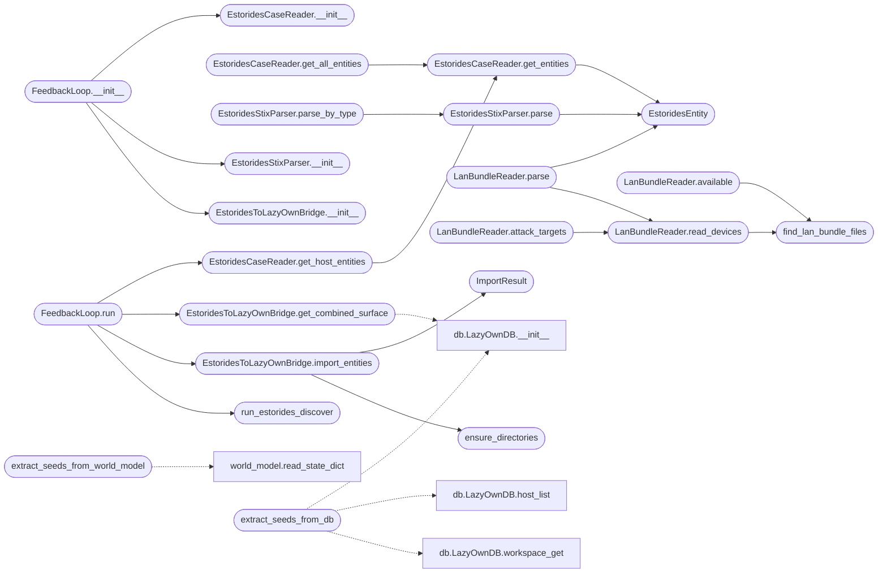

# `modules.estorides_importer`

> Source: [modules/estorides_importer.py:1](../../modules/estorides_importer.py#L1) | language `py` | coverage 65.1% | [API index](../index.md)

estorides_importer ================== Bidirectional bridge between Estorides (passive OSINT) and LazyOwn (active pentest).

Feeds LazyOwn host/domain intelligence into Estorides for passive discovery
and imports Estorides-discovered entities back into LazyOwn's database, scope,
and world model — creating a continuous feedback loop.

Data flow:

    LazyOwn (world_model, db_hosts, scope)
         │
         ▼  estorides_seed: extract IPs/domains → estorides discover
    Estorides (cases, STIX, graph, fusion)
         │
         ▼  estorides_import: parse entities → LazyOwn DB + scope
    LazyOwn (enriched: new hosts, expanded scope)
         │
         ▼  lazynmap / nuclei on new targets
    ...

Architecture:

    EstoridesSeedExtractor   - pull LazyOwn surfaces into estorides seeds
    EstoridesCaseReader      - read estorides_cases.sqlite
    EstoridesStixParser      - parse STIX 2.1 bundles
    EstoridesImporter        - import entities into LazyOwn DB/scope
    FeedbackLoop             - orchestrate the bidirectional cycle

## Contents

- **Classes:** [`EstoridesEntity`](#estoridesentity), [`ImportResult`](#importresult), [`SeedResult`](#seedresult), [`EstoridesCaseReader`](#estoridescasereader), [`EstoridesStixParser`](#estoridesstixparser), [`LanBundleReader`](#lanbundlereader), [`EstoridesToLazyOwnBridge`](#estoridestolazyownbridge), [`FeedbackLoop`](#feedbackloop)
- **Functions:** [`extract_seeds_from_world_model`](#extract_seeds_from_world_model), [`extract_seeds_from_hosts_file`](#extract_seeds_from_hosts_file), [`extract_seeds_from_db`](#extract_seeds_from_db), [`extract_seeds_from_scope`](#extract_seeds_from_scope), [`run_estorides_discover`](#run_estorides_discover), [`run_estorides_run`](#run_estorides_run), [`find_lan_bundle_files`](#find_lan_bundle_files), [`ensure_directories`](#ensure_directories), [`export_combined_graph`](#export_combined_graph)
- **Constants:** [`ESTORIDES_DIR`](#estorides_dir), [`ESTORIDES_CLI`](#estorides_cli), [`ESTORIDES_DATA`](#estorides_data), [`ESTORIDES_CASES_DB`](#estorides_cases_db), [`ESTORIDES_STIX`](#estorides_stix), [`ESTORIDES_GRAPHML`](#estorides_graphml), [`ENTITY_TYPE_MAP`](#entity_type_map), [`HOST_ENTITY_TYPES`](#host_entity_types), [`ESTORIDES_LAN_DIR`](#estorides_lan_dir), [`LAN_INVENTORY_NAMES`](#lan_inventory_names), [`LAN_LAZYOWN_NAMES`](#lan_lazyown_names), [`LAN_STIX_NAMES`](#lan_stix_names)

## Type Diagram

```mermaid
classDiagram
    direction LR
    class EstoridesEntity
    EstoridesEntity : str entity_type
    EstoridesEntity : str value
    EstoridesEntity : str source
    EstoridesEntity : float confidence
    EstoridesEntity : list[str] sources
    EstoridesEntity : str case_id
    class ImportResult
    ImportResult : int entities_total
    ImportResult : int hosts_added
    ImportResult : int hosts_existing
    ImportResult : int domains_found
    ImportResult : int ips_found
    ImportResult : int cves_found
    ImportResult : int emails_found
    ImportResult : int scope_entries_added
    ImportResult : list[str] errors
    ImportResult : success()
    ImportResult : to_dict()
    class SeedResult
    SeedResult : int seeds_sent
    SeedResult : list[str] cases_created
    SeedResult : int entities_discovered
    SeedResult : list[str] domains_discovered
    SeedResult : list[str] ips_discovered
    SeedResult : list[str] errors
    SeedResult : new_assets()
    class EstoridesCaseReader
    EstoridesCaseReader : __init__()
    EstoridesCaseReader : available()
    EstoridesCaseReader : list_cases()
    EstoridesCaseReader : get_entities()
    EstoridesCaseReader : get_host_entities()
    EstoridesCaseReader : get_all_entities()
    EstoridesCaseReader : stats()
    EstoridesCaseReader : close()
    class EstoridesStixParser
    EstoridesStixParser : dict[str, str] STIX_TO_ENTITY
    EstoridesStixParser : __init__()
    EstoridesStixParser : available()
    EstoridesStixParser : parse()
    EstoridesStixParser : parse_by_type()
    class LanBundleReader
    LanBundleReader : __init__()
    LanBundleReader : available()
    LanBundleReader : read_devices()
    LanBundleReader : parse()
    LanBundleReader : attack_targets()
    class EstoridesToLazyOwnBridge
    EstoridesToLazyOwnBridge : __init__()
    EstoridesToLazyOwnBridge : import_entities()
    EstoridesToLazyOwnBridge : get_combined_surface()
    class FeedbackLoop
    FeedbackLoop : __init__()
    FeedbackLoop : run()
```



## Call Graph

Solid arrows stay in this module, dashed arrows leave it.



## Classes

<a id="estoridesentity"></a>

### `EstoridesEntity`

`class` `dataclass` | [modules/estorides_importer.py:84](../../modules/estorides_importer.py#L84)

Decorators: `@dataclass`

```python
class EstoridesEntity
```

A single entity discovered by Estorides.

**Attributes**

| Name | Type | Default | Description |
|---|---|---|---|
| [`entity_type`](#estoridesentity-entity_type) | `str` |  |  |
| [`value`](#estoridesentity-value) | `str` |  |  |
| [`source`](#estoridesentity-source) | `str` | `''` |  |
| [`confidence`](#estoridesentity-confidence) | `float` | `1.0` |  |
| [`sources`](#estoridesentity-sources) | `list[str]` | `field(default_factory=list)` |  |
| [`case_id`](#estoridesentity-case_id) | `str` | `''` |  |

---

<a id="importresult"></a>

### `ImportResult`

`class` `dataclass` | [modules/estorides_importer.py:96](../../modules/estorides_importer.py#L96)

Decorators: `@dataclass`

```python
class ImportResult
```

Result of an estorides import operation.

**Attributes**

| Name | Type | Default | Description |
|---|---|---|---|
| [`entities_total`](#importresult-entities_total) | `int` | `0` |  |
| [`hosts_added`](#importresult-hosts_added) | `int` | `0` |  |
| [`hosts_existing`](#importresult-hosts_existing) | `int` | `0` |  |
| [`domains_found`](#importresult-domains_found) | `int` | `0` |  |
| [`ips_found`](#importresult-ips_found) | `int` | `0` |  |
| [`cves_found`](#importresult-cves_found) | `int` | `0` |  |
| [`emails_found`](#importresult-emails_found) | `int` | `0` |  |
| [`scope_entries_added`](#importresult-scope_entries_added) | `int` | `0` |  |
| [`errors`](#importresult-errors) | `list[str]` | `field(default_factory=list)` |  |

**Members**

| Member | Kind | Summary |
|---|---|---|
| [`success`](#importresult-success) | property |  |
| [`to_dict`](#importresult-to_dict) | method |  |

<a id="importresult-success"></a>

#### `ImportResult.success`

`property` | [modules/estorides_importer.py:110](../../modules/estorides_importer.py#L110)

Decorators: `@property`

```python
def success(self) -> bool
```

**Returns:** `bool`

<a id="importresult-to_dict"></a>

#### `ImportResult.to_dict`

`method` | [modules/estorides_importer.py:113](../../modules/estorides_importer.py#L113)

```python
def to_dict(self) -> dict[str, Any]
```

**Returns:** `dict[str, Any]`

---

<a id="seedresult"></a>

### `SeedResult`

`class` `dataclass` | [modules/estorides_importer.py:128](../../modules/estorides_importer.py#L128)

Decorators: `@dataclass`

```python
class SeedResult
```

Result of seeding estorides with LazyOwn hosts.

**Attributes**

| Name | Type | Default | Description |
|---|---|---|---|
| [`seeds_sent`](#seedresult-seeds_sent) | `int` | `0` |  |
| [`cases_created`](#seedresult-cases_created) | `list[str]` | `field(default_factory=list)` |  |
| [`entities_discovered`](#seedresult-entities_discovered) | `int` | `0` |  |
| [`domains_discovered`](#seedresult-domains_discovered) | `list[str]` | `field(default_factory=list)` |  |
| [`ips_discovered`](#seedresult-ips_discovered) | `list[str]` | `field(default_factory=list)` |  |
| [`errors`](#seedresult-errors) | `list[str]` | `field(default_factory=list)` |  |

**Members**

| Member | Kind | Summary |
|---|---|---|
| [`new_assets`](#seedresult-new_assets) | property |  |

<a id="seedresult-new_assets"></a>

#### `SeedResult.new_assets`

`property` | [modules/estorides_importer.py:139](../../modules/estorides_importer.py#L139)

Decorators: `@property`

```python
def new_assets(self) -> list[str]
```

**Returns:** `list[str]`

---

<a id="estoridescasereader"></a>

### `EstoridesCaseReader`

`class` | [modules/estorides_importer.py:387](../../modules/estorides_importer.py#L387)

```python
class EstoridesCaseReader
```

Read entities from the estorides case store (SQLite).

**Members**

| Member | Kind | Summary |
|---|---|---|
| [`__init__`](#estoridescasereader-__init__) | constructor |  |
| [`available`](#estoridescasereader-available) | property |  |
| [`list_cases`](#estoridescasereader-list_cases) | method |  |
| [`get_entities`](#estoridescasereader-get_entities) | method | Fetch entities from the case store. |
| [`get_host_entities`](#estoridescasereader-get_host_entities) | method | Get entities of host-related types (ipv4, ipv6, domain, url, asn). |
| [`get_all_entities`](#estoridescasereader-get_all_entities) | method |  |
| [`stats`](#estoridescasereader-stats) | method |  |
| [`close`](#estoridescasereader-close) | method |  |

<a id="estoridescasereader-__init__"></a>

#### `EstoridesCaseReader.__init__`

`constructor` | [modules/estorides_importer.py:390](../../modules/estorides_importer.py#L390)

```python
def __init__(self, db_path: Path | None = None) -> None
```

**Parameters**

| Name | Type | Default | Description |
|---|---|---|---|
| `db_path` | `Path \| None` | `None` |  |

*Called by:* [`EstoridesCommandSet.do_estorides_import`](cli.commands.estorides.py.md#estoridescommandset-do_estorides_import), [`EstoridesCommandSet.do_estorides_surface`](cli.commands.estorides.py.md#estoridescommandset-do_estorides_surface), [`FeedbackLoop.__init__`](#feedbackloop-__init__)

<a id="estoridescasereader-available"></a>

#### `EstoridesCaseReader.available`

`property` | [modules/estorides_importer.py:395](../../modules/estorides_importer.py#L395)

Decorators: `@property`

```python
def available(self) -> bool
```

**Returns:** `bool`

<a id="estoridescasereader-list_cases"></a>

#### `EstoridesCaseReader.list_cases`

`method` | [modules/estorides_importer.py:404](../../modules/estorides_importer.py#L404)

```python
def list_cases(self, limit: int = 20) -> list[dict[str, Any]]
```

**Parameters**

| Name | Type | Default | Description |
|---|---|---|---|
| `limit` | `int` | `20` |  |

**Returns:** `list[dict[str, Any]]`

<a id="estoridescasereader-get_entities"></a>

#### `EstoridesCaseReader.get_entities`

`method` | [modules/estorides_importer.py:416](../../modules/estorides_importer.py#L416)

```python
def get_entities(self, case_id: str | None = None, entity_types: Iterable[str] | None = None, limit: int = 500) -> list[EstoridesEntity]
```

Fetch entities from the case store.

If case_id is None, fetches from all cases.

**Parameters**

| Name | Type | Default | Description |
|---|---|---|---|
| `case_id` | `str \| None` | `None` |  |
| `entity_types` | `Iterable[str] \| None` | `None` |  |
| `limit` | `int` | `500` |  |

**Returns:** `list[EstoridesEntity]`

*Calls:* [`EstoridesEntity`](#estoridesentity)

*Called by:* [`EstoridesCaseReader.get_all_entities`](#estoridescasereader-get_all_entities), [`EstoridesCaseReader.get_host_entities`](#estoridescasereader-get_host_entities)

<a id="estoridescasereader-get_host_entities"></a>

#### `EstoridesCaseReader.get_host_entities`

`method` | [modules/estorides_importer.py:471](../../modules/estorides_importer.py#L471)

```python
def get_host_entities(self, case_id: str | None = None) -> list[EstoridesEntity]
```

Get entities of host-related types (ipv4, ipv6, domain, url, asn).

**Parameters**

| Name | Type | Default | Description |
|---|---|---|---|
| `case_id` | `str \| None` | `None` |  |

**Returns:** `list[EstoridesEntity]`

*Calls:* [`EstoridesCaseReader.get_entities`](#estoridescasereader-get_entities)

*Called by:* [`EstoridesCommandSet.do_estorides_import`](cli.commands.estorides.py.md#estoridescommandset-do_estorides_import), [`EstoridesCommandSet.do_estorides_surface`](cli.commands.estorides.py.md#estoridescommandset-do_estorides_surface), [`FeedbackLoop.run`](#feedbackloop-run)

<a id="estoridescasereader-get_all_entities"></a>

#### `EstoridesCaseReader.get_all_entities`

`method` | [modules/estorides_importer.py:475](../../modules/estorides_importer.py#L475)

```python
def get_all_entities(self, case_id: str | None = None) -> list[EstoridesEntity]
```

**Parameters**

| Name | Type | Default | Description |
|---|---|---|---|
| `case_id` | `str \| None` | `None` |  |

**Returns:** `list[EstoridesEntity]`

*Calls:* [`EstoridesCaseReader.get_entities`](#estoridescasereader-get_entities)

<a id="estoridescasereader-stats"></a>

#### `EstoridesCaseReader.stats`

`method` | [modules/estorides_importer.py:478](../../modules/estorides_importer.py#L478)

```python
def stats(self) -> dict[str, Any]
```

**Returns:** `dict[str, Any]`

*Called by:* [`EstoridesCommandSet.do_estorides_import`](cli.commands.estorides.py.md#estoridescommandset-do_estorides_import)

<a id="estoridescasereader-close"></a>

#### `EstoridesCaseReader.close`

`method` | [modules/estorides_importer.py:491](../../modules/estorides_importer.py#L491)

```python
def close(self) -> None
```

*Called by:* [`EstoridesCommandSet.do_estorides_import`](cli.commands.estorides.py.md#estoridescommandset-do_estorides_import), [`EstoridesCommandSet.do_estorides_surface`](cli.commands.estorides.py.md#estoridescommandset-do_estorides_surface)

---

<a id="estoridesstixparser"></a>

### `EstoridesStixParser`

`class` | [modules/estorides_importer.py:497](../../modules/estorides_importer.py#L497)

```python
class EstoridesStixParser
```

Parse STIX 2.1 bundles produced by estorides.

**Attributes**

| Name | Type | Default | Description |
|---|---|---|---|
| [`STIX_TO_ENTITY`](#estoridesstixparser-stix_to_entity) | `dict[str, str]` | `{'ipv4-addr': 'ipv4', 'ipv6-addr': 'ipv6', 'domain-name': 'domain', 'url': 'url', 'email-addr': 'email', 'vulnerability': 'cve', 'file': 'hash', 'autonomous-system': 'asn', 'mac-addr': 'mac', 'crypto-wallet': 'crypto'}` |  |

**Members**

| Member | Kind | Summary |
|---|---|---|
| [`__init__`](#estoridesstixparser-__init__) | constructor |  |
| [`available`](#estoridesstixparser-available) | property |  |
| [`parse`](#estoridesstixparser-parse) | method | Parse a STIX 2.1 bundle into EstoridesEntity objects. |
| [`parse_by_type`](#estoridesstixparser-parse_by_type) | method | Parse STIX and group values by entity type. |

<a id="estoridesstixparser-__init__"></a>

#### `EstoridesStixParser.__init__`

`constructor` | [modules/estorides_importer.py:513](../../modules/estorides_importer.py#L513)

```python
def __init__(self, stix_path: Path | None = None) -> None
```

**Parameters**

| Name | Type | Default | Description |
|---|---|---|---|
| `stix_path` | `Path \| None` | `None` |  |

*Called by:* [`EstoridesCommandSet.do_estorides_import`](cli.commands.estorides.py.md#estoridescommandset-do_estorides_import), [`EstoridesCommandSet.do_estorides_surface`](cli.commands.estorides.py.md#estoridescommandset-do_estorides_surface), [`FeedbackLoop.__init__`](#feedbackloop-__init__)

<a id="estoridesstixparser-available"></a>

#### `EstoridesStixParser.available`

`property` | [modules/estorides_importer.py:517](../../modules/estorides_importer.py#L517)

Decorators: `@property`

```python
def available(self) -> bool
```

**Returns:** `bool`

<a id="estoridesstixparser-parse"></a>

#### `EstoridesStixParser.parse`

`method` | [modules/estorides_importer.py:520](../../modules/estorides_importer.py#L520)

```python
def parse(self) -> list[EstoridesEntity]
```

Parse a STIX 2.1 bundle into EstoridesEntity objects.

**Returns:** `list[EstoridesEntity]`

*Calls:* [`EstoridesEntity`](#estoridesentity)

*Called by:* [`EstoridesCommandSet.do_estorides_import`](cli.commands.estorides.py.md#estoridescommandset-do_estorides_import), [`EstoridesStixParser.parse_by_type`](#estoridesstixparser-parse_by_type)

<a id="estoridesstixparser-parse_by_type"></a>

#### `EstoridesStixParser.parse_by_type`

`method` | [modules/estorides_importer.py:554](../../modules/estorides_importer.py#L554)

```python
def parse_by_type(self, entity_types: Iterable[str] | None = None) -> dict[str, list[str]]
```

Parse STIX and group values by entity type.

**Parameters**

| Name | Type | Default | Description |
|---|---|---|---|
| `entity_types` | `Iterable[str] \| None` | `None` |  |

**Returns:** `dict[str, list[str]]`

*Calls:* [`EstoridesStixParser.parse`](#estoridesstixparser-parse)

*Called by:* [`EstoridesCommandSet.do_estorides_import`](cli.commands.estorides.py.md#estoridescommandset-do_estorides_import), [`EstoridesCommandSet.do_estorides_surface`](cli.commands.estorides.py.md#estoridescommandset-do_estorides_surface)

---

<a id="lanbundlereader"></a>

### `LanBundleReader`

`class` | [modules/estorides_importer.py:624](../../modules/estorides_importer.py#L624)

```python
class LanBundleReader
```

Read Estorides LAN output deliverables into entities.

Consumes ``lan_inventory.json`` (preferred, device-grounded),
``lan_lazyown.json`` / ``lan_graph.json`` (graph vocabulary), and
``lan_stix.json`` (STIX bundle). Output feeds the same import path
as OSINT entities so LAN hosts flow into the DB, scope, intel
graph, attack graph, and auto_loop queue.

**Members**

| Member | Kind | Summary |
|---|---|---|
| [`__init__`](#lanbundlereader-__init__) | constructor |  |
| [`available`](#lanbundlereader-available) | property |  |
| [`read_devices`](#lanbundlereader-read_devices) | method | Return raw device dicts from the inventory file. |
| [`parse`](#lanbundlereader-parse) | method | Parse LAN devices into entities (host, mac, domain). |
| [`attack_targets`](#lanbundlereader-attack_targets) | method | IPs actionable for the attack graph and auto_loop queue. |

<a id="lanbundlereader-__init__"></a>

#### `LanBundleReader.__init__`

`constructor` | [modules/estorides_importer.py:634](../../modules/estorides_importer.py#L634)

```python
def __init__(self, lan_dir: Path | None = None) -> None
```

**Parameters**

| Name | Type | Default | Description |
|---|---|---|---|
| `lan_dir` | `Path \| None` | `None` |  |

*Called by:* [`EstoridesCommandSet.do_estorides_import`](cli.commands.estorides.py.md#estoridescommandset-do_estorides_import)

<a id="lanbundlereader-available"></a>

#### `LanBundleReader.available`

`property` | [modules/estorides_importer.py:638](../../modules/estorides_importer.py#L638)

Decorators: `@property`

```python
def available(self) -> bool
```

**Returns:** `bool`

*Calls:* [`find_lan_bundle_files`](#find_lan_bundle_files)

<a id="lanbundlereader-read_devices"></a>

#### `LanBundleReader.read_devices`

`method` | [modules/estorides_importer.py:641](../../modules/estorides_importer.py#L641)

```python
def read_devices(self) -> list[dict[str, Any]]
```

Return raw device dicts from the inventory file.

**Returns:** `list[dict[str, Any]]`

*Calls:* [`find_lan_bundle_files`](#find_lan_bundle_files)

*Called by:* [`EstoridesCommandSet.do_estorides_import`](cli.commands.estorides.py.md#estoridescommandset-do_estorides_import), [`LanBundleReader.attack_targets`](#lanbundlereader-attack_targets), [`LanBundleReader.parse`](#lanbundlereader-parse)

<a id="lanbundlereader-parse"></a>

#### `LanBundleReader.parse`

`method` | [modules/estorides_importer.py:654](../../modules/estorides_importer.py#L654)

```python
def parse(self) -> list[EstoridesEntity]
```

Parse LAN devices into entities (host, mac, domain).

**Returns:** `list[EstoridesEntity]`

*Calls:* [`EstoridesEntity`](#estoridesentity), [`LanBundleReader.read_devices`](#lanbundlereader-read_devices)

*Called by:* [`EstoridesCommandSet.do_estorides_import`](cli.commands.estorides.py.md#estoridescommandset-do_estorides_import)

<a id="lanbundlereader-attack_targets"></a>

#### `LanBundleReader.attack_targets`

`method` | [modules/estorides_importer.py:685](../../modules/estorides_importer.py#L685)

```python
def attack_targets(self) -> list[str]
```

IPs actionable for the attack graph and auto_loop queue.

**Returns:** `list[str]`

*Calls:* [`LanBundleReader.read_devices`](#lanbundlereader-read_devices)

*Called by:* [`EstoridesCommandSet.do_estorides_import`](cli.commands.estorides.py.md#estoridescommandset-do_estorides_import)

---

<a id="estoridestolazyownbridge"></a>

### `EstoridesToLazyOwnBridge`

`class` | [modules/estorides_importer.py:702](../../modules/estorides_importer.py#L702)

```python
class EstoridesToLazyOwnBridge
```

Import estorides-discovered entities into LazyOwn's database and scope.

**Members**

| Member | Kind | Summary |
|---|---|---|
| [`__init__`](#estoridestolazyownbridge-__init__) | constructor |  |
| [`import_entities`](#estoridestolazyownbridge-import_entities) | method | Import entities into LazyOwn DB and optionally scope. |
| [`get_combined_surface`](#estoridestolazyownbridge-get_combined_surface) | method | Get the combined attack surface from LazyOwn DB + scope. |

<a id="estoridestolazyownbridge-__init__"></a>

#### `EstoridesToLazyOwnBridge.__init__`

`constructor` | [modules/estorides_importer.py:705](../../modules/estorides_importer.py#L705)

```python
def __init__(self, db_path: str | None = None, config_path: str | None = None) -> None
```

**Parameters**

| Name | Type | Default | Description |
|---|---|---|---|
| `db_path` | `str \| None` | `None` |  |
| `config_path` | `str \| None` | `None` |  |

*Called by:* [`EstoridesCommandSet.do_estorides_import`](cli.commands.estorides.py.md#estoridescommandset-do_estorides_import), [`EstoridesCommandSet.do_estorides_surface`](cli.commands.estorides.py.md#estoridescommandset-do_estorides_surface), [`FeedbackLoop.__init__`](#feedbackloop-__init__)

<a id="estoridestolazyownbridge-import_entities"></a>

#### `EstoridesToLazyOwnBridge.import_entities`

`method` | [modules/estorides_importer.py:713](../../modules/estorides_importer.py#L713)

```python
def import_entities(self, entities: Iterable[EstoridesEntity], add_to_scope: bool = True, add_to_db: bool = True) -> ImportResult
```

Import entities into LazyOwn DB and optionally scope.

**Parameters**

| Name | Type | Default | Description |
|---|---|---|---|
| `entities` | `Iterable[EstoridesEntity]` |  | Entities to import. |
| `add_to_scope` | `bool` | `True` | If True, add new IPs/domains to payload.json scope. |
| `add_to_db` | `bool` | `True` | If True, add entities to lazyown.db hosts table. |

**Returns:** `ImportResult` - ImportResult with counts.

*Calls:* [`ImportResult`](#importresult), [`ensure_directories`](#ensure_directories)

*Called by:* [`EstoridesCommandSet.do_estorides_import`](cli.commands.estorides.py.md#estoridescommandset-do_estorides_import), [`FeedbackLoop.run`](#feedbackloop-run)

<a id="estoridestolazyownbridge-get_combined_surface"></a>

#### `EstoridesToLazyOwnBridge.get_combined_surface`

`method` | [modules/estorides_importer.py:836](../../modules/estorides_importer.py#L836)

```python
def get_combined_surface(self) -> dict[str, Any]
```

Get the combined attack surface from LazyOwn DB + scope.

**Returns:** `dict[str, Any]`

*Calls:* [`LazyOwnDB.__init__`](modules.db.py.md#lazyowndb-__init__), [`LazyOwnDB.host_list`](modules.db.py.md#lazyowndb-host_list), [`LazyOwnDB.workspace_create`](modules.db.py.md#lazyowndb-workspace_create), [`LazyOwnDB.workspace_get`](modules.db.py.md#lazyowndb-workspace_get), [`read_state_dict`](modules.world_model.py.md#read_state_dict)

*Called by:* [`EstoridesCommandSet.do_estorides_surface`](cli.commands.estorides.py.md#estoridescommandset-do_estorides_surface), [`FeedbackLoop.run`](#feedbackloop-run)

---

<a id="feedbackloop"></a>

### `FeedbackLoop`

`class` | [modules/estorides_importer.py:885](../../modules/estorides_importer.py#L885)

```python
class FeedbackLoop
```

Orchestrate the bidirectional estorides <-> LazyOwn feedback cycle.

Each iteration:
  1. Extract seeds from LazyOwn (world model, scope, DB, hosts files)
  2. Feed each seed into estorides discover for passive OSINT
  3. Parse estorides output (cases + STIX)
  4. Import new entities back into LazyOwn DB + scope
  5. New entities become seeds for the next iteration

**Members**

| Member | Kind | Summary |
|---|---|---|
| [`__init__`](#feedbackloop-__init__) | constructor |  |
| [`run`](#feedbackloop-run) | method | Run the feedback loop. |

<a id="feedbackloop-__init__"></a>

#### `FeedbackLoop.__init__`

`constructor` | [modules/estorides_importer.py:896](../../modules/estorides_importer.py#L896)

```python
def __init__(self, max_iterations: int = 3, max_depth: int = 2, max_steps: int = 10, timeout: float = 120.0) -> None
```

**Parameters**

| Name | Type | Default | Description |
|---|---|---|---|
| `max_iterations` | `int` | `3` |  |
| `max_depth` | `int` | `2` |  |
| `max_steps` | `int` | `10` |  |
| `timeout` | `float` | `120.0` |  |

*Calls:* [`EstoridesCaseReader.__init__`](#estoridescasereader-__init__), [`EstoridesStixParser.__init__`](#estoridesstixparser-__init__), [`EstoridesToLazyOwnBridge.__init__`](#estoridestolazyownbridge-__init__)

*Called by:* [`EstoridesCommandSet.do_estorides_loop`](cli.commands.estorides.py.md#estoridescommandset-do_estorides_loop)

<a id="feedbackloop-run"></a>

#### `FeedbackLoop.run`

`method` | [modules/estorides_importer.py:912](../../modules/estorides_importer.py#L912)

```python
def run(self, seed_methods: list[str] | None = None) -> dict[str, Any]
```

Run the feedback loop.

**Parameters**

| Name | Type | Default | Description |
|---|---|---|---|
| `seed_methods` | `list[str] \| None` | `None` | Which sources to extract seeds from. Options: 'world_model', 'hosts_file', 'db', 'scope', 'all'. Default: ['world_model', 'hosts_file'] |

**Returns:** `dict[str, Any]` - Dict with iteration summaries and final surface state.

*Calls:* [`EstoridesCaseReader.get_host_entities`](#estoridescasereader-get_host_entities), [`EstoridesToLazyOwnBridge.get_combined_surface`](#estoridestolazyownbridge-get_combined_surface), [`EstoridesToLazyOwnBridge.import_entities`](#estoridestolazyownbridge-import_entities), [`run_estorides_discover`](#run_estorides_discover)

*Called by:* [`EstoridesCommandSet.do_estorides_loop`](cli.commands.estorides.py.md#estoridescommandset-do_estorides_loop)

---

## Functions

<a id="extract_seeds_from_world_model"></a>

### `extract_seeds_from_world_model`

`function` | [modules/estorides_importer.py:143](../../modules/estorides_importer.py#L143)

```python
def extract_seeds_from_world_model(world_model_path: Path | None = None) -> list[tuple[str, str]]
```

Extract IPs and domains from world_model.json as estorides seeds.

Returns list of (type, value) tuples suitable for estorides discover.

**Parameters**

| Name | Type | Default | Description |
|---|---|---|---|
| `world_model_path` | `Path \| None` | `None` |  |

**Returns:** `list[tuple[str, str]]`

*Calls:* [`read_state_dict`](modules.world_model.py.md#read_state_dict)

*Called by:* [`EstoridesCommandSet.do_estorides_seed`](cli.commands.estorides.py.md#estoridescommandset-do_estorides_seed)

---

<a id="extract_seeds_from_hosts_file"></a>

### `extract_seeds_from_hosts_file`

`function` | [modules/estorides_importer.py:177](../../modules/estorides_importer.py#L177)

```python
def extract_seeds_from_hosts_file(path: Path | None = None) -> list[tuple[str, str]]
```

Extract IPs/domains from hostsdiscovery.txt or similar.

Returns list of (type, value) tuples.

**Parameters**

| Name | Type | Default | Description |
|---|---|---|---|
| `path` | `Path \| None` | `None` |  |

**Returns:** `list[tuple[str, str]]`

*Called by:* [`EstoridesCommandSet.do_estorides_seed`](cli.commands.estorides.py.md#estoridescommandset-do_estorides_seed)

---

<a id="extract_seeds_from_db"></a>

### `extract_seeds_from_db`

`function` | [modules/estorides_importer.py:205](../../modules/estorides_importer.py#L205)

```python
def extract_seeds_from_db(db_path: str | None = None) -> list[tuple[str, str]]
```

Extract hosts from LazyOwn database.

Returns list of (type, value) tuples.

**Parameters**

| Name | Type | Default | Description |
|---|---|---|---|
| `db_path` | `str \| None` | `None` |  |

**Returns:** `list[tuple[str, str]]`

*Calls:* [`LazyOwnDB.__init__`](modules.db.py.md#lazyowndb-__init__), [`LazyOwnDB.host_list`](modules.db.py.md#lazyowndb-host_list), [`LazyOwnDB.workspace_get`](modules.db.py.md#lazyowndb-workspace_get)

*Called by:* [`EstoridesCommandSet.do_estorides_seed`](cli.commands.estorides.py.md#estoridescommandset-do_estorides_seed)

---

<a id="extract_seeds_from_scope"></a>

### `extract_seeds_from_scope`

`function` | [modules/estorides_importer.py:244](../../modules/estorides_importer.py#L244)

```python
def extract_seeds_from_scope(scope_entries: list[str] | None = None) -> list[tuple[str, str]]
```

Extract scoped IPs/domains from payload.json scope list.

Returns list of (type, value) tuples.

**Parameters**

| Name | Type | Default | Description |
|---|---|---|---|
| `scope_entries` | `list[str] \| None` | `None` |  |

**Returns:** `list[tuple[str, str]]`

*Called by:* [`EstoridesCommandSet.do_estorides_seed`](cli.commands.estorides.py.md#estoridescommandset-do_estorides_seed)

---

<a id="run_estorides_discover"></a>

### `run_estorides_discover`

`function` | [modules/estorides_importer.py:274](../../modules/estorides_importer.py#L274)

```python
def run_estorides_discover(seed_type: str, seed_value: str, max_depth: int = 2, max_steps: int = 15, out_json: str | None = None, timeout: float = 120.0) -> dict[str, Any] | None
```

Run estorides discover on a single seed.

Returns the surface JSON dict on success, None on failure.

**Parameters**

| Name | Type | Default | Description |
|---|---|---|---|
| `seed_type` | `str` |  |  |
| `seed_value` | `str` |  |  |
| `max_depth` | `int` | `2` |  |
| `max_steps` | `int` | `15` |  |
| `out_json` | `str \| None` | `None` |  |
| `timeout` | `float` | `120.0` |  |

**Returns:** `dict[str, Any] | None`

*Called by:* [`EstoridesCommandSet.do_estorides_seed`](cli.commands.estorides.py.md#estoridescommandset-do_estorides_seed), [`FeedbackLoop.run`](#feedbackloop-run)

---

<a id="run_estorides_run"></a>

### `run_estorides_run`

`function` | [modules/estorides_importer.py:334](../../modules/estorides_importer.py#L334)

```python
def run_estorides_run(query: str, out_json: str | None = None, timeout: float = 60.0) -> dict[str, Any] | None
```

Run estorides run (single fan-out) on a query.

Returns the result JSON dict on success, None on failure.

**Parameters**

| Name | Type | Default | Description |
|---|---|---|---|
| `query` | `str` |  |  |
| `out_json` | `str \| None` | `None` |  |
| `timeout` | `float` | `60.0` |  |

**Returns:** `dict[str, Any] | None`

---

<a id="find_lan_bundle_files"></a>

### `find_lan_bundle_files`

`function` | [modules/estorides_importer.py:588](../../modules/estorides_importer.py#L588)

```python
def find_lan_bundle_files(lan_dir: Path | None = None, sessions_dir: Path | None = None) -> dict[str, Path]
```

Locate LAN bundle deliverables.

Never raises.

**Parameters**

| Name | Type | Default | Description |
|---|---|---|---|
| `lan_dir` | `Path \| None` | `None` |  |
| `sessions_dir` | `Path \| None` | `None` |  |

**Returns:** `dict[str, Path]`

*Called by:* [`LanBundleReader.available`](#lanbundlereader-available), [`LanBundleReader.read_devices`](#lanbundlereader-read_devices)

---

<a id="ensure_directories"></a>

### `ensure_directories`

`function` | [modules/estorides_importer.py:696](../../modules/estorides_importer.py#L696)

```python
def ensure_directories() -> None
```

Ensure sessions/ directories exist.

*Called by:* [`EstoridesToLazyOwnBridge.import_entities`](#estoridestolazyownbridge-import_entities)

---

<a id="export_combined_graph"></a>

### `export_combined_graph`

`function` | [modules/estorides_importer.py:1031](../../modules/estorides_importer.py#L1031)

```python
def export_combined_graph(output_path: str | None = None) -> Path | None
```

Export the combined (Estorides + LazyOwn) graph as GraphML.

**Parameters**

| Name | Type | Default | Description |
|---|---|---|---|
| `output_path` | `str \| None` | `None` |  |

**Returns:** `Path | None`

*Calls:* [`read_state_dict`](modules.world_model.py.md#read_state_dict)

---

## Constants

<a id="estorides_dir"></a>

### `ESTORIDES_DIR`

`constant` | [modules/estorides_importer.py:48](../../modules/estorides_importer.py#L48)

```python
ESTORIDES_DIR
```

---

<a id="estorides_cli"></a>

### `ESTORIDES_CLI`

`constant` | [modules/estorides_importer.py:54](../../modules/estorides_importer.py#L54)

```python
ESTORIDES_CLI = ESTORIDES_DIR / 'estorides_cli.py'
```

---

<a id="estorides_data"></a>

### `ESTORIDES_DATA`

`constant` | [modules/estorides_importer.py:55](../../modules/estorides_importer.py#L55)

```python
ESTORIDES_DATA = ESTORIDES_DIR / 'data'
```

---

<a id="estorides_cases_db"></a>

### `ESTORIDES_CASES_DB`

`constant` | [modules/estorides_importer.py:56](../../modules/estorides_importer.py#L56)

```python
ESTORIDES_CASES_DB = ESTORIDES_DATA / 'estorides_cases.sqlite'
```

---

<a id="estorides_stix"></a>

### `ESTORIDES_STIX`

`constant` | [modules/estorides_importer.py:57](../../modules/estorides_importer.py#L57)

```python
ESTORIDES_STIX = ESTORIDES_DATA / 'estorides_stix_bundle.json'
```

---

<a id="estorides_graphml"></a>

### `ESTORIDES_GRAPHML`

`constant` | [modules/estorides_importer.py:58](../../modules/estorides_importer.py#L58)

```python
ESTORIDES_GRAPHML = ESTORIDES_DATA / 'estorides_graph.graphml'
```

---

<a id="entity_type_map"></a>

### `ENTITY_TYPE_MAP`

`constant` | [modules/estorides_importer.py:60](../../modules/estorides_importer.py#L60)

```python
ENTITY_TYPE_MAP: dict[str, str]
```

---

<a id="host_entity_types"></a>

### `HOST_ENTITY_TYPES`

`constant` | [modules/estorides_importer.py:80](../../modules/estorides_importer.py#L80)

```python
HOST_ENTITY_TYPES = frozenset({'ipv4', 'ipv6', 'domain', 'url', 'asn'})
```

---

<a id="estorides_lan_dir"></a>

### `ESTORIDES_LAN_DIR`

`constant` | [modules/estorides_importer.py:581](../../modules/estorides_importer.py#L581)

```python
ESTORIDES_LAN_DIR = ESTORIDES_DATA / 'lan_output'
```

---

<a id="lan_inventory_names"></a>

### `LAN_INVENTORY_NAMES`

`constant` | [modules/estorides_importer.py:583](../../modules/estorides_importer.py#L583)

```python
LAN_INVENTORY_NAMES = ('lan_inventory.json',)
```

---

<a id="lan_lazyown_names"></a>

### `LAN_LAZYOWN_NAMES`

`constant` | [modules/estorides_importer.py:584](../../modules/estorides_importer.py#L584)

```python
LAN_LAZYOWN_NAMES = ('lan_lazyown.json', 'lan_graph.json')
```

---

<a id="lan_stix_names"></a>

### `LAN_STIX_NAMES`

`constant` | [modules/estorides_importer.py:585](../../modules/estorides_importer.py#L585)

```python
LAN_STIX_NAMES = ('lan_stix.json',)
```

---
