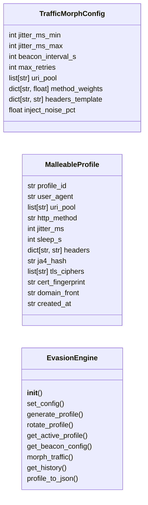
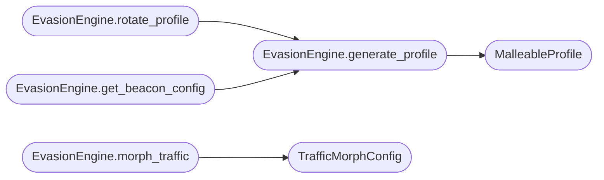

# `modules.evasion_engine`

> Source: [modules/evasion_engine.py:1](../../modules/evasion_engine.py#L1) | language `py` | coverage 15.4% | [API index](../index.md)

Advanced Evasion Engine for LazyOwn C2 operations.

Provides dynamic C2 profile generation, traffic morphing, JA3/JA4
fingerprint randomization, domain fronting, and certificate rotation.

All profile data is derived from payload.json configuration or generated
cryptographically at runtime — no hardcoded values.

## Contents

- **Classes:** [`TrafficMorphConfig`](#trafficmorphconfig), [`MalleableProfile`](#malleableprofile), [`EvasionEngine`](#evasionengine)
- **Constants:** [`SESSIONS_DIR`](#sessions_dir)

## Type Diagram



## Call Graph

Solid arrows stay in this module, dashed arrows leave it.



## Classes

<a id="trafficmorphconfig"></a>

### `TrafficMorphConfig`

`class` `dataclass` | [modules/evasion_engine.py:25](../../modules/evasion_engine.py#L25)

Decorators: `@dataclass`

```python
class TrafficMorphConfig
```

**Attributes**

| Name | Type | Default | Description |
|---|---|---|---|
| [`jitter_ms_min`](#trafficmorphconfig-jitter_ms_min) | `int` | `50` |  |
| [`jitter_ms_max`](#trafficmorphconfig-jitter_ms_max) | `int` | `2000` |  |
| [`beacon_interval_s`](#trafficmorphconfig-beacon_interval_s) | `int` | `60` |  |
| [`max_retries`](#trafficmorphconfig-max_retries) | `int` | `3` |  |
| [`uri_pool`](#trafficmorphconfig-uri_pool) | `list[str]` | `field(default_factory=list)` |  |
| [`method_weights`](#trafficmorphconfig-method_weights) | `dict[str, float]` | `field(default_factory=lambda: {'GET': 0.7, 'POST': 0.25, 'HEAD': 0.05})` |  |
| [`headers_template`](#trafficmorphconfig-headers_template) | `dict[str, str]` | `field(default_factory=dict)` |  |
| [`inject_noise_pct`](#trafficmorphconfig-inject_noise_pct) | `float` | `0.05` |  |

---

<a id="malleableprofile"></a>

### `MalleableProfile`

`class` `dataclass` | [modules/evasion_engine.py:37](../../modules/evasion_engine.py#L37)

Decorators: `@dataclass`

```python
class MalleableProfile
```

**Attributes**

| Name | Type | Default | Description |
|---|---|---|---|
| [`profile_id`](#malleableprofile-profile_id) | `str` |  |  |
| [`user_agent`](#malleableprofile-user_agent) | `str` |  |  |
| [`uri_pool`](#malleableprofile-uri_pool) | `list[str]` |  |  |
| [`http_method`](#malleableprofile-http_method) | `str` |  |  |
| [`jitter_ms`](#malleableprofile-jitter_ms) | `int` |  |  |
| [`sleep_s`](#malleableprofile-sleep_s) | `int` |  |  |
| [`headers`](#malleableprofile-headers) | `dict[str, str]` |  |  |
| [`ja4_hash`](#malleableprofile-ja4_hash) | `str` |  |  |
| [`tls_ciphers`](#malleableprofile-tls_ciphers) | `list[str]` |  |  |
| [`cert_fingerprint`](#malleableprofile-cert_fingerprint) | `str` |  |  |
| [`domain_front`](#malleableprofile-domain_front) | `str` |  |  |
| [`created_at`](#malleableprofile-created_at) | `str` | `field(default_factory=lambda: datetime.now(UTC).isoformat())` |  |

---

<a id="evasionengine"></a>

### `EvasionEngine`

`class` | [modules/evasion_engine.py:52](../../modules/evasion_engine.py#L52)

```python
class EvasionEngine
```

Generates and manages dynamic C2 evasion profiles.

**Members**

| Member | Kind | Summary |
|---|---|---|
| [`__init__`](#evasionengine-__init__) | constructor |  |
| [`set_config`](#evasionengine-set_config) | method |  |
| [`generate_profile`](#evasionengine-generate_profile) | method |  |
| [`rotate_profile`](#evasionengine-rotate_profile) | method |  |
| [`get_active_profile`](#evasionengine-get_active_profile) | method |  |
| [`get_beacon_config`](#evasionengine-get_beacon_config) | method |  |
| [`morph_traffic`](#evasionengine-morph_traffic) | method |  |
| [`get_history`](#evasionengine-get_history) | method |  |
| [`profile_to_json`](#evasionengine-profile_to_json) | method |  |

<a id="evasionengine-__init__"></a>

#### `EvasionEngine.__init__`

`constructor` | [modules/evasion_engine.py:130](../../modules/evasion_engine.py#L130)

```python
def __init__(self, config: Any = None) -> None
```

**Parameters**

| Name | Type | Default | Description |
|---|---|---|---|
| `config` | `Any` | `None` |  |

*Called by:* [`EvasivePayloadCommandSet.do_evasion`](cli.commands.evasive_payload.py.md#evasivepayloadcommandset-do_evasion)

<a id="evasionengine-set_config"></a>

#### `EvasionEngine.set_config`

`method` | [modules/evasion_engine.py:136](../../modules/evasion_engine.py#L136)

```python
def set_config(self, config: Any) -> None
```

**Parameters**

| Name | Type | Default | Description |
|---|---|---|---|
| `config` | `Any` |  |  |

<a id="evasionengine-generate_profile"></a>

#### `EvasionEngine.generate_profile`

`method` | [modules/evasion_engine.py:244](../../modules/evasion_engine.py#L244)

```python
def generate_profile(self, os_family: str = 'windows') -> MalleableProfile
```

**Parameters**

| Name | Type | Default | Description |
|---|---|---|---|
| `os_family` | `str` | `'windows'` |  |

**Returns:** `MalleableProfile`

*Calls:* [`MalleableProfile`](#malleableprofile)

*Called by:* [`EvasivePayloadCommandSet.do_evasion`](cli.commands.evasive_payload.py.md#evasivepayloadcommandset-do_evasion), [`EvasionEngine.get_beacon_config`](#evasionengine-get_beacon_config), [`EvasionEngine.rotate_profile`](#evasionengine-rotate_profile)

<a id="evasionengine-rotate_profile"></a>

#### `EvasionEngine.rotate_profile`

`method` | [modules/evasion_engine.py:264](../../modules/evasion_engine.py#L264)

```python
def rotate_profile(self, os_family: str | None = None) -> MalleableProfile
```

**Parameters**

| Name | Type | Default | Description |
|---|---|---|---|
| `os_family` | `str \| None` | `None` |  |

**Returns:** `MalleableProfile`

*Calls:* [`EvasionEngine.generate_profile`](#evasionengine-generate_profile)

*Called by:* [`EvasivePayloadCommandSet.do_evasion`](cli.commands.evasive_payload.py.md#evasivepayloadcommandset-do_evasion)

<a id="evasionengine-get_active_profile"></a>

#### `EvasionEngine.get_active_profile`

`method` | [modules/evasion_engine.py:269](../../modules/evasion_engine.py#L269)

```python
def get_active_profile(self) -> MalleableProfile | None
```

**Returns:** `MalleableProfile | None`

*Called by:* [`EvasivePayloadCommandSet.do_evasion`](cli.commands.evasive_payload.py.md#evasivepayloadcommandset-do_evasion)

<a id="evasionengine-get_beacon_config"></a>

#### `EvasionEngine.get_beacon_config`

`method` | [modules/evasion_engine.py:272](../../modules/evasion_engine.py#L272)

```python
def get_beacon_config(self) -> dict[str, Any]
```

**Returns:** `dict[str, Any]`

*Calls:* [`EvasionEngine.generate_profile`](#evasionengine-generate_profile)

*Called by:* [`EvasivePayloadCommandSet.do_evasion`](cli.commands.evasive_payload.py.md#evasivepayloadcommandset-do_evasion)

<a id="evasionengine-morph_traffic"></a>

#### `EvasionEngine.morph_traffic`

`method` | [modules/evasion_engine.py:287](../../modules/evasion_engine.py#L287)

```python
def morph_traffic(self, config: TrafficMorphConfig | None = None) -> dict[str, Any]
```

**Parameters**

| Name | Type | Default | Description |
|---|---|---|---|
| `config` | `TrafficMorphConfig \| None` | `None` |  |

**Returns:** `dict[str, Any]`

*Calls:* [`TrafficMorphConfig`](#trafficmorphconfig)

<a id="evasionengine-get_history"></a>

#### `EvasionEngine.get_history`

`method` | [modules/evasion_engine.py:328](../../modules/evasion_engine.py#L328)

```python
def get_history(self) -> list[dict[str, Any]]
```

**Returns:** `list[dict[str, Any]]`

*Called by:* [`EvasivePayloadCommandSet.do_evasion`](cli.commands.evasive_payload.py.md#evasivepayloadcommandset-do_evasion)

<a id="evasionengine-profile_to_json"></a>

#### `EvasionEngine.profile_to_json`

`method` | [modules/evasion_engine.py:343](../../modules/evasion_engine.py#L343)

```python
def profile_to_json(self, profile: MalleableProfile | None = None) -> str
```

**Parameters**

| Name | Type | Default | Description |
|---|---|---|---|
| `profile` | `MalleableProfile \| None` | `None` |  |

**Returns:** `str`

*Called by:* [`EvasivePayloadCommandSet.do_evasion`](cli.commands.evasive_payload.py.md#evasivepayloadcommandset-do_evasion)

---

## Constants

<a id="sessions_dir"></a>

### `SESSIONS_DIR`

`constant` | [modules/evasion_engine.py:21](../../modules/evasion_engine.py#L21)

```python
SESSIONS_DIR = Path(__file__).resolve().parent.parent / 'sessions'
```

---
