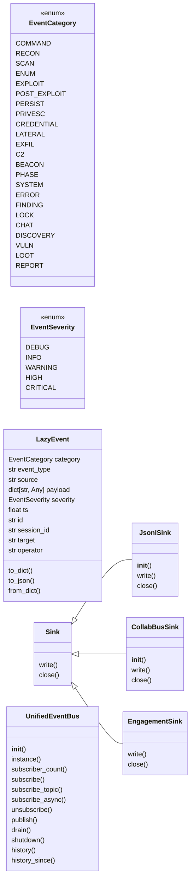
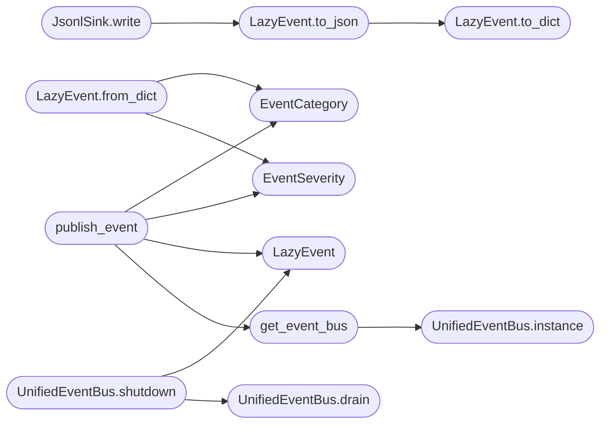

# `modules.event_bus`

> Source: [modules/event_bus.py:1](../../modules/event_bus.py#L1) | language `py` | coverage 52.8% | [API index](../index.md)

UnifiedEventBus — central nervous system connecting all LazyOwn components.

Replaces the fragmented event systems (collab_bp.EventBus, engagement_hooks,
event_engine) with a single typed pub/sub bus that CLI, C2, MCP, autonomous
agents, and bridges all share.

Design (SOLID)
--------------
- Single Responsibility : UnifiedEventBus owns only event routing + persistence.
- Open/Closed           : new event types/categories added without modifying bus.
- Liskov                : all subscribers honour Callable[[LazyEvent], None].
- Interface Segregation : subscribe/unsubscribe/publish are the only surface.
- Dependency Inversion  : bus depends on abstract Sink, not concrete backends.

Thread-safe. Async-compatible. Worker-based dispatch with backpressure via
a bounded queue. Persists to sessions/events.jsonl.

## Contents

- **Classes:** [`LazyEvent`](#lazyevent), [`Sink`](#sink), [`JsonlSink`](#jsonlsink), [`CollabBusSink`](#collabbussink), [`EngagementSink`](#engagementsink), [`UnifiedEventBus`](#unifiedeventbus)
- **Enums:** [`EventCategory`](#eventcategory), [`EventSeverity`](#eventseverity)
- **Functions:** [`get_event_bus`](#get_event_bus), [`publish_event`](#publish_event)
- **Constants:** [`MAX_HISTORY`](#max_history), [`MAX_QUEUE_PER_SUB`](#max_queue_per_sub), [`DISPATCH_QUEUE_SIZE`](#dispatch_queue_size)

## Type Diagram



## Call Graph

Solid arrows stay in this module, dashed arrows leave it.



## Classes

<a id="lazyevent"></a>

### `LazyEvent`

`class` `dataclass` | [modules/event_bus.py:82](../../modules/event_bus.py#L82)

Decorators: `@dataclass`

```python
class LazyEvent
```

Universal event envelope for all LazyOwn components.

**Attributes**

| Name | Type | Default | Description |
|---|---|---|---|
| [`category`](#lazyevent-category) | `EventCategory` |  |  |
| [`event_type`](#lazyevent-event_type) | `str` |  |  |
| [`source`](#lazyevent-source) | `str` |  |  |
| [`payload`](#lazyevent-payload) | `dict[str, Any]` | `field(default_factory=dict)` |  |
| [`severity`](#lazyevent-severity) | `EventSeverity` | `EventSeverity.INFO` |  |
| [`ts`](#lazyevent-ts) | `float` | `field(default_factory=time.time)` |  |
| [`id`](#lazyevent-id) | `str` | `field(default_factory=lambda: uuid.uuid4().hex[:12])` |  |
| [`session_id`](#lazyevent-session_id) | `str` | `''` |  |
| [`target`](#lazyevent-target) | `str` | `''` |  |
| [`operator`](#lazyevent-operator) | `str` | `'system'` |  |

**Members**

| Member | Kind | Summary |
|---|---|---|
| [`to_dict`](#lazyevent-to_dict) | method |  |
| [`to_json`](#lazyevent-to_json) | method |  |
| [`from_dict`](#lazyevent-from_dict) | classmethod |  |

<a id="lazyevent-to_dict"></a>

#### `LazyEvent.to_dict`

`method` | [modules/event_bus.py:96](../../modules/event_bus.py#L96)

```python
def to_dict(self) -> dict[str, Any]
```

**Returns:** `dict[str, Any]`

*Called by:* [`LazyEvent.to_json`](#lazyevent-to_json)

<a id="lazyevent-to_json"></a>

#### `LazyEvent.to_json`

`method` | [modules/event_bus.py:111](../../modules/event_bus.py#L111)

```python
def to_json(self) -> str
```

**Returns:** `str`

*Calls:* [`LazyEvent.to_dict`](#lazyevent-to_dict)

*Called by:* [`JsonlSink.write`](#jsonlsink-write)

<a id="lazyevent-from_dict"></a>

#### `LazyEvent.from_dict`

`classmethod` | [modules/event_bus.py:115](../../modules/event_bus.py#L115)

Decorators: `@classmethod`

```python
def from_dict(cls, d: dict[str, Any]) -> LazyEvent
```

**Parameters**

| Name | Type | Default | Description |
|---|---|---|---|
| `d` | `dict[str, Any]` |  |  |

**Returns:** `LazyEvent`

*Calls:* [`EventCategory`](#eventcategory), [`EventSeverity`](#eventseverity)

---

<a id="sink"></a>

### `Sink`

`class` `abstract` | [modules/event_bus.py:133](../../modules/event_bus.py#L133)

```python
class Sink(ABC)
```

Bases: `ABC`

Subclasses: [`CollabBusSink`](#collabbussink), [`EngagementSink`](#engagementsink), [`JsonlSink`](#jsonlsink)

Abstract sink for persisting or forwarding events.

**Members**

| Member | Kind | Summary |
|---|---|---|
| [`write`](#sink-write) | method |  |
| [`close`](#sink-close) | method |  |

<a id="sink-write"></a>

#### `Sink.write`

`method` `abstract` | [modules/event_bus.py:137](../../modules/event_bus.py#L137)

Decorators: `@abstractmethod`

```python
def write(self, event: LazyEvent) -> None
```

**Parameters**

| Name | Type | Default | Description |
|---|---|---|---|
| `event` | `LazyEvent` |  |  |

<a id="sink-close"></a>

#### `Sink.close`

`method` `abstract` | [modules/event_bus.py:140](../../modules/event_bus.py#L140)

Decorators: `@abstractmethod`

```python
def close(self) -> None
```

---

<a id="jsonlsink"></a>

### `JsonlSink`

`class` | [modules/event_bus.py:143](../../modules/event_bus.py#L143)

```python
class JsonlSink(Sink)
```

Bases: [`Sink`](#sink)

Persists events to sessions/events.jsonl (append-only).

**Members**

| Member | Kind | Summary |
|---|---|---|
| [`__init__`](#jsonlsink-__init__) | constructor |  |
| [`write`](#jsonlsink-write) | method |  |
| [`close`](#jsonlsink-close) | method |  |

<a id="jsonlsink-__init__"></a>

#### `JsonlSink.__init__`

`constructor` | [modules/event_bus.py:146](../../modules/event_bus.py#L146)

```python
def __init__(self, filepath: Path = _EVENTS_FILE) -> None
```

**Parameters**

| Name | Type | Default | Description |
|---|---|---|---|
| `filepath` | `Path` | `_EVENTS_FILE` |  |

<a id="jsonlsink-write"></a>

#### `JsonlSink.write`

`method` | [modules/event_bus.py:151](../../modules/event_bus.py#L151)

```python
def write(self, event: LazyEvent) -> None
```

**Parameters**

| Name | Type | Default | Description |
|---|---|---|---|
| `event` | `LazyEvent` |  |  |

*Calls:* [`LazyEvent.to_json`](#lazyevent-to_json)

<a id="jsonlsink-close"></a>

#### `JsonlSink.close`

`method` | [modules/event_bus.py:159](../../modules/event_bus.py#L159)

```python
def close(self) -> None
```

---

<a id="collabbussink"></a>

### `CollabBusSink`

`class` | [modules/event_bus.py:163](../../modules/event_bus.py#L163)

```python
class CollabBusSink(Sink)
```

Bases: [`Sink`](#sink)

Forwards LazyEvents to the existing collab_bp.EventBus for SSE streaming.

**Members**

| Member | Kind | Summary |
|---|---|---|
| [`__init__`](#collabbussink-__init__) | constructor |  |
| [`write`](#collabbussink-write) | method |  |
| [`close`](#collabbussink-close) | method |  |

<a id="collabbussink-__init__"></a>

#### `CollabBusSink.__init__`

`constructor` | [modules/event_bus.py:166](../../modules/event_bus.py#L166)

```python
def __init__(self) -> None
```

<a id="collabbussink-write"></a>

#### `CollabBusSink.write`

`method` | [modules/event_bus.py:181](../../modules/event_bus.py#L181)

```python
def write(self, event: LazyEvent) -> None
```

**Parameters**

| Name | Type | Default | Description |
|---|---|---|---|
| `event` | `LazyEvent` |  |  |

<a id="collabbussink-close"></a>

#### `CollabBusSink.close`

`method` | [modules/event_bus.py:198](../../modules/event_bus.py#L198)

```python
def close(self) -> None
```

---

<a id="engagementsink"></a>

### `EngagementSink`

`class` | [modules/event_bus.py:202](../../modules/event_bus.py#L202)

```python
class EngagementSink(Sink)
```

Bases: [`Sink`](#sink)

Forwards LazyEvents to the engagement_hooks narrator.

**Members**

| Member | Kind | Summary |
|---|---|---|
| [`write`](#engagementsink-write) | method |  |
| [`close`](#engagementsink-close) | method |  |

<a id="engagementsink-write"></a>

#### `EngagementSink.write`

`method` | [modules/event_bus.py:205](../../modules/event_bus.py#L205)

```python
def write(self, event: LazyEvent) -> None
```

**Parameters**

| Name | Type | Default | Description |
|---|---|---|---|
| `event` | `LazyEvent` |  |  |

<a id="engagementsink-close"></a>

#### `EngagementSink.close`

`method` | [modules/event_bus.py:226](../../modules/event_bus.py#L226)

```python
def close(self) -> None
```

---

<a id="unifiedeventbus"></a>

### `UnifiedEventBus`

`class` | [modules/event_bus.py:230](../../modules/event_bus.py#L230)

```python
class UnifiedEventBus
```

Central event bus for all LazyOwn components.

Events are queued on a bounded ``queue.Queue`` (backpressure) and
dispatched by a dedicated worker thread. This decouples publish()
latency from subscriber execution speed and provides natural
backpressure when subscribers fall behind.

Usage::

    bus = get_event_bus()
    bus.subscribe("my_module", lambda ev: print(ev.event_type))
    bus.publish(LazyEvent(
        category=EventCategory.RECON,
        event_type="scan_complete",
        source="lazynmap",
        payload={"host": "10.0.0.1", "ports": [22, 80, 445]},
    ))

**Members**

| Member | Kind | Summary |
|---|---|---|
| [`__init__`](#unifiedeventbus-__init__) | constructor |  |
| [`instance`](#unifiedeventbus-instance) | classmethod |  |
| [`subscriber_count`](#unifiedeventbus-subscriber_count) | property | Return the number of active subscribers across all registration types. |
| [`subscribe`](#unifiedeventbus-subscribe) | method | Register a callback for all events. |
| [`subscribe_topic`](#unifiedeventbus-subscribe_topic) | method | Register a callback for events matching a topic. |
| [`subscribe_async`](#unifiedeventbus-subscribe_async) | method | Get a Queue for async event consumption (for SSE, WebSocket, etc.). |
| [`unsubscribe`](#unifiedeventbus-unsubscribe) | method | Remove all subscriptions for a subscriber. |
| [`publish`](#unifiedeventbus-publish) | method | Publish an event via the bounded dispatch queue. |
| [`drain`](#unifiedeventbus-drain) | method | Consume and drop all pending events from the dispatch queue. |
| [`shutdown`](#unifiedeventbus-shutdown) | method | Shut down the event bus cleanly. |
| [`history`](#unifiedeventbus-history) | method | Return recent events, optionally filtered by category. |
| [`history_since`](#unifiedeventbus-history_since) | method | Return all events since a given timestamp. |

<a id="unifiedeventbus-__init__"></a>

#### `UnifiedEventBus.__init__`

`constructor` | [modules/event_bus.py:255](../../modules/event_bus.py#L255)

```python
def __init__(self) -> None
```

<a id="unifiedeventbus-instance"></a>

#### `UnifiedEventBus.instance`

`classmethod` | [modules/event_bus.py:287](../../modules/event_bus.py#L287)

Decorators: `@classmethod`

```python
def instance(cls) -> UnifiedEventBus
```

**Returns:** `UnifiedEventBus`

*Called by:* [`get_event_bus`](#get_event_bus)

<a id="unifiedeventbus-subscriber_count"></a>

#### `UnifiedEventBus.subscriber_count`

`property` | [modules/event_bus.py:295](../../modules/event_bus.py#L295)

Decorators: `@property`

```python
def subscriber_count(self) -> int
```

Return the number of active subscribers across all registration types.

**Returns:** `int`

<a id="unifiedeventbus-subscribe"></a>

#### `UnifiedEventBus.subscribe`

`method` | [modules/event_bus.py:300](../../modules/event_bus.py#L300)

```python
def subscribe(self, subscriber_id: str, callback: Subscriber) -> None
```

Register a callback for all events.

**Parameters**

| Name | Type | Default | Description |
|---|---|---|---|
| `subscriber_id` | `str` |  |  |
| `callback` | `Subscriber` |  |  |

<a id="unifiedeventbus-subscribe_topic"></a>

#### `UnifiedEventBus.subscribe_topic`

`method` | [modules/event_bus.py:305](../../modules/event_bus.py#L305)

```python
def subscribe_topic(self, subscriber_id: str, topic: str, callback: Subscriber) -> None
```

Register a callback for events matching a topic.

Topics are dotted strings like 'recon.nmap' or 'beacon.*'.
Wildcards: '*' matches any single segment, '**' matches everything.

**Parameters**

| Name | Type | Default | Description |
|---|---|---|---|
| `subscriber_id` | `str` |  |  |
| `topic` | `str` |  |  |
| `callback` | `Subscriber` |  |  |

<a id="unifiedeventbus-subscribe_async"></a>

#### `UnifiedEventBus.subscribe_async`

`method` | [modules/event_bus.py:315](../../modules/event_bus.py#L315)

```python
def subscribe_async(self, subscriber_id: str) -> queue.Queue
```

Get a Queue for async event consumption (for SSE, WebSocket, etc.).

**Parameters**

| Name | Type | Default | Description |
|---|---|---|---|
| `subscriber_id` | `str` |  |  |

**Returns:** `queue.Queue`

<a id="unifiedeventbus-unsubscribe"></a>

#### `UnifiedEventBus.unsubscribe`

`method` | [modules/event_bus.py:327](../../modules/event_bus.py#L327)

```python
def unsubscribe(self, subscriber_id: str) -> None
```

Remove all subscriptions for a subscriber.

**Parameters**

| Name | Type | Default | Description |
|---|---|---|---|
| `subscriber_id` | `str` |  |  |

<a id="unifiedeventbus-publish"></a>

#### `UnifiedEventBus.publish`

`method` | [modules/event_bus.py:336](../../modules/event_bus.py#L336)

```python
def publish(self, event: LazyEvent) -> None
```

Publish an event via the bounded dispatch queue.

Appends to history immediately. The event is then placed on the
internal dispatch queue for worker-thread delivery to subscribers
and sinks.  When the queue is full this call blocks, providing
natural backpressure.

**Parameters**

| Name | Type | Default | Description |
|---|---|---|---|
| `event` | `LazyEvent` |  | The event to publish. |

<a id="unifiedeventbus-drain"></a>

#### `UnifiedEventBus.drain`

`method` | [modules/event_bus.py:354](../../modules/event_bus.py#L354)

```python
def drain(self) -> None
```

Consume and drop all pending events from the dispatch queue.

Already-delivered events that were dispatched before the drain
call are not affected.  History is preserved so post-drain
queries can still see what was published.

*Called by:* [`UnifiedEventBus.shutdown`](#unifiedeventbus-shutdown)

<a id="unifiedeventbus-shutdown"></a>

#### `UnifiedEventBus.shutdown`

`method` | [modules/event_bus.py:372](../../modules/event_bus.py#L372)

```python
def shutdown(self) -> None
```

Shut down the event bus cleanly.

1. Marks the bus as stopped.
2. Sends a shutdown sentinel through the dispatch queue so the
   worker thread can notify all subscribers and exit.
3. Joins the worker thread (with a timeout).
4. Closes all sinks and clears subscriber registrations.

Thread-safe. Idempotent.

*Calls:* [`LazyEvent`](#lazyevent), [`UnifiedEventBus.drain`](#unifiedeventbus-drain)

<a id="unifiedeventbus-history"></a>

#### `UnifiedEventBus.history`

`method` | [modules/event_bus.py:556](../../modules/event_bus.py#L556)

```python
def history(self, n: int = 50, category: EventCategory | None = None) -> list[LazyEvent]
```

Return recent events, optionally filtered by category.

**Parameters**

| Name | Type | Default | Description |
|---|---|---|---|
| `n` | `int` | `50` |  |
| `category` | `EventCategory \| None` | `None` |  |

**Returns:** `list[LazyEvent]`

<a id="unifiedeventbus-history_since"></a>

#### `UnifiedEventBus.history_since`

`method` | [modules/event_bus.py:564](../../modules/event_bus.py#L564)

```python
def history_since(self, since_ts: float) -> list[LazyEvent]
```

Return all events since a given timestamp.

**Parameters**

| Name | Type | Default | Description |
|---|---|---|---|
| `since_ts` | `float` |  |  |

**Returns:** `list[LazyEvent]`

---

## Enums

<a id="eventcategory"></a>

### `EventCategory`

`enum` | [modules/event_bus.py:47](../../modules/event_bus.py#L47)

```python
class EventCategory(str, Enum)
```

Bases: `str`, `Enum`

**Attributes**

| Name | Type | Default | Description |
|---|---|---|---|
| [`COMMAND`](#eventcategory-command) |  | `'command'` |  |
| [`RECON`](#eventcategory-recon) |  | `'recon'` |  |
| [`SCAN`](#eventcategory-scan) |  | `'scan'` |  |
| [`ENUM`](#eventcategory-enum) |  | `'enum'` |  |
| [`EXPLOIT`](#eventcategory-exploit) |  | `'exploit'` |  |
| [`POST_EXPLOIT`](#eventcategory-post_exploit) |  | `'post_exploit'` |  |
| [`PERSIST`](#eventcategory-persist) |  | `'persist'` |  |
| [`PRIVESC`](#eventcategory-privesc) |  | `'privesc'` |  |
| [`CREDENTIAL`](#eventcategory-credential) |  | `'credential'` |  |
| [`LATERAL`](#eventcategory-lateral) |  | `'lateral'` |  |
| [`EXFIL`](#eventcategory-exfil) |  | `'exfil'` |  |
| [`C2`](#eventcategory-c2) |  | `'c2'` |  |
| [`BEACON`](#eventcategory-beacon) |  | `'beacon'` |  |
| [`PHASE`](#eventcategory-phase) |  | `'phase'` |  |
| [`SYSTEM`](#eventcategory-system) |  | `'system'` |  |
| [`ERROR`](#eventcategory-error) |  | `'error'` |  |
| [`FINDING`](#eventcategory-finding) |  | `'finding'` |  |
| [`LOCK`](#eventcategory-lock) |  | `'lock'` |  |
| [`CHAT`](#eventcategory-chat) |  | `'chat'` |  |
| [`DISCOVERY`](#eventcategory-discovery) |  | `'discovery'` |  |
| [`VULN`](#eventcategory-vuln) |  | `'vuln'` |  |
| [`LOOT`](#eventcategory-loot) |  | `'loot'` |  |
| [`REPORT`](#eventcategory-report) |  | `'report'` |  |

---

<a id="eventseverity"></a>

### `EventSeverity`

`enum` | [modules/event_bus.py:73](../../modules/event_bus.py#L73)

```python
class EventSeverity(str, Enum)
```

Bases: `str`, `Enum`

**Attributes**

| Name | Type | Default | Description |
|---|---|---|---|
| [`DEBUG`](#eventseverity-debug) |  | `'debug'` |  |
| [`INFO`](#eventseverity-info) |  | `'info'` |  |
| [`WARNING`](#eventseverity-warning) |  | `'warning'` |  |
| [`HIGH`](#eventseverity-high) |  | `'high'` |  |
| [`CRITICAL`](#eventseverity-critical) |  | `'critical'` |  |

---

## Functions

<a id="get_event_bus"></a>

### `get_event_bus`

`function` | [modules/event_bus.py:570](../../modules/event_bus.py#L570)

```python
def get_event_bus() -> UnifiedEventBus
```

Return the singleton UnifiedEventBus instance.

**Returns:** `UnifiedEventBus`

*Calls:* [`UnifiedEventBus.instance`](#unifiedeventbus-instance)

*Called by:* [`LazyOwnShell.do_event_log`](lazyown.py.md#lazyownshell-do_event_log), [`publish_event`](#publish_event), [`unwire_all_consumers`](modules.event_consumers.py.md#unwire_all_consumers), [`wire_all_consumers`](modules.event_consumers.py.md#wire_all_consumers)

---

<a id="publish_event"></a>

### `publish_event`

`function` | [modules/event_bus.py:575](../../modules/event_bus.py#L575)

```python
def publish_event(category: EventCategory | str, event_type: str, source: str = 'system', payload: dict[str, Any] | None = None, severity: EventSeverity | str = EventSeverity.INFO, target: str = '', operator: str = 'system') -> LazyEvent
```

Convenience function to build and publish an event in one call.

**Parameters**

| Name | Type | Default | Description |
|---|---|---|---|
| `category` | `EventCategory \| str` |  |  |
| `event_type` | `str` |  |  |
| `source` | `str` | `'system'` |  |
| `payload` | `dict[str, Any] \| None` | `None` |  |
| `severity` | `EventSeverity \| str` | `EventSeverity.INFO` |  |
| `target` | `str` | `''` |  |
| `operator` | `str` | `'system'` |  |

**Returns:** `LazyEvent`

*Calls:* [`EventCategory`](#eventcategory), [`EventSeverity`](#eventseverity), [`LazyEvent`](#lazyevent), [`get_event_bus`](#get_event_bus)

*Called by:* [`publish_loop_event`](modules.loop_ai_bridge.py.md#publish_loop_event)

---

## Constants

<a id="max_history"></a>

### `MAX_HISTORY`

`constant` | [modules/event_bus.py:42](../../modules/event_bus.py#L42)

```python
MAX_HISTORY = 1000
```

---

<a id="max_queue_per_sub"></a>

### `MAX_QUEUE_PER_SUB`

`constant` | [modules/event_bus.py:43](../../modules/event_bus.py#L43)

```python
MAX_QUEUE_PER_SUB = 500
```

---

<a id="dispatch_queue_size"></a>

### `DISPATCH_QUEUE_SIZE`

`constant` | [modules/event_bus.py:44](../../modules/event_bus.py#L44)

```python
DISPATCH_QUEUE_SIZE = 500
```

---
