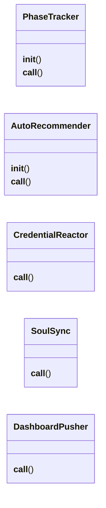
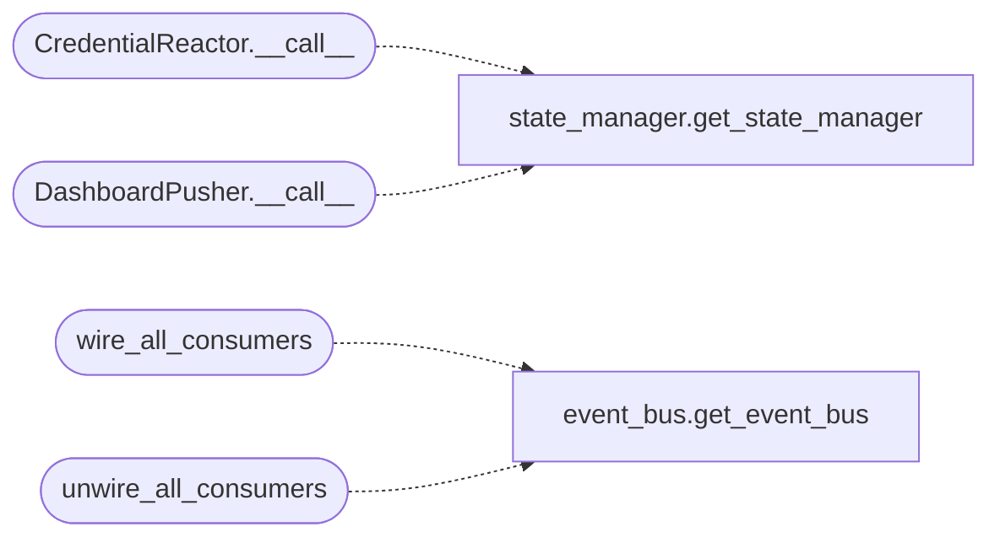

# `modules.event_consumers`

> Source: [modules/event_consumers.py:1](../../modules/event_consumers.py#L1) | language `py` | coverage 53.3% | [API index](../index.md)

Event Consumers — reactive layer that makes EventBus events drive real actions.

These subscribers turn the EventBus from a passive log into an active nervous
system. Each consumer listens for specific event patterns and triggers
concrete framework actions without any component needing to know about others.

Consumers:
- PhaseTracker      : advances host states, updates world_model.json on scan/enum events
- AutoRecommender   : injects "recommend next" objectives after scans complete
- CredentialReactor : auto-triggers credential spraying when creds are found
- SoulSync          : keeps sessions/soul.md in sync with campaign phase/state
- DashboardPusher   : pushes events to collab_bus SSE + session_state.json

All consumers are self-registering — call `[`wire_all_consumers`](#wire_all_consumers)` once at boot.

## Contents

- **Classes:** [`PhaseTracker`](#phasetracker), [`AutoRecommender`](#autorecommender), [`CredentialReactor`](#credentialreactor), [`SoulSync`](#soulsync), [`DashboardPusher`](#dashboardpusher)
- **Functions:** [`wire_all_consumers`](#wire_all_consumers), [`unwire_all_consumers`](#unwire_all_consumers)

## Type Diagram



## Call Graph

Solid arrows stay in this module, dashed arrows leave it.



## Classes

<a id="phasetracker"></a>

### `PhaseTracker`

`class` | [modules/event_consumers.py:146](../../modules/event_consumers.py#L146)

```python
class PhaseTracker
```

Advances host states and updates world_model.json based on scan/enum events.

State machine:
    command like lazynmap   → host state "scanned"
    service_added            → host state "enumerated" (if services present)
    vulnerability_added      → host state "exploited" (if vulns present)
    credential_added         → host state "owned"

**Members**

| Member | Kind | Summary |
|---|---|---|
| [`__init__`](#phasetracker-__init__) | constructor |  |
| [`__call__`](#phasetracker-__call__) | method |  |

<a id="phasetracker-__init__"></a>

#### `PhaseTracker.__init__`

`constructor` | [modules/event_consumers.py:156](../../modules/event_consumers.py#L156)

```python
def __init__(self) -> None
```

<a id="phasetracker-__call__"></a>

#### `PhaseTracker.__call__`

`method` | [modules/event_consumers.py:159](../../modules/event_consumers.py#L159)

```python
def __call__(self, event: Any) -> None
```

**Parameters**

| Name | Type | Default | Description |
|---|---|---|---|
| `event` | `Any` |  |  |

---

<a id="autorecommender"></a>

### `AutoRecommender`

`class` | [modules/event_consumers.py:201](../../modules/event_consumers.py#L201)

```python
class AutoRecommender
```

Injects objectives when significant events happen (scan done, vuln found, etc.).

**Members**

| Member | Kind | Summary |
|---|---|---|
| [`__init__`](#autorecommender-__init__) | constructor |  |
| [`__call__`](#autorecommender-__call__) | method |  |

<a id="autorecommender-__init__"></a>

#### `AutoRecommender.__init__`

`constructor` | [modules/event_consumers.py:204](../../modules/event_consumers.py#L204)

```python
def __init__(self) -> None
```

<a id="autorecommender-__call__"></a>

#### `AutoRecommender.__call__`

`method` | [modules/event_consumers.py:207](../../modules/event_consumers.py#L207)

```python
def __call__(self, event: Any) -> None
```

**Parameters**

| Name | Type | Default | Description |
|---|---|---|---|
| `event` | `Any` |  |  |

---

<a id="credentialreactor"></a>

### `CredentialReactor`

`class` | [modules/event_consumers.py:272](../../modules/event_consumers.py#L272)

```python
class CredentialReactor
```

Detects credential patterns in command output and auto-captures them.

**Members**

| Member | Kind | Summary |
|---|---|---|
| [`__call__`](#credentialreactor-__call__) | method |  |

<a id="credentialreactor-__call__"></a>

#### `CredentialReactor.__call__`

`method` | [modules/event_consumers.py:282](../../modules/event_consumers.py#L282)

```python
def __call__(self, event: Any) -> None
```

**Parameters**

| Name | Type | Default | Description |
|---|---|---|---|
| `event` | `Any` |  |  |

*Calls:* [`get_state_manager`](modules.state_manager.py.md#get_state_manager)

---

<a id="soulsync"></a>

### `SoulSync`

`class` | [modules/event_consumers.py:320](../../modules/event_consumers.py#L320)

```python
class SoulSync
```

Keeps sessions/soul.md in sync with campaign state from events.

**Members**

| Member | Kind | Summary |
|---|---|---|
| [`__call__`](#soulsync-__call__) | method |  |

<a id="soulsync-__call__"></a>

#### `SoulSync.__call__`

`method` | [modules/event_consumers.py:323](../../modules/event_consumers.py#L323)

```python
def __call__(self, event: Any) -> None
```

**Parameters**

| Name | Type | Default | Description |
|---|---|---|---|
| `event` | `Any` |  |  |

---

<a id="dashboardpusher"></a>

### `DashboardPusher`

`class` | [modules/event_consumers.py:358](../../modules/event_consumers.py#L358)

```python
class DashboardPusher
```

Refreshes session_state.json and pushes to collab_bus on every event.

**Members**

| Member | Kind | Summary |
|---|---|---|
| [`__call__`](#dashboardpusher-__call__) | method |  |

<a id="dashboardpusher-__call__"></a>

#### `DashboardPusher.__call__`

`method` | [modules/event_consumers.py:361](../../modules/event_consumers.py#L361)

```python
def __call__(self, event: Any) -> None
```

**Parameters**

| Name | Type | Default | Description |
|---|---|---|---|
| `event` | `Any` |  |  |

*Calls:* [`get_state_manager`](modules.state_manager.py.md#get_state_manager)

---

## Functions

<a id="wire_all_consumers"></a>

### `wire_all_consumers`

`function` | [modules/event_consumers.py:380](../../modules/event_consumers.py#L380)

```python
def wire_all_consumers(bus=None) -> int
```

Register all event consumers on the UnifiedEventBus.

**Parameters**

| Name | Type | Default | Description |
|---|---|---|---|
| `bus` |  | `None` | Optional UnifiedEventBus instance. Uses singleton if None. |

**Returns:** `int` - Number of consumers registered.

*Calls:* [`get_event_bus`](modules.event_bus.py.md#get_event_bus)

---

<a id="unwire_all_consumers"></a>

### `unwire_all_consumers`

`function` | [modules/event_consumers.py:409](../../modules/event_consumers.py#L409)

```python
def unwire_all_consumers(bus=None) -> None
```

Remove all event consumers from the bus.

**Parameters**

| Name | Type | Default | Description |
|---|---|---|---|
| `bus` |  | `None` |  |

*Calls:* [`get_event_bus`](modules.event_bus.py.md#get_event_bus)

---
