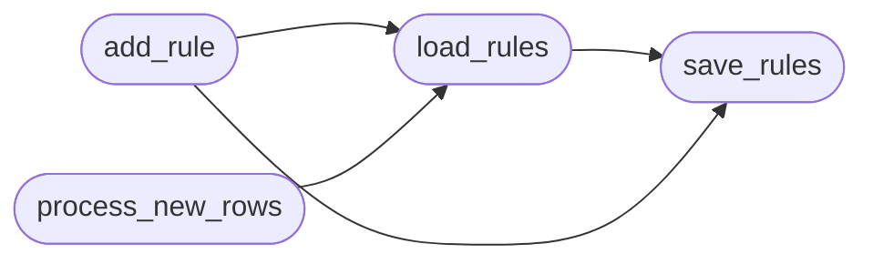

# `modules.event_engine`

> Source: [modules/event_engine.py:1](../../modules/event_engine.py#L1) | language `py` | coverage 85.7% | [API index](../index.md)

LazyOwn Event Engine ==================== Tails sessions/LazyOwn_session_report.csv for new command executions, matches them against rules in sessions/event_rules.json, and appends structured events to sessions/events.jsonl for Claude (MCP) to consume.

Designed to run as a lightweight background loop (see skills/heartbeat.py).

## Contents

- **Functions:** [`load_rules`](#load_rules), [`save_rules`](#save_rules), [`add_rule`](#add_rule), [`process_new_rows`](#process_new_rows), [`read_events`](#read_events), [`ack_event`](#ack_event)
- **Constants:** [`BASE_DIR`](#base_dir), [`SESSIONS`](#sessions), [`CSV_FILE`](#csv_file), [`EVENTS_FILE`](#events_file), [`RULES_FILE`](#rules_file), [`LOGS_DIR`](#logs_dir), [`WATERMARK`](#watermark), [`DEFAULT_RULES`](#default_rules)

## Call Graph

Solid arrows stay in this module, dashed arrows leave it.



## Functions

<a id="load_rules"></a>

### `load_rules`

`function` | [modules/event_engine.py:99](../../modules/event_engine.py#L99)

```python
def load_rules() -> list[dict]
```

Load rules from event_rules.json, creating it with defaults if missing.

**Returns:** `list[dict]`

*Calls:* [`save_rules`](#save_rules)

*Called by:* [`add_rule`](#add_rule), [`process_new_rows`](#process_new_rows), [`call_tool`](skills.lazyown_mcp.py.md#call_tool)

---

<a id="save_rules"></a>

### `save_rules`

`function` | [modules/event_engine.py:110](../../modules/event_engine.py#L110)

```python
def save_rules(rules: list[dict])
```

**Parameters**

| Name | Type | Default | Description |
|---|---|---|---|
| `rules` | `list[dict]` |  |  |

*Called by:* [`add_rule`](#add_rule), [`load_rules`](#load_rules)

---

<a id="add_rule"></a>

### `add_rule`

`function` | [modules/event_engine.py:114](../../modules/event_engine.py#L114)

```python
def add_rule(rule: dict) -> str
```

Add or replace a rule by id.

Returns 'added' or 'updated'.

**Parameters**

| Name | Type | Default | Description |
|---|---|---|---|
| `rule` | `dict` |  |  |

**Returns:** `str`

*Calls:* [`load_rules`](#load_rules), [`save_rules`](#save_rules)

*Called by:* [`call_tool`](skills.lazyown_mcp.py.md#call_tool)

---

<a id="process_new_rows"></a>

### `process_new_rows`

`function` | [modules/event_engine.py:181](../../modules/event_engine.py#L181)

```python
def process_new_rows() -> int
```

Read new rows from the session CSV since last watermark.

Match against rules and emit events to events.jsonl. Returns the number of events emitted.

**Returns:** `int`

*Calls:* [`load_rules`](#load_rules)

*Called by:* [`run_loop`](skills.heartbeat.py.md#run_loop)

---

<a id="read_events"></a>

### `read_events`

`function` | [modules/event_engine.py:250](../../modules/event_engine.py#L250)

```python
def read_events(limit: int = 20, status: str = 'pending') -> list[dict]
```

Return up to `limit` events matching [`status`](modules.lazy_sandbox.py.md#status) (pending/processed/all).

**Parameters**

| Name | Type | Default | Description |
|---|---|---|---|
| `limit` | `int` | `20` |  |
| `status` | `str` | `'pending'` |  |

**Returns:** `list[dict]`

*Called by:* [`run_loop`](skills.heartbeat.py.md#run_loop), [`call_tool`](skills.lazyown_mcp.py.md#call_tool)

---

<a id="ack_event"></a>

### `ack_event`

`function` | [modules/event_engine.py:270](../../modules/event_engine.py#L270)

```python
def ack_event(event_id: str) -> bool
```

Mark an event as processed.

Returns True if found.

**Parameters**

| Name | Type | Default | Description |
|---|---|---|---|
| `event_id` | `str` |  |  |

**Returns:** `bool`

---

## Constants

<a id="base_dir"></a>

### `BASE_DIR`

`constant` | [modules/event_engine.py:18](../../modules/event_engine.py#L18)

```python
BASE_DIR = Path(__file__).parent.parent
```

---

<a id="sessions"></a>

### `SESSIONS`

`constant` | [modules/event_engine.py:19](../../modules/event_engine.py#L19)

```python
SESSIONS = BASE_DIR / 'sessions'
```

---

<a id="csv_file"></a>

### `CSV_FILE`

`constant` | [modules/event_engine.py:20](../../modules/event_engine.py#L20)

```python
CSV_FILE = SESSIONS / 'LazyOwn_session_report.csv'
```

---

<a id="events_file"></a>

### `EVENTS_FILE`

`constant` | [modules/event_engine.py:21](../../modules/event_engine.py#L21)

```python
EVENTS_FILE = SESSIONS / 'events.jsonl'
```

---

<a id="rules_file"></a>

### `RULES_FILE`

`constant` | [modules/event_engine.py:22](../../modules/event_engine.py#L22)

```python
RULES_FILE = SESSIONS / 'event_rules.json'
```

---

<a id="logs_dir"></a>

### `LOGS_DIR`

`constant` | [modules/event_engine.py:23](../../modules/event_engine.py#L23)

```python
LOGS_DIR = SESSIONS / 'logs'
```

---

<a id="watermark"></a>

### `WATERMARK`

`constant` | [modules/event_engine.py:24](../../modules/event_engine.py#L24)

```python
WATERMARK = SESSIONS / '.event_engine_watermark'
```

---

<a id="default_rules"></a>

### `DEFAULT_RULES`

`constant` | [modules/event_engine.py:28](../../modules/event_engine.py#L28)

```python
DEFAULT_RULES
```

---
