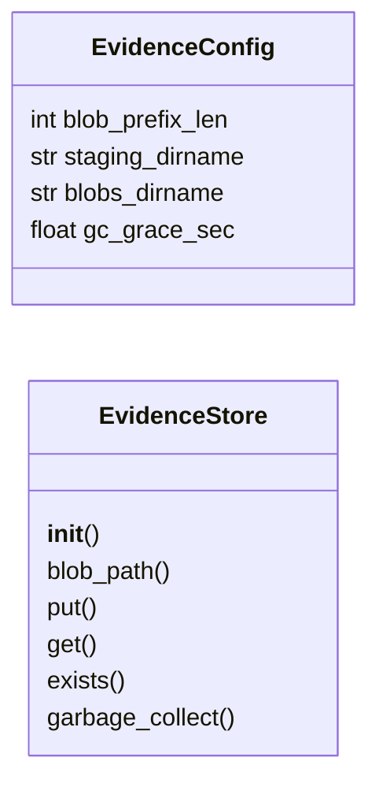
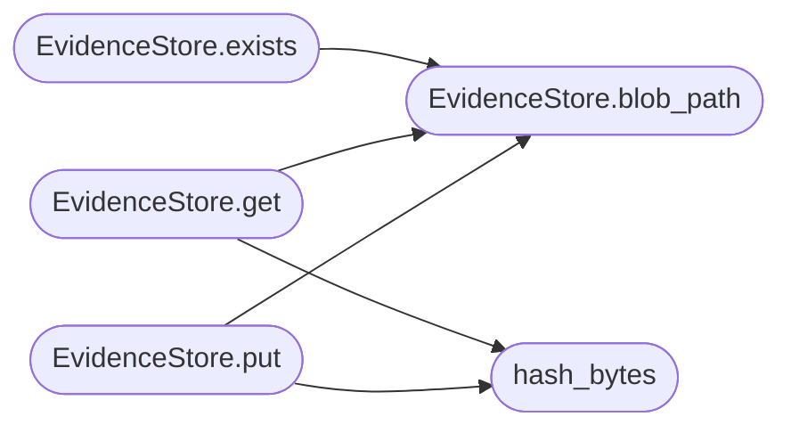

# `modules.evidence`

> Source: [modules/evidence.py:1](../../modules/evidence.py#L1) | language `py` | coverage 100.0% | [API index](../index.md)

Content-addressed evidence vault independent of disposable traffic.

Ports the LAZY ``evidence`` subsystem: finding evidence is hashed
with SHA-256, written atomically via a staging directory, verified on
read, and garbage-collected when unreferenced past a grace period.

## Contents

- **Classes:** [`EvidenceConfig`](#evidenceconfig), [`EvidenceStore`](#evidencestore)
- **Functions:** [`hash_bytes`](#hash_bytes)
- **Constants:** [`CONFIG`](#config), [`BLOB_PREFIX_LEN`](#blob_prefix_len), [`STAGING_DIRNAME`](#staging_dirname), [`BLOBS_DIRNAME`](#blobs_dirname), [`GC_GRACE_SEC`](#gc_grace_sec)

## Type Diagram



## Call Graph

Solid arrows stay in this module, dashed arrows leave it.



## Classes

<a id="evidenceconfig"></a>

### `EvidenceConfig`

`class` `dataclass` | [modules/evidence.py:20](../../modules/evidence.py#L20)

Decorators: `@dataclass(frozen=True, slots=True)`

```python
class EvidenceConfig
```

Centralized constants for vault behavior.

**Attributes**

| Name | Type | Default | Description |
|---|---|---|---|
| [`blob_prefix_len`](#evidenceconfig-blob_prefix_len) | `int` | `2` |  |
| [`staging_dirname`](#evidenceconfig-staging_dirname) | `str` | `'.staging'` |  |
| [`blobs_dirname`](#evidenceconfig-blobs_dirname) | `str` | `'blobs'` |  |
| [`gc_grace_sec`](#evidenceconfig-gc_grace_sec) | `float` | `86400.0` |  |

---

<a id="evidencestore"></a>

### `EvidenceStore`

`class` | [modules/evidence.py:54](../../modules/evidence.py#L54)

```python
class EvidenceStore
```

Durable content-addressed blob store for finding evidence.

**Members**

| Member | Kind | Summary |
|---|---|---|
| [`__init__`](#evidencestore-__init__) | constructor | Create vault directories. |
| [`blob_path`](#evidencestore-blob_path) | method | Resolve the canonical path for a validated hash. |
| [`put`](#evidencestore-put) | method | Atomically store bytes and return their SHA-256 hash. |
| [`get`](#evidencestore-get) | method | Read and verify blob bytes for a hash. |
| [`exists`](#evidencestore-exists) | method | Return True when the blob exists on disk. |
| [`garbage_collect`](#evidencestore-garbage_collect) | method | Remove unreferenced blobs older than the grace period. |

<a id="evidencestore-__init__"></a>

#### `EvidenceStore.__init__`

`constructor` | [modules/evidence.py:57](../../modules/evidence.py#L57)

```python
def __init__(self, base_dir: str | Path) -> None
```

Create vault directories.

**Parameters**

| Name | Type | Default | Description |
|---|---|---|---|
| `base_dir` | `str \| Path` |  |  |

<a id="evidencestore-blob_path"></a>

#### `EvidenceStore.blob_path`

`method` | [modules/evidence.py:65](../../modules/evidence.py#L65)

```python
def blob_path(self, content_hash: str) -> Path
```

Resolve the canonical path for a validated hash.

**Parameters**

| Name | Type | Default | Description |
|---|---|---|---|
| `content_hash` | `str` |  |  |

**Returns:** `Path`

*Called by:* [`EvidenceStore.exists`](#evidencestore-exists), [`EvidenceStore.get`](#evidencestore-get), [`EvidenceStore.put`](#evidencestore-put)

<a id="evidencestore-put"></a>

#### `EvidenceStore.put`

`method` | [modules/evidence.py:70](../../modules/evidence.py#L70)

```python
def put(self, data: bytes) -> str
```

Atomically store bytes and return their SHA-256 hash.

**Parameters**

| Name | Type | Default | Description |
|---|---|---|---|
| `data` | `bytes` |  |  |

**Returns:** `str`

*Calls:* [`EvidenceStore.blob_path`](#evidencestore-blob_path), [`hash_bytes`](#hash_bytes)

<a id="evidencestore-get"></a>

#### `EvidenceStore.get`

`method` | [modules/evidence.py:90](../../modules/evidence.py#L90)

```python
def get(self, content_hash: str) -> bytes
```

Read and verify blob bytes for a hash.

**Parameters**

| Name | Type | Default | Description |
|---|---|---|---|
| `content_hash` | `str` |  |  |

**Returns:** `bytes`

**Raises**

- `ValueError`: (raised in the body, not documented)

*Calls:* [`EvidenceStore.blob_path`](#evidencestore-blob_path), [`hash_bytes`](#hash_bytes)

<a id="evidencestore-exists"></a>

#### `EvidenceStore.exists`

`method` | [modules/evidence.py:98](../../modules/evidence.py#L98)

```python
def exists(self, content_hash: str) -> bool
```

Return True when the blob exists on disk.

**Parameters**

| Name | Type | Default | Description |
|---|---|---|---|
| `content_hash` | `str` |  |  |

**Returns:** `bool`

*Calls:* [`EvidenceStore.blob_path`](#evidencestore-blob_path)

<a id="evidencestore-garbage_collect"></a>

#### `EvidenceStore.garbage_collect`

`method` | [modules/evidence.py:105](../../modules/evidence.py#L105)

```python
def garbage_collect(self, referenced: set[str]) -> int
```

Remove unreferenced blobs older than the grace period.

**Parameters**

| Name | Type | Default | Description |
|---|---|---|---|
| `referenced` | `set[str]` |  |  |

**Returns:** `int`

---

## Functions

<a id="hash_bytes"></a>

### `hash_bytes`

`function` | [modules/evidence.py:37](../../modules/evidence.py#L37)

```python
def hash_bytes(data: bytes) -> str
```

Return the lowercase hex SHA-256 of data.

**Parameters**

| Name | Type | Default | Description |
|---|---|---|---|
| `data` | `bytes` |  |  |

**Returns:** `str`

*Called by:* [`EvidenceStore.get`](#evidencestore-get), [`EvidenceStore.put`](#evidencestore-put)

---

## Constants

<a id="config"></a>

### `CONFIG`

`constant` | [modules/evidence.py:29](../../modules/evidence.py#L29)

```python
CONFIG = EvidenceConfig()
```

---

<a id="blob_prefix_len"></a>

### `BLOB_PREFIX_LEN`

`constant` | [modules/evidence.py:31](../../modules/evidence.py#L31)

```python
BLOB_PREFIX_LEN = CONFIG.blob_prefix_len
```

---

<a id="staging_dirname"></a>

### `STAGING_DIRNAME`

`constant` | [modules/evidence.py:32](../../modules/evidence.py#L32)

```python
STAGING_DIRNAME = CONFIG.staging_dirname
```

---

<a id="blobs_dirname"></a>

### `BLOBS_DIRNAME`

`constant` | [modules/evidence.py:33](../../modules/evidence.py#L33)

```python
BLOBS_DIRNAME = CONFIG.blobs_dirname
```

---

<a id="gc_grace_sec"></a>

### `GC_GRACE_SEC`

`constant` | [modules/evidence.py:34](../../modules/evidence.py#L34)

```python
GC_GRACE_SEC = CONFIG.gc_grace_sec
```

---
