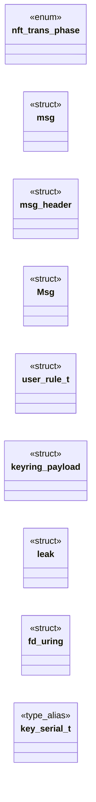
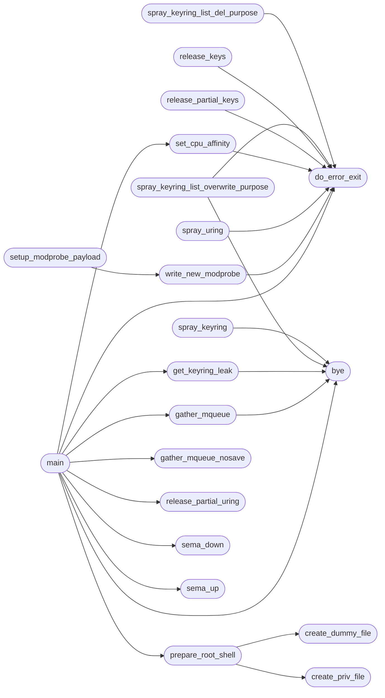

# `modules/exp.c`

> Source: [modules/exp.c:1](../../modules/exp.c#L1) | language `c` | coverage 1.8% | [API index](../index.md)

## Contents

- **Structs:** [`msg`](#msg), [`msg_header`](#msg_header), [`Msg`](#msg), [`user_rule_t`](#user_rule_t), [`keyring_payload`](#keyring_payload), [`leak`](#leak), [`fd_uring`](#fd_uring)
- **Enums:** [`nft_trans_phase`](#nft_trans_phase)
- **Type Aliases:** [`key_serial_t`](#key_serial_t)
- **Functions:** [`bye`](#bye), [`do_error_exit`](#do_error_exit), [`bye2`](#bye2), [`spray_keyring`](#spray_keyring), [`spray_keyring_list_del_purpose`](#spray_keyring_list_del_purpose), [`spray_keyring_list_overwrite_purpose`](#spray_keyring_list_overwrite_purpose), [`get_keyring_leak`](#get_keyring_leak), [`awake_partial_keys`](#awake_partial_keys), [`release_keys`](#release_keys), [`release_partial_keys`](#release_partial_keys), [`unshare_setup`](#unshare_setup), [`set_stable_table_and_set`](#set_stable_table_and_set), [`set_trigger_set_and_overwrite`](#set_trigger_set_and_overwrite), [`set_cpu_affinity`](#set_cpu_affinity), [`spray_mqueue`](#spray_mqueue), [`gather_mqueue`](#gather_mqueue), [`gather_mqueue_nosave`](#gather_mqueue_nosave), [`spray_msg_msg`](#spray_msg_msg), [`spray_uring`](#spray_uring), [`release_uring`](#release_uring), [`release_partial_uring`](#release_partial_uring), [`prepare_root_shell`](#prepare_root_shell), [`create_dummy_file`](#create_dummy_file), [`create_priv_file`](#create_priv_file), [`write_new_modprobe`](#write_new_modprobe), [`setup_modprobe_payload`](#setup_modprobe_payload), [`userland_T`](#userland_t), [`sema_up`](#sema_up), [`sema_down`](#sema_down), [`main`](#main)
- **Macros:** [`_GNU_SOURCE`](#_gnu_source), [`MQUEUE_NUM`](#mqueue_num), [`INBOUND`](#inbound), [`OUTBOUND`](#outbound), [`DESC_MAX`](#desc_max), [`BUFFER`](#buffer), [`NAMELEN`](#namelen), [`ERROR_PREFIX`](#error_prefix), [`KEY_DESC_MAX_SIZE`](#key_desc_max_size), [`PREFIX_BUF_LEN`](#prefix_buf_len), [`RCU_HEAD_LEN`](#rcu_head_len), [`SPRAY_KEY_SIZE`](#spray_key_size), [`PHYSMAP_MASK`](#physmap_mask), [`SPRAY_SIZE`](#spray_size), [`SPRAY_NB_ENTRIES`](#spray_nb_entries)

## Type Diagram



## Call Graph

Solid arrows stay in this module, dashed arrows leave it.



## Structs

<a id="msg"></a>

### `msg`

`struct` | [modules/exp.c:84](../../modules/exp.c#L84)

```c
typedef struct
```

---

<a id="msg_header"></a>

### `msg_header`

`struct` | [modules/exp.c:90](../../modules/exp.c#L90)

```c
typedef struct
```

---

<a id="msg"></a>

### `Msg`

`struct` | [modules/exp.c:100](../../modules/exp.c#L100)

```c
typedef struct
```

---

<a id="user_rule_t"></a>

### `user_rule_t`

`struct` | [modules/exp.c:105](../../modules/exp.c#L105)

```c
typedef struct
```

---

<a id="keyring_payload"></a>

### `keyring_payload`

`struct` | [modules/exp.c:120](../../modules/exp.c#L120)

```c
struct keyring_payload
```

---

<a id="leak"></a>

### `leak`

`struct` | [modules/exp.c:126](../../modules/exp.c#L126)

```c
struct leak
```

---

<a id="fd_uring"></a>

### `fd_uring`

`struct` | [modules/exp.c:131](../../modules/exp.c#L131)

```c
struct fd_uring
```

---

## Enums

<a id="nft_trans_phase"></a>

### `nft_trans_phase`

`enum` | [modules/exp.c:77](../../modules/exp.c#L77)

```c
enum nft_trans_phase
```

---

## Type Aliases

<a id="key_serial_t"></a>

### `key_serial_t`

`type_alias` | [modules/exp.c:135](../../modules/exp.c#L135)

```c
typedef int32_t key_serial_t;
```

---

## Functions

<a id="bye"></a>

### `bye`

`function` | [modules/exp.c:155](../../modules/exp.c#L155)

```c
void bye(char *info)
```

**Parameters**

| Name | Type | Default | Description |
|---|---|---|---|
| `info` | `char *` |  |  |

*Called by:* [`gather_mqueue`](#gather_mqueue), [`get_keyring_leak`](#get_keyring_leak), [`main`](#main), [`spray_keyring`](#spray_keyring), [`spray_keyring_list_overwrite_purpose`](#spray_keyring_list_overwrite_purpose)

---

<a id="do_error_exit"></a>

### `do_error_exit`

`function` | [modules/exp.c:161](../../modules/exp.c#L161)

```c
void do_error_exit(char *info)
```

**Parameters**

| Name | Type | Default | Description |
|---|---|---|---|
| `info` | `char *` |  |  |

*Called by:* [`main`](#main), [`release_keys`](#release_keys), [`release_partial_keys`](#release_partial_keys), [`set_cpu_affinity`](#set_cpu_affinity), [`spray_keyring_list_del_purpose`](#spray_keyring_list_del_purpose), [`spray_keyring_list_overwrite_purpose`](#spray_keyring_list_overwrite_purpose), [`spray_uring`](#spray_uring), [`write_new_modprobe`](#write_new_modprobe)

---

<a id="bye2"></a>

### `bye2`

`function` | [modules/exp.c:167](../../modules/exp.c#L167)

```c
void bye2(char *info, char *arg)
```

**Parameters**

| Name | Type | Default | Description |
|---|---|---|---|
| `info` | `char *` |  |  |
| `arg` | `char *` |  |  |

---

<a id="spray_keyring"></a>

### `spray_keyring`

`function` | [modules/exp.c:172](../../modules/exp.c#L172)

```c
key_serial_t *spray_keyring(uint32_t start, uint32_t spray_size)
```

**Parameters**

| Name | Type | Default | Description |
|---|---|---|---|
| `start` | `uint32_t` |  |  |
| `spray_size` | `uint32_t` |  |  |

**Returns:** `key_serial_t *`

*Calls:* [`bye`](#bye)

*Called by:* [`main`](#main)

---

<a id="spray_keyring_list_del_purpose"></a>

### `spray_keyring_list_del_purpose`

`function` | [modules/exp.c:190](../../modules/exp.c#L190)

```c
key_serial_t *spray_keyring_list_del_purpose(uint32_t spray_size, uint64_t next, uint64_t prev, uint64_t size)
```

**Parameters**

| Name | Type | Default | Description |
|---|---|---|---|
| `spray_size` | `uint32_t` |  |  |
| `next` | `uint64_t` |  |  |
| `prev` | `uint64_t` |  |  |
| `size` | `uint64_t` |  |  |

**Returns:** `key_serial_t *`

*Calls:* [`do_error_exit`](#do_error_exit)

*Called by:* [`main`](#main)

---

<a id="spray_keyring_list_overwrite_purpose"></a>

### `spray_keyring_list_overwrite_purpose`

`function` | [modules/exp.c:214](../../modules/exp.c#L214)

```c
key_serial_t *spray_keyring_list_overwrite_purpose(uint32_t spray_size, uint64_t len, uint64_t off_18, uint64_t off_20, uint64_t off_28, uint64_t off_30, uint64_t off_38)
```

**Parameters**

| Name | Type | Default | Description |
|---|---|---|---|
| `spray_size` | `uint32_t` |  |  |
| `len` | `uint64_t` |  |  |
| `off_18` | `uint64_t` |  |  |
| `off_20` | `uint64_t` |  |  |
| `off_28` | `uint64_t` |  |  |
| `off_30` | `uint64_t` |  |  |
| `off_38` | `uint64_t` |  |  |

**Returns:** `key_serial_t *`

*Calls:* [`bye`](#bye), [`do_error_exit`](#do_error_exit)

---

<a id="get_keyring_leak"></a>

### `get_keyring_leak`

`function` | [modules/exp.c:248](../../modules/exp.c#L248)

```c
int get_keyring_leak(key_serial_t *id_buffer, uint32_t id_buffer_size)
```

**Parameters**

| Name | Type | Default | Description |
|---|---|---|---|
| `id_buffer` | `key_serial_t *` |  |  |
| `id_buffer_size` | `uint32_t` |  |  |

**Returns:** `int`

*Calls:* [`bye`](#bye)

*Called by:* [`main`](#main)

---

<a id="awake_partial_keys"></a>

### `awake_partial_keys`

`function` | [modules/exp.c:271](../../modules/exp.c#L271)

```c
void awake_partial_keys(key_serial_t *id_buffer, uint32_t idx)
```

**Parameters**

| Name | Type | Default | Description |
|---|---|---|---|
| `id_buffer` | `key_serial_t *` |  |  |
| `idx` | `uint32_t` |  |  |

---

<a id="release_keys"></a>

### `release_keys`

`function` | [modules/exp.c:279](../../modules/exp.c#L279)

```c
void release_keys(key_serial_t *id_buffer, uint32_t id_buffer_size)
```

**Parameters**

| Name | Type | Default | Description |
|---|---|---|---|
| `id_buffer` | `key_serial_t *` |  |  |
| `id_buffer_size` | `uint32_t` |  |  |

*Calls:* [`do_error_exit`](#do_error_exit)

---

<a id="release_partial_keys"></a>

### `release_partial_keys`

`function` | [modules/exp.c:290](../../modules/exp.c#L290)

```c
void release_partial_keys(key_serial_t *id_buffer, int i)
```

**Parameters**

| Name | Type | Default | Description |
|---|---|---|---|
| `id_buffer` | `key_serial_t *` |  |  |
| `i` | `int` |  |  |

*Calls:* [`do_error_exit`](#do_error_exit)

---

<a id="unshare_setup"></a>

### `unshare_setup`

`function` | [modules/exp.c:297](../../modules/exp.c#L297)

```c
void unshare_setup(uid_t uid, gid_t gid)
```

**Parameters**

| Name | Type | Default | Description |
|---|---|---|---|
| `uid` | `uid_t` |  |  |
| `gid` | `gid_t` |  |  |

*Called by:* [`main`](#main)

---

<a id="set_stable_table_and_set"></a>

### `set_stable_table_and_set`

`function` | [modules/exp.c:322](../../modules/exp.c#L322)

```c
void set_stable_table_and_set(struct mnl_socket* nl, const char *name)
```

**Parameters**

| Name | Type | Default | Description |
|---|---|---|---|
| `nl` | `struct mnl_socket*` |  |  |
| `name` | `char *` |  |  |

*Called by:* [`main`](#main)

---

<a id="set_trigger_set_and_overwrite"></a>

### `set_trigger_set_and_overwrite`

`function` | [modules/exp.c:385](../../modules/exp.c#L385)

```c
void set_trigger_set_and_overwrite(struct mnl_socket* nl, const char *name, const char *set_name)
```

**Parameters**

| Name | Type | Default | Description |
|---|---|---|---|
| `nl` | `struct mnl_socket*` |  |  |
| `name` | `char *` |  |  |
| `set_name` | `char *` |  |  |

*Called by:* [`main`](#main)

---

<a id="set_cpu_affinity"></a>

### `set_cpu_affinity`

`function` | [modules/exp.c:438](../../modules/exp.c#L438)

```c
void set_cpu_affinity(int cpu_n, pid_t pid)
```

**Parameters**

| Name | Type | Default | Description |
|---|---|---|---|
| `cpu_n` | `int` |  |  |
| `pid` | `pid_t` |  |  |

*Calls:* [`do_error_exit`](#do_error_exit)

*Called by:* [`main`](#main)

---

<a id="spray_mqueue"></a>

### `spray_mqueue`

`function` | [modules/exp.c:448](../../modules/exp.c#L448)

```c
void spray_mqueue(mqd_t mqdes, char *msgptr, int spray_size)
```

**Parameters**

| Name | Type | Default | Description |
|---|---|---|---|
| `mqdes` | `mqd_t` |  |  |
| `msgptr` | `char *` |  |  |
| `spray_size` | `int` |  |  |

*Called by:* [`main`](#main)

---

<a id="gather_mqueue"></a>

### `gather_mqueue`

`function` | [modules/exp.c:463](../../modules/exp.c#L463)

```c
int gather_mqueue(mqd_t mqdes, int gather_size)
```

**Parameters**

| Name | Type | Default | Description |
|---|---|---|---|
| `mqdes` | `mqd_t` |  |  |
| `gather_size` | `int` |  |  |

**Returns:** `int`

*Calls:* [`bye`](#bye)

*Called by:* [`main`](#main)

---

<a id="gather_mqueue_nosave"></a>

### `gather_mqueue_nosave`

`function` | [modules/exp.c:485](../../modules/exp.c#L485)

```c
int gather_mqueue_nosave(mqd_t mqdes, int gather_size)
```

**Parameters**

| Name | Type | Default | Description |
|---|---|---|---|
| `mqdes` | `mqd_t` |  |  |
| `gather_size` | `int` |  |  |

**Returns:** `int`

*Called by:* [`main`](#main)

---

<a id="spray_msg_msg"></a>

### `spray_msg_msg`

`function` | [modules/exp.c:496](../../modules/exp.c#L496)

```c
void spray_msg_msg(unsigned int size, unsigned int amount, int qid)
```

**Parameters**

| Name | Type | Default | Description |
|---|---|---|---|
| `size` | `unsigned int` |  |  |
| `amount` | `unsigned int` |  |  |
| `qid` | `int` |  |  |

---

<a id="spray_uring"></a>

### `spray_uring`

`function` | [modules/exp.c:529](../../modules/exp.c#L529)

```c
struct fd_uring *spray_uring(uint32_t spray_size, struct fd_uring *fd_buffer)
```

**Parameters**

| Name | Type | Default | Description |
|---|---|---|---|
| `spray_size` | `uint32_t` |  |  |
| `fd_buffer` | `struct fd_uring *` |  |  |

**Returns:** `fd_uring *`

*Calls:* [`do_error_exit`](#do_error_exit)

*Called by:* [`main`](#main)

---

<a id="release_uring"></a>

### `release_uring`

`function` | [modules/exp.c:546](../../modules/exp.c#L546)

```c
void release_uring(struct fd_uring *fd_buffer, uint32_t buffer_size)
```

**Parameters**

| Name | Type | Default | Description |
|---|---|---|---|
| `fd_buffer` | `struct fd_uring *` |  |  |
| `buffer_size` | `uint32_t` |  |  |

---

<a id="release_partial_uring"></a>

### `release_partial_uring`

`function` | [modules/exp.c:554](../../modules/exp.c#L554)

```c
void release_partial_uring(struct fd_uring *fd_buffer, uint32_t buffer_idx)
```

**Parameters**

| Name | Type | Default | Description |
|---|---|---|---|
| `fd_buffer` | `struct fd_uring *` |  |  |
| `buffer_idx` | `uint32_t` |  |  |

*Called by:* [`main`](#main)

---

<a id="prepare_root_shell"></a>

### `prepare_root_shell`

`function` | [modules/exp.c:559](../../modules/exp.c#L559)

```c
void prepare_root_shell(void)
```

*Calls:* [`create_dummy_file`](#create_dummy_file), [`create_priv_file`](#create_priv_file)

*Called by:* [`main`](#main)

---

<a id="create_dummy_file"></a>

### `create_dummy_file`

`function` | [modules/exp.c:564](../../modules/exp.c#L564)

```c
void create_dummy_file(void)
```

*Called by:* [`prepare_root_shell`](#prepare_root_shell)

---

<a id="create_priv_file"></a>

### `create_priv_file`

`function` | [modules/exp.c:572](../../modules/exp.c#L572)

```c
void create_priv_file(void)
```

*Called by:* [`prepare_root_shell`](#prepare_root_shell)

---

<a id="write_new_modprobe"></a>

### `write_new_modprobe`

`function` | [modules/exp.c:582](../../modules/exp.c#L582)

```c
void write_new_modprobe()
```

*Calls:* [`do_error_exit`](#do_error_exit)

*Called by:* [`setup_modprobe_payload`](#setup_modprobe_payload)

---

<a id="setup_modprobe_payload"></a>

### `setup_modprobe_payload`

`function` | [modules/exp.c:601](../../modules/exp.c#L601)

```c
void setup_modprobe_payload()
```

*Calls:* [`write_new_modprobe`](#write_new_modprobe)

*Called by:* [`main`](#main)

---

<a id="userland_t"></a>

### `userland_T`

`function` | [modules/exp.c:605](../../modules/exp.c#L605)

```c
void userland_T(int *sema)
```

**Parameters**

| Name | Type | Default | Description |
|---|---|---|---|
| `sema` | `int *` |  |  |

*Called by:* [`main`](#main)

---

<a id="sema_up"></a>

### `sema_up`

`function` | [modules/exp.c:610](../../modules/exp.c#L610)

```c
void sema_up(int *sema)
```

**Parameters**

| Name | Type | Default | Description |
|---|---|---|---|
| `sema` | `int *` |  |  |

*Called by:* [`main`](#main)

---

<a id="sema_down"></a>

### `sema_down`

`function` | [modules/exp.c:615](../../modules/exp.c#L615)

```c
void sema_down(int *sema)
```

**Parameters**

| Name | Type | Default | Description |
|---|---|---|---|
| `sema` | `int *` |  |  |

*Called by:* [`main`](#main)

---

<a id="main"></a>

### `main`

`function` | [modules/exp.c:620](../../modules/exp.c#L620)

```c
int main(int argc, char ** argv)
```

**Parameters**

| Name | Type | Default | Description |
|---|---|---|---|
| `argc` | `int` |  |  |
| `argv` | `char **` |  |  |

**Returns:** `int`

*Calls:* [`bye`](#bye), [`do_error_exit`](#do_error_exit), [`gather_mqueue`](#gather_mqueue), [`gather_mqueue_nosave`](#gather_mqueue_nosave), [`get_keyring_leak`](#get_keyring_leak), [`prepare_root_shell`](#prepare_root_shell), [`release_partial_uring`](#release_partial_uring), [`sema_down`](#sema_down), [`sema_up`](#sema_up), [`set_cpu_affinity`](#set_cpu_affinity), [`set_stable_table_and_set`](#set_stable_table_and_set), [`set_trigger_set_and_overwrite`](#set_trigger_set_and_overwrite) and 8 more

---

## Macros

<a id="_gnu_source"></a>

### `_GNU_SOURCE`

`macro` | [modules/exp.c:2](../../modules/exp.c#L2)

```c
#define _GNU_SOURCE
```

gcc exp.c -o exp -l mnl -l nftnl -w

---

<a id="mqueue_num"></a>

### `MQUEUE_NUM`

`macro` | [modules/exp.c:49](../../modules/exp.c#L49)

```c
#define MQUEUE_NUM
```

---

<a id="inbound"></a>

### `INBOUND`

`macro` | [modules/exp.c:52](../../modules/exp.c#L52)

```c
#define INBOUND
```

---

<a id="outbound"></a>

### `OUTBOUND`

`macro` | [modules/exp.c:53](../../modules/exp.c#L53)

```c
#define OUTBOUND
```

---

<a id="desc_max"></a>

### `DESC_MAX`

`macro` | [modules/exp.c:54](../../modules/exp.c#L54)

```c
#define DESC_MAX
```

---

<a id="buffer"></a>

### `BUFFER`

`macro` | [modules/exp.c:56](../../modules/exp.c#L56)

```c
#define BUFFER
```

---

<a id="namelen"></a>

### `NAMELEN`

`macro` | [modules/exp.c:57](../../modules/exp.c#L57)

```c
#define NAMELEN
```

---

<a id="error_prefix"></a>

### `ERROR_PREFIX`

`macro` | [modules/exp.c:58](../../modules/exp.c#L58)

```c
#define ERROR_PREFIX
```

---

<a id="key_desc_max_size"></a>

### `KEY_DESC_MAX_SIZE`

`macro` | [modules/exp.c:60](../../modules/exp.c#L60)

```c
#define KEY_DESC_MAX_SIZE
```

---

<a id="prefix_buf_len"></a>

### `PREFIX_BUF_LEN`

`macro` | [modules/exp.c:62](../../modules/exp.c#L62)

```c
#define PREFIX_BUF_LEN
```

---

<a id="rcu_head_len"></a>

### `RCU_HEAD_LEN`

`macro` | [modules/exp.c:63](../../modules/exp.c#L63)

```c
#define RCU_HEAD_LEN
```

---

<a id="spray_key_size"></a>

### `SPRAY_KEY_SIZE`

`macro` | [modules/exp.c:65](../../modules/exp.c#L65)

```c
#define SPRAY_KEY_SIZE
```

---

<a id="physmap_mask"></a>

### `PHYSMAP_MASK`

`macro` | [modules/exp.c:67](../../modules/exp.c#L67)

```c
#define PHYSMAP_MASK
```

---

<a id="spray_size"></a>

### `SPRAY_SIZE`

`macro` | [modules/exp.c:69](../../modules/exp.c#L69)

```c
#define SPRAY_SIZE
```

---

<a id="spray_nb_entries"></a>

### `SPRAY_NB_ENTRIES`

`macro` | [modules/exp.c:71](../../modules/exp.c#L71)

```c
#define SPRAY_NB_ENTRIES
```

---
