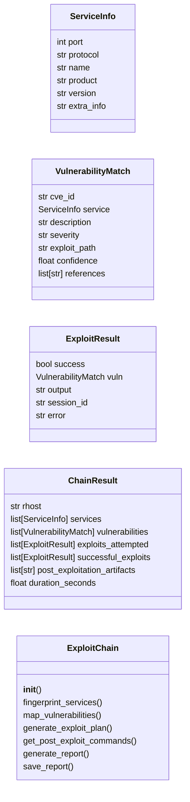
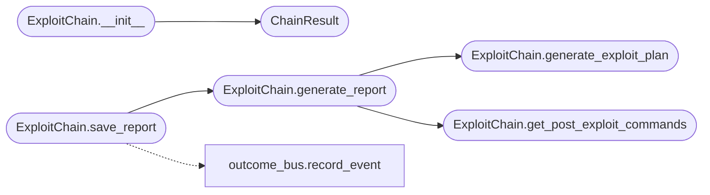

# `modules.exploit_chain`

> Source: [modules/exploit_chain.py:1](../../modules/exploit_chain.py#L1) | language `py` | coverage 92.3% | [API index](../index.md)

Autonomous exploitation chain engine.

Orchestrates the full kill chain from recon through exploitation to
post-exploitation in a single automated workflow. Implements a
decision-tree based approach with fallback strategies when initial
exploitation attempts fail.

Phases:
    1. Service fingerprinting
    2. Vulnerability mapping
    3. Exploit selection and prioritization
    4. Payload generation and delivery
    5. Session verification
    6. Post-exploitation automation

## Contents

- **Classes:** [`ServiceInfo`](#serviceinfo), [`VulnerabilityMatch`](#vulnerabilitymatch), [`ExploitResult`](#exploitresult), [`ChainResult`](#chainresult), [`ExploitChain`](#exploitchain)

## Type Diagram



## Call Graph

Solid arrows stay in this module, dashed arrows leave it.



## Classes

<a id="serviceinfo"></a>

### `ServiceInfo`

`class` `dataclass` | [modules/exploit_chain.py:29](../../modules/exploit_chain.py#L29)

Decorators: `@dataclass`

```python
class ServiceInfo
```

Fingerprinted service metadata.

**Attributes**

| Name | Type | Default | Description |
|---|---|---|---|
| [`port`](#serviceinfo-port) | `int` |  |  |
| [`protocol`](#serviceinfo-protocol) | `str` | `'tcp'` |  |
| [`name`](#serviceinfo-name) | `str` | `''` |  |
| [`product`](#serviceinfo-product) | `str` | `''` |  |
| [`version`](#serviceinfo-version) | `str` | `''` |  |
| [`extra_info`](#serviceinfo-extra_info) | `str` | `''` |  |

---

<a id="vulnerabilitymatch"></a>

### `VulnerabilityMatch`

`class` `dataclass` | [modules/exploit_chain.py:41](../../modules/exploit_chain.py#L41)

Decorators: `@dataclass`

```python
class VulnerabilityMatch
```

A vulnerability matched to a discovered service.

**Attributes**

| Name | Type | Default | Description |
|---|---|---|---|
| [`cve_id`](#vulnerabilitymatch-cve_id) | `str` |  |  |
| [`service`](#vulnerabilitymatch-service) | `ServiceInfo` |  |  |
| [`description`](#vulnerabilitymatch-description) | `str` | `''` |  |
| [`severity`](#vulnerabilitymatch-severity) | `str` | `'medium'` |  |
| [`exploit_path`](#vulnerabilitymatch-exploit_path) | `str` | `''` |  |
| [`confidence`](#vulnerabilitymatch-confidence) | `float` | `0.0` |  |
| [`references`](#vulnerabilitymatch-references) | `list[str]` | `field(default_factory=list)` |  |

---

<a id="exploitresult"></a>

### `ExploitResult`

`class` `dataclass` | [modules/exploit_chain.py:54](../../modules/exploit_chain.py#L54)

Decorators: `@dataclass`

```python
class ExploitResult
```

Result of an exploitation attempt.

**Attributes**

| Name | Type | Default | Description |
|---|---|---|---|
| [`success`](#exploitresult-success) | `bool` |  |  |
| [`vuln`](#exploitresult-vuln) | `VulnerabilityMatch` |  |  |
| [`output`](#exploitresult-output) | `str` | `''` |  |
| [`session_id`](#exploitresult-session_id) | `str` | `''` |  |
| [`error`](#exploitresult-error) | `str` | `''` |  |

---

<a id="chainresult"></a>

### `ChainResult`

`class` `dataclass` | [modules/exploit_chain.py:65](../../modules/exploit_chain.py#L65)

Decorators: `@dataclass`

```python
class ChainResult
```

Complete exploitation chain result.

**Attributes**

| Name | Type | Default | Description |
|---|---|---|---|
| [`rhost`](#chainresult-rhost) | `str` |  |  |
| [`services`](#chainresult-services) | `list[ServiceInfo]` | `field(default_factory=list)` |  |
| [`vulnerabilities`](#chainresult-vulnerabilities) | `list[VulnerabilityMatch]` | `field(default_factory=list)` |  |
| [`exploits_attempted`](#chainresult-exploits_attempted) | `list[ExploitResult]` | `field(default_factory=list)` |  |
| [`successful_exploits`](#chainresult-successful_exploits) | `list[ExploitResult]` | `field(default_factory=list)` |  |
| [`post_exploitation_artifacts`](#chainresult-post_exploitation_artifacts) | `list[str]` | `field(default_factory=list)` |  |
| [`duration_seconds`](#chainresult-duration_seconds) | `float` | `0.0` |  |

---

<a id="exploitchain"></a>

### `ExploitChain`

`class` | [modules/exploit_chain.py:289](../../modules/exploit_chain.py#L289)

```python
class ExploitChain
```

Autonomous exploitation chain orchestrator.

**Members**

| Member | Kind | Summary |
|---|---|---|
| [`__init__`](#exploitchain-__init__) | constructor |  |
| [`fingerprint_services`](#exploitchain-fingerprint_services) | method | Parse service information from all available nmap XML files. |
| [`map_vulnerabilities`](#exploitchain-map_vulnerabilities) | method | Map discovered services to known vulnerabilities. |
| [`generate_exploit_plan`](#exploitchain-generate_exploit_plan) | method | Generate a prioritized exploitation plan. |
| [`get_post_exploit_commands`](#exploitchain-get_post_exploit_commands) | method | Return recommended post-exploitation commands for the platform. |
| [`generate_report`](#exploitchain-generate_report) | method | Generate a structured exploitation chain report. |
| [`save_report`](#exploitchain-save_report) | method | Save the exploitation chain report to a file. |

<a id="exploitchain-__init__"></a>

#### `ExploitChain.__init__`

`constructor` | [modules/exploit_chain.py:292](../../modules/exploit_chain.py#L292)

```python
def __init__(self, rhost: str, rport: int | None = None, lhost: str = '127.0.0.1', lport: int = 4444, sessions_dir: str = 'sessions', nmap_xml_path: str | None = None) -> None
```

**Parameters**

| Name | Type | Default | Description |
|---|---|---|---|
| `rhost` | `str` |  |  |
| `rport` | `int \| None` | `None` |  |
| `lhost` | `str` | `'127.0.0.1'` |  |
| `lport` | `int` | `4444` |  |
| `sessions_dir` | `str` | `'sessions'` |  |
| `nmap_xml_path` | `str \| None` | `None` |  |

*Calls:* [`ChainResult`](#chainresult)

*Called by:* [`ExploitMigratedCommandSet.do_chain`](cli.commands.exploit_migrated.py.md#exploitmigratedcommandset-do_chain)

<a id="exploitchain-fingerprint_services"></a>

#### `ExploitChain.fingerprint_services`

`method` | [modules/exploit_chain.py:311](../../modules/exploit_chain.py#L311)

```python
def fingerprint_services(self, nmap_output: str | None = None) -> list[ServiceInfo]
```

Parse service information from all available nmap XML files.

Scans sessions/ for all scan_<rhost>*.nmap.xml and vulns_<rhost>*.nmap.xml
files, parses them with ElementTree, and merges results deduplicating
by port/protocol. Files with richer data (product+version) take priority.

**Parameters**

| Name | Type | Default | Description |
|---|---|---|---|
| `nmap_output` | `str \| None` | `None` | Raw nmap output text or None to use XML files. |

**Returns:** `list[ServiceInfo]` - List of fingerprinted services.

*Called by:* [`ExploitMigratedCommandSet.do_chain`](cli.commands.exploit_migrated.py.md#exploitmigratedcommandset-do_chain)

<a id="exploitchain-map_vulnerabilities"></a>

#### `ExploitChain.map_vulnerabilities`

`method` | [modules/exploit_chain.py:446](../../modules/exploit_chain.py#L446)

```python
def map_vulnerabilities(self) -> list[VulnerabilityMatch]
```

Map discovered services to known vulnerabilities.

**Returns:** `list[VulnerabilityMatch]` - List of vulnerability matches sorted by severity.

*Called by:* [`ExploitMigratedCommandSet.do_chain`](cli.commands.exploit_migrated.py.md#exploitmigratedcommandset-do_chain)

<a id="exploitchain-generate_exploit_plan"></a>

#### `ExploitChain.generate_exploit_plan`

`method` | [modules/exploit_chain.py:499](../../modules/exploit_chain.py#L499)

```python
def generate_exploit_plan(self) -> list[dict[str, Any]]
```

Generate a prioritized exploitation plan.

**Returns:** `list[dict[str, Any]]` - Ordered list of exploitation steps with fallbacks.

*Called by:* [`ExploitMigratedCommandSet.do_chain`](cli.commands.exploit_migrated.py.md#exploitmigratedcommandset-do_chain), [`ExploitChain.generate_report`](#exploitchain-generate_report)

<a id="exploitchain-get_post_exploit_commands"></a>

#### `ExploitChain.get_post_exploit_commands`

`method` | [modules/exploit_chain.py:519](../../modules/exploit_chain.py#L519)

```python
def get_post_exploit_commands(self, platform: str = 'linux') -> list[str]
```

Return recommended post-exploitation commands for the platform.

**Parameters**

| Name | Type | Default | Description |
|---|---|---|---|
| `platform` | `str` | `'linux'` | Target OS platform (linux or windows). |

**Returns:** `list[str]` - List of post-exploitation command suggestions.

*Called by:* [`ExploitMigratedCommandSet.do_chain`](cli.commands.exploit_migrated.py.md#exploitmigratedcommandset-do_chain), [`ExploitChain.generate_report`](#exploitchain-generate_report)

<a id="exploitchain-generate_report"></a>

#### `ExploitChain.generate_report`

`method` | [modules/exploit_chain.py:531](../../modules/exploit_chain.py#L531)

```python
def generate_report(self) -> dict[str, Any]
```

Generate a structured exploitation chain report.

**Returns:** `dict[str, Any]` - Complete report dictionary with all chain data.

*Calls:* [`ExploitChain.generate_exploit_plan`](#exploitchain-generate_exploit_plan), [`ExploitChain.get_post_exploit_commands`](#exploitchain-get_post_exploit_commands)

*Called by:* [`ExploitChain.save_report`](#exploitchain-save_report)

<a id="exploitchain-save_report"></a>

#### `ExploitChain.save_report`

`method` | [modules/exploit_chain.py:566](../../modules/exploit_chain.py#L566)

```python
def save_report(self, path: str | None = None) -> str
```

Save the exploitation chain report to a file.

**Parameters**

| Name | Type | Default | Description |
|---|---|---|---|
| `path` | `str \| None` | `None` | Output file path. Defaults to sessions/exploit_chain_{rhost}.json. |

**Returns:** `str` - Path to the saved report.

*Calls:* [`ExploitChain.generate_report`](#exploitchain-generate_report), [`record_event`](modules.outcome_bus.py.md#record_event)

*Called by:* [`ExploitMigratedCommandSet.do_chain`](cli.commands.exploit_migrated.py.md#exploitmigratedcommandset-do_chain)

---
