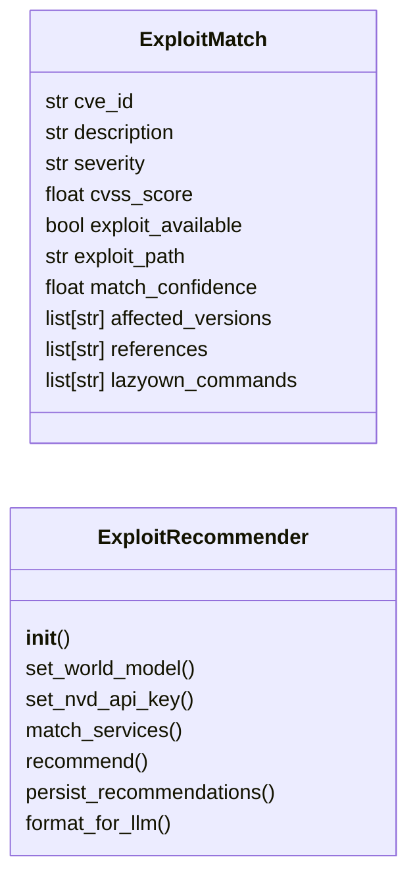

# `modules.exploit_recommender`

> Source: [modules/exploit_recommender.py:1](../../modules/exploit_recommender.py#L1) | language `py` | coverage 60.0% | [API index](../index.md)

AI-Powered Exploit Recommendation Engine for LazyOwn.

Queries NVD API for CVEs, matches against Exploit-DB, ranks exploits by
reliability and impact, and auto-generates LazyOwn commands.

Integrates with WorldModel, module_registry, and lazyown_bridge.

## Contents

- **Classes:** [`ExploitMatch`](#exploitmatch), [`ExploitRecommender`](#exploitrecommender)
- **Constants:** [`EXPLOITDB_SEARCH`](#exploitdb_search), [`NVD_API_BASE`](#nvd_api_base), [`SESSIONS_DIR`](#sessions_dir)

## Type Diagram



## Call Graph

Solid arrows stay in this module, dashed arrows leave it.


## Classes

<a id="exploitmatch"></a>

### `ExploitMatch`

`class` `dataclass` | [modules/exploit_recommender.py:37](../../modules/exploit_recommender.py#L37)

Decorators: `@dataclass`

```python
class ExploitMatch
```

**Attributes**

| Name | Type | Default | Description |
|---|---|---|---|
| [`cve_id`](#exploitmatch-cve_id) | `str` |  |  |
| [`description`](#exploitmatch-description) | `str` |  |  |
| [`severity`](#exploitmatch-severity) | `str` |  |  |
| [`cvss_score`](#exploitmatch-cvss_score) | `float` |  |  |
| [`exploit_available`](#exploitmatch-exploit_available) | `bool` |  |  |
| [`exploit_path`](#exploitmatch-exploit_path) | `str` |  |  |
| [`match_confidence`](#exploitmatch-match_confidence) | `float` |  |  |
| [`affected_versions`](#exploitmatch-affected_versions) | `list[str]` | `field(default_factory=list)` |  |
| [`references`](#exploitmatch-references) | `list[str]` | `field(default_factory=list)` |  |
| [`lazyown_commands`](#exploitmatch-lazyown_commands) | `list[str]` | `field(default_factory=list)` |  |

---

<a id="exploitrecommender"></a>

### `ExploitRecommender`

`class` | [modules/exploit_recommender.py:50](../../modules/exploit_recommender.py#L50)

```python
class ExploitRecommender
```

Matches discovered services against known CVEs and available exploits.

**Members**

| Member | Kind | Summary |
|---|---|---|
| [`__init__`](#exploitrecommender-__init__) | constructor |  |
| [`set_world_model`](#exploitrecommender-set_world_model) | method |  |
| [`set_nvd_api_key`](#exploitrecommender-set_nvd_api_key) | method |  |
| [`match_services`](#exploitrecommender-match_services) | method | Match discovered services against known CVEs with confidence scoring. |
| [`recommend`](#exploitrecommender-recommend) | method | Return top-N recommended exploits as structured dicts for MCP/CLI. |
| [`persist_recommendations`](#exploitrecommender-persist_recommendations) | method | Save recommendations to sessions/ for audit and replay. |
| [`format_for_llm`](#exploitrecommender-format_for_llm) | method | Format recommendations as compact text for LLM context injection. |

<a id="exploitrecommender-__init__"></a>

#### `ExploitRecommender.__init__`

`constructor` | [modules/exploit_recommender.py:120](../../modules/exploit_recommender.py#L120)

```python
def __init__(self, world_model: WorldModel | None = None) -> None
```

**Parameters**

| Name | Type | Default | Description |
|---|---|---|---|
| `world_model` | `WorldModel \| None` | `None` |  |

*Called by:* [`ExploitMigratedCommandSet.do_exploit_recommend`](cli.commands.exploit_migrated.py.md#exploitmigratedcommandset-do_exploit_recommend), [`PwnCommandSet.do_rich_tui`](cli.commands.pwn.py.md#pwncommandset-do_rich_tui)

<a id="exploitrecommender-set_world_model"></a>

#### `ExploitRecommender.set_world_model`

`method` | [modules/exploit_recommender.py:129](../../modules/exploit_recommender.py#L129)

```python
def set_world_model(self, world_model: WorldModel) -> None
```

**Parameters**

| Name | Type | Default | Description |
|---|---|---|---|
| `world_model` | `WorldModel` |  |  |

<a id="exploitrecommender-set_nvd_api_key"></a>

#### `ExploitRecommender.set_nvd_api_key`

`method` | [modules/exploit_recommender.py:132](../../modules/exploit_recommender.py#L132)

```python
def set_nvd_api_key(self, key: str) -> None
```

**Parameters**

| Name | Type | Default | Description |
|---|---|---|---|
| `key` | `str` |  |  |

<a id="exploitrecommender-match_services"></a>

#### `ExploitRecommender.match_services`

`method` | [modules/exploit_recommender.py:244](../../modules/exploit_recommender.py#L244)

```python
def match_services(self, hosts: dict[str, HostEntry] | None = None) -> list[ExploitMatch]
```

Match discovered services against known CVEs with confidence scoring.

**Parameters**

| Name | Type | Default | Description |
|---|---|---|---|
| `hosts` | `dict[str, HostEntry] \| None` | `None` | Optional dict of HostEntry objects. Uses world_model hosts if None. |

**Returns:** `list[ExploitMatch]` - List of ExploitMatch objects sorted by severity then confidence.

*Calls:* [`ExploitMatch`](#exploitmatch)

*Called by:* [`ExploitRecommender.recommend`](#exploitrecommender-recommend)

<a id="exploitrecommender-recommend"></a>

#### `ExploitRecommender.recommend`

`method` | [modules/exploit_recommender.py:337](../../modules/exploit_recommender.py#L337)

```python
def recommend(self, hosts: dict[str, HostEntry] | None = None, top_n: int = 10) -> list[dict[str, Any]]
```

Return top-N recommended exploits as structured dicts for MCP/CLI.

**Parameters**

| Name | Type | Default | Description |
|---|---|---|---|
| `hosts` | `dict[str, HostEntry] \| None` | `None` | Optional host dict override. |
| `top_n` | `int` | `10` | Maximum number of recommendations to return. |

**Returns:** `list[dict[str, Any]]` - List of recommendation dicts with keys: cve, severity, confidence,
description, exploit_available, command, service, host, port.

*Calls:* [`ExploitRecommender.match_services`](#exploitrecommender-match_services)

*Called by:* [`ExploitMigratedCommandSet.do_exploit_recommend`](cli.commands.exploit_migrated.py.md#exploitmigratedcommandset-do_exploit_recommend)

<a id="exploitrecommender-persist_recommendations"></a>

#### `ExploitRecommender.persist_recommendations`

`method` | [modules/exploit_recommender.py:370](../../modules/exploit_recommender.py#L370)

```python
def persist_recommendations(self, matches: list[dict[str, Any]]) -> Path
```

Save recommendations to sessions/ for audit and replay.

**Parameters**

| Name | Type | Default | Description |
|---|---|---|---|
| `matches` | `list[dict[str, Any]]` |  | List of recommendation dicts from recommend(). |

**Returns:** `Path` - Path to the written JSON file.

*Called by:* [`ExploitMigratedCommandSet.do_exploit_recommend`](cli.commands.exploit_migrated.py.md#exploitmigratedcommandset-do_exploit_recommend)

<a id="exploitrecommender-format_for_llm"></a>

#### `ExploitRecommender.format_for_llm`

`method` | [modules/exploit_recommender.py:390](../../modules/exploit_recommender.py#L390)

```python
def format_for_llm(self, matches: list[dict[str, Any]], max_items: int = 5) -> str
```

Format recommendations as compact text for LLM context injection.

**Parameters**

| Name | Type | Default | Description |
|---|---|---|---|
| `matches` | `list[dict[str, Any]]` |  | List of recommendation dicts. |
| `max_items` | `int` | `5` | Maximum items to include in the context string. |

**Returns:** `str` - A single string suitable for appending to an LLM system prompt.

---

## Constants

<a id="exploitdb_search"></a>

### `EXPLOITDB_SEARCH`

`constant` | [modules/exploit_recommender.py:31](../../modules/exploit_recommender.py#L31)

```python
EXPLOITDB_SEARCH = '/usr/share/exploitdb/files_exploits.csv'
```

---

<a id="nvd_api_base"></a>

### `NVD_API_BASE`

`constant` | [modules/exploit_recommender.py:32](../../modules/exploit_recommender.py#L32)

```python
NVD_API_BASE = 'https://services.nvd.nist.gov/rest/json/cves/2.0'
```

---

<a id="sessions_dir"></a>

### `SESSIONS_DIR`

`constant` | [modules/exploit_recommender.py:33](../../modules/exploit_recommender.py#L33)

```python
SESSIONS_DIR = Path(__file__).resolve().parent.parent / 'sessions'
```

---
