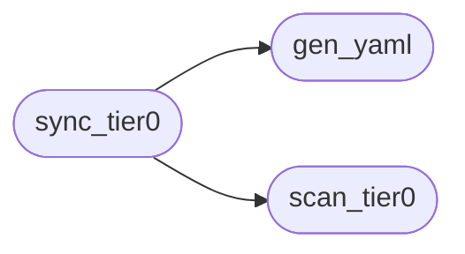

# `modules.exploitdb_bridge`

> Source: [modules/exploitdb_bridge.py:1](../../modules/exploitdb_bridge.py#L1) | language `py` | coverage 0.0% | [API index](../index.md)

## Contents

- **Functions:** [`scan_tier0`](#scan_tier0), [`gen_yaml`](#gen_yaml), [`sync_tier0`](#sync_tier0)
- **Constants:** [`BASE_DIR`](#base_dir), [`EDB_ROOT`](#edb_root), [`CSV_PATH`](#csv_path), [`EXPLOITS_DIR`](#exploits_dir), [`SCRIPTS_DIR`](#scripts_dir), [`TIER0_EXTS`](#tier0_exts), [`SKIP_TYPES`](#skip_types), [`BAD_PATHS`](#bad_paths), [`GOOD_PLATFORMS`](#good_platforms)

## Call Graph

Solid arrows stay in this module, dashed arrows leave it.



## Functions

<a id="scan_tier0"></a>

### `scan_tier0`

`function` | [modules/exploitdb_bridge.py:105](../../modules/exploitdb_bridge.py#L105)

```python
def scan_tier0(limit: int = 60, platform: str = '', only_cve: bool = False) -> list[dict]
```

**Parameters**

| Name | Type | Default | Description |
|---|---|---|---|
| `limit` | `int` | `60` |  |
| `platform` | `str` | `''` |  |
| `only_cve` | `bool` | `False` |  |

**Returns:** `list[dict]`

*Called by:* [`ExploitdbCommands.do_exploitdb_scan`](cli.commands.exploitdb.py.md#exploitdbcommands-do_exploitdb_scan), [`sync_tier0`](#sync_tier0)

---

<a id="gen_yaml"></a>

### `gen_yaml`

`function` | [modules/exploitdb_bridge.py:151](../../modules/exploitdb_bridge.py#L151)

```python
def gen_yaml(item: dict, outdir: Path | None = None) -> Path
```

**Parameters**

| Name | Type | Default | Description |
|---|---|---|---|
| `item` | `dict` |  |  |
| `outdir` | `Path \| None` | `None` |  |

**Returns:** `Path`

*Called by:* [`ExploitdbCommands.do_exploitdb_gen`](cli.commands.exploitdb.py.md#exploitdbcommands-do_exploitdb_gen), [`sync_tier0`](#sync_tier0)

---

<a id="sync_tier0"></a>

### `sync_tier0`

`function` | [modules/exploitdb_bridge.py:194](../../modules/exploitdb_bridge.py#L194)

```python
def sync_tier0(limit: int = 40, platform: str = 'linux', only_cve: bool = False, outdir: Path | None = None) -> list[Path]
```

**Parameters**

| Name | Type | Default | Description |
|---|---|---|---|
| `limit` | `int` | `40` |  |
| `platform` | `str` | `'linux'` |  |
| `only_cve` | `bool` | `False` |  |
| `outdir` | `Path \| None` | `None` |  |

**Returns:** `list[Path]`

*Calls:* [`gen_yaml`](#gen_yaml), [`scan_tier0`](#scan_tier0)

*Called by:* [`ExploitdbCommands.do_exploitdb_sync`](cli.commands.exploitdb.py.md#exploitdbcommands-do_exploitdb_sync)

---

## Constants

<a id="base_dir"></a>

### `BASE_DIR`

`constant` | [modules/exploitdb_bridge.py:11](../../modules/exploitdb_bridge.py#L11)

```python
BASE_DIR = Path(__file__).resolve().parent.parent
```

---

<a id="edb_root"></a>

### `EDB_ROOT`

`constant` | [modules/exploitdb_bridge.py:12](../../modules/exploitdb_bridge.py#L12)

```python
EDB_ROOT = Path('/usr/share/exploitdb')
```

---

<a id="csv_path"></a>

### `CSV_PATH`

`constant` | [modules/exploitdb_bridge.py:13](../../modules/exploitdb_bridge.py#L13)

```python
CSV_PATH = EDB_ROOT / 'files_exploits.csv'
```

---

<a id="exploits_dir"></a>

### `EXPLOITS_DIR`

`constant` | [modules/exploitdb_bridge.py:14](../../modules/exploitdb_bridge.py#L14)

```python
EXPLOITS_DIR = BASE_DIR / 'exploits'
```

---

<a id="scripts_dir"></a>

### `SCRIPTS_DIR`

`constant` | [modules/exploitdb_bridge.py:15](../../modules/exploitdb_bridge.py#L15)

```python
SCRIPTS_DIR = BASE_DIR / 'sessions' / 'exploitdb_scripts'
```

---

<a id="tier0_exts"></a>

### `TIER0_EXTS`

`constant` | [modules/exploitdb_bridge.py:17](../../modules/exploitdb_bridge.py#L17)

```python
TIER0_EXTS = {'py', 'pl', 'rb', 'php', 'sh'}
```

---

<a id="skip_types"></a>

### `SKIP_TYPES`

`constant` | [modules/exploitdb_bridge.py:18](../../modules/exploitdb_bridge.py#L18)

```python
SKIP_TYPES = {'dos', 'local'}
```

---

<a id="bad_paths"></a>

### `BAD_PATHS`

`constant` | [modules/exploitdb_bridge.py:19](../../modules/exploitdb_bridge.py#L19)

```python
BAD_PATHS = ['/local/']
```

---

<a id="good_platforms"></a>

### `GOOD_PLATFORMS`

`constant` | [modules/exploitdb_bridge.py:20](../../modules/exploitdb_bridge.py#L20)

```python
GOOD_PLATFORMS = {'linux', 'unix', 'multiple', '', 'hardware', 'cgi'}
```

---
