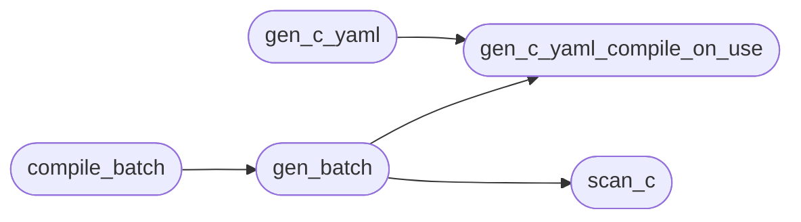

# `modules.exploitdb_c_bridge`

> Source: [modules/exploitdb_c_bridge.py:1](../../modules/exploitdb_c_bridge.py#L1) | language `py` | coverage 0.0% | [API index](../index.md)

## Contents

- **Functions:** [`scan_c`](#scan_c), [`gen_c_yaml_compile_on_use`](#gen_c_yaml_compile_on_use), [`gen_batch`](#gen_batch), [`compile_batch`](#compile_batch), [`gen_c_yaml`](#gen_c_yaml)
- **Constants:** [`BASE_DIR`](#base_dir), [`EDB_ROOT`](#edb_root), [`CSV_PATH`](#csv_path), [`EXPLOITS_DIR`](#exploits_dir), [`RUN_DIR`](#run_dir)

## Call Graph

Solid arrows stay in this module, dashed arrows leave it.



## Functions

<a id="scan_c"></a>

### `scan_c`

`function` | [modules/exploitdb_c_bridge.py:32](../../modules/exploitdb_c_bridge.py#L32)

```python
def scan_c(limit: int = 30, platform: str = 'linux', skip_existing: bool = True)
```

**Parameters**

| Name | Type | Default | Description |
|---|---|---|---|
| `limit` | `int` | `30` |  |
| `platform` | `str` | `'linux'` |  |
| `skip_existing` | `bool` | `True` |  |

*Called by:* [`ExploitdbCCommands.do_exploitdb_cscan`](cli.commands.exploitdb.py.md#exploitdbccommands-do_exploitdb_cscan), [`ExploitdbCommands.do_exploitdb_cscan`](cli.commands.exploitdb.py.md#exploitdbcommands-do_exploitdb_cscan), [`gen_batch`](#gen_batch)

---

<a id="gen_c_yaml_compile_on_use"></a>

### `gen_c_yaml_compile_on_use`

`function` | [modules/exploitdb_c_bridge.py:89](../../modules/exploitdb_c_bridge.py#L89)

```python
def gen_c_yaml_compile_on_use(item: dict) -> Path
```

**Parameters**

| Name | Type | Default | Description |
|---|---|---|---|
| `item` | `dict` |  |  |

**Returns:** `Path`

*Called by:* [`gen_batch`](#gen_batch), [`gen_c_yaml`](#gen_c_yaml)

---

<a id="gen_batch"></a>

### `gen_batch`

`function` | [modules/exploitdb_c_bridge.py:134](../../modules/exploitdb_c_bridge.py#L134)

```python
def gen_batch(limit: int = 30)
```

**Parameters**

| Name | Type | Default | Description |
|---|---|---|---|
| `limit` | `int` | `30` |  |

*Calls:* [`gen_c_yaml_compile_on_use`](#gen_c_yaml_compile_on_use), [`scan_c`](#scan_c)

*Called by:* [`compile_batch`](#compile_batch)

---

<a id="compile_batch"></a>

### `compile_batch`

`function` | [modules/exploitdb_c_bridge.py:148](../../modules/exploitdb_c_bridge.py#L148)

```python
def compile_batch(limit: int = 10)
```

**Parameters**

| Name | Type | Default | Description |
|---|---|---|---|
| `limit` | `int` | `10` |  |

*Calls:* [`gen_batch`](#gen_batch)

*Called by:* [`ExploitdbCCommands.do_exploitdb_ccompile`](cli.commands.exploitdb.py.md#exploitdbccommands-do_exploitdb_ccompile), [`ExploitdbCommands.do_exploitdb_ccompile`](cli.commands.exploitdb.py.md#exploitdbcommands-do_exploitdb_ccompile)

---

<a id="gen_c_yaml"></a>

### `gen_c_yaml`

`function` | [modules/exploitdb_c_bridge.py:152](../../modules/exploitdb_c_bridge.py#L152)

```python
def gen_c_yaml(item: dict, binpath: str = '', wrapper: Path | None = None)
```

**Parameters**

| Name | Type | Default | Description |
|---|---|---|---|
| `item` | `dict` |  |  |
| `binpath` | `str` | `''` |  |
| `wrapper` | `Path \| None` | `None` |  |

*Calls:* [`gen_c_yaml_compile_on_use`](#gen_c_yaml_compile_on_use)

---

## Constants

<a id="base_dir"></a>

### `BASE_DIR`

`constant` | [modules/exploitdb_c_bridge.py:10](../../modules/exploitdb_c_bridge.py#L10)

```python
BASE_DIR = Path(__file__).resolve().parent.parent
```

---

<a id="edb_root"></a>

### `EDB_ROOT`

`constant` | [modules/exploitdb_c_bridge.py:11](../../modules/exploitdb_c_bridge.py#L11)

```python
EDB_ROOT = Path('/usr/share/exploitdb')
```

---

<a id="csv_path"></a>

### `CSV_PATH`

`constant` | [modules/exploitdb_c_bridge.py:12](../../modules/exploitdb_c_bridge.py#L12)

```python
CSV_PATH = EDB_ROOT / 'files_exploits.csv'
```

---

<a id="exploits_dir"></a>

### `EXPLOITS_DIR`

`constant` | [modules/exploitdb_c_bridge.py:13](../../modules/exploitdb_c_bridge.py#L13)

```python
EXPLOITS_DIR = BASE_DIR / 'exploits'
```

---

<a id="run_dir"></a>

### `RUN_DIR`

`constant` | [modules/exploitdb_c_bridge.py:14](../../modules/exploitdb_c_bridge.py#L14)

```python
RUN_DIR = BASE_DIR / 'sessions' / 'exploitdb_c'
```

---
