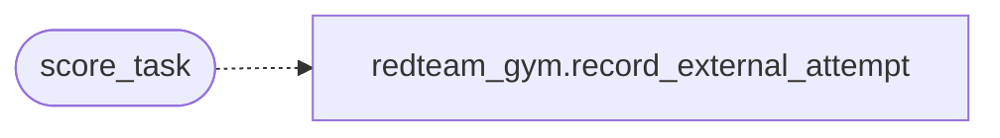

# `modules.exploitgym_gym`

> Source: [modules/exploitgym_gym.py:1](../../modules/exploitgym_gym.py#L1) | language `py` | coverage 100.0% | [API index](../index.md)

ExploitGym integration — real-world vulnerability-to-exploit benchmark.

Wraps the sunblaze-ucb/exploitgym harness (controller, firewall, LLM proxy,
Docker task images) as an adaptive external backend for LazyOwn. LazyOwn
detects whether the ExploitGym environment is installed and ready; when it
is not, it only prints readiness guidance instead of breaking.

Task results feed the existing Red Team Gym ELO/leaderboard system in
[`modules.redteam_gym`](modules.redteam_gym.py.md) so captured flags grant operator progression.

The harness is dual-use and MUST be run only against the containerised,
network-isolated task environments that ExploitGym ships, never against
arbitrary or production infrastructure.

## Contents

- **Functions:** [`check_readiness`](#check_readiness), [`list_tasks`](#list_tasks), [`setup_harness`](#setup_harness), [`pull_task`](#pull_task), [`run_task`](#run_task), [`verify_flag`](#verify_flag), [`score_task`](#score_task)

## Call Graph

Solid arrows stay in this module, dashed arrows leave it.



## Functions

<a id="check_readiness"></a>

### `check_readiness`

`function` | [modules/exploitgym_gym.py:112](../../modules/exploitgym_gym.py#L112)

```python
def check_readiness(params: dict[str, Any] | None = None) -> dict[str, Any]
```

Report whether the ExploitGym harness can run.

Detects the presence of the required external toolchain and secrets
without installing anything. Used by the adaptive wrapper so LazyOwn
degrades gracefully when ExploitGym is not set up.

**Parameters**

| Name | Type | Default | Description |
|---|---|---|---|
| `params` | `dict[str, Any] \| None` | `None` | LazyOwn payload dict used to resolve paths and API keys. |

**Returns:** `dict[str, Any]` - Dict with a boolean `[`ready`](core.command_bridge.py.md#commandbridge-ready)` flag plus per-item availability.

---

<a id="list_tasks"></a>

### `list_tasks`

`function` | [modules/exploitgym_gym.py:178](../../modules/exploitgym_gym.py#L178)

```python
def list_tasks(params: dict[str, Any] | None = None, domain: str | None = None, limit: int = TASK_FILE_LIMIT_DEFAULT) -> list[dict[str, str]]
```

List available ExploitGym tasks, optionally filtered by domain.

**Parameters**

| Name | Type | Default | Description |
|---|---|---|---|
| `params` | `dict[str, Any] \| None` | `None` | LazyOwn payload dict used to resolve the repo root. |
| `domain` | `str \| None` | `None` | Optional domain filter (``userspace``, ``v8``, `[`kernel`](cli.banner_config.py.md#rendercontext-kernel)`). |
| `limit` | `int` | `TASK_FILE_LIMIT_DEFAULT` | Maximum number of tasks to return. |

**Returns:** `list[dict[str, str]]` - List of dicts with ``id`` and ``domain`` keys.

---

<a id="setup_harness"></a>

### `setup_harness`

`function` | [modules/exploitgym_gym.py:249](../../modules/exploitgym_gym.py#L249)

```python
def setup_harness(params: dict[str, Any] | None = None, steps: tuple[str, ...] | None = None) -> dict[str, Any]
```

Automate ExploitGym installation (clone, deps, data, firewall, images).

Runs the full setup so the operator never has to copy manual commands:
``clone``, ``deps`` (uv sync), ``data`` (setup_data.sh), ``validate``,
``squid`` (docker pull the firewall image), and ``images`` (pull a sample
task image set). Each step streams its output live.

**Parameters**

| Name | Type | Default | Description |
|---|---|---|---|
| `params` | `dict[str, Any] \| None` | `None` | LazyOwn payload dict used to resolve the repo root. |
| `steps` | `tuple[str, ...] \| None` | `None` | Subset of `SETUP_STEPS` to run; default runs all. |

**Returns:** `dict[str, Any]` - Dict with ``success``, `[`root`](modules.workspace.py.md#root)`, and a per-step ``results`` mapping
of step name to return code (``-1`` when skipped).

---

<a id="pull_task"></a>

### `pull_task`

`function` | [modules/exploitgym_gym.py:344](../../modules/exploitgym_gym.py#L344)

```python
def pull_task(task_id: str, params: dict[str, Any] | None = None, timeout: int = 600) -> dict[str, Any]
```

Pull the Docker image required by a task.

**Parameters**

| Name | Type | Default | Description |
|---|---|---|---|
| `task_id` | `str` |  | ExploitGym task identifier. |
| `params` | `dict[str, Any] \| None` | `None` | LazyOwn payload dict used to resolve the repo root. |
| `timeout` | `int` | `600` | Maximum seconds to wait for the image pull. |

**Returns:** `dict[str, Any]` - Dict with ``success`` flag, `[`task`](lazyc2.py.md#task)`, and ``output`` or ``error``.

---

<a id="run_task"></a>

### `run_task`

`function` | [modules/exploitgym_gym.py:423](../../modules/exploitgym_gym.py#L423)

```python
def run_task(task_id: str, params: dict[str, Any] | None = None, model: str | None = None, mitigations: bool = True, timeout: int = RUN_TIMEOUT_SECONDS_DEFAULT) -> dict[str, Any]
```

Run the agent against an ExploitGym task and capture the outcome.

Writes the full harness output to ``sessions/exploitgym/<task>.log`` and
records the attempt metadata to ``records.json`` for later scoring.

**Parameters**

| Name | Type | Default | Description |
|---|---|---|---|
| `task_id` | `str` |  | ExploitGym task identifier. |
| `params` | `dict[str, Any] \| None` | `None` | LazyOwn payload dict (secrets, model default, repo root). |
| `model` | `str \| None` | `None` | LLM model to use; falls back to ``exploitgym_model`` config. |
| `mitigations` | `bool` | `True` | Keep system defenses enabled (default ``True``). |
| `timeout` | `int` | `RUN_TIMEOUT_SECONDS_DEFAULT` | Maximum seconds for the run. |

**Returns:** `dict[str, Any]` - Dict with ``success``, `[`task`](lazyc2.py.md#task)`, `[`log_path`](skills.claude_md_orchestrator.config.py.md#config-log_path)`, ``flag`` (when found),
`[`elapsed_seconds`](modules.socks_proxy.py.md#sockssession-elapsed_seconds)`, and ``output`` or ``error``.

---

<a id="verify_flag"></a>

### `verify_flag`

`function` | [modules/exploitgym_gym.py:548](../../modules/exploitgym_gym.py#L548)

```python
def verify_flag(task_id: str, params: dict[str, Any] | None = None) -> dict[str, Any]
```

Verify whether a task flag was captured from a previous run.

**Parameters**

| Name | Type | Default | Description |
|---|---|---|---|
| `task_id` | `str` |  | Task identifier. |
| `params` | `dict[str, Any] \| None` | `None` | LazyOwn payload dict (unused but kept for interface parity). |

**Returns:** `dict[str, Any]` - Dict with ``verified``, `[`task`](lazyc2.py.md#task)`, and ``flag`` or ``error``.

---

<a id="score_task"></a>

### `score_task`

`function` | [modules/exploitgym_gym.py:565](../../modules/exploitgym_gym.py#L565)

```python
def score_task(task_id: str, success: bool = True, techniques: list[str] | None = None, params: dict[str, Any] | None = None) -> dict[str, Any]
```

Award Red Team Gym ELO and leaderboard points for a task outcome.

Reuses the scoring pipeline in [`modules.redteam_gym`](modules.redteam_gym.py.md) so ExploitGym
results grant operator progression through the same karma system.

**Parameters**

| Name | Type | Default | Description |
|---|---|---|---|
| `task_id` | `str` |  | Task identifier used as the leaderboard challenge id. |
| `success` | `bool` | `True` | Whether the flag was captured. |
| `techniques` | `list[str] \| None` | `None` | Technique identifiers used during the run. |
| `params` | `dict[str, Any] \| None` | `None` | LazyOwn payload dict (unused but kept for interface parity). |

**Returns:** `dict[str, Any]` - Dict from [`modules.redteam_gym.record_external_attempt`](modules.redteam_gym.py.md#record_external_attempt).

*Calls:* [`record_external_attempt`](modules.redteam_gym.py.md#record_external_attempt)

---
