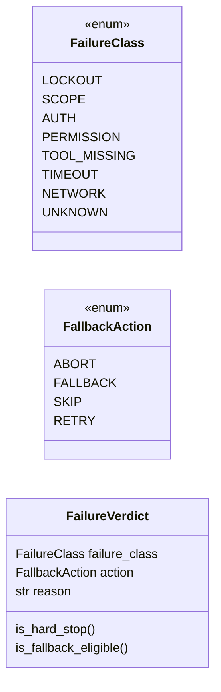

# `modules.failure_verdict`

> Source: [modules/failure_verdict.py:1](../../modules/failure_verdict.py#L1) | language `py` | coverage 100.0% | [API index](../index.md)

Failure verdict contract: classify one failed execution into an action.

Any runner (chain, retry, autonomous loop) captures the same evidence
for a failed attempt: command, exit code, output tail and a timeout
flag. This module turns that evidence into one typed verdict with an
engine action so every surface can share a single policy: never retry a
lockout, stop spraying after one, skip tool-less attempts outright, and
hand auth or permission walls to the adaptive fallback arbiter instead
of burning retries.

Pure stdlib, no I/O: the caller owns the evidence and the action.

## Contents

- **Classes:** [`FailureVerdict`](#failureverdict)
- **Enums:** [`FailureClass`](#failureclass), [`FallbackAction`](#fallbackaction)
- **Functions:** [`classify_failure`](#classify_failure), [`classify_outcome`](#classify_outcome)
- **Constants:** [`CLASS_ACTIONS`](#class_actions)

## Type Diagram



## Call Graph

Solid arrows stay in this module, dashed arrows leave it.


## Classes

<a id="failureverdict"></a>

### `FailureVerdict`

`class` `dataclass` | [modules/failure_verdict.py:118](../../modules/failure_verdict.py#L118)

Decorators: `@dataclass(frozen=True)`

```python
class FailureVerdict
```

One classified failure with the action its class requests.

**Attributes**

| Name | Type | Default | Description |
|---|---|---|---|
| [`failure_class`](#failureverdict-failure_class) | `FailureClass` |  |  |
| [`action`](#failureverdict-action) | `FallbackAction` |  |  |
| [`reason`](#failureverdict-reason) | `str` | `''` |  |

**Members**

| Member | Kind | Summary |
|---|---|---|
| [`is_hard_stop`](#failureverdict-is_hard_stop) | property | Return True when the verdict forbids any further attempt. |
| [`is_fallback_eligible`](#failureverdict-is_fallback_eligible) | property | Return True when adaptive alternatives may replace the retry. |

<a id="failureverdict-is_hard_stop"></a>

#### `FailureVerdict.is_hard_stop`

`property` | [modules/failure_verdict.py:126](../../modules/failure_verdict.py#L126)

Decorators: `@property`

```python
def is_hard_stop(self) -> bool
```

Return True when the verdict forbids any further attempt.

**Returns:** `bool`

<a id="failureverdict-is_fallback_eligible"></a>

#### `FailureVerdict.is_fallback_eligible`

`property` | [modules/failure_verdict.py:131](../../modules/failure_verdict.py#L131)

Decorators: `@property`

```python
def is_fallback_eligible(self) -> bool
```

Return True when adaptive alternatives may replace the retry.

**Returns:** `bool`

---

## Enums

<a id="failureclass"></a>

### `FailureClass`

`enum` | [modules/failure_verdict.py:71](../../modules/failure_verdict.py#L71)

```python
class FailureClass(str, Enum)
```

Bases: `str`, `Enum`

Why one attempt failed, as far as captured evidence can say.

**Attributes**

| Name | Type | Default | Description |
|---|---|---|---|
| [`LOCKOUT`](#failureclass-lockout) |  | `'lockout'` |  |
| [`SCOPE`](#failureclass-scope) |  | `'scope'` |  |
| [`AUTH`](#failureclass-auth) |  | `'auth'` |  |
| [`PERMISSION`](#failureclass-permission) |  | `'permission'` |  |
| [`TOOL_MISSING`](#failureclass-tool_missing) |  | `'tool_missing'` |  |
| [`TIMEOUT`](#failureclass-timeout) |  | `'timeout'` |  |
| [`NETWORK`](#failureclass-network) |  | `'network'` |  |
| [`UNKNOWN`](#failureclass-unknown) |  | `'unknown'` |  |

---

<a id="fallbackaction"></a>

### `FallbackAction`

`enum` | [modules/failure_verdict.py:84](../../modules/failure_verdict.py#L84)

```python
class FallbackAction(str, Enum)
```

Bases: `str`, `Enum`

Engine reaction requested for the verdict.

**Attributes**

| Name | Type | Default | Description |
|---|---|---|---|
| [`ABORT`](#fallbackaction-abort) |  | `'abort'` |  |
| [`FALLBACK`](#fallbackaction-fallback) |  | `'fallback'` |  |
| [`SKIP`](#fallbackaction-skip) |  | `'skip'` |  |
| [`RETRY`](#fallbackaction-retry) |  | `'retry'` |  |

---

## Functions

<a id="classify_failure"></a>

### `classify_failure`

`function` | [modules/failure_verdict.py:144](../../modules/failure_verdict.py#L144)

```python
def classify_failure(command: str, output: str = '', exit_code: int | None = None, timed_out: bool = False) -> FailureVerdict
```

Classify one failed attempt into a verdict with an engine action.

**Parameters**

| Name | Type | Default | Description |
|---|---|---|---|
| `command` | `str` |  | The attempted command line (not parsed; kept empty-safe). |
| `output` | `str` | `''` | Captured stdout/stderr or the error reason; the tail is enough and long inputs are truncated before matching. |
| `exit_code` | `int \| None` | `None` | Process exit status when the runner knows it. |
| `timed_out` | `bool` | `False` | True when the runner enforced a wall-clock timeout. |

**Returns:** `FailureVerdict` - A [`FailureVerdict`](#failureverdict); unknown evidence still carries an
action (retry) so a runner's default policy stays unchanged.

*Calls:* [`FailureVerdict`](#failureverdict)

*Called by:* [`classify_outcome`](#classify_outcome)

---

<a id="classify_outcome"></a>

### `classify_outcome`

`function` | [modules/failure_verdict.py:192](../../modules/failure_verdict.py#L192)

```python
def classify_outcome(outcome: object) -> FailureVerdict
```

Classify one runner outcome object carrying the standard fields.

**Parameters**

| Name | Type | Default | Description |
|---|---|---|---|
| `outcome` | `object` |  | Anything exposing ``run``, ``status``, ``output``, `[`reason`](#failureverdict-reason)` and ``duration_ms`` (a chain `[`StepOutcome`](modules.chain_runner.py.md#stepoutcome)`). |

**Returns:** `FailureVerdict` - The verdict only when the outcome actually failed; a successful
or skipped outcome classifies as unknown-retry, which callers
gate on [`FailureVerdict.is_fallback_eligible`](#failureverdict-is_fallback_eligible) before use.

*Calls:* [`FailureVerdict`](#failureverdict), [`classify_failure`](#classify_failure)

*Called by:* [`build_adaptive_replanner`](cli.apt_chain_support.py.md#build_adaptive_replanner), [`render_result`](cli.apt_chain_support.py.md#render_result)

---

## Constants

<a id="class_actions"></a>

### `CLASS_ACTIONS`

`constant` | [modules/failure_verdict.py:104](../../modules/failure_verdict.py#L104)

```python
CLASS_ACTIONS: dict[FailureClass, FallbackAction] = dict(_CLASS_ACTIONS)
```

---
