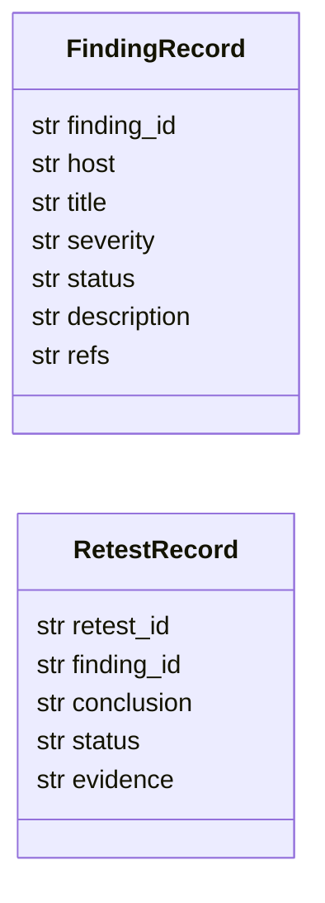
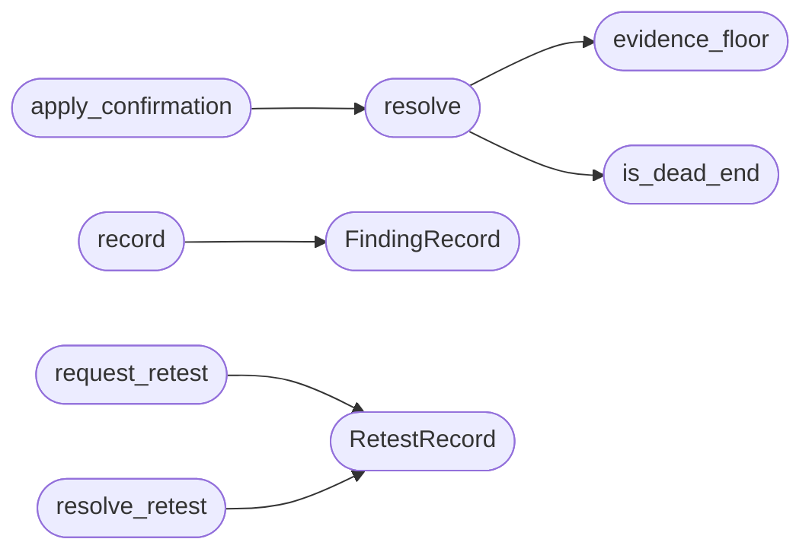

# `modules.finding_lifecycle`

> Source: [modules/finding_lifecycle.py:1](../../modules/finding_lifecycle.py#L1) | language `py` | coverage 100.0% | [API index](../index.md)

Finding confirmation lifecycle: pending -> confirmed / rejected.

Faithful to the CAIRN discipline (seed-add, seed validation, dead-end
suppression list): a finding only becomes intel once it carries linked
evidence. Anything else stays pending; disproven leads go to the dead-end
list with a labeled reason instead of being silently dropped.

- explicit states persist in ``sessions/finding_lifecycle.json``;
- `[`resolve`](#resolve)` layers explicit state over the automatic rule
  (2+ independent corroborating sources auto-confirm, like CAIRN's
  multi-signal confirmation), explicit reject always wins;
- the campaign funnel counts only confirmed findings at its narrow end.

Stdlib only.

## Contents

- **Classes:** [`FindingRecord`](#findingrecord), [`RetestRecord`](#retestrecord)
- **Functions:** [`evidence_floor`](#evidence_floor), [`confirm`](#confirm), [`reject`](#reject), [`add_dead_end`](#add_dead_end), [`is_dead_end`](#is_dead_end), [`suppressed_values`](#suppressed_values), [`resolve`](#resolve), [`apply_confirmation`](#apply_confirmation), [`record`](#record), [`findings_for`](#findings_for), [`set_status`](#set_status), [`has_running_retest`](#has_running_retest), [`request_retest`](#request_retest), [`resolve_retest`](#resolve_retest), [`classify_retest`](#classify_retest), [`render_markdown`](#render_markdown)
- **Constants:** [`PENDING`](#pending), [`CONFIRMED`](#confirmed), [`REJECTED`](#rejected), [`STORE_FILENAME`](#store_filename), [`AUTO_CONFIRM_SOURCES`](#auto_confirm_sources), [`HARD_EVIDENCE_MARKERS`](#hard_evidence_markers), [`FINDING_STATUSES`](#finding_statuses), [`RETEST_CONCLUSIONS`](#retest_conclusions)

## Type Diagram



## Call Graph

Solid arrows stay in this module, dashed arrows leave it.



## Classes

<a id="findingrecord"></a>

### `FindingRecord`

`class` `dataclass` | [modules/finding_lifecycle.py:218](../../modules/finding_lifecycle.py#L218)

Decorators: `@dataclass`

```python
class FindingRecord
```

One campaign finding as stored on a vuln row.

**Attributes**

| Name | Type | Default | Description |
|---|---|---|---|
| [`finding_id`](#findingrecord-finding_id) | `str` |  |  |
| [`host`](#findingrecord-host) | `str` |  |  |
| [`title`](#findingrecord-title) | `str` |  |  |
| [`severity`](#findingrecord-severity) | `str` |  |  |
| [`status`](#findingrecord-status) | `str` |  |  |
| [`description`](#findingrecord-description) | `str` | `''` |  |
| [`refs`](#findingrecord-refs) | `str` | `''` |  |

---

<a id="retestrecord"></a>

### `RetestRecord`

`class` `dataclass` | [modules/finding_lifecycle.py:231](../../modules/finding_lifecycle.py#L231)

Decorators: `@dataclass`

```python
class RetestRecord
```

One retest request/attempt for a finding.

**Attributes**

| Name | Type | Default | Description |
|---|---|---|---|
| [`retest_id`](#retestrecord-retest_id) | `str` |  |  |
| [`finding_id`](#retestrecord-finding_id) | `str` |  |  |
| [`conclusion`](#retestrecord-conclusion) | `str` | `''` |  |
| [`status`](#retestrecord-status) | `str` | `'running'` |  |
| [`evidence`](#retestrecord-evidence) | `str` | `''` |  |

---

## Functions

<a id="evidence_floor"></a>

### `evidence_floor`

`function` | [modules/finding_lifecycle.py:52](../../modules/finding_lifecycle.py#L52)

```python
def evidence_floor(items: list[str] | None) -> bool
```

Whether hard evidence is present in a list of evidence strings.

**Parameters**

| Name | Type | Default | Description |
|---|---|---|---|
| `items` | `list[str] \| None` |  | Evidence strings (operator notes, OSINT verdicts, PoC output). |

**Returns:** `bool` - True when at least one item carries hard evidence.

*Called by:* [`resolve`](#resolve)

---

<a id="confirm"></a>

### `confirm`

`function` | [modules/finding_lifecycle.py:94](../../modules/finding_lifecycle.py#L94)

```python
def confirm(finding_id: str, evidence: list[str] | None = None, sessions_dir: str | Path = SESSIONS_DIR, by: str = 'operator') -> dict
```

Mark a finding confirmed with linked evidence (CAIRN seed-add).

Evidence mentioning a CVE id is auto-enriched with keyless OSINT
(OSV advisory, CISA KEV, EPSS score); enrichment never fails the call.

**Parameters**

| Name | Type | Default | Description |
|---|---|---|---|
| `finding_id` | `str` |  |  |
| `evidence` | `list[str] \| None` | `None` |  |
| `sessions_dir` | `str \| Path` | `SESSIONS_DIR` |  |
| `by` | `str` | `'operator'` |  |

**Returns:** `dict`

---

<a id="reject"></a>

### `reject`

`function` | [modules/finding_lifecycle.py:123](../../modules/finding_lifecycle.py#L123)

```python
def reject(finding_id: str, reason: str = '', sessions_dir: str | Path = SESSIONS_DIR, by: str = 'operator') -> dict
```

Mark a finding rejected (disproven lead, CAIRN dead-end discipline).

**Parameters**

| Name | Type | Default | Description |
|---|---|---|---|
| `finding_id` | `str` |  |  |
| `reason` | `str` | `''` |  |
| `sessions_dir` | `str \| Path` | `SESSIONS_DIR` |  |
| `by` | `str` | `'operator'` |  |

**Returns:** `dict`

---

<a id="add_dead_end"></a>

### `add_dead_end`

`function` | [modules/finding_lifecycle.py:137](../../modules/finding_lifecycle.py#L137)

```python
def add_dead_end(kind: str, value: str, reason: str = '', sessions_dir: str | Path = SESSIONS_DIR) -> dict
```

Suppress a value campaign-wide with a labeled reason (dead_end_hashes).

**Parameters**

| Name | Type | Default | Description |
|---|---|---|---|
| `kind` | `str` |  |  |
| `value` | `str` |  |  |
| `reason` | `str` | `''` |  |
| `sessions_dir` | `str \| Path` | `SESSIONS_DIR` |  |

**Returns:** `dict`

---

<a id="is_dead_end"></a>

### `is_dead_end`

`function` | [modules/finding_lifecycle.py:149](../../modules/finding_lifecycle.py#L149)

```python
def is_dead_end(kind: str, value: str, sessions_dir: str | Path = SESSIONS_DIR) -> bool
```

Return True when a kind/value pair sits on the suppression list.

**Parameters**

| Name | Type | Default | Description |
|---|---|---|---|
| `kind` | `str` |  |  |
| `value` | `str` |  |  |
| `sessions_dir` | `str \| Path` | `SESSIONS_DIR` |  |

**Returns:** `bool`

*Called by:* [`resolve`](#resolve)

---

<a id="suppressed_values"></a>

### `suppressed_values`

`function` | [modules/finding_lifecycle.py:156](../../modules/finding_lifecycle.py#L156)

```python
def suppressed_values(sessions_dir: str | Path = SESSIONS_DIR) -> list[str]
```

Return every suppressed value for text-level filtering by the loop.

**Parameters**

| Name | Type | Default | Description |
|---|---|---|---|
| `sessions_dir` | `str \| Path` | `SESSIONS_DIR` |  |

**Returns:** `list[str]`

---

<a id="resolve"></a>

### `resolve`

`function` | [modules/finding_lifecycle.py:162](../../modules/finding_lifecycle.py#L162)

```python
def resolve(node: dict, sessions_dir: str | Path = SESSIONS_DIR) -> str
```

Resolve a finding node's confirmation state.

Precedence: dead-end list and explicit reject beat everything;
explicit confirm beats the automatic multi-source rule; otherwise
2+ independent sources auto-confirm, single-source stays pending.
Non-finding nodes always resolve to pending.

**Parameters**

| Name | Type | Default | Description |
|---|---|---|---|
| `node` | `dict` |  |  |
| `sessions_dir` | `str \| Path` | `SESSIONS_DIR` |  |

**Returns:** `str`

*Calls:* [`evidence_floor`](#evidence_floor), [`is_dead_end`](#is_dead_end)

*Called by:* [`apply_confirmation`](#apply_confirmation), [`ActivityLog.emit`](modules.lazy_loop.py.md#activitylog-emit), [`Worker.execute`](modules.lazy_loop.py.md#worker-execute)

---

<a id="apply_confirmation"></a>

### `apply_confirmation`

`function` | [modules/finding_lifecycle.py:190](../../modules/finding_lifecycle.py#L190)

```python
def apply_confirmation(nodes: dict[str, dict], sessions_dir: str | Path = SESSIONS_DIR) -> None
```

Stamp ``confirmation``/``status`` on every finding node in place.

**Parameters**

| Name | Type | Default | Description |
|---|---|---|---|
| `nodes` | `dict[str, dict]` |  |  |
| `sessions_dir` | `str \| Path` | `SESSIONS_DIR` |  |

*Calls:* [`resolve`](#resolve)

---

<a id="record"></a>

### `record`

`function` | [modules/finding_lifecycle.py:270](../../modules/finding_lifecycle.py#L270)

```python
def record(db, workspace: int, host: str, title: str, severity: str, summary: str = '', poc: str = '') -> FindingRecord
```

Record a campaign finding on the DB for one host.

**Parameters**

| Name | Type | Default | Description |
|---|---|---|---|
| `db` |  |  | Open [`modules.db.LazyOwnDB`](modules.db.py.md#lazyowndb). |
| `workspace` | `int` |  | Workspace id the host belongs to. |
| `host` | `str` |  | Host address (created on first use). |
| `title` | `str` |  | Finding name. |
| `severity` | `str` |  | Severity label. |
| `summary` | `str` | `''` | Short description. |
| `poc` | `str` | `''` | Optional proof-of-concept text appended to the description. |

**Returns:** `FindingRecord` - The stored [`FindingRecord`](#findingrecord) with its `[`finding_id`](#findingrecord-finding_id)`.

*Calls:* [`FindingRecord`](#findingrecord)

---

<a id="findings_for"></a>

### `findings_for`

`function` | [modules/finding_lifecycle.py:295](../../modules/finding_lifecycle.py#L295)

```python
def findings_for(db, workspace: int) -> list[FindingRecord]
```

List campaign findings with parsed status markers.

**Parameters**

| Name | Type | Default | Description |
|---|---|---|---|
| `db` |  |  |  |
| `workspace` | `int` |  |  |

**Returns:** `list[FindingRecord]`

---

<a id="set_status"></a>

### `set_status`

`function` | [modules/finding_lifecycle.py:300](../../modules/finding_lifecycle.py#L300)

```python
def set_status(db, finding_id: str, status: str) -> bool
```

Set the lifecycle status marker on one finding.

**Parameters**

| Name | Type | Default | Description |
|---|---|---|---|
| `db` |  |  | Open campaign DB. |
| `finding_id` | `str` |  | Vuln row id (string form). |
| `status` | `str` |  | One of [`FINDING_STATUSES`](#finding_statuses). |

**Returns:** `bool` - True when the row existed and was updated.

**Raises**

- `ValueError`: Unknown status.

---

<a id="has_running_retest"></a>

### `has_running_retest`

`function` | [modules/finding_lifecycle.py:346](../../modules/finding_lifecycle.py#L346)

```python
def has_running_retest(finding_id: str, sessions_dir: str | Path = SESSIONS_DIR) -> bool
```

Return True while a retest for the finding is still running.

**Parameters**

| Name | Type | Default | Description |
|---|---|---|---|
| `finding_id` | `str` |  |  |
| `sessions_dir` | `str \| Path` | `SESSIONS_DIR` |  |

**Returns:** `bool`

---

<a id="request_retest"></a>

### `request_retest`

`function` | [modules/finding_lifecycle.py:354](../../modules/finding_lifecycle.py#L354)

```python
def request_retest(db, finding_id: str, sessions_dir: str | Path = SESSIONS_DIR) -> RetestRecord
```

Queue a retest; an already-running one is returned unchanged.

**Parameters**

| Name | Type | Default | Description |
|---|---|---|---|
| `db` |  |  |  |
| `finding_id` | `str` |  |  |
| `sessions_dir` | `str \| Path` | `SESSIONS_DIR` |  |

**Returns:** `RetestRecord`

*Calls:* [`RetestRecord`](#retestrecord)

---

<a id="resolve_retest"></a>

### `resolve_retest`

`function` | [modules/finding_lifecycle.py:374](../../modules/finding_lifecycle.py#L374)

```python
def resolve_retest(db, retest_id: str, conclusion: str, evidence: str = '', sessions_dir: str | Path = SESSIONS_DIR) -> RetestRecord
```

Close a retest, bump the evidence version and apply the verdict.

**Parameters**

| Name | Type | Default | Description |
|---|---|---|---|
| `db` |  |  | Open campaign DB. |
| `retest_id` | `str` |  | Retest to close. |
| `conclusion` | `str` |  | One of [`RETEST_CONCLUSIONS`](#retest_conclusions). |
| `evidence` | `str` | `''` | Optional retest output/evidence snippet. |
| `sessions_dir` | `str \| Path` | `SESSIONS_DIR` | Sessions directory holding the retest store. |

**Returns:** `RetestRecord` - The resolved [`RetestRecord`](#retestrecord).

**Raises**

- `ValueError`: Unknown conclusion.
- `KeyError`: Unknown retest id.

*Calls:* [`RetestRecord`](#retestrecord)

---

<a id="classify_retest"></a>

### `classify_retest`

`function` | [modules/finding_lifecycle.py:420](../../modules/finding_lifecycle.py#L420)

```python
def classify_retest(needle: str, output: str) -> str
```

Map retest output onto reproducible / fixed / inconclusive.

A vanished service or an explicit patch report means fixed; the
original marker still present means reproducible; everything else
(including errors and unrelated banners) stays inconclusive.

**Parameters**

| Name | Type | Default | Description |
|---|---|---|---|
| `needle` | `str` |  |  |
| `output` | `str` |  |  |

**Returns:** `str`

---

<a id="render_markdown"></a>

### `render_markdown`

`function` | [modules/finding_lifecycle.py:439](../../modules/finding_lifecycle.py#L439)

```python
def render_markdown(db, workspace: int, title: str = 'Findings') -> str
```

Render campaign findings as a markdown report.

**Parameters**

| Name | Type | Default | Description |
|---|---|---|---|
| `db` |  |  |  |
| `workspace` | `int` |  |  |
| `title` | `str` | `'Findings'` |  |

**Returns:** `str`

---

## Constants

<a id="pending"></a>

### `PENDING`

`constant` | [modules/finding_lifecycle.py:24](../../modules/finding_lifecycle.py#L24)

```python
PENDING = 'pending'
```

---

<a id="confirmed"></a>

### `CONFIRMED`

`constant` | [modules/finding_lifecycle.py:25](../../modules/finding_lifecycle.py#L25)

```python
CONFIRMED = 'confirmed'
```

---

<a id="rejected"></a>

### `REJECTED`

`constant` | [modules/finding_lifecycle.py:26](../../modules/finding_lifecycle.py#L26)

```python
REJECTED = 'rejected'
```

---

<a id="store_filename"></a>

### `STORE_FILENAME`

`constant` | [modules/finding_lifecycle.py:31](../../modules/finding_lifecycle.py#L31)

```python
STORE_FILENAME = 'finding_lifecycle.json'
```

---

<a id="auto_confirm_sources"></a>

### `AUTO_CONFIRM_SOURCES`

`constant` | [modules/finding_lifecycle.py:32](../../modules/finding_lifecycle.py#L32)

```python
AUTO_CONFIRM_SOURCES = 2
```

---

<a id="hard_evidence_markers"></a>

### `HARD_EVIDENCE_MARKERS`

`constant` | [modules/finding_lifecycle.py:38](../../modules/finding_lifecycle.py#L38)

```python
HARD_EVIDENCE_MARKERS
```

---

<a id="finding_statuses"></a>

### `FINDING_STATUSES`

`constant` | [modules/finding_lifecycle.py:200](../../modules/finding_lifecycle.py#L200)

```python
FINDING_STATUSES
```

---

<a id="retest_conclusions"></a>

### `RETEST_CONCLUSIONS`

`constant` | [modules/finding_lifecycle.py:211](../../modules/finding_lifecycle.py#L211)

```python
RETEST_CONCLUSIONS = ('reproducible', 'fixed', 'inconclusive')
```

---
