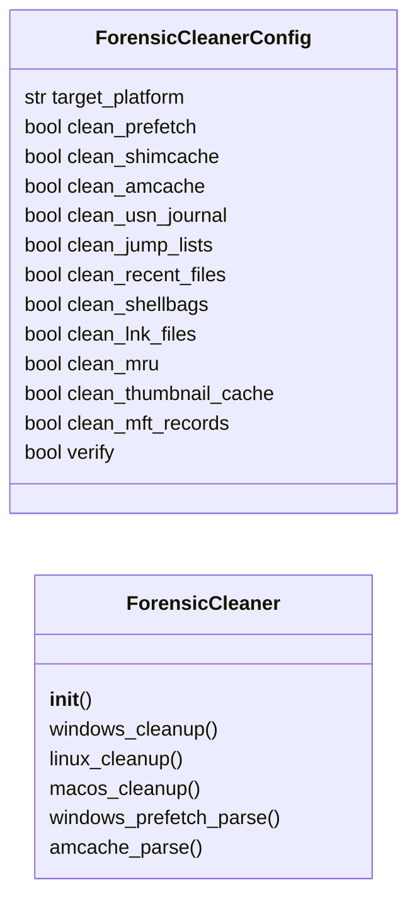

# `modules.forensic_cleaner`

> Source: [modules/forensic_cleaner.py:1](../../modules/forensic_cleaner.py#L1) | language `py` | coverage 88.9% | [API index](../index.md)

Forensic artifact cleaner — Prefetch, Shimcache, Amcache, MFT/USN cleanup.

Removes evidence of execution from Windows forensic artifacts: Prefetch
files (.pf), Shimcache (AppCompatCache), Amcache registry entries,
MFT records, USN journal entries, Jump Lists, LNK files, and Recent
documents. Covers both automated cleanup and manual operator-guided
forensic wiping.

Linux/macOS equivalents cover bash history, syslog entries, atime
modification, and unified log pruning.

## Contents

- **Classes:** [`ForensicCleanerConfig`](#forensiccleanerconfig), [`ForensicCleaner`](#forensiccleaner)
- **Constants:** [`SESSIONS_DIR`](#sessions_dir)

## Type Diagram



## Call Graph

Solid arrows stay in this module, dashed arrows leave it.


## Classes

<a id="forensiccleanerconfig"></a>

### `ForensicCleanerConfig`

`class` `dataclass` | [modules/forensic_cleaner.py:23](../../modules/forensic_cleaner.py#L23)

Decorators: `@dataclass`

```python
class ForensicCleanerConfig
```

Configuration for forensic artifact cleaning.

**Attributes**

| Name | Type | Default | Description |
|---|---|---|---|
| [`target_platform`](#forensiccleanerconfig-target_platform) | `str` | `'windows'` | windows, linux, or macos. |
| [`clean_prefetch`](#forensiccleanerconfig-clean_prefetch) | `bool` | `True` | Remove Windows Prefetch files (.pf). |
| [`clean_shimcache`](#forensiccleanerconfig-clean_shimcache) | `bool` | `True` | Clear Windows Shimcache (AppCompatCache). |
| [`clean_amcache`](#forensiccleanerconfig-clean_amcache) | `bool` | `True` | Clear Windows Amcache registry entries. |
| [`clean_usn_journal`](#forensiccleanerconfig-clean_usn_journal) | `bool` | `False` | Purge Windows USN journal. |
| [`clean_jump_lists`](#forensiccleanerconfig-clean_jump_lists) | `bool` | `True` | Remove Windows Jump Lists. |
| [`clean_recent_files`](#forensiccleanerconfig-clean_recent_files) | `bool` | `True` | Clear Recent files and MRU lists. |
| [`clean_shellbags`](#forensiccleanerconfig-clean_shellbags) | `bool` | `True` | Clear Windows Shellbags (explorer paths). |
| [`clean_lnk_files`](#forensiccleanerconfig-clean_lnk_files) | `bool` | `True` | Remove LNK shortcut files in Recent dirs. |
| [`clean_mru`](#forensiccleanerconfig-clean_mru) | `bool` | `True` | Clear Most Recently Used (MRU) registry entries. |
| [`clean_thumbnail_cache`](#forensiccleanerconfig-clean_thumbnail_cache) | `bool` | `True` | Remove thumbnail cache files. |
| [`clean_mft_records`](#forensiccleanerconfig-clean_mft_records) | `bool` | `False` | Overwrite deleted MFT records (requires defrag + sdelete). |
| [`verify`](#forensiccleanerconfig-verify) | `bool` | `True` | Run verification checks after cleaning. |

---

<a id="forensiccleaner"></a>

### `ForensicCleaner`

`class` | [modules/forensic_cleaner.py:57](../../modules/forensic_cleaner.py#L57)

```python
class ForensicCleaner
```

Generate artifact removal commands for Windows, Linux, and macOS.

Each method produces platform-native commands that can be executed
directly on the target or wrapped in a C2 command dispatch.

**Members**

| Member | Kind | Summary |
|---|---|---|
| [`__init__`](#forensiccleaner-__init__) | constructor |  |
| [`windows_cleanup`](#forensiccleaner-windows_cleanup) | method | Generate Windows forensic artifact cleanup commands. |
| [`linux_cleanup`](#forensiccleaner-linux_cleanup) | method | Generate Linux forensic artifact cleanup commands. |
| [`macos_cleanup`](#forensiccleaner-macos_cleanup) | method | Generate macOS forensic artifact cleanup commands. |
| [`windows_prefetch_parse`](#forensiccleaner-windows_prefetch_parse) | method | Parse Prefetch files to identify what the attacker should clean. |
| [`amcache_parse`](#forensiccleaner-amcache_parse) | method | Parse Amcache registry entries for evidence of execution. |

<a id="forensiccleaner-__init__"></a>

#### `ForensicCleaner.__init__`

`constructor` | [modules/forensic_cleaner.py:67](../../modules/forensic_cleaner.py#L67)

```python
def __init__(self, config: ForensicCleanerConfig | None = None)
```

**Parameters**

| Name | Type | Default | Description |
|---|---|---|---|
| `config` | `ForensicCleanerConfig \| None` | `None` |  |

*Calls:* [`ForensicCleanerConfig`](#forensiccleanerconfig)

*Called by:* [`OpsecCleanupCommandSet.do_forensic_clean`](cli.commands.opsec_cleanup.py.md#opseccleanupcommandset-do_forensic_clean)

<a id="forensiccleaner-windows_cleanup"></a>

#### `ForensicCleaner.windows_cleanup`

`method` | [modules/forensic_cleaner.py:70](../../modules/forensic_cleaner.py#L70)

```python
def windows_cleanup(self) -> dict[str, Any]
```

Generate Windows forensic artifact cleanup commands.

**Returns:** `dict[str, Any]` - Dict with PowerShell/batch commands organized by artifact type.

*Called by:* [`OpsecCleanupCommandSet.do_forensic_clean`](cli.commands.opsec_cleanup.py.md#opseccleanupcommandset-do_forensic_clean)

<a id="forensiccleaner-linux_cleanup"></a>

#### `ForensicCleaner.linux_cleanup`

`method` | [modules/forensic_cleaner.py:165](../../modules/forensic_cleaner.py#L165)

```python
def linux_cleanup(self) -> dict[str, Any]
```

Generate Linux forensic artifact cleanup commands.

**Returns:** `dict[str, Any]` - Dict with bash commands for shell history, log cleanup,
and filesystem timestamp manipulation.

*Called by:* [`OpsecCleanupCommandSet.do_forensic_clean`](cli.commands.opsec_cleanup.py.md#opseccleanupcommandset-do_forensic_clean)

<a id="forensiccleaner-macos_cleanup"></a>

#### `ForensicCleaner.macos_cleanup`

`method` | [modules/forensic_cleaner.py:193](../../modules/forensic_cleaner.py#L193)

```python
def macos_cleanup(self) -> dict[str, Any]
```

Generate macOS forensic artifact cleanup commands.

**Returns:** `dict[str, Any]` - Dict with zsh commands for macOS-specific artifacts.

*Called by:* [`OpsecCleanupCommandSet.do_forensic_clean`](cli.commands.opsec_cleanup.py.md#opseccleanupcommandset-do_forensic_clean)

<a id="forensiccleaner-windows_prefetch_parse"></a>

#### `ForensicCleaner.windows_prefetch_parse`

`method` | [modules/forensic_cleaner.py:221](../../modules/forensic_cleaner.py#L221)

```python
def windows_prefetch_parse(self, prefetch_path: str = 'C:\\Windows\\Prefetch') -> dict[str, Any]
```

Parse Prefetch files to identify what the attacker should clean.

**Parameters**

| Name | Type | Default | Description |
|---|---|---|---|
| `prefetch_path` | `str` | `'C:\\Windows\\Prefetch'` | Directory containing .pf files. |

**Returns:** `dict[str, Any]` - Dict with Prefetch analysis commands.

<a id="forensiccleaner-amcache_parse"></a>

#### `ForensicCleaner.amcache_parse`

`method` | [modules/forensic_cleaner.py:259](../../modules/forensic_cleaner.py#L259)

```python
def amcache_parse(self) -> dict[str, Any]
```

Parse Amcache registry entries for evidence of execution.

**Returns:** `dict[str, Any]` - Dict with Amcache parsing commands.

---

## Constants

<a id="sessions_dir"></a>

### `SESSIONS_DIR`

`constant` | [modules/forensic_cleaner.py:19](../../modules/forensic_cleaner.py#L19)

```python
SESSIONS_DIR = Path(__file__).resolve().parent.parent / 'sessions'
```

---
