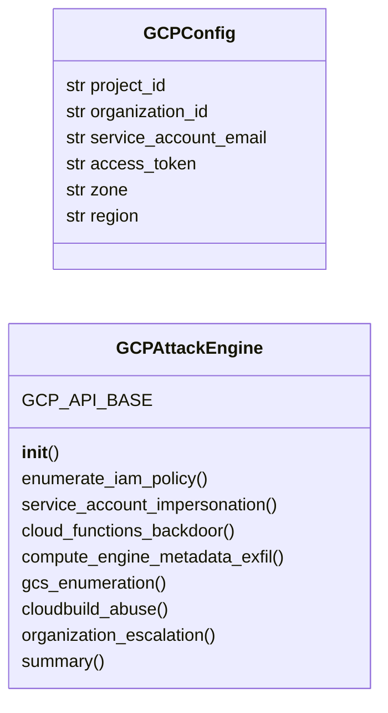
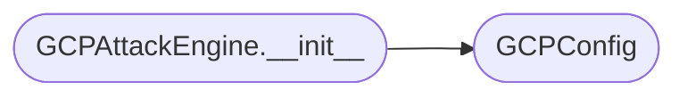

# `modules.gcp_attacks`

> Source: [modules/gcp_attacks.py:1](../../modules/gcp_attacks.py#L1) | language `py` | coverage 83.3% | [API index](../index.md)

GCP privilege escalation — service account impersonation, Cloud Functions, GCS enumeration.

Provides attack primitives for Google Cloud Platform: service account IAM
abuse, Cloud Functions backdoor insertion, Compute Engine metadata exfiltration,
Cloud Storage bucket enumeration, and organization-level privilege escalation
across GCP projects.

Uses google-cloud-* libraries when available; provides raw REST API commands.

## Contents

- **Classes:** [`GCPConfig`](#gcpconfig), [`GCPAttackEngine`](#gcpattackengine)
- **Constants:** [`GCP_PRIVESC_METHODS`](#gcp_privesc_methods), [`GCP_SENSITIVE_ROLES`](#gcp_sensitive_roles)

## Type Diagram



## Call Graph

Solid arrows stay in this module, dashed arrows leave it.



## Classes

<a id="gcpconfig"></a>

### `GCPConfig`

`class` `dataclass` | [modules/gcp_attacks.py:57](../../modules/gcp_attacks.py#L57)

Decorators: `@dataclass`

```python
class GCPConfig
```

Configuration for GCP attack operations.

**Attributes**

| Name | Type | Default | Description |
|---|---|---|---|
| [`project_id`](#gcpconfig-project_id) | `str` | `''` | GCP project ID. |
| [`organization_id`](#gcpconfig-organization_id) | `str` | `''` | GCP organization ID. |
| [`service_account_email`](#gcpconfig-service_account_email) | `str` | `''` | Target service account. |
| [`access_token`](#gcpconfig-access_token) | `str` | `''` | OAuth2 access token. |
| [`zone`](#gcpconfig-zone) | `str` | `'us-central1-a'` | GCP compute zone. |
| [`region`](#gcpconfig-region) | `str` | `'us-central1'` | GCP region. |

---

<a id="gcpattackengine"></a>

### `GCPAttackEngine`

`class` | [modules/gcp_attacks.py:77](../../modules/gcp_attacks.py#L77)

```python
class GCPAttackEngine
```

Execute GCP privilege escalation and enumeration attacks.

Implements service account impersonation, Cloud Functions backdoors,
GCS bucket enumeration, Compute Engine metadata exfiltration, and
organization-level escalation paths.

**Attributes**

| Name | Type | Default | Description |
|---|---|---|---|
| [`GCP_API_BASE`](#gcpattackengine-gcp_api_base) |  | `'https://www.googleapis.com'` |  |

**Members**

| Member | Kind | Summary |
|---|---|---|
| [`__init__`](#gcpattackengine-__init__) | constructor |  |
| [`enumerate_iam_policy`](#gcpattackengine-enumerate_iam_policy) | method | Enumerate IAM policies for projects, folders, or organizations. |
| [`service_account_impersonation`](#gcpattackengine-service_account_impersonation) | method | Exploit service account impersonation for privilege escalation. |
| [`cloud_functions_backdoor`](#gcpattackengine-cloud_functions_backdoor) | method | Backdoor Cloud Functions for privilege escalation. |
| [`compute_engine_metadata_exfil`](#gcpattackengine-compute_engine_metadata_exfil) | method | Exfiltrate GCE instance metadata and service account tokens. |
| [`gcs_enumeration`](#gcpattackengine-gcs_enumeration) | method | Enumerate Cloud Storage buckets for sensitive data. |
| [`cloudbuild_abuse`](#gcpattackengine-cloudbuild_abuse) | method | Abuse Cloud Build for privilege escalation. |
| [`organization_escalation`](#gcpattackengine-organization_escalation) | method | Escalate from project-level to organization-level access. |
| [`summary`](#gcpattackengine-summary) | method |  |

<a id="gcpattackengine-__init__"></a>

#### `GCPAttackEngine.__init__`

`constructor` | [modules/gcp_attacks.py:90](../../modules/gcp_attacks.py#L90)

```python
def __init__(self, config: GCPConfig | None = None)
```

**Parameters**

| Name | Type | Default | Description |
|---|---|---|---|
| `config` | `GCPConfig \| None` | `None` |  |

*Calls:* [`GCPConfig`](#gcpconfig)

*Called by:* [`CloudAttackCommandSet.do_gcp_privesc`](cli.commands.cloud_attacks.py.md#cloudattackcommandset-do_gcp_privesc)

<a id="gcpattackengine-enumerate_iam_policy"></a>

#### `GCPAttackEngine.enumerate_iam_policy`

`method` | [modules/gcp_attacks.py:93](../../modules/gcp_attacks.py#L93)

```python
def enumerate_iam_policy(self, resource: str = '') -> dict[str, Any]
```

Enumerate IAM policies for projects, folders, or organizations.

**Parameters**

| Name | Type | Default | Description |
|---|---|---|---|
| `resource` | `str` | `''` | Resource path (e.g., projects/PROJECT_ID). |

**Returns:** `dict[str, Any]` - Dict with IAM enumeration commands and bindings.

*Called by:* [`CloudAttackCommandSet.do_gcp_privesc`](cli.commands.cloud_attacks.py.md#cloudattackcommandset-do_gcp_privesc)

<a id="gcpattackengine-service_account_impersonation"></a>

#### `GCPAttackEngine.service_account_impersonation`

`method` | [modules/gcp_attacks.py:119](../../modules/gcp_attacks.py#L119)

```python
def service_account_impersonation(self) -> dict[str, Any]
```

Exploit service account impersonation for privilege escalation.

Users with iam.serviceAccounts.actAs can impersonate any service
account and obtain its permissions.

**Returns:** `dict[str, Any]` - Dict with impersonation commands and OAuth token generation.

*Called by:* [`CloudAttackCommandSet.do_gcp_privesc`](cli.commands.cloud_attacks.py.md#cloudattackcommandset-do_gcp_privesc)

<a id="gcpattackengine-cloud_functions_backdoor"></a>

#### `GCPAttackEngine.cloud_functions_backdoor`

`method` | [modules/gcp_attacks.py:144](../../modules/gcp_attacks.py#L144)

```python
def cloud_functions_backdoor(self) -> dict[str, Any]
```

Backdoor Cloud Functions for privilege escalation.

Modifies a Cloud Function's code to exfiltrate its attached service
account's access token by querying the metadata server.

**Returns:** `dict[str, Any]` - Dict with Cloud Function backdooring commands.

*Called by:* [`CloudAttackCommandSet.do_gcp_privesc`](cli.commands.cloud_attacks.py.md#cloudattackcommandset-do_gcp_privesc)

<a id="gcpattackengine-compute_engine_metadata_exfil"></a>

#### `GCPAttackEngine.compute_engine_metadata_exfil`

`method` | [modules/gcp_attacks.py:173](../../modules/gcp_attacks.py#L173)

```python
def compute_engine_metadata_exfil(self) -> dict[str, Any]
```

Exfiltrate GCE instance metadata and service account tokens.

GCE instances expose metadata via a local HTTP endpoint. This includes
service account access tokens, SSH keys, and startup scripts.

**Returns:** `dict[str, Any]` - Dict with metadata exfiltration commands.

*Called by:* [`CloudAttackCommandSet.do_gcp_privesc`](cli.commands.cloud_attacks.py.md#cloudattackcommandset-do_gcp_privesc)

<a id="gcpattackengine-gcs_enumeration"></a>

#### `GCPAttackEngine.gcs_enumeration`

`method` | [modules/gcp_attacks.py:194](../../modules/gcp_attacks.py#L194)

```python
def gcs_enumeration(self) -> dict[str, Any]
```

Enumerate Cloud Storage buckets for sensitive data.

Maps accessible buckets, checks permissions, and identifies
buckets containing credentials, configs, or backup data.

**Returns:** `dict[str, Any]` - Dict with GCS enumeration commands.

*Called by:* [`CloudAttackCommandSet.do_gcp_privesc`](cli.commands.cloud_attacks.py.md#cloudattackcommandset-do_gcp_privesc)

<a id="gcpattackengine-cloudbuild_abuse"></a>

#### `GCPAttackEngine.cloudbuild_abuse`

`method` | [modules/gcp_attacks.py:230](../../modules/gcp_attacks.py#L230)

```python
def cloudbuild_abuse(self) -> dict[str, Any]
```

Abuse Cloud Build for privilege escalation.

Cloud Build runs with the Cloud Build service account by default.
Modifying the build configuration can execute arbitrary code with
the service account's permissions.

**Returns:** `dict[str, Any]` - Dict with Cloud Build abuse commands.

*Called by:* [`CloudAttackCommandSet.do_gcp_privesc`](cli.commands.cloud_attacks.py.md#cloudattackcommandset-do_gcp_privesc)

<a id="gcpattackengine-organization_escalation"></a>

#### `GCPAttackEngine.organization_escalation`

`method` | [modules/gcp_attacks.py:261](../../modules/gcp_attacks.py#L261)

```python
def organization_escalation(self) -> dict[str, Any]
```

Escalate from project-level to organization-level access.

If the attacker has project ownership and the organization policies
allow, escalate to organization-level privileges.

**Returns:** `dict[str, Any]` - Dict with organization escalation paths.

*Called by:* [`CloudAttackCommandSet.do_gcp_privesc`](cli.commands.cloud_attacks.py.md#cloudattackcommandset-do_gcp_privesc)

<a id="gcpattackengine-summary"></a>

#### `GCPAttackEngine.summary`

`method` | [modules/gcp_attacks.py:297](../../modules/gcp_attacks.py#L297)

```python
def summary(self) -> dict[str, Any]
```

**Returns:** `dict[str, Any]`

---

## Constants

<a id="gcp_privesc_methods"></a>

### `GCP_PRIVESC_METHODS`

`constant` | [modules/gcp_attacks.py:16](../../modules/gcp_attacks.py#L16)

```python
GCP_PRIVESC_METHODS
```

---

<a id="gcp_sensitive_roles"></a>

### `GCP_SENSITIVE_ROLES`

`constant` | [modules/gcp_attacks.py:39](../../modules/gcp_attacks.py#L39)

```python
GCP_SENSITIVE_ROLES
```

---
