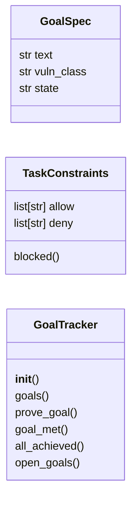
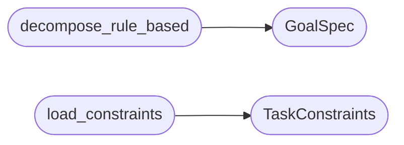

# `modules.goals`

> Source: [modules/goals.py:1](../../modules/goals.py#L1) | language `py` | coverage 100.0% | [API index](../index.md)

Goal decomposition round-0 with constraints and proof.

Ports the LAZY ``agent/goals.go`` + ``agent/constraints.go`` contract:
round-0 splits a free-text objective into discrete verifiable goals,
records task constraints (allow/deny, highest priority), registers the
explicit asset scope, and proves goals from evidence. `[`goal_met`](#goaltracker-goal_met)`
ends the whole task and is opt-in (default unbound, LAZY parity).

## Contents

- **Classes:** [`GoalSpec`](#goalspec), [`TaskConstraints`](#taskconstraints), [`GoalTracker`](#goaltracker)
- **Functions:** [`decompose_rule_based`](#decompose_rule_based), [`load_constraints`](#load_constraints), [`constraint_block_text`](#constraint_block_text)
- **Constants:** [`MAX_DECOMPOSE_TURNS`](#max_decompose_turns)

## Type Diagram



## Call Graph

Solid arrows stay in this module, dashed arrows leave it.



## Classes

<a id="goalspec"></a>

### `GoalSpec`

`class` `dataclass` | [modules/goals.py:20](../../modules/goals.py#L20)

Decorators: `@dataclass`

```python
class GoalSpec
```

One decomposed verifiable objective.

**Attributes**

| Name | Type | Default | Description |
|---|---|---|---|
| [`text`](#goalspec-text) | `str` |  |  |
| [`vuln_class`](#goalspec-vuln_class) | `str` | `''` |  |
| [`state`](#goalspec-state) | `str` | `'open'` |  |

---

<a id="taskconstraints"></a>

### `TaskConstraints`

`class` `dataclass` | [modules/goals.py:29](../../modules/goals.py#L29)

Decorators: `@dataclass`

```python
class TaskConstraints
```

Allow/deny constraints with deny-wins semantics (LAZY parity).

**Attributes**

| Name | Type | Default | Description |
|---|---|---|---|
| [`allow`](#taskconstraints-allow) | `list[str]` | `field(default_factory=list)` |  |
| [`deny`](#taskconstraints-deny) | `list[str]` | `field(default_factory=list)` |  |

**Members**

| Member | Kind | Summary |
|---|---|---|
| [`blocked`](#taskconstraints-blocked) | method | Return the blocking constraint or empty string. |

<a id="taskconstraints-blocked"></a>

#### `TaskConstraints.blocked`

`method` | [modules/goals.py:35](../../modules/goals.py#L35)

```python
def blocked(self, command: str) -> str
```

Return the blocking constraint or empty string.

**Parameters**

| Name | Type | Default | Description |
|---|---|---|---|
| `command` | `str` |  |  |

**Returns:** `str`

---

<a id="goaltracker"></a>

### `GoalTracker`

`class` | [modules/goals.py:117](../../modules/goals.py#L117)

```python
class GoalTracker
```

Round-0 goals with prove_goal / goal_met semantics.

**Members**

| Member | Kind | Summary |
|---|---|---|
| [`__init__`](#goaltracker-__init__) | constructor | Bind to an initial goal list. |
| [`goals`](#goaltracker-goals) | property | Return a copy of tracked goals. |
| [`prove_goal`](#goaltracker-prove_goal) | method | Mark one goal achieved from evidence; return True when found. |
| [`goal_met`](#goaltracker-goal_met) | method | End the whole task; requires explicit opt-in (default unbound). |
| [`all_achieved`](#goaltracker-all_achieved) | method | Return True when every goal is achieved. |
| [`open_goals`](#goaltracker-open_goals) | method | Return goals still open. |

<a id="goaltracker-__init__"></a>

#### `GoalTracker.__init__`

`constructor` | [modules/goals.py:120](../../modules/goals.py#L120)

```python
def __init__(self, goals: list[GoalSpec] | None = None) -> None
```

Bind to an initial goal list.

**Parameters**

| Name | Type | Default | Description |
|---|---|---|---|
| `goals` | `list[GoalSpec] \| None` | `None` |  |

<a id="goaltracker-goals"></a>

#### `GoalTracker.goals`

`property` | [modules/goals.py:125](../../modules/goals.py#L125)

Decorators: `@property`

```python
def goals(self) -> list[GoalSpec]
```

Return a copy of tracked goals.

**Returns:** `list[GoalSpec]`

<a id="goaltracker-prove_goal"></a>

#### `GoalTracker.prove_goal`

`method` | [modules/goals.py:129](../../modules/goals.py#L129)

```python
def prove_goal(self, goal_text: str, evidence: str = '') -> bool
```

Mark one goal achieved from evidence; return True when found.

**Parameters**

| Name | Type | Default | Description |
|---|---|---|---|
| `goal_text` | `str` |  |  |
| `evidence` | `str` | `''` |  |

**Returns:** `bool`

<a id="goaltracker-goal_met"></a>

#### `GoalTracker.goal_met`

`method` | [modules/goals.py:140](../../modules/goals.py#L140)

```python
def goal_met(self, opt_in: bool = False) -> bool
```

End the whole task; requires explicit opt-in (default unbound).

**Parameters**

| Name | Type | Default | Description |
|---|---|---|---|
| `opt_in` | `bool` | `False` |  |

**Returns:** `bool`

<a id="goaltracker-all_achieved"></a>

#### `GoalTracker.all_achieved`

`method` | [modules/goals.py:148](../../modules/goals.py#L148)

```python
def all_achieved(self) -> bool
```

Return True when every goal is achieved.

**Returns:** `bool`

<a id="goaltracker-open_goals"></a>

#### `GoalTracker.open_goals`

`method` | [modules/goals.py:152](../../modules/goals.py#L152)

```python
def open_goals(self) -> list[GoalSpec]
```

Return goals still open.

**Returns:** `list[GoalSpec]`

---

## Functions

<a id="decompose_rule_based"></a>

### `decompose_rule_based`

`function` | [modules/goals.py:63](../../modules/goals.py#L63)

```python
def decompose_rule_based(objective_text: str, max_goals: int = 8) -> list[GoalSpec]
```

Split objective text into goal specs without an LLM (deterministic).

**Parameters**

| Name | Type | Default | Description |
|---|---|---|---|
| `objective_text` | `str` |  |  |
| `max_goals` | `int` | `8` |  |

**Returns:** `list[GoalSpec]`

*Calls:* [`GoalSpec`](#goalspec)

---

<a id="load_constraints"></a>

### `load_constraints`

`function` | [modules/goals.py:83](../../modules/goals.py#L83)

```python
def load_constraints(payload: dict | None = None) -> TaskConstraints
```

Build constraints from payload config (deny wins, LAZY parity).

**Parameters**

| Name | Type | Default | Description |
|---|---|---|---|
| `payload` | `dict \| None` | `None` |  |

**Returns:** `TaskConstraints`

*Calls:* [`TaskConstraints`](#taskconstraints)

*Called by:* [`DaemonControlCommandSet.do_gatecheck`](cli.commands.daemon_ctl.py.md#daemoncontrolcommandset-do_gatecheck)

---

<a id="constraint_block_text"></a>

### `constraint_block_text`

`function` | [modules/goals.py:103](../../modules/goals.py#L103)

```python
def constraint_block_text(constraints: TaskConstraints) -> str
```

Render the constraint block injected at max priority (LAZY parity).

**Parameters**

| Name | Type | Default | Description |
|---|---|---|---|
| `constraints` | `TaskConstraints` |  |  |

**Returns:** `str`

---

## Constants

<a id="max_decompose_turns"></a>

### `MAX_DECOMPOSE_TURNS`

`constant` | [modules/goals.py:16](../../modules/goals.py#L16)

```python
MAX_DECOMPOSE_TURNS = 8
```

---
