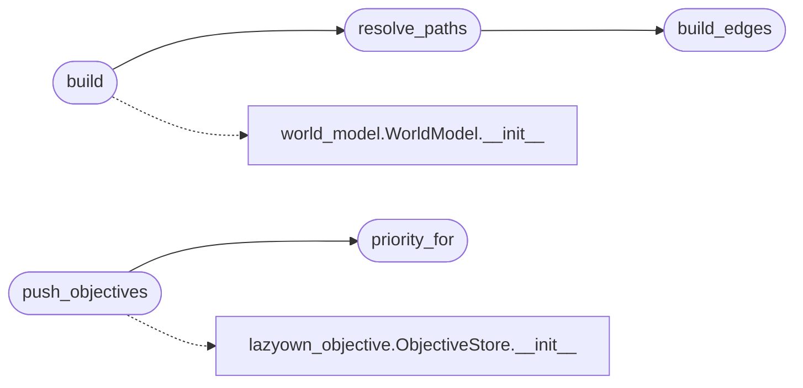

# `modules.golden_path`

> Source: [modules/golden_path.py:1](../../modules/golden_path.py#L1) | language `py` | coverage 100.0% | [API index](../index.md)

Deterministic attack-path solver over the LazyOwn world model.

Given a world-model snapshot the solver builds a weighted digraph and runs
Dijkstra from a virtual ``operator`` source:

- Anchors (already ``exploited``/``owned`` hosts) cost 0 from the operator.
- Vulnerability edges add remote-exploit hops weighted by severity
  (critical is the cheapest route in).
- Credential edges add login hops for confirmed harvested credentials.
- Network-graph relations (``may_authenticate_to``, ``discovered_by``...)
  add observed lateral hops between hosts.

Output is a ranked path list persisted to ``sessions/attack_paths.json``
and optionally injected into ``sessions/objectives.jsonl``.

## Contents

- **Functions:** [`build_edges`](#build_edges), [`resolve_paths`](#resolve_paths), [`build`](#build), [`load_artifact`](#load_artifact), [`priority_for`](#priority_for), [`push_objectives`](#push_objectives)
- **Constants:** [`OPERATOR_SOURCE`](#operator_source), [`HOST_PREFIX`](#host_prefix), [`CRED_PREFIX`](#cred_prefix), [`ARTIFACT_NAME`](#artifact_name), [`DEFAULT_CHAIN`](#default_chain), [`SEVERITY_COST`](#severity_cost), [`RELATION_COST`](#relation_cost), [`DEFAULT_RELATION_COST`](#default_relation_cost), [`PRIORITY_BANDS`](#priority_bands)

## Call Graph

Solid arrows stay in this module, dashed arrows leave it.



## Functions

<a id="build_edges"></a>

### `build_edges`

`function` | [modules/golden_path.py:155](../../modules/golden_path.py#L155)

```python
def build_edges(snapshot: dict) -> dict[str, dict[str, list[dict]]]
```

Build the weighted adjacency map from a world-model snapshot.

**Parameters**

| Name | Type | Default | Description |
|---|---|---|---|
| `snapshot` | `dict` |  | Serialised world model (hosts, credentials, vulnerabilities, network_graph relations). |

**Returns:** `dict[str, dict[str, list[dict]]]` - Adjacency mapping ``node -> {next_node -> [edge_meta]}``.

*Called by:* [`resolve_paths`](#resolve_paths)

---

<a id="resolve_paths"></a>

### `resolve_paths`

`function` | [modules/golden_path.py:274](../../modules/golden_path.py#L274)

```python
def resolve_paths(snapshot: dict, top_k: int = 5, source: str = OPERATOR_SOURCE) -> dict
```

Solve shortest attack paths toward every reachable host.

**Parameters**

| Name | Type | Default | Description |
|---|---|---|---|
| `snapshot` | `dict` |  | Serialised world model. |
| `top_k` | `int` | `5` | Maximum number of paths to return (targets ranked by cost). |
| `source` | `str` | `OPERATOR_SOURCE` | Virtual start node; ``operator`` anchors help via affected hosts. |

**Returns:** `dict` - Result dict with ``generated_at``, ``sources``, ``paths``, `[`stats`](modules.verb_catalog.py.md#stats)`.

*Calls:* [`build_edges`](#build_edges)

*Called by:* [`build`](#build)

---

<a id="build"></a>

### `build`

`function` | [modules/golden_path.py:350](../../modules/golden_path.py#L350)

```python
def build(world_model_path: str | Path | None = None, top_k: int = 5, sessions_dir: str | Path | None = None) -> dict
```

Load the live world model, solve paths, and persist the result.

**Parameters**

| Name | Type | Default | Description |
|---|---|---|---|
| `world_model_path` | `str \| Path \| None` | `None` | Optional explicit world-model path; defaults to the module default used by [`modules.world_model.WorldModel`](modules.world_model.py.md#worldmodel). |
| `top_k` | `int` | `5` | Maximum paths to render. |
| `sessions_dir` | `str \| Path \| None` | `None` | Optional sessions directory override used for the ``attack_paths.json`` artifact. |

**Returns:** `dict` - The solved result dict (also written to ``sessions/attack_paths.json``).

*Calls:* [`resolve_paths`](#resolve_paths), [`WorldModel.__init__`](modules.world_model.py.md#worldmodel-__init__)

---

<a id="load_artifact"></a>

### `load_artifact`

`function` | [modules/golden_path.py:401](../../modules/golden_path.py#L401)

```python
def load_artifact(sessions_dir: str | Path | None = None) -> dict
```

Read the persisted attack-path artifact.

**Parameters**

| Name | Type | Default | Description |
|---|---|---|---|
| `sessions_dir` | `str \| Path \| None` | `None` | Directory override; defaults to ``sessions/``. |

**Returns:** `dict` - The stored dict, or ``{"paths": []}`` when missing/corrupt.

---

<a id="priority_for"></a>

### `priority_for`

`function` | [modules/golden_path.py:418](../../modules/golden_path.py#L418)

```python
def priority_for(cost: float) -> str
```

Map a path cost to an objective priority band.

**Parameters**

| Name | Type | Default | Description |
|---|---|---|---|
| `cost` | `float` |  | Cumulative path cost. |

**Returns:** `str` - ``critical``, ``high``, ``medium``, or ``low``.

*Called by:* [`push_objectives`](#push_objectives)

---

<a id="push_objectives"></a>

### `push_objectives`

`function` | [modules/golden_path.py:433](../../modules/golden_path.py#L433)

```python
def push_objectives(paths: Iterable[dict], store_path: Path | None = None) -> list
```

Inject one objective per solved path into the objective store.

Text uses the stable ``target`` + `[`cost`](modules.verb_manifest.py.md#verbmanifest-cost)` fingerprint so re-pushes
deduplicate naturally.

**Parameters**

| Name | Type | Default | Description |
|---|---|---|---|
| `paths` | `Iterable[dict]` |  | Solved path dicts from [`resolve_paths`](#resolve_paths). |
| `store_path` | `Path \| None` | `None` | Optional objectives file override for tests. |

**Returns:** `list` - The list of injected (or existing) Objective objects.

*Calls:* [`priority_for`](#priority_for), [`ObjectiveStore.__init__`](skills.lazyown_objective.py.md#objectivestore-__init__)

---

## Constants

<a id="operator_source"></a>

### `OPERATOR_SOURCE`

`constant` | [modules/golden_path.py:29](../../modules/golden_path.py#L29)

```python
OPERATOR_SOURCE = 'operator'
```

---

<a id="host_prefix"></a>

### `HOST_PREFIX`

`constant` | [modules/golden_path.py:30](../../modules/golden_path.py#L30)

```python
HOST_PREFIX = 'host:'
```

---

<a id="cred_prefix"></a>

### `CRED_PREFIX`

`constant` | [modules/golden_path.py:31](../../modules/golden_path.py#L31)

```python
CRED_PREFIX = 'cred:'
```

---

<a id="artifact_name"></a>

### `ARTIFACT_NAME`

`constant` | [modules/golden_path.py:33](../../modules/golden_path.py#L33)

```python
ARTIFACT_NAME = 'attack_paths.json'
```

---

<a id="default_chain"></a>

### `DEFAULT_CHAIN`

`constant` | [modules/golden_path.py:35](../../modules/golden_path.py#L35)

```python
DEFAULT_CHAIN = 'gym_ms2_foothold'
```

---

<a id="severity_cost"></a>

### `SEVERITY_COST`

`constant` | [modules/golden_path.py:37](../../modules/golden_path.py#L37)

```python
SEVERITY_COST: dict[str, float]
```

---

<a id="relation_cost"></a>

### `RELATION_COST`

`constant` | [modules/golden_path.py:46](../../modules/golden_path.py#L46)

```python
RELATION_COST: dict[str, float]
```

---

<a id="default_relation_cost"></a>

### `DEFAULT_RELATION_COST`

`constant` | [modules/golden_path.py:55](../../modules/golden_path.py#L55)

```python
DEFAULT_RELATION_COST = 0.6
```

---

<a id="priority_bands"></a>

### `PRIORITY_BANDS`

`constant` | [modules/golden_path.py:59](../../modules/golden_path.py#L59)

```python
PRIORITY_BANDS: tuple[tuple[float, str], ...] = ((1.5, 'critical'), (3.0, 'high'), (6.0, 'medium'))
```

---
